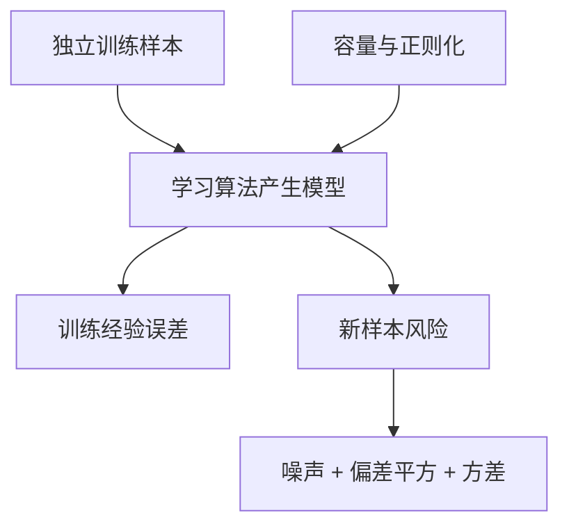

# 人工智能：理论、算法与系统 · 第 2 课
## 泛化、Bias–Variance Tradeoff 与模型复杂度

**2026 年 10 月 21 日｜第一周｜约 18 分钟**

> **归档说明：** 本课按当日计划重构成完整教学讲义，并非历史对话逐字恢复。标准答案仅保存在独立测验 JSON。

### 学习目标

理解经验风险与总体风险为何不同；逐步推导平方损失下的噪声、偏差平方、方差分解；用数值表分析正则化；设计训练集、验证集和最终测试集的使用边界。

## 一、训练集上的好成绩为何不足以证明泛化？

训练样本 $S=(Z_1,\ldots,Z_n)$ 来自未知数据分布 P。学习算法接受 S 并产生参数 $\hat\theta=A(S)$。定义经验风险和总体风险：

$$\hat R_S(\hat\theta)=\frac1n\sum_{i=1}^n \ell(\hat\theta,Z_i),$$

$$R(\hat\theta)=\mathbb E_{Z\sim P}\ell(\hat\theta,Z).$$

前者在训练样本上计算，后者是对独立新样本的期望损失。若模型在观察数据之前已固定，独立样本平均往往可无偏估计风险；但实际模型是依赖这份训练数据选出来的，所以**不能直接把固定模型的推理套在训练选出的模型上**。模型可能专门拟合抽样噪声，训练损失降低而新样本损失增大。

## 二、建立一个能手算的概率模型

假设没有输入特征，标量观测为

$$Y=\mu+\varepsilon,\qquad \mathbb E\varepsilon=0,\quad \operatorname{Var}(\varepsilon)=\sigma^2.$$

n 个独立训练观测的均值是

$$\bar Y=\frac1n\sum_iY_i=\mu+\bar\varepsilon.$$

因为独立零均值噪声方差可加：

$$\mathbb E\bar\varepsilon=0,\qquad \operatorname{Var}(\bar\varepsilon)=\frac1{n^2}\sum_i\sigma^2=\frac{\sigma^2}{n}.$$

现在独立测试样本 $Y_{\rm new}=\mu+\varepsilon_{\rm new}$。若预测用 $\bar Y$，预测误差为 $\varepsilon_{\rm new}-\bar\varepsilon$，两部分均值为零且独立，因此

$$\mathbb E(Y_{\rm new}-\bar Y)^2=\sigma^2+\sigma^2/n.$$

第一项是未来观测本身的随机噪声，第二项是用有限样本估计均值产生的波动。

## 三、正则化式收缩为何可能改善风险？

定义估计量 $\hat\theta_\alpha=\alpha\bar Y$，其中 $0\le\alpha\le1$。当 α 小于 1 时，参数主动向零收缩，不再完全拟合样本均值。

其期望为 $\mathbb E\hat\theta_\alpha=\alpha\mu$，偏差为 $(\alpha-1)\mu$。方差由常数缩放公式得到

$$\operatorname{Var}(\hat\theta_\alpha)=\alpha^2\sigma^2/n.$$

对新的独立测试样本，误差逐项拆分：

$$Y_{\rm new}-\hat\theta_\alpha=\varepsilon_{\rm new}+(1-\alpha)\mu-\alpha\bar\varepsilon.$$

平方展开后，测试噪声和训练均值噪声是独立零均值的，因此交叉项期望为零，得到

$$\boxed{\mathbb E[(Y_{\rm new}-\hat\theta_\alpha)^2]=\underbrace{\sigma^2}_{\text{不可约噪声}}+\underbrace{(1-\alpha)^2\mu^2}_{\text{偏差平方}}+\underbrace{\alpha^2\sigma^2/n}_{\text{估计方差}}.}$$

这里没有跳过随机变量独立的前提。若训练与测试相关，交叉项未必为零。

[[viz:biasvariance]]

## 四、数值可视化：风险为什么可能是 U 形？

取 $\mu=3$、$\sigma^2=9$、$n=9$。代入上式：

$$R(\alpha)=9+9(1-\alpha)^2+\alpha^2.$$

| 收缩 α | 偏差平方 | 估计方差 | 不可约噪声 | 总风险 |
|---:|---:|---:|---:|---:|
| 0 | 9 | 0 | 9 | 18 |
| 0.5 | 2.25 | 0.25 | 9 | 11.5 |
| 0.9 | 0.09 | 0.81 | 9 | 9.9 |
| 1 | 0 | 1 | 9 | 10 |

从 α=1 向下略微收缩时，训练集拟合可能变差，但估计方差下降快于偏差平方上升，总风险可能改善。继续过分收缩，偏差平方又会占主导。所以“更强正则化”并不保证总体测试风险必然更小。

对一般参数可进一步对

$$R(\alpha)=\sigma^2+(1-\alpha)^2\mu^2+\alpha^2\sigma^2/n$$

求导，寻找总体风险的理论最优收缩系数。但真实 μ 和 σ² 往往未知，不能把用真实分布参数算出来的系数当作已经从训练数据获得的超参数。第三课将从 Ridge 回归进一步分析。

## 五、把模型容量、优化与评估分开

模型容量过小可能无法表达真实规律，出现欠拟合；容量很大时又有机会记忆噪声，产生过拟合。但容量不是唯一起因：优化算法、预训练、样本量、数据增强、显式正则化都会改变训练过程和泛化。

| 观察现象 | 可能原因 | 下一步验证 |
|---|---|---|
| 训练和测试误差都高 | 欠拟合、优化不充分或数据问题 | 检查梯度、表示能力、损失 |
| 训练好、测试差 | 训练噪声过拟合或数据分布不同 | 调正则、扩大训练集、检查分布 |
| 验证分数经多次试验不断变好 | 真实提升与验证选择偏差混合 | 隔离最终测试集 |
| 正则化训练误差略升、测试下降 | 方差减少可能超过偏差增加 | 独立重复实验核对 |

注意平方损失下的分解是经典理论恒等式，不应不加条件地直接套到 0-1 分类损失或 Agent 成功率指标上。

### 泛化因素示意图

## 六、独立测试协议：防止数据泄漏

训练集用于拟合参数，验证集用于选择学习率、模型容量、训练轮次等，最终测试集应在开发决策冻结后独立评估。因为每一次根据验证集修改方案都在利用它的信息，经历大量选择后的验证成绩可能乐观。

如果同一实体的样本出现在多个集合中，或者存在时间依赖，应按实体/时间而不是简单随机行划分。报告模型最终性能时，应说明所有调参用过的数据以及测试集是否被反复使用。

## 七、适用边界与下一讲

本课的干净偏差—方差分解需要平方损失与所声明的独立零均值噪声。真实神经网络常常是非凸、过参数化的，不能只根据参数数量推断泛化好坏。下一讲将推导 Ridge 回归和矩阵形式的偏差—方差关系。

## 四级分级测评（100 分；首次不泄露答案）

前三题客观评分，第四题需人工、ChatGPT 或自评。

### Lv1｜泛化概念辨析｜15 分｜约 2 分钟

一个模型在训练集上的误差远低于独立测试集，哪项解释最严谨？

**A.** 训练误差小就严格保证总体风险小

**B.** 模型可能拟合了训练数据中的偶然噪声，经验风险不等同于总体风险

**C.** 增大参数量会保证测试误差严格下降

**D.** 验证集用于反复调参后仍完全等价于一次性独立测试集

*可选提示：经验风险依赖训练样本；模型输出也依赖这些样本。*

### Lv2｜独立测试风险计算｜20 分｜约 4 分钟

Y=μ+ε，μ=2、Eε=0、Varε=4。使用 n=5 个独立样本的均值 ȳ，估计 θ=αȳ，α=0.5。求对独立测试观测 Ynew 的 E[(Ynew−θ)²]。

*可选提示：分成测试噪声、参数估计偏差平方与参数估计方差三项。*

### Lv3｜偏差方差与评估边界｜25 分｜约 5 分钟

以下关于偏差—方差、验证集与正则化的判断哪些成立？（多选）

**A.** 平方损失、独立零均值训练和测试噪声下，测试风险可分解为不可约噪声、偏差平方、估计方差

**B.** 增大样本量总能让任何算法在任何分布上的测试风险严格下降

**C.** 反复按同一验证集的成绩修改训练配置会产生适应性选择偏差

**D.** 正则化可能降低估计方差也可能引入更大偏差，应独立评估

*可选提示：核对独立性假设，并警惕“任何”和“严格”一类过强断言。*

### Lv4｜风险推导和实验协议｜40 分｜约 12 分钟

A（12分）假设 Y=μ+ε、Eε=0、Varε=σ²，用 n 个独立训练样本构造 θ=αȳ，独立测试 Ynew，逐项展开 E[(Ynew−θ)²]。B（10分）求使该风险最小的 α（μ≠0、σ²>0），说明真实训练时相关总体参数未知。C（10分）解释正则化的偏差—方差权衡，以及为什么训练拟合更好却可能测试更差。D（8分）设计训练、验证和隔离最终测试集的使用协议，防止评估泄漏。

*可选提示：先把测试误差写成 εnew+(1−α)μ−αε̄；利用独立与零均值消除交叉项，再求导。*
