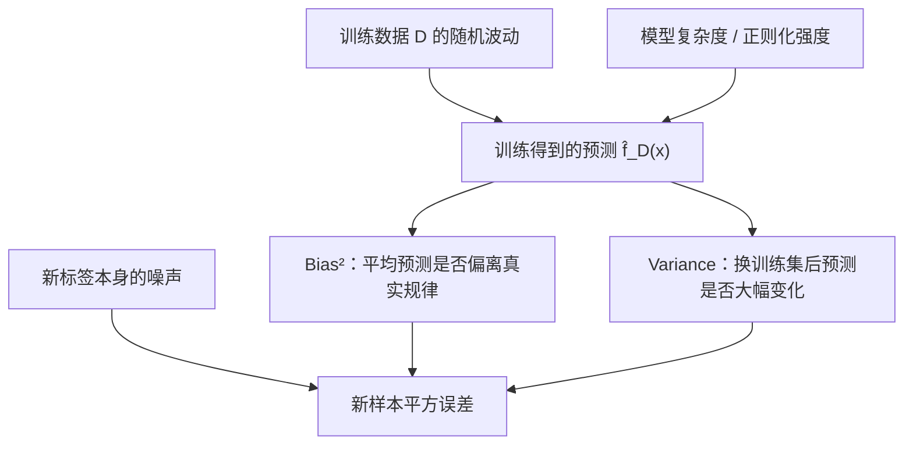
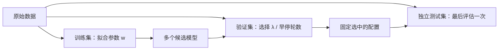

# 人工智能 · 第 3 课｜偏差—方差分解：正则化为什么可能改善泛化？

> 2026-10-22 · 第一周 · 建议 17 分钟。今天的主问题：**为什么允许训练误差变大，反而可能让模型在新数据上表现得更好？**

**学习目标**：严格区分训练误差与期望测试风险；在平方损失下推导 Bias² + Variance + Noise；从目标函数推出 Ridge 闭式解；用数值算例解释正则化的收益和代价；理解独立验证集在调超参数时的边界。

## 1. 从第 1 课接过来：经验风险小，不代表泛化好

第 1 课我们从最大似然得到交叉熵，并讨论经验风险与总体风险的区别。定义训练集 $D=\{(x_i,y_i)\}_{i=1}^{n}$，学习算法输出 $\hat f_D$。对于损失函数 $\ell$：

$$
\hat R_D(\hat f_D)=\frac1n\sum_{i=1}^n\ell(\hat f_D(x_i),y_i),
\qquad
R(\hat f_D)=\mathbb E_{(X,Y)\sim\mathcal P}\ell(\hat f_D(X),Y).
$$

**过拟合**不是“训练集上做得好”本身，而是训练表现不能可靠迁移到同分布的独立新样本。一个模型可能把数据里的偶然噪声也学进去。我们想知道：这种现象能否定量分解？

今天先研究平方损失，这里有一个非常优美的精确恒等式。**不要把这个恒等式无条件套到交叉熵或 0-1 分类错误率上。**

## 2. 固定一个输入点，推导偏差—方差分解

假设数据由下面的回归模型产生：

$$
Y=f^*(X)+\varepsilon,\quad
f^*(x)=\mathbb E[Y\mid X=x],\quad
\mathbb E[\varepsilon\mid X=x]=0.
$$

在固定测试输入 $x$ 处，记新标签的条件噪声方差为 $\sigma^2(x)=\mathrm{Var}(Y\mid X=x)$。训练集 $D$ 是随机抽取的，所以同一个训练算法在不同训练集上会产生不同预测 $\hat f_D(x)$。取均值

$$
m(x)=\mathbb E_D[\hat f_D(x)].
$$

目标是对**新样本**预测的平方误差求期望：

$$
\mathbb E_{D,Y_{\rm new}\mid x}\big[(Y_{\rm new}-\hat f_D(x))^2\big].
$$

将误差拆成三部分：

$$
Y_{\rm new}-\hat f_D(x)
=\underbrace{f^*(x)-m(x)}_{\text{系统性偏差}}
+\underbrace{m(x)-\hat f_D(x)}_{\text{训练集随机性}}
+\underbrace{\varepsilon_{\rm new}}_{\text{新标签噪声}}.
$$

展开平方并取期望。交叉项消失：第二项对训练集的均值为 0；新标签噪声均值为 0，且它与训练集独立。因此：

$$
\boxed{\mathbb E[(Y_{\rm new}-\hat f_D(x))^2\mid x]
=\underbrace{(m(x)-f^*(x))^2}_{\mathrm{Bias}^2}
+\underbrace{\mathbb E_D[(\hat f_D(x)-m(x))^2]}_{\mathrm{Variance}}
+\underbrace{\sigma^2(x)}_{\mathrm{Noise}}.}
$$

三个量不要混淆：

| 项 | 精确定义 | 直觉 | 典型改善方向 |
|---|---|---|---|
| Bias² | 平均预测与真实条件均值的差的平方 | 模型或训练规则系统性偏离 | 增加表达能力、放松限制 |
| Variance | 换一份训练数据后，预测变化有多大 | 对训练样本的偶然性敏感 | 更多数据、适度正则化 |
| Noise | $Y$ 在给定 $X=x$ 后仍不可预测的波动 | 样本观测本身的不确定性 | 改善测量或增加有效特征 |

**注意量词**：上式针对固定 $x$，期望既跨训练集，也跨独立的新标签。若再对测试输入分布 $X$ 取平均，就得到总体的平方误差分解。

### 一张因果图：复杂度影响哪一项？

常见的曲线示意是：复杂度增加时偏差下降、方差上升，总风险可能呈 U 形。**“可能”至关重要**：深度网络可能出现 double descent，数据量、优化策略及模型类别都会改变曲线形状。不能把教科书上的 U 形当成所有神经网络的普遍定律。

## 3. 用数学模型研究正则化：Ridge 回归

设线性模型预测为 $Xw$，其中 $X\in\mathbb R^{n\times d}$、$w\in\mathbb R^d$、$y\in\mathbb R^n$。先不考虑截距；实际建模时截距通常不做同样的 L2 惩罚。

最小二乘目标：

$$
\min_w\frac12\|Xw-y\|_2^2.
$$

在参数中加入 L2 正则化：

$$
\boxed{\min_w J_\lambda(w)
=\frac12\|Xw-y\|_2^2+\frac\lambda2\|w\|_2^2,\qquad\lambda\ge0.}
$$

注意 $\lambda$ 的定义：这里没有再除以样本数 $n$。**如果损失使用平均值而不是求和，数值上对应的正则化系数会不同。**

求导：

$$
\nabla J_\lambda(w)=X^\top(Xw-y)+\lambda w.
$$

令梯度为零：

$$
(X^\top X+\lambda I)w=X^\top y.
$$

当 $\lambda>0$ 时，矩阵正定且可逆，因此唯一解为：

$$
\boxed{\hat w_\lambda=(X^\top X+\lambda I)^{-1}X^\top y.}
$$

当 $\lambda=0$，若 $X^\top X$ 不可逆，要使用伪逆或描述整个最小二乘解集，不能直接写普通逆矩阵。

### 为什么 L2 会降低对噪声的敏感性？

给 $X$ 做奇异值分解：$X=U\Sigma V^\top$。对非零奇异值 $s_j$ 所在的方向：

$$
\hat w_\lambda
=\sum_{j:s_j>0}\frac{s_j}{s_j^2+\lambda}\,v_j(u_j^\top y).
$$

不加正则时系数因子为 $1/s_j$。如果 $s_j$ 很小，数据噪声在这个方向容易被显著放大；增加 $\lambda$ 后，系数因子变为 $s_j/(s_j^2+\lambda)$。

从预测角度看，相对于普通最小二乘，相应方向的收缩比例为：

$$
\frac{s_j^2}{s_j^2+\lambda}.
$$

因此弱约束、病态的小奇异值方向通常被更强烈压缩。这提供了“方差可能下降”的线性代数解释；同时若真实信号就在被压缩的方向，便会产生偏差。

## 4. 数值例题：训练误差增大，未必是坏事

考虑一维无截距模型 $y\approx wx$，三个训练点为：

$$
(x_i,y_i)=(1,1),(2,2),(3,2).
$$

此时 $\sum x_i^2=1+4+9=14$，$\sum x_iy_i=1+4+6=11$，所以：

$$
\hat w_\lambda=\frac{11}{14+\lambda}.
$$

当 $\lambda=0$ 时，$\hat w_0=11/14\approx0.7857$；当 $\lambda=2$ 时，$\hat w_2=11/16=0.6875$。

对于测试输入 $x=2$，两次预测分别为约 $1.5714$ 与 $1.375$。那么哪个更好？**光看训练数据，无法判断**，因为我们不知道该点真实的条件均值，也没有独立测试数据。

训练集平方误差反而能直接计算：

| $\lambda$ | $\hat w_\lambda$ | 训练集 $\frac12\sum_i(wx_i-y_i)^2$ |
|---:|---:|---:|
| 0 | 0.7857 | 0.1786 |
| 2 | 0.6875 | 0.2461 |

加正则使训练误差变大；它的目的不是优化已见样本的拟合，而是可能改善未知样本的平均预测表现。

### 一个真正能算出期望测试误差的简化模型

设训练样本只有单个常数特征 $x_i=1$，共 $n=4$ 个：

$$
y_i=w^*+\varepsilon_i,\quad w^*=2,\quad
\mathbb E\varepsilon_i=0,\quad\mathrm{Var}(\varepsilon_i)=1,
$$

且噪声相互独立。Ridge 解为 $\hat w_\lambda=\frac{\sum_i y_i}{4+\lambda}$。于是：

$$
\mathbb E\hat w_\lambda=\frac{4w^*}{4+\lambda},\quad
\mathrm{Bias}=-\frac{\lambda w^*}{4+\lambda},\quad
\mathrm{Var}(\hat w_\lambda)=\frac{4}{(4+\lambda)^2}.
$$

在 $x_{\rm test}=1$ 处预测**真实均值**的期望平方误差（尚未加新标签噪声）为：

$$
\boxed{\mathrm{MSE}_{\rm signal}(\lambda)
=\frac{4\lambda^2+4}{(4+\lambda)^2}.}
$$

| $\lambda$ | Bias² | Variance | 合计：信号预测 MSE |
|---:|---:|---:|---:|
| 0 | 0 | 0.2500 | 0.2500 |
| 0.25 | 0.0138 | 0.2215 | **0.2353** |
| 1 | 0.1600 | 0.1600 | 0.3200 |
| 4 | 1.0000 | 0.0625 | 1.0625 |

这里少量正则化确实改善了平均误差，但正则过强会使 Bias² 主导。若评价新标签 $Y_{\rm new}$ 而非真实均值，表中每个合计还要加同一个不可约噪声方差 1。

**结论**：增加正则化通常增强收缩，却不保证测试误差单调改善。

## 5. 正则化和概率模型的联系：L2 作为 MAP

假设噪声服从独立高斯分布：

$$
y\mid X,w\sim\mathcal N(Xw,\sigma^2 I).
$$

那么负对数似然在忽略与 $w$ 无关的常数后是：

$$
-\log p(y\mid X,w)=\frac{1}{2\sigma^2}\|Xw-y\|^2+\mathrm{const}.
$$

再假设参数先验为：

$$
w\sim\mathcal N(0,\tau^2 I).
$$

其负对数先验为：

$$
-\log p(w)=\frac{1}{2\tau^2}\|w\|^2+\mathrm{const}.
$$

最大后验估计（MAP）最小化二者之和。乘以 $\sigma^2$ 后，恰好得到 Ridge 目标，且：

$$
\boxed{\lambda=\frac{\sigma^2}{\tau^2}.}
$$

因此 L2 正则化在此模型里也表示一个偏好：**除非数据提供足够证据，否则先倾向于较小的参数**。但这依赖高斯噪声、零均值各向同性高斯先验等具体假设，不代表所有使用 weight decay 的深度学习优化器都严格等同于这个 MAP 问题。尤其 AdamW 的解耦 weight decay 与 Adam 里的 L2 梯度惩罚，在更新规则上并不普遍等价。

## 6. 如何实际选择 $\lambda$？为什么不能反复看测试集？

真实任务中不知道 $w^*$ 和噪声方差，也很难直接精确计算期望泛化误差。因此通常将数据分为：

训练集用于优化模型参数；验证集用于比较超参数；测试集只在模型选择过程结束后提供最终近似无偏的性能估计（前提是测试集确实独立且同分布）。

一个值得警惕的现象：**同一个验证集被反复用于挑选大量配置时，最小验证损失往往比最终在独立测试集上的表现乐观**。这是模型选择引入的“赢家偏差”。当调参规模很大时，可以采用交叉验证、嵌套交叉验证，或保留真正未触碰的最终测试集。

对 LLM 来说，这同样适用于预训练验证损失、选择 checkpoint、评估提示模板和 Agent benchmark：反复针对同一 benchmark 调整策略，测得的分数就不再能代表完全独立的新任务表现。

## 7. 易错点与适用边界

**错误 1：偏差越小越好。** 只关注 Bias² 会遗漏 Variance。复杂模型可能几乎无偏，但对随机训练集极其敏感。

**错误 2：L2 正则必定提高测试表现。** 只是可能，而且效果依赖数据分布、信号方向、噪声、样本量和优化过程。

**错误 3：所有分类损失都满足今天的 Bias² + Variance + Noise 恒等式。** 今天的三项分解是对平方损失、条件均值目标和独立新标签推导的；交叉熵有不同的性质与分解方法，不能直接替换。

**错误 4：双重下降与 U 形曲线矛盾。** 经典 U 形是受限统计模型下的有用直觉，不是现代过参数化模型的无条件定律。

**错误 5：增加参数会必然增大预测方差。** 这不是普遍命题；参数化、归纳偏置、优化隐式正则化、数据规模和插值区域都会影响它。

## 8. 本课知识地图

从第 1 课的 MLE / 交叉熵，到今天的学习流程：

1. 先明确总体风险 $R$ 与训练经验风险 $\hat R_D$ 不相同。
2. 在平方损失下，将新样本预测风险精确分解为 Bias²、Variance、Noise。
3. 用 Ridge 回归展示“收缩预测”的实际机制及闭式解。
4. 不直接用训练误差确定 $\lambda$；使用独立验证数据选模型，并保留不参与调参的测试集。

> **下一课（第 4 课）**：泛化误差的概率保证：从固定假设的 Hoeffding 界到“同时对所有候选模型成立”的统一收敛，解释模型选择为什么引入复杂度代价。将明确哪些结论需要独立同分布、有界损失和固定的假设空间。

## 9. 四级学习检测（100 分；首次不公布答案）

四题检验不同能力。前 3 题为客观题；第 4 题为推导题，需人工或 ChatGPT 按步骤评分。提示可按需查看，但先不公开答案。

### Lv1｜机制辨析（15 分；约 2 分钟）

**考点：正则化、偏差和方差的关系**

**题目：** 在同一训练数据和同一线性回归模型类别下增大 Ridge 的正则化系数 $\lambda$，以下哪项是最准确的理解？

A. 增大 $\lambda$ 总会同时减小偏差和方差，故泛化误差必然下降。

B. 增大 $\lambda$ 会压缩估计的某些方向，可能降低方差、增加偏差；实际泛化误差不保证单调改变。

C. 增大 $\lambda$ 不会改变回归参数，只会改变损失函数的报告数值。

D. 只要模型没有截距，Ridge 和普通最小二乘的测试预测始终相同。

### Lv2｜闭式解计算（20 分；约 3 分钟）

**考点：一维 Ridge 目标的梯度和精确数值**

**题目：** 一维无截距 Ridge 使用两个训练点 $(x,y)=(1,2),(2,4)$，最小化 $J(w)=\tfrac12\sum_i(wx_i-y_i)^2+\tfrac12\lambda w^2$。取 $\lambda=1$，求最优参数 $\hat w_\lambda$。输出一个小数，保留至少四位；误差容忍度为 $0.001$。

### Lv3｜适用条件与模型选择（25 分；约 5 分钟；多选）

**考点：分解假设、验证集泄漏与损失函数边界**

**题目：** 下列说法哪些正确？（多选）

A. 在平方损失、固定测试输入 $x$、新标签噪声与训练集独立且条件均值为零的条件下，可以将期望测试误差分解为 Bias²、Variance 和 Noise。

B. 对任意神经网络的交叉熵损失，都可以不加条件地写成完全相同的三个平方项。

C. 在同一个验证集上试验大量超参数后再报告其中最小的验证损失，这个数可能对独立测试风险过于乐观。

D. 对任何数据集与任意线性模型，增加 L2 正则化系数都必然提高测试集准确率。

### Lv4｜综合推导与建模（40 分；约 10–12 分钟）

**考点：Ridge 估计量的偏差、方差、泛化风险和最优正则化强度**

**题目：** 考虑固定设计的一维模型 $y_i=x_iw^*+\varepsilon_i$，其中 $S=\sum_{i=1}^n x_i^2>0$，噪声独立且 $\mathbb E\varepsilon_i=0$、$\mathrm{Var}(\varepsilon_i)=\sigma^2>0$。用 $J_\lambda(w)=\tfrac12\sum_i(x_iw-y_i)^2+\tfrac\lambda2w^2$ 估计参数，且 $\lambda\ge0$。对独立新样本 $y_0=w^*+\varepsilon_0$，其测试输入为 $x_0=1$，噪声服从相同零均值、方差为 $\sigma^2$ 的分布。请：（1）推导 $\hat w_\lambda$、其期望和方差；（2）推导 $\mathbb E[(y_0-\hat w_\lambda)^2]$，清楚标出 Bias²、Variance 和 Noise；（3）当 $w^*\ne0$ 时求使期望测试误差最小的 $\lambda$，并对 $S=6,w^*=2,\sigma^2=1$ 给出数值；（4）解释为什么实际训练中不能直接使用由未知总体参数得到的最优 $\lambda$。要求写出中间推导，而不只是最终公式。

**可选提示（不泄露结果）**：先把 $\sum_i x_iy_i$ 写成 $Sw^*+\sum_i x_i\varepsilon_i$。计算方差时，要利用不同 $\varepsilon_i$ 的独立性；优化 $\lambda$ 时，注意不可约噪声项与 $\lambda$ 无关。

---

**学习反馈机制**：Lv1–Lv3 合计 60 分可客观判分；Lv4 40 分采用评分要点人工或 ChatGPT 批改。最终得分 ≥80 分继续深入，60–79 分针对薄弱点补一个例题，低于 60 分安排专项回顾，但不会打乱按日期推进的课程编号。