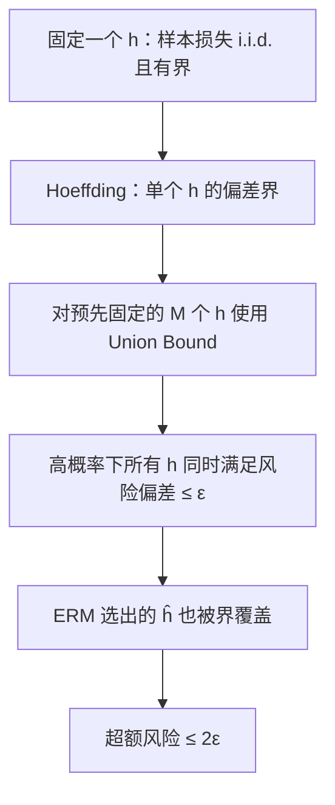

# 人工智能 · 第 4 课｜泛化误差的概率保证：Hoeffding、统一收敛与 ERM

> **2026-10-23 · 第一周 · 建议学习 17 分钟。** 今天的关键问题：**为什么训练误差低并不保证测试误差低？我们能否用可计算的概率界，量化这种差距？**

第 1 课学习最大似然与交叉熵，第 3 课用 Bias² + Variance + Noise 理解平均预测误差。今天换一个角度：**不假设具体线性回归数据生成模型，研究训练误差与真实风险的差距在多大概率下不会太大。**

**学习目标**：推导固定模型的 Hoeffding 误差界、通过并集界得到整个有限候选集合的统一收敛、证明 ERM 的超额风险保证，并理解反复选模型为什么会带来统计风险。

## 1. 先看“训练集挑冠军”的陷阱

假设你比较 100 个分类器，各自具有接近的真实错误率；只看有限训练集后选训练错误最少者。即使各候选训练错误是各自总体错误率的无偏估计，**冠军的训练错误也可能因选择效应而显得过于乐观**：你恰好选中了训练集上运气好的模型。

问题在于模型是**看过同一份数据后才选出来的**。我们需要一个“对所有候选同时成立”的保证，才能合法地将它用于最终选中的模型。

## 2. 模型和假设：先说清定理适用范围

数据集 $D=(Z_1,\ldots,Z_n)$ 独立同分布，$Z_i\sim\mathcal P$。假设类 $\mathcal H=\{h_1,\ldots,h_M\}$ 在看训练数据**之前**就已经确定，且 $M<\infty$。损失为 $\ell(h,Z)\in[0,1]$，例如分类 0-1 损失。

定义总体风险与经验风险：

$$
R(h)=\mathbb E_{Z\sim\mathcal P}[\ell(h,Z)],
\qquad
\widehat R_D(h)=\frac1n\sum_{i=1}^n\ell(h,Z_i).
$$

$R(h)$ 是分布的固定性质，$\widehat R_D(h)$ 随训练样本而变。假设类可包含很多固定的模型；**不同候选在同一份数据上的错误可以相关**，这不会妨碍后面的并集界。

## 3. 第一层：一个固定模型的 Hoeffding 界

先固定一个与 $D$ 独立的 $h$，记 $X_i=\ell(h,Z_i)\in[0,1]$。由于样本 i.i.d.，$X_i$ 也 i.i.d.，且 $\mathbb E X_i=R(h)$。

Hoeffding 不等式给出：

$$
\Pr\!\left(\left|\widehat R_D(h)-R(h)\right|>\epsilon\right)
\le 2\exp(-2n\epsilon^2).
\tag{1}
$$

这个结论不要求损失服从正态分布，也不要求不同候选之间独立；它要求的是**对固定 $h$ 的样本损失独立，并且有界**。

**指数项从何而来？（推导概要）** 对 $0\le X_i\le1$，Hoeffding 引理给出 $\mathbb E[e^{t(X_i-\mathbb EX_i)}]\le e^{t^2/8}$。利用样本间独立性、Markov 不等式与任意 $t>0$：

$$
\Pr\!\left(\widehat R-R\ge\epsilon\right)
\le \exp\left(-tn\epsilon+\frac{nt^2}{8}\right).
$$

令 $t=4\epsilon$ 使右边指数最小，得到 $e^{-2n\epsilon^2}$；负方向同理，两侧相加得到式 (1)。

如果想让偏差超过 $\epsilon$ 的概率最多为 $\delta$，只需：

$$
2e^{-2n\epsilon^2}\le\delta
\quad\Rightarrow\quad
\boxed{\epsilon_{\rm fixed}(n,\delta)=
\sqrt{\frac{\ln(2/\delta)}{2n}}.}
$$

注意这里的 $\ln$ 是**自然对数**。当 $n$ 增加 4 倍，界宽在其他参数不变时缩小一半。

## 4. 第二层：从“一个模型”到“所有模型”

在训练集上做 ERM（Empirical Risk Minimization，经验风险最小化）：

$$
\hat h\in\arg\min_{h\in\mathcal H}\widehat R_D(h).
$$

$\hat h$ 是 $D$ 的函数，所以**不能直接把 $\hat h$ 当作事先固定的 $h$ 使用式 (1)**。正确的思路是先证明所有 $h$ 都靠近真实风险。

对每个候选定义失败事件：

$$
E_j=\left\{|\widehat R_D(h_j)-R(h_j)|>\epsilon\right\}.
$$

并集界（Union Bound）对任意事件成立，**不要求 $E_j$ 相互独立**：

$$
\Pr\left(\bigcup_{j=1}^{M}E_j\right)
\le\sum_{j=1}^{M}\Pr(E_j)
\le2M e^{-2n\epsilon^2}.
$$

令右边不超过 $\delta$，得到：

$$
\boxed{\epsilon(n,M,\delta)=
\sqrt{\frac{\ln(2M/\delta)}{2n}}.}
\tag{2}
$$

因此，以至少 $1-\delta$ 的概率，对**所有** $h\in\mathcal H$ 同时有：

$$
\boxed{\sup_{h\in\mathcal H}|\widehat R_D(h)-R(h)|
\le\epsilon(n,M,\delta).}
\tag{3}
$$

这叫做**统一收敛（Uniform Convergence）**。既然事件同时覆盖全部候选，它也覆盖你根据训练数据选出的 $\hat h$。



### 为什么会出现 $\ln M$？

为了同时保护更多候选，需要更严格的置信控制；但候选数进入界的是 $\ln M$，不是 $M$ 本身：

$$
\epsilon=O\left(\sqrt{\frac{\ln M+\ln(1/\delta)}n}\right).
$$

如果固定 $n,\delta$，候选模型数变成原来的十倍，误差界不会变成十倍。但对于极大的候选类，界依然可能宽到失去实用价值。

## 5. 第三层：ERM 的超额风险证明

设 $h^*\in\arg\min_{h\in\mathcal H}R(h)$，$\hat h$ 则最小化经验风险。考虑式 (3) 成立的同一个事件：

$$
\begin{aligned}
R(\hat h)
&\le \widehat R_D(\hat h)+\epsilon
&&\text{（统一收敛，用于数据选中的模型）}\\
&\le \widehat R_D(h^*)+\epsilon
&&\text{（ERM 定义）}\\
&\le R(h^*)+2\epsilon
&&\text{（统一收敛，用于最优候选）}.
\end{aligned}
$$

于是：

$$
\boxed{R(\hat h)-\min_{h\in\mathcal H}R(h)
\le 2\sqrt{\frac{\ln(2M/\delta)}{2n}}}
\tag{4}
$$

以概率至少 $1-\delta$ 成立。

**关键细节**：这保证的是相对于**假设类内部的最优模型**的超额风险，而不是与“宇宙中真正最好的预测器”的差距。若 $\mathcal H$ 本身表达能力不足，类内最优仍可能很差：这就是近似误差与估计误差的区别。

### 需要多少数据才能达到目标精度？

如果希望以至少 $1-\delta$ 的概率保证 ERM 超额风险不超过 $\gamma>0$，令式 (4) 右侧不超过 $\gamma$：

$$
2\sqrt{\frac{\ln(2M/\delta)}{2n}}\le\gamma.
$$

两边平方并整理：

$$
\boxed{n\ge\frac{2}{\gamma^2}\ln\frac{2M}{\delta}.}
\tag{5}
$$

这是一个**充分样本量**，并非说真实算法一定需要这么多数据。

## 6. 数值例子：100 个候选模型和 1000 个样本

假设预先确定 $M=100$ 个分类器，$n=1000$ 个独立样本，取 $\delta=0.05$。则：

$$
\epsilon=\sqrt{\frac{\ln(2\times100/0.05)}{2000}}
=\sqrt{\frac{\ln4000}{2000}}
\approx0.0644.
$$

所以，以至少 95% 的概率，**100 个候选模型的每个经验风险都与真实风险相差不超过约 6.44 个百分点**。

若经验风险最小者训练错误率为 $0.08$，则在这个高概率事件中：

$$
R(\hat h)\le0.08+0.0644=0.1444.
$$

并且，ERM 相对类内最优的超额风险不超过：

$$
2\epsilon\approx0.1288.
$$

不要把这两个上界当作预测的实际错误率！它们往往偏保守。也不要把“95%”解释为对某个已经固定的实际数据集有 95% 概率真的满足：概率是针对**抽样过程**的。

## 7. 研究和工程中应该怎样使用？

### 7.1 验证集挑超参数，也是一种选择

假设你有 40 个固定配置，分别训练好，再用一份**独立于训练过程**的验证集比较。如果候选预测器不依赖这份验证集，就可以在条件于训练结果的意义下，对这 40 个固定候选应用类似的统一界。

但如果每次看到验证集得分就修改训练方案，再连续进行数百轮搜索，候选配置已适应这份验证集，不能简单地继续把 $M=40$ 当作真实的搜索复杂度。

对于 LLM/Agent 的反复 Benchmark 调参，这尤其重要。

### 7.2 0-1 Loss 与交叉熵不能随意替换

0-1 Loss 落在 $[0,1]$ 内；但未裁剪的交叉熵 $-\ln p_\theta(y|x)$ 可以趋于无穷大。**不能直接对任意交叉熵使用今天相同的 $[0,1]$ Hoeffding 常数**。若希望使用类似分析，需要额外的有界性或尾部条件，并正确调整常数。

### 7.3 无限假设类怎么办？

深度神经网络的参数连续变化，$\mathcal H$ 通常无限。直接代入 $M=\infty$ 会使式 (2) 失去信息。

后续会用 VC 维、Rademacher 复杂度、稳定性等工具度量可区分的预测能力，而不是简单数参数个数。即使某个理论上界很宽，也不代表该模型必然泛化差。

### 7.4 一个安全的实验协议

```text
预先约定任务/指标/划分
         ↓
训练集：拟合模型参数
         ↓
验证集：比较配置、早停、选择 checkpoint
         ↓
锁定训练流程和最终方案
         ↓
独立测试集：最终评估，避免反复调参
```

这不是说“一次测试一定完全无偏”——有限测试集仍有抽样误差。重点是避免把测试集偷偷变成第二个训练集。

## 8. 误区与反例

**误区 A：“单个模型 Hoeffding 成立，所以我挑出的最佳模型也直接满足同样的单模型界。”** 选模型使它依赖样本；需要统一控制候选类，或使用真正独立的数据进行评估。

**误区 B：“并集界必须要求不同候选的错误事件独立。”** 并集界不需要。独立性出现在固定模型的样本损失上。

**误区 C：“统一收敛证明了深度学习的大模型一定不泛化。”** 没有。今天的定理针对预先固定的有限候选类，有界损失；直接将它粗暴替代现代网络实际行为是不合理的。

**误区 D：“95% 置信意味着我有 95% 概率知道这次训练的真实风险。”** 它是重复抽样意义下的高概率保证，不是对已固定未知常数赋予贝叶斯后验概率。

## 9. 四级学习检测（共 100 分）

**前三题可客观判分，第四题检查严谨推导与实验设计；本课首次发送不公布标准答案。**

### Lv1｜固定模型 vs. 数据选择（15 分；预计 2 分钟）

**考点：Hoeffding 假设与模型选择。**

一个分类器 ĥ 是通过在同一份训练集 D 上比较 100 个预先确定的候选分类器的训练错误率而选出的。为什么不能不加论证地把“针对固定 h 的 Hoeffding 界”直接套用到 ĥ 上？

- A. 因为 Hoeffding 不等式仅适用于回归任务。
- B. 因为 ĥ 依赖训练数据，固定假设的浓缩结论本身不自动覆盖数据依赖的选择；需要同时控制候选集合。
- C. 因为 100 个分类器的错误事件必须相互独立，才能使用并集界。
- D. 因为选择训练错误率最小者，会让所有候选的总体错误率都为零。

### Lv2｜数值计算（20 分；预计 3 分钟）

**考点：统一收敛界的定量计算。**

损失在 [0,1] 内；预先固定的假设集合有 M=40 个模型，训练样本 n=800，置信参数 δ=0.05。按照双侧 Hoeffding + 并集界，计算统一偏差界 ε=√[ln(2M/δ)/(2n)]。输入 ε 的十进制数值（四位小数即可）。

### Lv3｜机制边界和量词（25 分；预计 5 分钟）

**考点：并集界、假设类是否依赖训练数据、ERM 风险保证。**

设训练数据 i.i.d.、损失 ∈[0,1]、H 为独立于训练数据预先确定的有限集合，|H|=M。以下哪些说法正确？（多选）

- A. 从各 h 的 Hoeffding 界到整个 H 的并集界，不要求不同 h 的偏差事件相互独立。
- B. 如果先观察全部训练标签，再任意构造只有一个成员的集合 H={h_D}，就能自动得到 M=1 的同一泛化保证。
- C. 在所有 h 同时满足 |R(h)-R̂(h)|≤ε 的事件中，经验风险最小化的超额风险至多为 2ε。
- D. 将候选模型数 M 从 50 增到 100，会使 ε 恰好翻倍。

### Lv4｜综合推导与实验设计（40 分；预计 10–12 分钟）

**考点：Hoeffding+Union Bound、ERM oracle bound、样本复杂度、验证集泄漏。**

【综合证明与实验设计】设 H 是与训练集独立、事先确定的 M 个分类器；n 个样本独立同分布，使用 0-1 损失。A（10 分）先对任意固定 h 写出双侧 Hoeffding 不等式，再证明以概率 ≥1−δ 同时对所有 h∈H 有 |R(h)−R̂_D(h)|≤ε，并写出 ε。B（12 分）令 ĥ 为经验风险最小化解，h* 为 H 内真实风险最小者，严格推导 R(ĥ)−R(h*)≤2ε。C（10 分）若要求以至少 95% 置信度保证超额风险不超过 0.10，M=50，计算上述界给出的充分样本量 n（向上取整）。D（8 分）解释如果 H 是看完训练标签才任意选择的，哪个证明步骤不再合法；设计训练/验证/最终测试的流程，使超参数比较与最终评估尽量避免数据泄漏。

## 10. 今日知识总结与下节预告

本课三条主线：

$$
\text{固定 }h:\quad
\Pr(|R-\widehat R|>\epsilon)\le2e^{-2n\epsilon^2};
$$

$$
\text{有限固定 }\mathcal H:\quad
\sup_{h\in\mathcal H}|R(h)-\widehat R(h)|
\le\sqrt{\frac{\ln(2M/\delta)}{2n}}
\quad\text{（概率至少 }1-\delta\text{）};
$$

$$
\text{ERM}:\quad
R(\hat h)-\min_{\mathcal H}R
\le2\sqrt{\frac{\ln(2M/\delta)}{2n}}.
$$

**下节课（第 5 课）预告**：无限假设类、VC 维和模型容量——为什么连续参数的模型仍可能泛化？第 7 课将对第一周知识进行系统复盘。

**参考材料**：Stanford CS229 Learning Theory 讲义（https://cs229.stanford.edu/notes_archive/cs229-notes4.pdf）；Stanford CS229T/STAT231 Statistical Learning Theory（https://web.stanford.edu/class/cs229t/2016/notes.pdf）。
