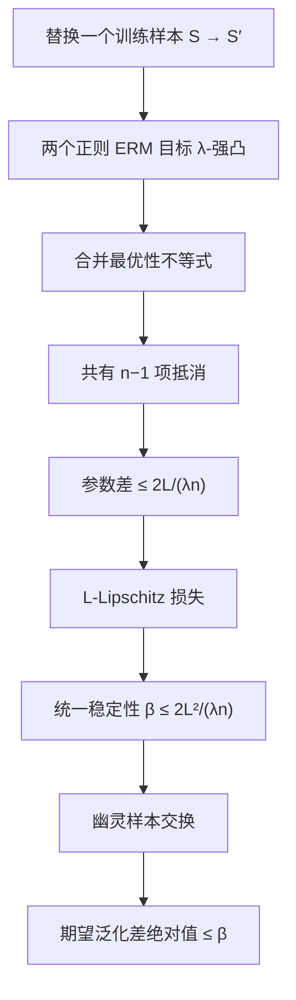

# 人工智能：理论、算法与系统 · 第 6 课

## 算法稳定性与正则化泛化：只替换一个训练样本会怎样？

**2026 年 10 月 25 日｜第 1 周第 6 课｜预计 18 分钟**

> **核心问题：** 昨天我们用 VC 维限制整个假设类的表达能力。今天换个方向：即使模型类很大，如果训练集中只换一个样本，算法输出变化很小，能否从这一点直接证明泛化？

**本节目标：**（1）严格区分“模型类复杂度”和“学习算法稳定性”；（2）推导统一稳定性如何控制**期望**泛化差；（3）证明凸损失 + ℓ₂ 正则化 ERM 的 $O(1/(\lambda n))$ 稳定性界；（4）手算数据替换前后的模型、损失和泛化差；（5）理解正则化的稳定性—偏差权衡及失效边界。

这是统计学习理论的经典内容。算法稳定性与泛化的系统联系可追溯至 Bousquet 与 Elisseeff（JMLR, 2002），不是关于现代 LLM 的新实验结论。

## 一、为什么 VC 维之外还需要算法稳定性？

昨天的分析关注一个预先给定的集合 $\mathcal H$：它在 $n$ 个样本上能产生多少种不同标记？今天关注的是另一个对象：

$$
\boxed{A:\;S=(z_1,\ldots,z_n)\longmapsto w_S.}
$$

这里 $A$ 是**训练算法**，$w_S$ 是它根据训练数据返回的参数。即使 $\mathcal H$ 不变，两种训练算法也可能对一个训练样本的改变作出完全不同的反应。

一个极端例子：如果算法只是把所有训练点逐字记住，替换一个样本可能让该样本附近的预测发生剧烈变化。相反，有足够正则化的算法可能输出几乎相同的参数。

直觉是：**如果单条数据很难左右学到的模型，那么训练样本对评估结果的“特殊影响”就更小。** 但直觉本身不是定理，必须先定义这种“小”。

## 二、符号、概率与“相邻训练集”

设 $z_i\overset{\mathrm{i.i.d.}}{\sim}P$，单样本损失为 $\ell(w,z)$，其中参数 $w\in K\subseteq\mathbb R^d$。定义：

$$
R(w)=\mathbb E_{z\sim P}\ell(w,z),\qquad
\widehat R_S(w)=\frac1n\sum_{i=1}^n\ell(w,z_i).
$$

$R(w_S)-\widehat R_S(w_S)$ 叫作**泛化差**。它是随机量，因为 $w_S$ 依赖随机训练集 $S$。

把 $S$ 的第 $i$ 项 $z_i$ 换成另一个可能样本 $z_i'$，其余 $n-1$ 项保持不变，得到 $S^{(i)}$。我们称它们是**替换型相邻数据集**，与“删掉一个样本”的稳定性定义要区分。

对确定性学习算法，定义统一稳定性（Uniform Stability）参数 $\beta$：

$$
\boxed{
\forall S,S'\text{ 相邻},\;\forall z,\quad
|\ell(A(S),z)-\ell(A(S'),z)|\le\beta.
}\tag{1}
$$

**重要的三个量词：** 对所有相邻训练集、所有可能的评估样本，同一个 $\beta$ 都成立。稳定性是损失的变化界，**不是**参数距离界；后者必须结合损失的 Lipschitz 性才能转化为前者。

| 对比 | VC / 增长函数方法 | 稳定性方法 |
|---|---|---|
| 研究对象 | 模型类 $\mathcal H$ 的标记能力 | 训练映射 $S\mapsto A(S)$ |
| 核心控制量 | VC 维 $d$ 等容量指标 | 替换一个训练样本的损失变化 $\beta$ |
| 数据依赖 | 通过统一收敛控制数据选出的模型 | 直接研究训练算法对数据的敏感度 |
| 常见结论 | 高概率统一风险偏差 | 首先得到期望泛化差；高概率需额外分析 |

## 三、最关键的定理：统一稳定性 ⇒ 期望泛化差小

假设学习算法满足式 (1)，并且下面的期望均存在。则：

$$
\boxed{
\left|
\mathbb E_S\!\left[R(A(S))-\widehat R_S(A(S))\right]
\right|\le\beta.
}\tag{2}
$$

请看清楚：左侧是 **$\left|\mathbb E[\text{gap}]\right|$**，不是 $\mathbb E[|\text{gap}|]$，更不是“每一份数据集的 gap 都不超过 $\beta$”。

### 证明：引入独立的幽灵样本

对每个训练点 $z_i$，额外独立抽取 $z_i'\sim P$。由总体风险定义与期望线性性：

$$
\begin{aligned}
\mathbb E_S[R(A(S))-\widehat R_S(A(S))]
=\frac1n\sum_{i=1}^n
\mathbb E_{S,z_i'}[
\ell(A(S),z_i')-\ell(A(S),z_i)
].
\end{aligned}
$$

在联合分布里交换 $z_i$ 与 $z_i'$，分布不变。因此：

$$
\mathbb E_{S,z_i'}\ell(A(S),z_i')
=
\mathbb E_{S,z_i'}\ell(A(S^{(i)}),z_i).
$$

代回：

$$
\boxed{
\mathbb E[\text{gap}]
=\frac1n\sum_i\mathbb E[
\ell(A(S^{(i)}),z_i)-\ell(A(S),z_i)
].
}
$$

每一项的绝对值由式 (1) 控制在 $\beta$ 内，因此三角不等式得到式 (2)。证明完成。

**为什么这一招有用？** 对新样本的预测损失，通过交换对称性，变成了“换掉一个训练样本前后，对同一评估样本的损失差”。正好能使用稳定性定义。这个证明不需要假设类有限。

## 四、正则化怎样制造稳定性？从强凸性严格推导

考虑正则化经验风险最小化（Regularized ERM）：

$$
\boxed{
w_S=A(S)=\arg\min_{w\in K}
F_S(w),\quad
F_S(w)=\frac1n\sum_{i=1}^n\ell(w,z_i)
+\frac{\lambda}{2}\|w\|_2^2.
}\tag{3}
$$

明确假设：

- $K$ 是非空闭凸集（可取 $\mathbb R^d$）。
- 对每个 $z$，$\ell(\cdot,z)$ **凸**且 **$L$-Lipschitz**：$|\ell(u,z)-\ell(v,z)|\le L\|u-v\|$。
- $\lambda>0$，求的是式 (3) 的**精确全局极小点**；由二次正则项，$F_S$ 是 $\lambda$-强凸，解唯一。

这里的 $L$ 是**损失对参数值的 Lipschitz 常数**，不是前面优化课程里“梯度 Lipschitz”的 Smooth 常数。这两个定义不能混用。

### 第一步：比较两个相邻数据集的最优点

设 $S,S'$ 只在第 $i$ 项不同，$w=A(S)$、$w'=A(S')$，记 $\Delta=w-w'$。

因为 $F_S$ 和 $F_{S'}$ 都是 $\lambda$-强凸的，且各自在凸域 $K$ 上取得最小值：

$$
F_S(w')\ge F_S(w)+\frac\lambda2\|\Delta\|^2,
$$

$$
F_{S'}(w)\ge F_{S'}(w')+\frac\lambda2\|\Delta\|^2.
$$

相加：

$$
\lambda\|\Delta\|^2
\le F_S(w')-F_S(w)+F_{S'}(w)-F_{S'}(w').
$$

**第二步：消掉共有的 $n-1$ 个样本。** 两个目标函数的正则项也抵消，只剩替换前后的两个损失：

$$
\lambda\|\Delta\|^2\le
\frac1n\big[
\ell(w',z_i)-\ell(w,z_i)
+\ell(w,z_i')-\ell(w',z_i')
\big].
$$

每个损失差的绝对值都不超过 $L\|\Delta\|$，故

$$
\lambda\|\Delta\|^2\le\frac{2L}{n}\|\Delta\|.
$$

若 $\Delta=0$，结论显然成立；否则除以 $\|\Delta\|$：

$$
\boxed{\|w-w'\|\le\frac{2L}{\lambda n}.}\tag{4}
$$

**第三步：从参数稳定性回到损失稳定性。** 对任意评估样本 $z$：

$$
|\ell(w,z)-\ell(w',z)|
\le L\|w-w'\|
\le\boxed{\frac{2L^2}{\lambda n}}.
$$

因此可选取统一稳定性上界

$$
\boxed{\beta\le\frac{2L^2}{\lambda n}.}\tag{5}
$$

再结合式 (2)：

$$
\boxed{
\left|\mathbb E_S[R(w_S)-\widehat R_S(w_S)]\right|
\le\frac{2L^2}{\lambda n}.
}\tag{6}
$$

**机制直觉：** 每个样本只占经验目标的 $1/n$；强凸正则项使最优点受到曲率约束，不易被单个样本拉走。$n$ 或 $\lambda$ 增大，**这个上界**会变小；并不保证实际测试损失一定单调变好。

### 证明依赖图



## 五、完整数值 Trace：替换一个样本究竟改变多少？

为了能精确核对每一步，考虑一维玩具回归：

$$
z\in\{-1,+1\},\quad
w\in[-1,1],\quad
\ell(w,z)=\frac{(w-z)^2}{4},\quad\lambda=1.
$$

在这个**有界参数域**内，$0\le\ell\le1$，且 $|\partial\ell/\partial w|=|w-z|/2\le1$，所以可取 $L=1$。注意：同样的平方损失若允许 $w\in\mathbb R$ 无界，就没有这样的统一 $L$。

取 $n=4$：

$$
S=(+1,+1,-1,+1),\quad
S'=(+1,+1,-1,-1).
$$

令样本平均为 $\bar z$。正则目标的一阶条件：

$$
0=\frac{w-\bar z}{2}+\lambda w
\quad\Longrightarrow\quad
\boxed{w_S=\frac{\bar z}{1+2\lambda}}.
$$

两份数据分别得到：

| 项目 | 原数据 $S$ | 替换后 $S'$ |
|---|---:|---:|
| $\bar z$ | $1/2$ | $0$ |
| 正则化解 $w$ | $1/6$ | $0$ |
| $\widehat R_S(w_S)$ | $31/144\approx0.2153$ | — |
| 参数改变量 $|w_S-w_{S'}|$ | $1/6\approx0.1667$ | $1/6\approx0.1667$ |

这里参数变化 $1/6$，而式 (4) 给出的普适上界为 $2L/(\lambda n)=1/2$；理论保证可以明显保守。

再设真实分布满足 $P(z=+1)=P(z=-1)=1/2$。那么：

$$
R(w)=\frac14\mathbb E[(w-z)^2]=\frac{1+w^2}{4}.
$$

对原数据学到的 $w_S=1/6$：

$$
R(w_S)=\frac{37}{144},\qquad
\widehat R_S(w_S)=\frac{31}{144}.
$$

因此**这一次特定抽样**的泛化差是：

$$
\boxed{R(w_S)-\widehat R_S(w_S)=\frac1{24}\approx0.0417.}
$$

这只是一个样本集上的数值，不等于式 (6) 的**对训练集抽样取期望**的量。也不要把单次抽样差小，理解成一个模型在每种新分布上都可靠。

## 六、稳定性与拟合能力：为什么 λ 不能无限增大？

式 (5) 看起来鼓励不断增大 $\lambda$，因为上界随 $1/\lambda$ 下降。可是，正则项也会把参数推向零，可能造成欠拟合。

给出一个严谨的权衡。令 $w^*$ 是**未正则化总体风险**在 $K$ 内的最优解，并假设 $\|w^*\|\le B$。由正则化经验最优性：

$$
\widehat R_S(w_S)+\frac\lambda2\|w_S\|^2
\le\widehat R_S(w^*)+\frac\lambda2\|w^*\|^2.
$$

去掉左侧非负正则项并取期望，利用 $\mathbb E\widehat R_S(w^*)=R(w^*)$ 与式 (6)，得到

$$
\boxed{
\mathbb E R(w_S)-R(w^*)
\le\underbrace{\frac{2L^2}{\lambda n}}_{\text{稳定性/估计项}}
+\underbrace{\frac{\lambda B^2}{2}}_{\text{正则化偏移项}}.
}\tag{7}
$$

这才说明“更强正则化更稳定”不等于“更强正则化一定更准”。一个项随 $\lambda$ 下降，另一个却随 $\lambda$ 上升。

对 $B>0$，最小化上界的建议尺度是 $\lambda\propto1/\sqrt n$，代入可得到 $O(1/\sqrt n)$ 的**期望超额风险上界**。注意它是当前保守理论上界的最优选择，**不是所有数据与模型的真实最佳超参数**。也不应把该 $O(1/\sqrt n)$ 与昨天 VC 维的界不加条件地比较“谁更强”，因为假设、损失和比较基准不同。

## 七、经典结论的边界与容易犯的错误

**误区 1：稳定性证明已经给出每次训练的高概率误差界。** 没有。式 (6) 只控制 $\left|\mathbb E[\text{gap}]\right|$。要推出高概率保证，还需额外的有界差分、浓缩工具或更精细的稳定性分析。若损失属于 $[0,1]$，可进一步用 McDiarmid 这类不等式；不能直接把 $\beta$ 当成任意单次训练的误差上限。

**误区 2：加入 ℓ₂ 正则，任何深度网络都自动满足式 (5)。** 不成立。上面的推导使用**样本损失凸且统一 Lipschitz、参数域凸、精确极小化**。一般深度网络非凸，SGD 只近似找到某个点，不能直接调用此强凸 ERM 证明。现代训练算法的稳定性有专门研究，不能拿经典凸定理冒充现成的大模型保证。

**误区 3：验证集反复使用不会影响稳定性。** 训练算法对训练样本稳定，不代表研究人员反复看同一验证集结果、不断修改配置后，验证集分数仍保持无偏。后者是**适应性模型选择**问题；应留出未参与设计决策的最终测试集。

**误区 4：损失函数的两个 L 可以混用。** 本课需要的是 $\ell(w,z)$ 对参数 $w$ 的函数值 Lipschitz 性；第 2 周深度学习优化将讨论梯度 Lipschitz / Smoothness。这两者不同，特别是平方损失在无界参数空间里通常不满足统一的函数值 Lipschitz 常数。

一个小实验伪代码，检验的是“替换敏感度”，而不是直接证明总体泛化：

```text
for seed in seeds:
    S = sample_training_set(n, seed)
    S_prime = replace_exactly_one_example(S)
    w = train_regularized_ERM(S, lam)
    w_prime = train_regularized_ERM(S_prime, lam)
    report_parameter_distance(norm(w - w_prime))
    report_loss_sensitivity(max_abs_loss_diff_on_independent_probe_set)
# 另用从未参与调参的独立测试集评估真实泛化；有限 probe 集不能证明全称稳定性。
```

## 八、本周逻辑收束

第一周我们从**损失与概率目标**进入**学习理论**：

$$
\text{MLE / 交叉熵}
\rightarrow
\text{偏差—方差与正则化}
\rightarrow
\begin{cases}
\text{固定模型的浓缩与 VC 容量}\\
\text{训练算法的稳定性}
\end{cases}
\rightarrow
\text{有前提的泛化保证}.
$$

两条泛化路线关注的对象不同，却共同强调：**训练误差小本身不是充分的泛化论证；数据选择过程与理论假设必须一同检查。**

## 九、四级自测（总分 100，首次不公布答案）

前三题可客观判分；第四题为开放证明，需按评分要点自评或交由人工/ChatGPT 批改，不做虚假的机器语义自动评分。

### Lv1｜参数敏感度与损失稳定性的逻辑关系（15 分｜预计 2 分钟｜单选）

**题目：** 一个确定性学习算法 A 在相邻训练集 S、S′（仅替换一个样本）上输出参数 w、w′。关于“参数变化小”与“统一稳定性”，哪一项最严谨？

A. 只要 ‖w−w′‖ 很小，无需任何损失函数假设，就能保证所有评估样本的损失变化都很小。

B. 如果任意评估样本 z 的损失 ℓ(w,z) 对参数都满足统一的 L-Lipschitz 条件，则 ‖w−w′‖ 的上界能够转化为逐样本损失差的上界。

C. 统一稳定性只比较训练集内的损失，不对训练集外的评估样本提出要求。

D. 只要训练误差为零，学习算法就必然是零稳定性算法。

*可选提示：先判断从参数空间距离到损失差，需要对损失的变化速率作什么假设。*

### Lv2｜正则化 ERM 的解析解与泛化差计算（20 分｜预计 4 分钟｜数值）

**题目：** 令 z∈{−1,+1} 且真实分布 P(z=+1)=P(z=−1)=1/2。参数 w∈[−1,1]，单样本损失 ℓ(w,z)=(w−z)²/4。给定 n=6 的训练集 S=(+1,+1,+1,+1,−1,−1)，用 λ=0.5 训练：w_S=argmin_w [ (1/6)Σ_i ℓ(w,z_i)+(λ/2)w² ]。求有符号的泛化差 R(w_S)−R̂_S(w_S)，用小数表示并保留至少 6 位。

请填写十进制数值；容许绝对误差不超过 0.0001。

*可选提示：先对正则化目标求导得到 w_S，再分别计算真实分布与训练集下的平均损失；注意差值是有符号的。*

### Lv3｜稳定性定理假设、概率量词与正则化权衡（25 分｜预计 5 分钟｜多选）

**题目：** 对确定性正则化 ERM 及其泛化结论，哪些陈述成立？（多选）

A. 若参数域凸、每个样本损失凸且 L-Lipschitz，并加入 λ‖w‖²/2（λ>0），则可得到统一稳定性上界 β≤2L²/(λn)；固定 L、λ 时该上界随 n 按 1/n 减小。

B. 若算法统一稳定性为 β=0.01，则每一份实际训练集 S 的泛化差绝对值都必然不超过 0.01。

C. 增大 λ 可以改善上述稳定性上界，但因改变了训练目标，不能据此断言真实总体风险必然下降。

D. 对参数域无界、平方损失也无界的设置，不能未经额外限制直接使用本节“统一有限 L-Lipschitz 损失”的证明。

*可选提示：区分期望与逐数据集保证；逐项核对凸性、Lipschitz、正则项以及 λ 所引入的目标偏移。*

### Lv4｜稳定性证明、幽灵样本、正则化权衡与实验设计（40 分｜预计 12 分钟｜开放推导）

**题目：** 设训练样本 S=(z₁,…,z_n) 独立同分布，K⊂Rᵈ 是非空闭凸参数域；每个 ℓ(·,z) 凸且 L-Lipschitz；A(S)=argmin_{w∈K}{R̂_S(w)+(λ/2)‖w‖²}，λ>0。A（12分）：令 S′ 仅替换第 i 个样本，w=A(S)、w′=A(S′)，从两组 λ-强凸最优性不等式出发证明 ‖w−w′‖≤2L/(λn) 及 β≤2L²/(λn)。B（10分）：引入独立样本 z′_i 与替换训练集 S^(i)，推导 |E_S[R(A(S))−R̂_S(A(S))]|≤β。C（10分）：若 w*∈argmin_{w∈K}R(w)、‖w*‖≤B，证明 E[R(A(S))−R(w*)]≤2L²/(λn)+λB²/2；当 B>0 时求使这个上界最小的 λ，并说明它不等于真实最优调参值。D（8分）：设计实验区分“训练算法不稳定”与“测试集选择偏差”，写出相邻样本重训练、独立测试集和控制变量的具体做法。

请写出每小题的完整推导或实验方案。

*可选提示：A 中把两个不同数据集的目标最优性不等式相加，使共有样本项抵消；B 通过交换 z_i 和 z′_i 的分布；C 利用正则化目标的经验最优性；D 将训练随机性、数据扰动和测试集复用分开。*

## 十、下节预告与参考阅读

**下一讲：2026 年 10 月 26 日，第 7 课是第一周复盘。** 将把 MLE/交叉熵、偏差—方差、Hoeffding/Union Bound、VC 维及算法稳定性放进一组综合情境中，重点练习**如何选择正确的泛化工具并检查假设**。第 8 课进入第二周深度学习优化、初始化、归一化和残差网络。

**经典参考：** Bousquet & Elisseeff, *Stability and Generalization*, JMLR 2 (2002), 499–526；Shalev-Shwartz & Ben-David, *Understanding Machine Learning*（稳定性和正则化相关章节）。
