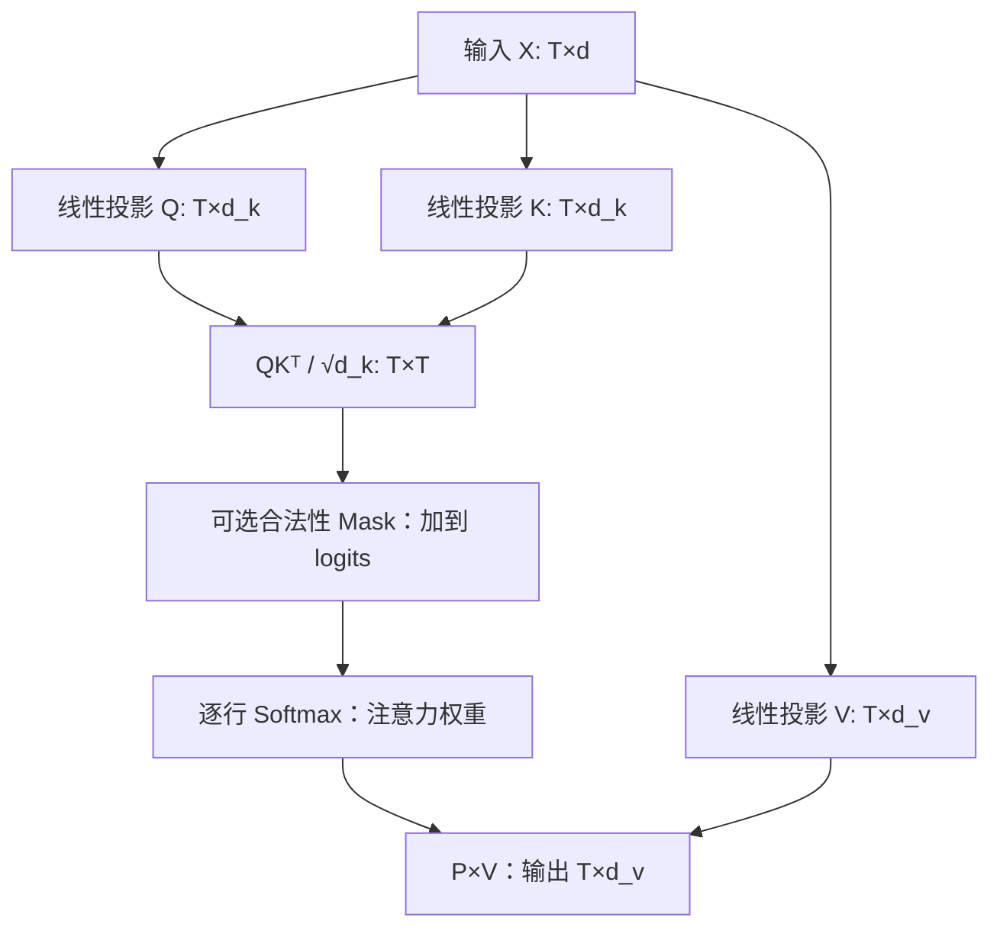

# 人工智能：理论、算法与系统 · 第 15 课

## 从信息检索到缩放点积 Attention：Query、Key、Value 如何工作？

**2026 年 11 月 3 日｜第 3 周第 1 课｜约 18 分钟**

上周我们研究了初始化、梯度、归一化和残差怎样使深层网络可训练。今天进入 Transformer：**模型怎样让一个 token 有选择地读取其他 token 的信息？**

本课目标：独立写出 Q/K/V 与 Scaled Dot-Product Attention，理解 Softmax 是怎样形成“软检索”权重的；手算完整的两 token 注意力；推导 \(1/\sqrt{d_k}\) 的统计来源；区分 causal mask、位置编码及 \(O(T^2)\) 的计算与显存来源。以下以经典 Transformer 注意力为主，系统新进展仅作有边界的延伸。

### 一、为什么需要 Attention：从单个向量到可寻址的信息集合

在早期编码器—解码器设计中，一种做法是把整个输入序列压成固定大小的向量，再让解码器根据它生成输出。对很长的序列，这可能构成表示瓶颈。Attention 的关键不是“记住每个词的字面意思”，而是允许当前计算位置根据内容，**从多个候选位置动态汇总信息**。

把它类比成一个软检索系统：

- **Query（Q）**：当前计算位置要找什么。
- **Key（K）**：每个候选位置用什么特征让自己可被匹配。
- **Value（V）**：该位置被选中后，真正贡献给输出的内容。

与数据库的硬检索不同，标准 Attention 通常对多个 Value 做连续加权平均，而不是只返回一个命中项。Q、K、V 一般是可学习线性投影的结果，并不天然具有人工指定的语义。

### 二、从单个 Query 推导 Attention

令当前 Query 为 \(q\in\mathbb R^{d_k}\)，候选 Key 为 \(k_j\in\mathbb R^{d_k}\)，Value 为 \(v_j\in\mathbb R^{d_v}\)。先计算兼容分数：

\[
s_j=\frac{q^\top k_j}{\sqrt{d_k}}.
\]

再用 Softmax 归一化：

\[
\boxed{p_j=\frac{e^{s_j}}{\sum_{r=1}^{T}e^{s_r}}},\qquad
p_j>0,\ \sum_jp_j=1
\]

（这是所有位置都合法且 logits 有限时的结果。）最后输出：

\[
\boxed{o=\sum_{j=1}^{T}p_jv_j.}
\]

所以在当前这一次计算中，输出是 Value 向量的**凸组合**；但后续输出投影、残差等操作不一定保持这种凸组合性质。

为什么 Softmax 适合软检索？它把较大的匹配分数映射为较大权重，并保持可微。还可从带熵正则的选择问题理解：给定分数 \(s_j\)，最大化

\[
\max_{\substack{p_j\ge0\\\sum_jp_j=1}}
\left[\sum_jp_js_j+\tau H(p)\right],\quad
H(p)=-\sum_jp_j\ln p_j,\quad\tau>0,
\]

用拉格朗日乘子一阶条件可得 \(p_j\propto e^{s_j/\tau}\)。Softmax 相当于在“偏好高分位置”和“不要立即变成硬选择”之间做平滑权衡；\(\tau\) 越小通常越尖锐。标准公式将匹配分数缩放并使用温度 1。

### 三、从 Token Embedding 得到矩阵形式

对长度为 \(T\) 的输入表示 \(X\in\mathbb R^{T\times d}\)，令

\[
Q=XW_Q,\qquad K=XW_K,\qquad V=XW_V,
\]

其中 \(W_Q,W_K\in\mathbb R^{d\times d_k}\)，\(W_V\in\mathbb R^{d\times d_v}\)。于是：

\[
Q,K\in\mathbb R^{T\times d_k},\qquad V\in\mathbb R^{T\times d_v}.
\]

所有 Query 同时计算：

\[
S=\frac{QK^\top}{\sqrt{d_k}}\in\mathbb R^{T\times T},
\qquad
P=\operatorname{softmax}_{\text{row}}(S),
\]

\[
\boxed{\operatorname{Attention}(Q,K,V)=PV
=\operatorname{softmax}_{\text{row}}\left(\frac{QK^\top}{\sqrt{d_k}}\right)V.}
\]

这里 **Softmax 是按每一行做的**。第 \(i\) 行表示“位置 \(i\) 用自己的 Query 查看全部 Key”。输出 \(O\in\mathbb R^{T\times d_v}\)。



注意 **Self-Attention** 的 Q/K/V 来自同一个序列表示，**Cross-Attention** 的 Q 与 K/V 可以来自不同序列，因此其分数矩阵形状一般为 \(T_q\times T_k\)，不一定是方阵。

### 四、手算两 token 的完整注意力

取 \(d_k=d_v=2\)，给定

\[
Q=\begin{bmatrix}1&0\\0&1\end{bmatrix},\quad
K=\begin{bmatrix}\sqrt2\ln2&0\\0&\sqrt2\ln2\end{bmatrix},\quad
V=\begin{bmatrix}3&0\\0&6\end{bmatrix}.
\]

第一步：点积除以 \(\sqrt2\)：

\[
S=\frac{QK^\top}{\sqrt2}
=\begin{bmatrix}\ln2&0\\0&\ln2\end{bmatrix}.
\]

第二步：每一行 Softmax。由于 \(e^{\ln2}=2\)：

\[
P=\begin{bmatrix}2/3&1/3\\1/3&2/3\end{bmatrix}.
\]

第三步：乘以 Value：

\[
O=PV
=\begin{bmatrix}
2&2\\
1&4
\end{bmatrix}.
\]

解释：第一个 Query 对第一个 Key 更匹配，因此从 \(v_1=(3,0)\) 取得更大权重，但仍读取 \(v_2=(0,6)\) 的一部分。**权重决定读多少；Value 决定读到什么。**

### 五、为什么一定要除以 \(\sqrt{d_k}\)？

这是一个**带假设的统计尺度推导**，而不是对任何训练状态都成立的恒等式。

设各分量 \(q_r,k_r\) 相互独立，均值 0、方差 1。未缩放点积为：

\[
u=q^\top k=\sum_{r=1}^{d_k}q_rk_r.
\]

因为 \(E[q_rk_r]=0\)，且每项

\[
\operatorname{Var}(q_rk_r)=E[q_r^2]E[k_r^2]=1,
\]

不同项协方差为零，所以

\[
\boxed{E[u]=0,\qquad\operatorname{Var}(u)=d_k.}
\]

当 \(d_k\) 增大时，典型 logit 尺度按 \(\sqrt{d_k}\) 增大；于是

\[
\boxed{\operatorname{Var}\left(\frac{u}{\sqrt{d_k}}\right)=1.}
\]

这一缩放有助于减少仅因维度增大而导致的 Softmax 过度尖锐。但若训练后 Q/K 相关、方差不是 1，或存在特殊归一化/温度机制，分数方差不会必然等于 1。**缩放也绝不意味着 logits 被硬限制在 [-1,1]。**

为什么尖锐的 Softmax 可能影响梯度？记 \(p_j=e^{s_j}/\sum_re^{s_r}\)，可由商法则推导：

\[
\boxed{\frac{\partial p_j}{\partial s_k}
=p_j(\mathbf1_{j=k}-p_k).}
\]

例如两个 logits 为 \((10,0)\)，第一项的概率接近 1，多个导数项接近 0；模型在这种近饱和区域可能较难通过匹配分数调整权重。这里说的是 Softmax 的局部导数，不代表整个网络梯度一定消失。

### 六、Causal Mask：为什么生成第一个 token 不能看未来？

在自回归语言模型中，位置 \(i\) 不应读取位置 \(j>i\) 的未来信息。做法是在 **Softmax 前** 将不允许的 logits 加上 \(-\infty\)：

\[
\boxed{P=\operatorname{softmax}_{\rm row}
\left(\frac{QK^\top}{\sqrt{d_k}}+M\right),}
\]

其中长度为 3 的 causal mask 可写为

\[
M=
\begin{bmatrix}
0&-\infty&-\infty\\
0&0&-\infty\\
0&0&0
\end{bmatrix}.
\]

于是第 1 行只有第 1 个位置有非零权重，第 2 行可查看前两个位置，第 3 行可查看前三个位置。在真实代码中常使用可表达的最小有限值或专门的 masked softmax kernel；必须正确处理整行全被 mask 的特殊情况以避免 NaN。

对于第四节的两 token 示例，如果采用 causal mask，**第一个位置只允许读取 \(v_1\)**，而第二行仍可查看两个位置。不要在 Softmax 完成后简单把未来权重置零却不重新归一化，否则行和通常不再等于 1。

Mask 管理“允许看谁”，**不提供顺序信息本身**。没有位置编码、无因果掩码的普通 Self-Attention 对序列重排具有置换等变性质：同步重排输入会同步重排输出，模型无法仅从这种结构区分“甲在乙之前”和“乙在甲之前”的顺序关系。这也引出了本周后续的位置编码专题。

### 七、系统视角：\(O(T^2)\) 从哪里来？

对于单头长度 \(T\) 的密集 Self-Attention：

- \(QK^\top\) 计算 \(T\times T\) 对分数，算术量为 \(\Theta(T^2d_k)\)；
- \(PV\) 算术量为 \(\Theta(T^2d_v)\)；
- 若显式存储 \(P\)，需要 \(T^2\) 个注意力权重元素。

对 \(B\) 个序列、\(H\) 个头，若 \(d=Hd_k=Hd_v\)，注意力两个矩阵乘法合计

\[
\boxed{\Theta(BT^2d)}
\]

而 Q/K/V 等稠密投影通常还有 \(\Theta(BTd^2)\) 计算。物化注意力权重的额外存储量为

\[
\boxed{\Theta(BHT^2)}\text{ 个元素。}
\]

将 \(T\) 翻倍、其他条件固定时，两两交互计算约变成 4 倍，而投影计算约变成 2 倍。这说明“Attention 是二次的”说的是**序列交互部分**，并不是 Transformer 整体所有算子的成本都只由 \(T^2\) 决定。

因果 mask 只允许约 \(T(T+1)/2\) 个位置对，仍是二次量级。FlashAttention 等 IO-aware **精确密集注意力**方法通过分块计算、在线 Softmax 与重算策略，避免在 HBM 中物化完整 \(T\times T\) 注意力矩阵，并减少数据搬运；它并不把标准密集点积注意力的主要两两交互计算神奇地变成线性复杂度。性能取决于硬件、序列长度、头维度和 kernel。

```python
# 教学伪代码：展示数学计算顺序，忽略批次与多头维
scores = (Q @ K.T) / sqrt(d_k)       # [T, T]
scores = scores + causal_mask       # 未来位置加 -inf
weights = softmax(scores, axis=-1)  # 每一行总和为 1
output = weights @ V                # [T, d_v]
```

### 八、易错反例与研究边界

| 容易误解 | 更严谨的判断 |
|---|---|
| Q、K、V 是三个固定语义标签 | 它们是可学习投影，语义由训练决定 |
| Attention 只选一个最相关位置 | Softmax 通常产生多个非零权重并加权求和 |
| 除以 \(\sqrt{d_k}\) 后分数被截断 | 只在理想假设下控制统计方差，并不限制取值范围 |
| causal mask 等于位置编码 | Mask 限制未来可见性；位置编码承载顺序信息 |
| 权重越大就一定是“因果解释” | 权重是模型内部计算量，不自动等于可验证的解释 |
| FlashAttention 消除了二次计算 | 它主要优化 IO/中间存储，密集精确交互仍为二次 |

本节 Q/K/V、Softmax 与缩放点积 Attention 属于经典 Transformer 理论（2017 年论文）。IO-aware 注意力属于之后的系统优化研究；本节不把任何特定硬件上的加速数字当作通用结果。

**参考原文：** [Attention Is All You Need](https://arxiv.org/abs/1706.03762)，[FlashAttention](https://arxiv.org/abs/2205.14135)。

### 九、四级递进自测（共 100 分）

**先不要看标准答案。** 前三题可客观判分，最后一题按推导与实验设计分项评分。提交四题答案后逐题批改：80 分及以上继续，60–79 分补练，低于 60 分复习再练。

### Lv1｜Query/Key/Value 与 Softmax 的机制边界（15 分｜预计 2 分钟｜单选题）

在不考虑 dropout 的单头缩放点积 Attention 中，给定一个 query 与若干 key-value 对，下面哪项陈述最严谨？

**A.** Value 直接决定每个位置的注意力权重，Key 只负责携带最终输出内容。

**B.** Attention 权重可以为负，且一行的权重和不必为 1。

**C.** Query 与 Key 决定相似性分数，Softmax 生成非负且和为 1 的权重，输出是对应 Value 的加权和；这种权重不自动等于因果解释。

**D.** 只要使用 1/√d_k 缩放，所有 logits 就会严格限制在 [-1,1]。

*提示：把“寻址匹配”“读取内容”“归一化权重”分别对应到 Q、K、V；再考虑 Softmax 的数学性质。*

### Lv2｜缩放点积注意力前向数值（20 分｜预计 4 分钟｜数值题）

单个 query 为 \(q=(\sqrt2,0)\)，两把 key 为 \(k_1=(\ln3,0)\)、\(k_2=(0,0)\)，且 \(d_k=2\)。两个标量 value 为 \(v_1=2\)、\(v_2=10\)。不使用 mask，按 \(s_j=q^\top k_j/\sqrt{d_k}\)、\(p_j=\operatorname{softmax}(s)_j\)、\(o=\sum_jp_jv_j\) 计算输出 \(o\)，填写十进制数。

*提示：先计算两个 scaled logits，再将其指数化并归一化，最后对两个 value 加权；注意 (sqrt{d_k}) 只除一次。*

### Lv3｜Attention 的时间/显存复杂度与实现边界（25 分｜预计 6 分钟｜多选题）

考虑批量 \(B\)、序列长度 \(T\)、头数 \(H\)、模型宽度 \(d=Hd_k=Hd_v\) 的标准**密集自注意力**。Q/K/V 线性投影取常规稠密矩阵，忽略常数与低阶项。下列哪些陈述正确？（多选）

**A.** 若显式物化每个头的完整 attention 权重矩阵，该矩阵需要 Θ(BHT²) 个元素。

**B.** 使用 causal mask 后，任意标准稠密 Attention kernel 的总算术量必然从二次变为 Θ(BTd)。

**C.** QKᵀ 与随后对 V 的加权聚合的总算术量级为 Θ(BT²d)。

**D.** 固定 B、d、H 将 T 翻倍时，Q/K/V 投影成本与 attention 两两交互成本都严格变成原来的四倍。

**E.** FlashAttention 类 IO-aware 精确密集注意力可避免将完整 T×T 权重矩阵写入 HBM，但标准稠密注意力的主要两两交互计算依然是二次量级。

**F.** Cross-attention 的分数矩阵一定为 T×T，即使 query 长度与 key 长度不同也不例外。

*提示：分别数清 QKᵀ 的矩阵形状和乘法次数；区分“有效连接数”“稠密 kernel 的计算量”和“是否把权重矩阵落到 HBM”。*

### Lv4｜缩放推导、Softmax 反向、因果掩码与验证实验（40 分｜预计 15 分钟｜开放题）

综合推导与实验设计（40 分）。

**A（12 分）** 假设 \(q_r,k_r\)（\(r=1,\ldots,d_k\)）相互独立，均值为 0、方差为 1。推导 \(s=q^\top k\) 的期望与方差，并说明为什么使用 \(s/\sqrt{d_k}\)；指出至少一项该推导不能无条件推广到训练后网络的原因。

**B（12 分）** 对 \(p_j=\exp(s_j)/\sum_r\exp(s_r)\)，推导 \(\partial p_j/\partial s_k\)，解释为什么 logits 差距极大时某些 Softmax 梯度会很小，并区分“缩放”与“数学上强制限制范围”。

**C（8 分）** 对长度为 3 的自回归序列，写出合法的 causal mask（用 0 和 \(-\infty\) 表示），明确应在 Softmax 前还是后作用；解释为什么位置 1 的输出不能读取位置 2、3 的 Value。

**D（8 分）** 设计一个可复现的实验，比较是否使用 \(1/\sqrt{d_k}\) 缩放时，随 \(d_k\) 变化的 logits 方差、注意力熵和梯度尺度；另说明如何比较显式注意力实现与 IO-aware 分块精确实现的峰值显存、延迟及数值误差，并指出应该固定什么。

*提示：A 展开独立乘积的方差；B 对指数函数与分母使用商法则；C 想想第一行哪些列必须被屏蔽；D 区分统计尺度、算术复杂度、HBM 访问量和实际墙钟时间。*

### 十、下一课预告

**第 16 课｜2026 年 11 月 4 日：Multi-Head Attention 与 Transformer Block。** 我们将从单头扩展到多头，推导 head split、Concat 与 \(W_O\) 的张量形状，解释多头为什么不是简单重复计算；并把 Attention 接回上周的残差、RMSNorm/LayerNorm 和 MLP，分析一个完整 Transformer Block 的参数量与计算成本。
