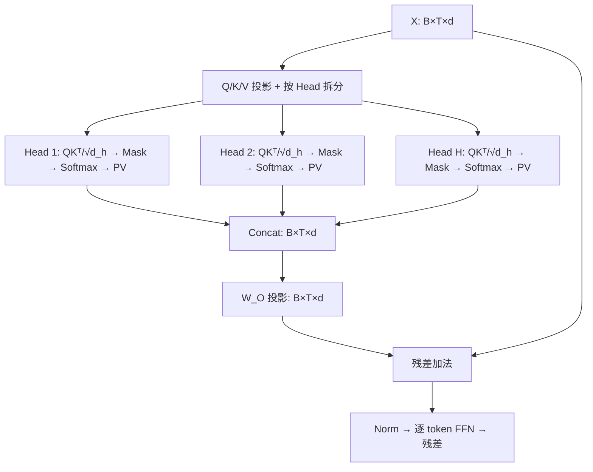

# 人工智能：理论、算法与系统 · 第 16 课

## Multi-Head Attention 与 Transformer Block：为什么不是一个大 Head？

**2026 年 11 月 4 日｜第 3 周第 2 课｜约 18 分钟**

上一课得到单头注意力公式：

\[
\mathrm{Attn}(Q,K,V)=\mathrm{softmax}_{\mathrm{key}}\left(\frac{QK^\top}{\sqrt{d_k}}+M\right)V.
\]

今天研究 **多头如何并行计算、输出怎样合并，以及注意力怎样和上一周学的 Norm、Residual、FFN 组成完整 Transformer Block**。本课的四个目标是：写出完整张量形状；亲手算两头输出；推导参数量与计算量；辨析多头与 GQA 在推理显存上的差别。

### 一、一个大 Head 有什么局限？

对于固定 Query 位置 i，单头 Attention 输出是

\[
o_i=\sum_{j=1}^{T}p_{ij}v_j,\qquad
p_{ij}=\mathrm{softmax}_j(q_i^\top k_j/\sqrt{d_k}+m_{ij}).
\]

注意这里 **所有 Value 坐标共用同一组权重 \(p_{ij}\)**。如果当前 token 同时需要在不同表示子空间中关注不同位置，例如一组特征需要读近邻，另一组特征需要读远处信息，单一注意力分布可能形成建模上的约束。

多头的思路不是简单把一个分数矩阵算 H 遍，而是让不同头拥有**各自可学习的 Q、K、V 投影**，从而可以形成不同的注意力权重矩阵。它提供了多种“读取方式”的归纳偏置，但没有数学定理保证 Head 越多质量越好。Head 也不保证自然分工为某个固定语法角色。

### 二、Multi-Head Attention 的完整形状

令输入为

\[
X\in\mathbb R^{B\times T\times d},
\]

其中 B 为 batch，T 为序列长度，d 为模型隐藏宽度。标准 MHA 设 H 个 Head，为简化取

\[
d_h=d_k=d_v=\frac dH,\quad H\mid d.
\]

对第 h 个 Head，参数矩阵为

\[
W_Q^{(h)},W_K^{(h)},W_V^{(h)}\in\mathbb R^{d\times d_h}.
\]

先投影：

\[
Q_h=XW_Q^{(h)},\quad K_h=XW_K^{(h)},\quad V_h=XW_V^{(h)}
\]

均为 \([B,T,d_h]\)。实际 GPU 实现通常将全部 Head 的投影融合成三个 \([d,d]\) 矩阵，再 reshape 成

\[
Q,K,V\in\mathbb R^{B\times H\times T\times d_h}.
\]

对每个 Head：

\[
S_h=\frac{Q_hK_h^\top}{\sqrt{d_h}}+M\in\mathbb R^{B\times T\times T},
\]

其中 mask 在不同 Head 上按需要广播。每一行对 **Key 位置**（最后一维）做 Softmax：

\[
A_h=\mathrm{softmax}_{j}(S_h),\quad
O_h=A_hV_h\in\mathbb R^{B\times T\times d_h}.
\]

于是

\[
C=\mathrm{Concat}(O_1,\ldots,O_H)\in\mathbb R^{B\times T\times d},
\]

最后使用输出投影：

\[
\boxed{\mathrm{MHA}(X)=CW_O,\quad W_O\in\mathbb R^{d\times d}.}
\]

**为什么需要 \(W_O\)？** Concat 只是把各 Head 的坐标并排放置；\(W_O\) 使不同 Head 的输出可以线性组合，并将结果送回模型的 d 维残差流。严格地说，如果已经满足维度，省略 \(W_O\) 仍可构造另一种网络；它是标准 MHA 的可学习混合层，而非形状上绝对不可缺少的一步。



**容易错的地方：** 不能把 H 个 Head 的全部 logits 先拼接，再在 Head 维上统一 Softmax。标准 MHA 是**每个 Head 单独在合法的 Key 位置归一化**。Head 间的信息融合由 Concat 后的输出投影完成。

### 三、手算两个 Head：不同读法如何拼在一起？

为了让结果整齐，只计算第二个 token（前两个 token 对它均可见）。设两个 Head 的 scaled logits 分别为

\[
s^{(1)}=(\ln3,0),\qquad s^{(2)}=(0,\ln3).
\]

Softmax 的权重是

\[
p^{(1)}=(3/4,1/4),\quad p^{(2)}=(1/4,3/4).
\]

取 Head 1 的 Value：

\[
V^{(1)}=\begin{bmatrix}2&0\\0&4\end{bmatrix},
\]

于是

\[
o^{(1)}=\tfrac34(2,0)+\tfrac14(0,4)=(1.5,1).
\]

取 Head 2 的 Value：

\[
V^{(2)}=\begin{bmatrix}0&6\\2&0\end{bmatrix},
\]

于是

\[
o^{(2)}=\tfrac14(0,6)+\tfrac34(2,0)=(1.5,1.5).
\]

Concat 得到

\[
c=(1.5,1,1.5,1.5).
\]

最终输出不是各 Head 的简单平均，而是

\[
y=cW_O.
\]

每个输出维度都可以利用不同 Head 的多个坐标。这是**多个注意力分布 + 可学习结果混合**的核心结构。后面 Lv2 将用一个给定的输出投影继续完成计算。

### 四、固定 d 时，多头是否使参数量乘以 H？

把每头独立投影的参数相加：

\[
H\times(d\,d_h)=H\times d(d/H)=d^2.
\]

所以 Q、K、V 各有 \(d^2\) 个权重。Concat 后的 \(W_O\) 也有 \(d^2\) 个权重。忽略 bias：

\[
\boxed{P_{\mathrm{MHA}}=4d^2.}
\]

例如 \(d=768,H=12,d_h=64\)，三个输入投影和输出投影总权重数：

\[
4\times768^2=2{,}359{,}296.
\]

如果改成 H=24、每头 32 维而总宽度保持 768，则这一**理想化标准 MHA 权重数保持不变**。实际显存、kernel 效率、并行调度和精度可能变化，所以参数量相同不等于速度相同。

**复杂度推导：** 输入投影和输出投影共为

\[
\Theta(BTd^2).
\]

每头 \(Q_hK_h^\top\) 是 \([T,d_h]\times[d_h,T]\)，算术量 \(\Theta(T^2d_h)\)；乘上 H 个头：

\[
\boxed{\Theta(BHT^2d_h)=\Theta(BT^2d).}
\]

后面的 \(A_hV_h\) 同阶。因此，固定总宽度 d 时，把一个满宽 Head 拆成 H 个窄 Head，**不会仅仅因为 H 增大，就在主导算术量里多乘一个 H**。

如果朴素实现显式保留注意力矩阵，所有 Head 的权重形状为：

\[
[B,H,T,T],
\]

因此仅这个中间张量就需要 \(BHT^2\) 个元素。FlashAttention 一类 IO-aware 精确实现可以避免把完整权重矩阵物化到 HBM；但标准密集 Attention 的两两交互算术量仍为二次量级。因果掩码只允许访问前文，并不自动让所有实现的算术量变成线性。

### 五、接上 FFN：Transformer 不是只做 Attention

对每个 token 的 d 维向量 \(x\)，经典两层位置独立 Feed-Forward Network（FFN）是：

\[
\boxed{\mathrm{FFN}(x)=\phi(xW_1+b_1)W_2+b_2}
\]

其中

\[
W_1\in\mathbb R^{d\times d_{\mathrm{ff}}},\qquad
W_2\in\mathbb R^{d_{\mathrm{ff}}\times d}.
\]

若 \(d_{\mathrm{ff}}=4d\)，不计 bias：

\[
\boxed{P_{\mathrm{FFN}}=d(4d)+(4d)d=8d^2.}
\]

FFN 对不同 token 使用**同一组权重，却逐 token 独立执行**，不会直接在 token 之间交换信息；跨 token 混合主要由 Attention 实现。FFN 的算术量为 \(\Theta(BTd\,d_{\mathrm{ff}})=\Theta(BTd^2)\)。

不计 Norm、bias 和其他层，一个这样的 MHA+FFN Block 有

\[
\boxed{4d^2+8d^2=12d^2}
\]

个权重。上述是经典两层 FFN 的计数；如果换成 SwiGLU 等门控 FFN，矩阵结构与参数数目要重新计算，不能直接套用 8d²。

### 六、Pre-Norm Decoder Block 的前向与 Jacobian

上一周我们学过 Pre-Norm 和残差。对输入 X，经典的两子层 Pre-Norm Decoder Block 可以写为：

\[
\boxed{\begin{aligned}
U&=X+\mathrm{MHA}(\mathrm{Norm}_1(X)),\\
Y&=U+\mathrm{FFN}(\mathrm{Norm}_2(U)).
\end{aligned}}
\]

其中 MHA 施加 causal mask；Norm 可以是 LayerNorm 或适当设计的 RMSNorm；具体模型可能另含 dropout、旋转位置编码、门控 MLP 和残差缩放。

令 \(A(X)=\mathrm{MHA}(\mathrm{Norm}_1(X))\)，\(F(U)=\mathrm{FFN}(\mathrm{Norm}_2(U))\)。两次残差更新的 Jacobian 为：

\[
J_{U,X}=I+J_A,\qquad J_{Y,U}=I+J_F.
\]

整体：

\[
\boxed{J_{Y,X}=(I+J_F)(I+J_A).}
\]

这个表达式包含 identity 路径，但并不意味着所有奇异值都在 1 附近：例如若 \(J_A=-I\)，第一块就可以抵消直通路径。**结构上的直接梯度通道是优化优势的直觉，不是全局或任意深度稳定的无条件定理。**

可以用下面的教学伪代码对应完整前向：

```python
# 教学伪代码；实现须正确处理维度与 Mask
def prenorm_decoder_block(x, H, Wq, Wk, Wv, Wo, W1, W2):
    u = norm1(x)
    q, k, v = u @ Wq, u @ Wk, u @ Wv
    q, k, v = split_heads(q, H), split_heads(k, H), split_heads(v, H)
    scores = (q @ transpose_last2(k)) / sqrt(q.shape[-1])
    scores = scores + causal_mask(scores.shape[-2:])
    attn = softmax(scores, axis=-1) @ v
    x = x + concat_heads(attn) @ Wo
    u = norm2(x)
    return x + activation(u @ W1) @ W2
```

与 2017 年原始 Transformer 常见的 Post-Norm 写法相比，这里刻意选用了 Pre-Norm，便于和第 12—14 课连接。二者并非完全等价的计算图。

### 七、从 MHA 到 GQA：为何多头还影响 KV Cache？

标准 MHA 让每个 Query Head 拥有自己的 Key 和 Value Head。自回归增量生成时，历史 token 的 K/V 可缓存，避免每生成一个 token 都重新投影整个历史。

对**单层**模型、批量 B、已缓存 T 个 token、每 Head 维度 \(d_h\)，标准 MHA 的 KV Cache 元素数是：

\[
\boxed{N_{\mathrm{KV,MHA}}=2BTHd_h.}
\]

因子 2 对应 K 与 V 两份缓存。若每元素占 s 字节，存储字节数再乘 s；多层再乘层数（忽略对齐与管理开销）。

Grouped-Query Attention（GQA）保留 H 个 Query Head，但让多个 Query Head 共享一组 KV。设 KV Head 数为 G，且 G 整除 H，则：

\[
\boxed{N_{\mathrm{KV,GQA}}=2BTGd_h.}
\]

相同 B、T、\(d_h\) 与数据类型时，缓存比例为：

\[
\frac{N_{\mathrm{KV,GQA}}}{N_{\mathrm{KV,MHA}}}=\frac GH.
\]

例如 H=16，G=4 时，**KV 张量元素数缩为原来的四分之一**，但模型全部显存及延迟并不会自动缩为四分之一。GQA 的前向投影参数数目也不再完全是标准 MHA 的 4d²，需要按 K/V 的实际总宽度重新计数。

GQA 是 2023 年公开研究并发表于 EMNLP 的方法；它是不同于 2017 年原始标准 MHA 的**后续架构研究**。原文：https://aclanthology.org/2023.emnlp-main.298/ 。关于 KV Cache 的生命周期、带宽及 GQA 具体实现，我们将在第五周推理课程系统讨论。

### 八、易错反例与系统实验

| 误解 | 更准确的边界 |
|---|---|
| 每个 Head 必定学到不同语法角色 | 各 Head 参数可不同，但训练可能产生冗余或近似相同的 Head |
| H 翻倍，QKV 参数和 FLOPs 一定翻倍 | 固定总宽度 d、每头变窄时，主导权重数和算术阶不必变化 |
| Concat 等于所有 Head 平均 | Concat 是坐标拼接，后接 \(W_O\) 才进行可学习线性混合 |
| 位置独立 FFN 会直接读取其他 token | 标准 FFN 不跨 token 混合；Attention 才构成主要交互路径 |
| 有 causal mask 就是 O(T) Attention | 密集注意力仍有二次规模的合法两两交互 |
| GQA 让整个模型显存减少 H/G 倍 | 该比例只适用于同条件下 K/V 缓存部分的元素数 |

最简单的实验：固定训练数据、宽度 d、Block 数、优化器、batch 和训练 token 预算，比较 H=1、4、8（要求整除 d）。记录验证损失、各 Head 注意力分布的相似度、吞吐、latency、峰值显存与总参数。然后固定 H，仅改变 KV Head 数 G，分别测 prefill 和 decode；对比时说明模型如何训练/转换为 GQA、是否维持相同质量。若更多 Head 没有改善验证指标，可能是任务不需要、Head 冗余、训练未充分优化，也可能是其他控制因素；**不能从头数一项直接断定因果关系**。

经典来源：Vaswani 等，*Attention Is All You Need*（2017），https://arxiv.org/abs/1706.03762 。后续系统和架构工作中的 FlashAttention、GQA 分别针对 IO 与 KV 共享，而非把标准 MHA 所有性质视为不变。

---

## 九、四级递进自测（总分 100）

前三题客观判分，第四题开放评分。首次授课只展示提示，不展示标准答案；提交答案后逐题批改，80+ 继续、60–79 补练、低于 60 复习再练。

### Lv1｜多头机制与输出混合（15 分｜预计 2 分钟｜单选）

固定模型宽度 d、总 Q/K/V 投影宽度均为 d，考虑标准 Multi-Head Self-Attention（MHA）。以下哪项机制解释最准确？

**A.** 每个 Head 被人工指定一个固定的语法功能，训练时功能不会变化。

**B.** 拆成 H 个 Head 之后，所有 Head 必须共用完全相同的 Softmax 权重，否则无法拼接。

**C.** 不同 Head 可用不同 Q/K/V 投影产生不同的注意力分布；拼接后用可学习的输出投影混合信息，但更多 Head 不保证质量一定更好。

**D.** 只要把 Head 数 H 翻倍，MHA 的 Q/K/V 与输出投影参数量就必然翻倍，即使总投影宽度 d 不变。

*提示：把“各 Head 的权重是否共享”“输出如何恢复 d 维”“参数量是否与 H 直接成正比”分开判断。*

### Lv2｜两头 Softmax、Concat 和输出投影（20 分｜预计 4 分钟｜数值题）

一个含两个 Head 的注意力模块处理两个 token。我们只计算第 2 个 token 的输出，两个位置对它均合法。Head 1 的 scaled logits 为 (\ln 3,0)，对应两个二维 Value 为 (2,0)、(0,4)；Head 2 的 scaled logits 为 (0,\ln 3)，对应两个二维 Value 为 (0,6)、(2,0)。每个 Head 分别 Softmax、加权求和，再按 Head 1、Head 2 顺序拼接成四维行向量 c。输出投影 W_O 的第一列为 (1,2,-1,1)^\top。求最终输出的第 1 个坐标 (cW_O)_1，填写十进制数。

*提示：先分别由 e^{ln3}=3 得到每个 Head 的两项权重，再计算两个二维向量，最后拼接并与 W_O 第一列做点积。*

### Lv3｜参数、算术量、物化显存与 FFN（25 分｜预计 6 分钟｜多选）

对标准密集 MHA，假定 d=Hd_h、Q/K/V 总宽度均为 d、FFN 中间宽度 d_ff=4d、忽略 bias/Norm。输入为 [B,T,d]，且用常规稠密投影。下列哪些判断成立？（多选）

**A.** Q、K、V 与输出投影 W_O 的总权重参数量为 4d²，不会仅因为固定 d 时更改 H 就自动改变。

**B.** 若朴素实现显式物化所有 Head 的 T×T 注意力权重，则其元素数为 BHT²。

**C.** 因为拆成 H 个 Head，固定 d 时注意力 QKᵀ 和 PV 的总算术量必然从 Θ(BT²d) 增加到 Θ(BHT²d)。

**D.** 两层常规位置独立 FFN 的权重参数量为 8d²，而这两个线性变换不会直接让不同 token 相互混合。

**E.** 添加因果掩码后，任何注意力实现的渐近算术复杂度都会从 T² 严格降到 T。

**F.** 即使改用分块的精确 Attention 而不把完整权重矩阵落到 HBM，标准密集 Attention 的两两交互算术量仍为二次量级。

*提示：令 d_h=d/H，将每个 Head 的 Θ(T²d_h) 乘以 H；把 FFN 的两个矩阵形状写出来；区分算术次数与中间矩阵是否写入 HBM。*

### Lv4｜Block 推导与推理系统对照（40 分｜预计 15 分钟｜开放题）

设计一个宽度为 d、H 个 Query Head、每头维度 d_h=d/H 的 Pre-Norm Decoder Transformer Block，输入 X∈ℝ^{B×T×d}，采用标准 MHA 与 d_ff=4d 的两层 FFN。

A（12 分）：写出从 X 到每个 Head 的 Q/K/V、含因果 Mask 的 scaled softmax、Concat 与 W_O 的全套公式和张量形状，解释为什么 Softmax 必须在每个 Head 内对 Key 位置计算。

B（10 分）：在忽略 bias 和 Norm 参数的前提下，推导该 Block 的注意力与 FFN 权重参数量，以及投影、Attention 两两交互和 FFN 的主要算术复杂度；固定 d 时说明 H 改变对理论算术量与实际 GPU 性能的不同影响。

C（10 分）：写出 Pre-Norm 的两个残差更新，解释 identity 梯度路径及其边界；提出一个反例或受控比较，说明多头并不保证一定优于单头。

D（8 分）：设计 MHA（H 个 Q/K/V Head）与 GQA（H 个 Query Head、G 个 KV Head，其中 G 整除 H）在自回归推理中的公平对照实验。推导单层 KV Cache 元素数，说明如何测量 prefill、逐 token decode、峰值显存和质量，并给出至少两项需要控制的变量。

*提示：A 跟踪 [B,H,T,d_h] 与 [B,H,T,T]；B 分别数矩阵乘法与矩阵元素；C 区分单块显式 I 与端到端谱；D 用缓存 K 和 V 两份、KV Head 数 G 建立公式。*

---

## 十、下一课预告

**第 17 课｜2026 年 11 月 5 日｜位置编码与 RoPE：注意力怎样知道先后与相对距离？**

我们将先证明无位置输入时 Self-Attention 的置换等变性质，再推导绝对位置编码、正弦位置编码和旋转位置编码（RoPE）的相对位置信息来源；重点区分“位置编码”和“Causal Mask”，并手算一个二维旋转点积例子。

本课知识中的 MHA、FFN、残差和形状推导属于经典机制；具体 Head 数是否最优、GQA 的质量—速度权衡与 GPU Kernel 性能须由受控实验判断。
