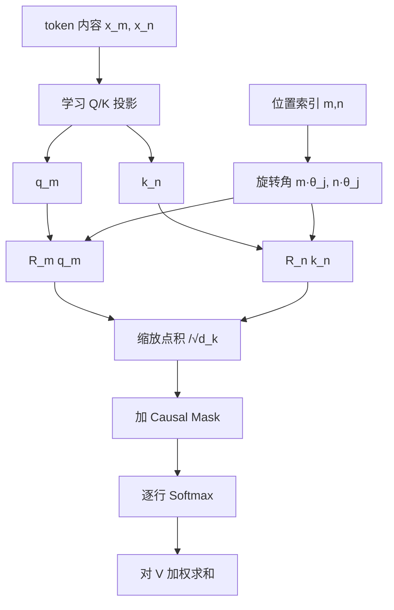

# 人工智能：理论、算法与系统 · 第 17 课

## 位置编码与 RoPE：注意力如何知道顺序和距离？

**2026 年 11 月 5 日｜第 3 周第 3 课｜约 18 分钟**

上一课我们把 Q/K/V、Multi-Head Attention、FFN 和残差连接组装成 Transformer Block。今天要解决一个根本问题：

**如果把“狗咬人”的 token 顺序换成“人咬狗”，为什么一个不含位置机制的 Self-Attention 不能仅凭结构正确理解顺序？**

本课四个学习目标：①证明无位置注意力的**置换等变性**；②解释绝对位置表和正弦位置编码；③从二维旋转严格推导 RoPE 为何使 Q/K 点积依赖相对位移；④理解 causal mask、KV Cache 及超长上下文的理论与工程边界。

### 一、原始 Self-Attention 其实不认识 token 的位置

对长度为 T 的输入矩阵 \(X\in\mathbb R^{T\times d}\)，不加位置编码、不加 mask、没有位置相关 bias 或其他依赖顺序的操作：

\[
Q=XW_Q,\quad K=XW_K,\quad V=XW_V,
\]
\[
\operatorname{Attn}(X)=\operatorname{softmax}_{\mathrm{row}}\!\left(\frac{QK^\top}{\sqrt{d_k}}\right)V.
\]

设 \(P\in\mathbb R^{T\times T}\) 是置换矩阵，将 token 顺序重排。由于投影逐 token 使用同一参数，

\[
Q'=PXW_Q=PQ,\quad K'=PK,\quad V'=PV.
\]

新的打分矩阵因此为：

\[
S'=\frac{(PQ)(PK)^\top}{\sqrt{d_k}}
   =P\left(\frac{QK^\top}{\sqrt{d_k}}\right)P^\top
   =PSP^\top.
\]

左右的 \(P,P^\top\) 只是同步交换分数矩阵的行与列；逐行 Softmax 满足：

\[
\operatorname{softmax}_{\mathrm{row}}(PSP^\top)
=P\operatorname{softmax}_{\mathrm{row}}(S)P^\top.
\]

所以：

\[
\begin{aligned}
\operatorname{Attn}(PX)
&=P\operatorname{softmax}_{\mathrm{row}}(S)P^\top PV\\
&=P\operatorname{Attn}(X).
\end{aligned}
\]

得到：

\[
\boxed{\operatorname{Attn}(PX)=P\operatorname{Attn}(X).}
\]

这叫 **Permutation Equivariance（置换等变）**，不是“输出完全不变”。输入位置被换到哪里，对应输出也被换到哪里；网络本身没有从索引获得“谁在前、谁在后”的独立信息。

**易错反例：** 注意力可以基于内容区分“人”和“狗”，不能说它完全看不出 token 差别。但没有位置机制时，对同一组 token 任意重排，输出只会同步重排，无法凭此建立任意顺序敏感的函数。逐 token FFN、LayerNorm 与残差加法也保留这种等变性（只要不加入其他位置依赖机制）。

### 二、Causal Mask 已经有顺序约束，为什么还研究位置编码？

自回归 Attention 的 causal mask 在 \(j>i\) 时禁止位置 i 读取位置 j。对于三个位置，Mask 为：

\[
M=
\begin{bmatrix}
0&-\infty&-\infty\\
0&0&-\infty\\
0&0&0
\end{bmatrix}.
\]

它打破了上述对**任意 token 置换**的等变性，因为固定三角 mask 通常不满足 \(M=PMP^\top\)。第一个位置只能看自身，第三个位置能看前三个，因而计算图本身具有有向先后关系。

但是必须区分：

**Causal Mask 回答“哪些位置允许被看见”；位置编码回答“当前位置与别的位置的索引或距离怎样进入匹配计算”。**

二者不是相同的算子。Causal Mask 也可能让多层网络间接获得部分位置信息，不能断言“有 mask 仍绝不含任何顺序信息”；更准确的说法是它没有显式提供任意两位置之间的可学习或固定相对相位函数。

### 三、最直接的做法：给 token 加一个绝对位置向量

对第 p 个 token 的 embedding \(x_p\)，给它一个位置向量 \(e_p\)：

\[
\boxed{h_p=x_p+e_p.}
\]

**Learned absolute positional embedding**：将 \(e_0,e_1,\dots,e_{L_{\max}-1}\) 存为可学习的 lookup 表。位置表有额外参数，超出训练或建表长度的位置需要明确扩表、插值或采用其他策略；不能直接索引一个不存在的位置。

**Fixed sinusoidal encoding**：用不同频率的 sin/cos 构造固定位置向量。2017 年的 Transformer 给出（d 为偶数）：

\[
\boxed{\begin{aligned}
PE(p,2j)&=\sin(p\omega_j),\\
PE(p,2j+1)&=\cos(p\omega_j),\\
\omega_j&=10000^{-2j/d},\quad j=0,\dots,d/2-1.
\end{aligned}}
\]

例如 \(d=4\) 时，\(\omega_0=1,\ \omega_1=0.01\)。因此：

\[
PE(0)=(0,1,0,1),
\]
\[
PE(1)=(\sin 1,\cos 1,\sin0.01,\cos0.01).
\]

为什么同时用 sin 与 cos？对频率 \(\omega\)，位置增加 \(\Delta\) 时：

\[
\sin((p+\Delta)\omega)=\sin(p\omega)\cos(\Delta\omega)+\cos(p\omega)\sin(\Delta\omega),
\]
\[
\cos((p+\Delta)\omega)=\cos(p\omega)\cos(\Delta\omega)-\sin(p\omega)\sin(\Delta\omega).
\]

可写成与 p 无关的二维线性变换：

\[
\begin{bmatrix}\sin((p+\Delta)\omega)\\\cos((p+\Delta)\omega)\end{bmatrix}
=
\begin{bmatrix}
\cos(\Delta\omega)&\sin(\Delta\omega)\\
-\sin(\Delta\omega)&\cos(\Delta\omega)
\end{bmatrix}
\begin{bmatrix}\sin(p\omega)\\\cos(p\omega)\end{bmatrix}.
\]

这使模型有机会通过线性投影学习相对位移关系，但**“有固定线性平移关系”不意味着任意模型都必然精确学会相对距离**。绝对编码相加后，打分仍受 token 内容及投影影响。

### 四、RoPE 的核心：不在输入上加位置，而是旋转 Q 和 K

RoPE（Rotary Position Embedding）将每个注意力 Head 中的 Q、K 切成二维分量对，并根据位置旋转它们。先看二维情形。

定义旋转矩阵：

\[
\boxed{
R(\phi)=
\begin{bmatrix}
\cos\phi&-\sin\phi\\
\sin\phi&\cos\phi
\end{bmatrix}.
}
\]

对位置 m 的 Query 和位置 n 的 Key，原始投影分别为 \(q,k\in\mathbb R^2\)，旋转后：

\[
\widetilde q_m=R(m\theta)q,\qquad
\widetilde k_n=R(n\theta)k.
\]

然后计算 Attention 的未缩放 logit：

\[
\begin{aligned}
\widetilde q_m^\top\widetilde k_n
&=q^\top R(m\theta)^\top R(n\theta)k\\
&=q^\top R(-m\theta)R(n\theta)k\\
&=\boxed{q^\top R((n-m)\theta)k}.
\end{aligned}
\]

最后一步使用旋转正交性 \(R(\phi)^\top=R(-\phi)\) 和旋转角相加 \(R(a)R(b)=R(a+b)\)。

**这就是 RoPE 的关键：两位置的绝对相位相消，点积中的位置作用自然变成相对位移 \(n-m\)。**

但请注意精确措辞：分数为 \(q^\top R((n-m)\theta)k\)，**仍然同时依赖 token 内容 q 和 k**；不能说分数“只由距离决定”，也不能从该公式推出距离越大权重越小。

### 五、手算 RoPE：两个位置一起平移会怎样？

设二维旋转每移动一个位置转过 \(\theta=\pi/2\)。取：

\[
q=(1,0),\quad k=(0,1),\quad m=0,\quad n=1.
\]

由于：

\[
R(\pi/2)=\begin{bmatrix}0&-1\\1&0\end{bmatrix},
\]

我们得到：

\[
\widetilde q_0=q=(1,0),\quad
\widetilde k_1=R(\pi/2)(0,1)=(-1,0),
\]

因此点积：

\[
\widetilde q_0^\top\widetilde k_1=-1.
\]

现在把两个位置同时平移 3：\(m'=3,n'=4\)。相对位移仍是 1，所以：

\[
(R(3\theta)q)^\top(R(4\theta)k)
=q^\top R(\theta)k=-1.
\]

如果 Key 改到与 Query 相同的位置，位移变为 0，未旋转内容向量的点积是：

\[
q^\top R(0)k=q^\top k=0.
\]

同一对内容向量、不同相对位移，得到了不同分数。这里选用 \(\pi/2\) 只是方便手算，真实 RoPE 不会让所有维度采用这个相同频率。

### 六、多维 RoPE：每一对维度有不同旋转频率

令用于旋转的 Head 维度 \(d_{\rm rot}\) 为偶数。将 Q/K 拆成 \(d_{\rm rot}/2\) 对二维向量。每一对采用：

\[
\theta_j=b^{-2j/d_{\rm rot}},\quad j=0,\ldots,d_{\rm rot}/2-1,
\]

其中常见基础频率参数 \(b=10000\)，具体模型可使用不同 base 或旋转部分维度。

定义：

\[
\mathcal R_m=\operatorname{blockdiag}(R(m\theta_0),R(m\theta_1),\ldots).
\]

那么：

\[
\boxed{
(\mathcal R_m q)^\top(\mathcal R_n k)
=q^\top\mathcal R_{n-m}k
}
\]

对旋转的全部维度成立。正交旋转还具有：

\[
\|\mathcal R_mq\|_2=\|q\|_2.
\]

常见实现把 RoPE 施加在投影后的 **Q 和 K** 上，通常不对 V 做同样的旋转；随后仍按 \(\sqrt{d_k}\) 缩放、加 causal mask、做 Softmax 并乘 V。

请区分**绝对位置用什么表示**与**相对位置如何影响 score**：RoPE 用绝对索引指定旋转角，但最终 Q/K 点积仅通过相对角度涉及位置差；这是两个相容而非矛盾的描述。

### 七、RoPE、Causal Mask 与 KV Cache 的系统边界

对于自回归 Decode，已有 token 的 Key 可以在其真实位置 n 上旋转并缓存：

\[
K_{\rm cached}[n]=\mathcal R_n k_n.
\]

之后生成位置 m 的新 token 时，对 Query 使用 \(\mathcal R_mq_m\)，读取先前的旋转 Key，不必重新为全部历史 token 计算投影或重复旋转（具体布局取决于实现）。Value 仍存为普通投影结果。

但这要求 **position id 严格一致**。例如复用 prefix、做 padding、分块 prefill 或并行处理多个请求时，若把 Key 当成位置 5 的旋转值，却按位置 105 的语义重用，就可能得到错误的相位关系。RoPE cache 是否可跨不同位置直接复用，取决于位置映射与实现，不能只按文本相等判断。

RoPE 旋转每个 Q/K 元素的额外处理量是 \(O(BTHd_{\rm rot})\) 级别；它没有让标准密集 Self-Attention 的主要 \(O(BT^2d)\) 两两交互消失。基于分块的高效 Attention Kernel 可融合 RoPE 的部分运算，实际延迟由访存、实现与输入形状决定。

### 八、为什么“RoPE 能计算更长位置”不等于“长上下文泛化”？

数学上，整数位置 p 取 2048、8192 或更大，都能代入 \(p\theta_j\) 计算三角函数。这只是**位置函数可定义**。

训练阶段若最多见过 512 token，模型能否在 2048 token 上保持质量，还受训练分布、位置相位范围、数值精度、Attention 竞争关系和任务自身的长程依赖影响。

RoPE 的周期结构也值得注意：单一二维分量的相位会绕圈，同一个频率上可能出现相位重复；多频率联用会丰富区分能力，但不保证任意长度都没有位置混淆。长上下文扩展中的频率缩放、插值等需要特定实验支持，不能仅由相对位移恒等式推出成功。

**研究实验建议：** 在统一 causal Decoder、训练 token 总量、数据、宽度、参数预算（尽量匹配）、优化器与 seed 下，对照 learned absolute lookup、固定 sinusoidal 和 RoPE。训练最大长度设为 512，分别测 512、1024、2048 的验证损失、检索准确率、按距离分组的注意力行为、decode 延迟和峰值 KV 显存；预先规定 learned lookup 越表后如何扩表或插值，避免给某方案不公平优势。

只有性能—成本曲线，才能判断位置机制在特定任务上是否真正改善长上下文能力。

### 九、易错反例与本课总结

| 常见误解 | 严谨理解 |
|---|---|
| 无位置 Self-Attention 的输出完全不变 | 输出对 token 置换**等变**，并非逐位置不变 |
| Causal Mask 就等于 RoPE | Mask 限制可见性，RoPE 把相对相位写入 Q/K 点积 |
| 正弦 PE 只能学绝对位置 | 正弦/余弦满足位置平移的线性变换关系，但效果需训练 |
| RoPE 分数只由距离决定 | 分数还依赖内容 q、k，且不保证随距离单调衰减 |
| RoPE 的 Q/K 范数会被放大 | 纯正交旋转保持各自欧氏范数 |
| 能算出位置 100000 就保证理解 100000 token | 位置函数可定义不代表分布外质量保证 |

本课经典基础包括置换矩阵、Softmax、三角函数与旋转代数。**原始 Transformer 的正弦位置编码发表于 2017 年，RoPE 作为 RoFormer 方法于 2021 年公开提出**；长上下文扩展和实际推理性能属于具体模型与系统的研究问题。

参考原文：Attention Is All You Need（2017），https://arxiv.org/abs/1706.03762；RoFormer: Enhanced Transformer with Rotary Position Embedding（2021），https://arxiv.org/abs/2104.09864。

---

## 十、四级递进自测（100 分）

**首次授课不显示标准答案。** 前三题客观判分，第四题按推导和实验评分；80+ 继续，60–79 针对性补练，低于 60 复习再练。

### Lv1｜位置编码与位置可见性的机制边界（15 分｜预计 2 分钟｜单选）

不含位置编码、位置相关 bias、mask 或 dropout 的 Self-Attention 与 RoPE，以下哪项解释最严谨？

**A.** 无位置 Self-Attention 对任意 token 重排保持完全相同的逐位置输出，因此不必重排结果。

**B.** Causal Mask 与位置编码数学上等价：只要存在下三角 Mask，模型就已经拥有与 RoPE 完全相同的相对距离函数。

**C.** 无位置 Self-Attention 对输入的同步置换具有等变性；RoPE 将位置角度注入 Q/K，使注意力点积能够显式依赖相对位移。

**D.** RoPE 主要对 V 做位置旋转，而 Q、K 的点积分数与位置无关。

*可选提示：区分置换“等变”和“不变”，再检查 Mask 与 Q/K 旋转是否完成同一件事。*

### Lv2｜二维 RoPE 相对旋转前向数值（20 分｜预计 4 分钟｜数值题）

二维旋转 R(φ)=[[cosφ,−sinφ],[sinφ,cosφ]]。未旋转的 q=(1,2)、k=(3,−1)，位置 m=2、n=3，每个位置的旋转角度是 p·θ，θ=π/2。求旋转后点积 (R(mθ)q)ᵀ(R(nθ)k) 的数值（不除以 √d_k）。

请填写十进制数值。

*可选提示：先用旋转正交性把两个绝对角度合并为相对角度 (n−m)θ，再进行二维向量点积。*

### Lv3｜置换对称性、RoPE 相对位移与长上下文边界（25 分｜预计 6 分钟｜多选）

以下判断哪些成立？（多选；假设没有额外位置依赖项；RoPE 使用固定 θ_j，在 Q/K 上按二维组旋转。）

**A.** 无位置编码、无 mask 的标准 Self-Attention，若令 P 为 token 置换矩阵，则输出满足 Attn(PX)=P Attn(X)。

**B.** 对于所有位置 m,n，RoPE 旋转后的注意力分数只由 n−m 决定，与两位置 token 的内容向量无关。

**C.** 在 Q、K 内容向量不变时，同时把两位置 m,n 加上同一个整数偏移，标准 RoPE 中两者的点积保持不变。

**D.** 既然 RoPE 旋转矩阵在任意整数位置都能定义，它就严格保证模型在任意超过训练长度的上下文上保持相同预测质量。

**E.** 标准 RoPE 主要旋转 Q 与 K，而 V 不必作同样的位置旋转；旋转的正交性还使单个 Q/K 的欧氏范数不因旋转改变。

**F.** 加入因果三角 Mask 后，注意力在任意 token 置换下仍具有与完全无遮挡时相同的置换等变性。

*可选提示：分别检查位置差是否是点积的唯一自变量、数学上可定义与泛化保证是否等价，以及 Mask 是否随任意置换保持不变。*

### Lv4｜置换等变证明、位置公式推导和长度外推实验（40 分｜预计 15 分钟｜开放题）

综合推导与实验设计（40 分）：A（12 分）对无 mask、无位置项的 Attn(X)=softmax_row(QKᵀ/√d_k)V，设 Q=XW_Q、K=XW_K、V=XW_V，严格证明任意 token 置换矩阵 P 下 Attn(PX)=P Attn(X)；解释因果 Mask 为什么破坏一般置换等变性。B（8 分）写出 d 为偶数时经典 sinusoidal 位置编码的两维一组公式，并用三角函数加法公式说明固定位置偏移 Δ 如何由位置无关的线性变换联系相应两维表示。C（12 分）定义二维旋转矩阵 R(φ)，从正交性和角度相加公式证明 (R(mθ)q)ᵀ(R(nθ)k)=qᵀR((n−m)θ)k，推广到多维 RoPE，并说明为什么这不意味着注意力分数只由距离决定。D（8 分）设计一个公平实验，对比 learned absolute embedding、sinusoidal PE 与 RoPE：训练长度固定为 512，评估长度包括 512、1024、2048；规定一致的数据、架构、位置索引、训练 token 预算与评估方法；记录长度泛化质量、不同位移上的注意力行为、延迟/显存，并解释为何不能仅靠 RoPE 可计算到更长位置就宣称长上下文能力。

*可选提示：A 写出 P(QKᵀ)Pᵀ 和逐行 Softmax 的变换；B 使用 sin(a+b)、cos(a+b)；C 使用 R(a)ᵀ=R(−a)；D 区分位置机制、训练分布、真正可处理的长度与实际质量。*

---

## 十一、下一课预告

**第 18 课｜2026 年 11 月 6 日｜第三周第 4 课：Transformer 的完整训练目标与 Decoder-only 数据流。** 我们将从 token embedding、位置编码、causal self-attention 到最终 LM head 和交叉熵，逐维度推导自回归 Next-Token Prediction，解释 teacher forcing、训练并行和逐 token decode 的区别，并为第五周 KV Cache 作准备。
