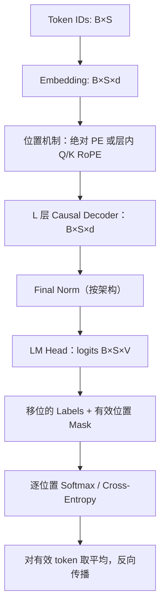

# 人工智能：理论、算法与系统 · 第 18 课

## Decoder-only 语言模型：从 Token 到 Next-Token Cross-Entropy

**2026 年 11 月 6 日｜第 3 周第 4 课｜约 18 分钟**

上一课我们证明了 RoPE 如何将相对位移带入 Q/K 点积。今天把 Transformer 真正变成**能够训练和生成文本的概率模型**。核心问题是：训练时模型已经拿到整段真实文本，为什么仍然是在预测未来？既然训练能同时计算所有位置，推理为什么不能一次生成所有 token？

本课目标：理解自回归概率分解与标签移位；沿着 embedding → causal decoder → LM head → cross-entropy 完整跟踪维度；推导交叉熵梯度；用一个三步数值例子算训练损失；辨析 teacher forcing、并行训练和 KV Cache 的边界。

### 一、语言模型学的不是“整段答案”，而是一串条件概率

设一段文本经 tokenizer 变成 token 序列 \(x_1,\ldots,x_T\)，另有特殊 token \(\mathrm{BOS}\)（起始）和 \(\mathrm{EOS}\)（结束）。给定 BOS 的联合分布满足概率链式法则：

\[
\boxed{
p_\theta(x_1,\ldots,x_T,\mathrm{EOS}\mid\mathrm{BOS})
=\prod_{t=1}^{T+1}
p_\theta(x_t\mid\mathrm{BOS},x_1,\ldots,x_{t-1}),
\quad x_{T+1}=\mathrm{EOS}.
}
\]

这不是 Transformer 独有的定理；**任意联合概率分布都可以链式分解**。Decoder-only Transformer 的设计，是用同一个共享参数网络 \(\theta\) 来表示每个不同长度前缀上的条件分布。

推理时，我们给模型一个已知前缀，然后从预测分布选取下一个 token。把选中的 token 追加到前缀，再预测下一 token，直到 EOS 或达到停止条件。选择方式可以是 greedy、采样等；训练时的最大似然目标本身并不要求一定采用某个解码策略。

### 二、训练输入与目标为什么要错开一位？

考虑一条样本：\([\mathrm{BOS},\text{甲},\text{乙},\mathrm{EOS}]\)。一个常见、便于教学的训练对齐是：

| 位置 | 输入给 Decoder 的 token | 当前位置预测的目标 |
|---|---|---|
| 0 | BOS | 甲 |
| 1 | 甲 | 乙 |
| 2 | 乙 | EOS |

因此 \(\text{inputs}=[\mathrm{BOS},\text{甲},\text{乙}]\)，\(\text{labels}=[\text{甲},\text{乙},\mathrm{EOS}]\)。

位置 1 看见真实的「甲」，并预测下一 token「乙」。**它不应该在自己的输入或 Attention 可见范围里看到「乙」**。

这叫 *teacher forcing*：训练时用真实历史 token 构造条件上下文，而不是把模型刚预测错的 token 再反馈到下一训练位置。

实际工程实现也常使用整个 token 序列作为输入，然后在 loss 中将 logits 与 labels 移位；若实现已经在数据准备阶段移位，不能再错误地移位第二次。BOS、EOS、padding 的具体约定依模型而定，但 **输入/目标对齐必须一致**。

### 三、从 token id 到 logits：完整形状追踪

令 batch size 为 \(B\)，输入长度 \(S\)，词表大小 \(V\)，hidden width 为 \(d\)，Decoder 层数为 \(L\)。

**Embedding。** token id 张量 \(I\in\{0,\ldots,V-1\}^{B\times S}\)，嵌入表 \(E\in\mathbb R^{V\times d}\)，查表得 \(X\in\mathbb R^{B\times S\times d}\)。如果采用绝对位置编码可与 embedding 相加；如果采用 RoPE，通常在各注意力层内对投影后的 Q/K 按 position id 旋转，两者不是同时必需的操作。

**Decoder Blocks。** 用第 16 课的 Pre-Norm 形式作为示例：

\[
U^{(l)}=H^{(l)}+\mathrm{CausalMHA}(\mathrm{Norm}_1(H^{(l)})),
\]
\[
H^{(l+1)}=U^{(l)}+\mathrm{FFN}(\mathrm{Norm}_2(U^{(l)})).
\]

所有隐藏态的外部形状保持 \([B,S,d]\)；MHA 中各 Head 的打分形状可为 \([B,H,S,S]\)，并对未来 Key 位置施加 causal mask。许多架构还会在最后施加一次 Norm。

**LM Head。** 将最终隐藏态 \(H\in\mathbb R^{B\times S\times d}\) 映射为 \(Z=HW_{\mathrm{LM}}+b\)，其中 \(W_{\mathrm{LM}}\in\mathbb R^{d\times V}\)。因此

\[
\boxed{Z\in\mathbb R^{B\times S\times V}.}
\]

每个 \(Z_{b,t,:}\) 是**该位置用于预测下一 token 的 V 个 logits**，并不是 V 个已经归一化的概率。Softmax 后才是 \(p_\theta(\cdot\mid\text{前缀})\)。

一个常见优化是 **weight tying**：若维度匹配，使用 \(W_{\mathrm{LM}}=E^\top\) 共享输入 embedding 与输出投影权重；但不是所有模型都要求共享。



### 四、为什么整段输入在训练时不会泄漏未来？

训练时计算图里确实包含所有真实输入位置，但 **Attention 的 causal mask 限制每个 Query 的可见 Key**：

\[
M_{ij}=\begin{cases}0,&j\le i,\\-\infty,&j>i.\end{cases}
\]

因此第 \(i\) 个位置只汇总 \(j\le i\) 的 Value。证明其对未来 token 的独立性可以用逐层归纳：嵌入层的第 \(i\) 行只依赖该位置 token 和合法的位置信息；若第 \(l\) 层每行只依赖不晚于自己的输入，下一层 causal Attention 的第 \(i\) 行也只依赖 \(\le i\)；逐 token Norm、FFN 和残差不引入跨位置的未来信息，于是输出 logits 的第 \(i\) 行仍只依赖前缀。

**这个结论有前提：** 不能混入跨整个时间轴归一化、泄漏未来的特征工程、错误的 packed sample mask 等其他操作。Padding mask 用于限制哪些输入位置可被读取；loss mask 用于限制哪些目标位置参与损失，它们是两个概念。

### 五、从最大似然推导 Cross-Entropy

对于一个有效训练位置，目标 token 索引为 \(y\in\{0,\ldots,V-1\}\)，模型给出 logits \(z\in\mathbb R^V\)：

\[
p_k=\frac{e^{z_k}}{\sum_{j=0}^{V-1}e^{z_j}}.
\]

最大化正确 token 的对数似然等价于最小化负对数似然：

\[
\ell(z,y)=-\ln p_y
=\boxed{-z_y+\ln\left(\sum_j e^{z_j}\right)}.
\]

这也是 one-hot 目标分布与预测分布之间的交叉熵。为提高数值稳定性，记 \(a=\max_jz_j\)，计算

\[
\boxed{\ell(z,y)=a-z_y+\ln\sum_j e^{z_j-a}.}
\]

这就是 log-sum-exp 的稳定写法，避免直接对极大 logit 求指数而溢出。

**反向梯度。** 对任意 logit 坐标 \(k\)：

\[
\frac{\partial\ell}{\partial z_k}
=-\mathbf1[k=y]+\frac{e^{z_k}}{\sum_je^{z_j}}
=\boxed{p_k-\mathbf1[k=y]}.
\]

所以正确类 logit 获得 \(p_y-1\) 的梯度，其他类为 \(p_k\)。从机制上看，训练鼓励增大目标 token 相对于竞争 token 的 logit。该公式对应单个 token 的 one-hot CE；若采用 label smoothing 或额外正则，梯度需按实际损失修改。

有 padding、忽略标签或不计损失的上下文位置时，用 \(m_{b,t}\in\{0,1\}\) 表示目标是否有效：

\[
\boxed{
\mathcal L
=\frac{\sum_{b,t}m_{b,t}\,[-\ln p_\theta(y_{b,t}\mid\text{合法前缀})]}
{\sum_{b,t}m_{b,t}}.
}
\]

假设分母非零。**分母是有效预测 token 数，不必等于 \(BS\)**；训练代码是否采用 token 平均、sequence 平均或其他权重，必须核对。

### 六、手算一个三位置的训练损失

词表包含 \([\mathrm{BOS},\text{甲},\text{乙},\mathrm{EOS}]\) 四类。输入为 \([\mathrm{BOS},\text{甲},\text{乙}]\)，目标为 \([\text{甲},\text{乙},\mathrm{EOS}]\)。

假设模型三个位置的 logits 依次为：

\[
z_0=(0,\ln3,0,0),\quad
z_1=(0,0,\ln2,0),\quad
z_2=(0,0,0,\ln3).
\]

第一行指数化得到 \((1,3,1,1)\)，因此正确类「甲」概率为 \(3/6=1/2\)。第二行得到 \((1,1,2,1)\)，正确类「乙」概率 \(2/5\)。第三行得到 \((1,1,1,3)\)，正确类 EOS 概率 \(1/2\)。

三位置平均损失为：

\[
\begin{aligned}
\mathcal L
&=-\frac{\ln(1/2)+\ln(2/5)+\ln(1/2)}3\\
&=\boxed{\frac{\ln10}{3}\approx0.76753}.
\end{aligned}
\]

在同一 tokenization、相同有效 token 统计方式下，可定义困惑度 \(\mathrm{PPL}=e^{\mathcal L}=10^{1/3}\approx2.1544\)。不能跨不同 tokenizer、不同标签处理方式直接用 PPL 数字断言模型优劣。

### 七、训练为什么可并行，生成却必须按步推进？

**训练：** 真实输入 \([\mathrm{BOS},x_1,\ldots]\) 已知，因果 mask 为每个位置约束合法前缀；一次 Transformer forward 可以**在同一层同时计算所有位置的预测**。层与层之间仍有顺序依赖，训练反向传播也不是零成本。密集 Attention 的主要两两交互量级为 \(\Theta(BST\,d)\)，当 Query/Key 长度均为 \(S\) 时即 \(\Theta(BS^2d)\)，另有投影 \(\Theta(BSd^2)\) 与 LM head \(\Theta(BSdV)\) 等成本。

**生成：** 假设模型生成 \(x_1\) 后，才能知道下一次要输入的真实生成前缀；若 \(x_1\) 不同，下一次条件分布也可能不同。因此普通逐 token 自回归解码无法简单地把所有未知未来 token 当作确定输入并在一次 forward 全部算出。特定 speculative decoding 等技术可并行做候选和验证，但需要额外机制，不等价于普通 teacher forcing。

训练与推理条件分布在模型定义上相同，但训练常使用**真实前缀**，自由生成使用**模型自己已生成的前缀**。这会带来训练与生成访问前缀的分布差异（常称 exposure bias）；不能由此直接证明某种替代训练方法一定更优。

### 八、Prefill、Decode 与 KV Cache 的第一眼系统分析

假设已有长前缀 \(P\) 个 token，要继续生成 \(G\) 个 token。

**Prefill：** 对已知前缀运行模型，得到其末位置下一个 token 的分布，并为每一层创建合法的历史 Key/Value。

**Decode：** 每生成一个新 token，就对这个 token 计算新的 Query/Key/Value；读取旧 KV 并把新 KV 加入缓存。对于当前可见长度 \(t\)，每个 Head 的新 Query 仍要与最多 \(t\) 个历史 Key 相互作用。因此只计注意力两两交互，单 token 单层算术量约为 \(\Theta(td)\)，而不是 \(\Theta(t^2d)\)。

对具有 \(H_{kv}\) 个 KV Head、每头 K/V 维度均为 \(d_h\) 的单层缓存，batch size \(B\)、缓存长度 \(t\)，元素数为：

\[
\boxed{N_{KV}=2BtH_{kv}d_h.}
\]

若有 \(L\) 层，且每层相同，则乘以 \(L\)；存储 bytes 还要乘每元素字节数。这里忽略分页、对齐和缓存管理元数据。

一次生成从 \(1\) 到 \(G\) 的 attention 两两交互总量，在没有固定前缀、只考虑单层时近似为 \(\sum_{t=1}^G\Theta(td)=\Theta(G^2d)\)。而每次不使用缓存都重算长度 \(t\) 的完整 dense causal 前向时，注意力交互总量是 \(\sum_{t=1}^G\Theta(t^2d)=\Theta(G^3d)\)。这里是特定算法的运算量对比，不直接代表完整推理延迟等比例变化：实际还受权重矩阵读取、batching、HBM 带宽、kernel 和 LM head 影响。

教学伪代码：

```python
# 训练：真实 token 在所有位置已知
inputs = [BOS] + tokens
labels = tokens + [EOS]
logits = decoder(inputs, causal_mask=True)
loss = masked_next_token_ce(logits, labels)
loss.backward()

# 推理：不能把未知 token 当作真实输入
cache, next_logits = prefill(prompt)
while not finished:
    new_token = choose_token(next_logits)
    append_to_output(new_token)
    cache, next_logits = decode_one(new_token, cache)
```

注意：不同 API 对 prefill 返回 logits、decode 接受 token 的约定可能不同；这里表示数据依赖，而非某个框架的直接接口。

### 九、最重要的反例与验证方法

| 常见说法 | 正确理解 |
|---|---|
| 训练看见整句，所以每个位置都看见答案 | 只有 causal mask 和跨位置操作都正确时，早期位置才不会获得未来信息 |
| Teacher forcing 是让模型重复当前 token | 目标通常是**下一个** token，输入/目标错位一格 |
| 训练可并行，所以采样生成也能一次算完 | 训练输入是真实已知序列；自由生成的后续前缀依赖先前生成结果 |
| KV Cache 消除所有长上下文成本 | 它减少历史 K/V 重算，但新 Query 仍需访问历史 Key/Value |
| 有 padding 只需 attention mask | 还需正确的 loss ignore mask，避免无效标签进入平均损失 |
| CE 极小代表真实任务能力全面优越 | CE 只评估指定数据、tokenization 与监督目标上的条件概率拟合 |

两个简单但很有力的单元测试：

**未来泄漏测试：** 固定前 \(k\) 个输入 token，把 \(k+1\) 及之后的 token 全部随机修改；在 eval 模式、相同位置 id 和正确 causal mask 下，前 \(k\) 个 logits 应在数值误差范围内保持一致。若变化明显，检查错误的 mask 或跨时间统计操作。

**缓存一致性测试：** 固定模型参数、eval 模式和精度，对同一前缀分别用完整前向与逐 token KV Cache 前向计算末位置 logits，检查最大绝对误差和相对误差；不能把浮点运算顺序差异误判为原理性不一致。

本课的概率链式法则、极大似然、Softmax 交叉熵及 causal Attention 是经典机制。不同长度上的质量泛化、实际缓存布局、吞吐优化和 speculative decoding 属于具体模型或系统研究，须用明确实验验证。

### 十、四级递进自测（100 分）

首次授课**不展示正确答案**。前三题由网站客观判分，第四题按明确要点评分；80 分及以上继续，60–79 分针对性补练，低于 60 分复习再练。

#### Lv1｜Teacher Forcing 的机制边界（15 分｜预计 2 分钟｜单选）

在 Decoder-only 自回归语言模型中，关于 teacher forcing、causal mask 和真实生成过程，哪项说法最准确？

**A.** 因为训练时已经知道整句目标，teacher forcing 不必使用 causal mask，也不会发生目标泄漏。

**B.** 位置 t 的训练输入直接包含目标 x_(t+1)，因此预测它不算信息泄漏。

**C.** Teacher forcing 用真实历史 token 作输入，可在正确因果掩码下并行计算多个位置的条件分布；自回归生成仍必须按已生成前缀逐步确定新 token。

**D.** LM head 对所有位置必然输出相同的概率分布，因此能并行计算并无实际意义。

*可选提示：区分“已知整段训练数据”“每个位置合法可见的前缀”和“生成时尚未确定的未来 token”。*

#### Lv2｜带忽略位置的 Token Cross-Entropy 数值（20 分｜预计 4 分钟｜数值题）

词表大小 V=3（索引 0、1、2）。一个样本的三个位置的目标索引依次为 [1,2,忽略]，有效掩码 m=[1,1,0]。前两个位置的 logits 分别为 (0,ln 2,0) 与 (0,0,ln 3)，第三位置任意。使用自然对数、按有效 token 数平均的交叉熵 L=−Σ_t m_t log p_t(y_t)/Σ_t m_t。求 L 的十进制数值（至少四位小数）。

*可选提示：分别指数化得到两行正确标签概率；第三行不计入分子和分母，分母不是序列长度 3。*

#### Lv3｜因果训练、计算复杂度与缓存边界（25 分｜预计 6 分钟｜多选）

设输入形状 [B,T,d]，H 个 Head，标准密集 causal Self-Attention，词表大小 V，训练使用正确移位标签；在推理阶段采用标准 KV Cache。以下哪些判断成立？（多选）

**A.** 一个训练前向中，虽然位置 t 不能看到未来 token，仍能在同一层并行计算多个位置的 Query 及注意力输出；朴素的全部头得分张量有 BHT² 个元素。

**B.** 用输入位置 t 的 logits 预测同一位置的输入 token x_t，总能构成正确的 next-token 训练目标。

**C.** KV Cache 允许增量 decode 复用历史 K/V，避免为已处理 token 反复进行全部层的 K/V 投影，但新 Query 通常仍需与允许的历史 Key 做交互。

**D.** 若显式保存每位置的全词表 logits，其张量元素数为 BTV，输出头密集乘法的典型算术量级为 Θ(BTdV)。

**E.** 使用因果三角 mask 后，任意密集精确 Attention 的训练计算量都严格从 Θ(T²) 变成 Θ(T)。

**F.** 使用真实前缀的 teacher forcing，可以一次前向获得序列各有效位置的 next-token 条件分布，而不需要先采样前一个预测 token。

*可选提示：将训练同层的矩阵计算、标签移位、逐步生成的时间依赖、KV Cache 的复用范围，以及显式 logits 的形状分别判断。*

#### Lv4｜自回归建模、CE 梯度、并行边界与验证实验（40 分｜预计 15 分钟｜开放题）

综合推导题（40 分）。A（12 分）：给定 BOS、真实 token x₁…x_T 及 EOS，写出自回归联合概率的链式分解，构造训练输入/移位标签，并证明在每层仅使用 causal Attention、逐 token Norm/FFN 和残差的条件下，位置 t 的 logits 不会依赖未来输入。B（10 分）：从 logits z∈R^V 推导单 token 交叉熵 ℓ=−log softmax(z)_y 的 log-sum-exp 形式和对 z_k 的梯度；写出含忽略位置掩码的全批损失。C（10 分）：解释为何一次 teacher-forcing 前向可并行计算多个位置，而自回归采样必须跨步顺序依赖；分别给出单层密集训练注意力 O(T²d)、缓存增量 decode 第 t 步 O(t d)（只计主要注意力两两交互）、长度 T 的 KV 存储量表达式并注明假设。D（8 分）：设计两个验证实验：未来 token 扰动不应改变较早位置 logits；正确 KV Cache 与全前缀重算在 eval、固定位置 id 下应数值接近。说明控制变量及检查指标。

*可选提示：A 从 p(x₁,…,EOS|BOS) 的链式法则和逐层归纳入手；B 用 −z_y+logΣe^z；C 区分同层位置并行与跨生成步依赖；D 先固定 dropout、mask、位置索引再比较 logits。*

### 十一、下一课预告

**第 19 课｜2026 年 11 月 7 日｜第三周第 5 课：Encoder-only、Decoder-only 与 Encoder–Decoder 的架构差异。** 我们将从注意力可见性矩阵、双向表征与自回归因子分解对比 BERT-style Masked LM、GPT-style causal LM 和 T5-style seq2seq，并解释各自的任务适配与推理成本；下周内仍会继续位置机制与 Transformer 主题，周末按自然日进行第三周复盘。
