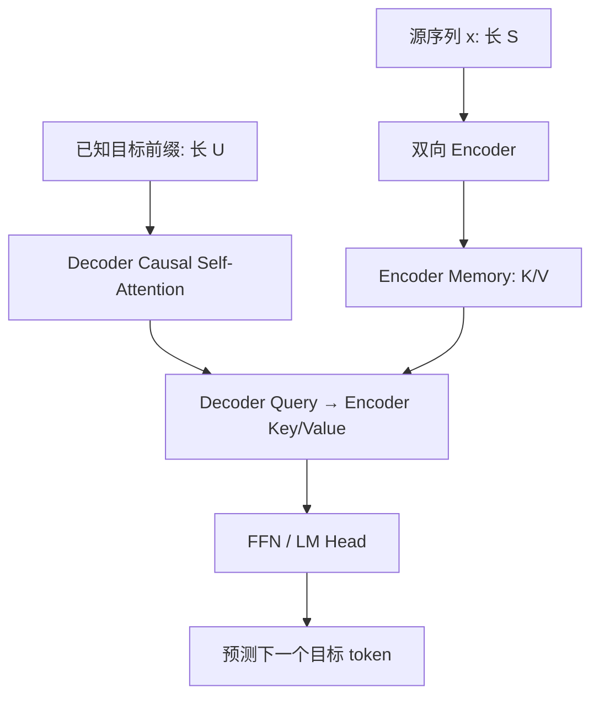

# 人工智能：理论、算法与系统 · 第 19 课

## Encoder-only、Decoder-only 与 Encoder–Decoder：同为 Transformer，为什么行为不同？

**2026 年 11 月 7 日｜第 3 周第 5 课｜约 18 分钟**

上一课我们将 Token Embedding、Causal Decoder、LM Head 与 Next-Token Cross-Entropy 接成一个完整语言模型。今天更进一步：**为什么 BERT 可以同时利用一个词左右的上下文，GPT 通常从左往右生成，而 T5 能先读完整输入再逐步生成输出？**

今天四个目标：分清网络架构、可见性与训练目标；手写三类 Attention Mask；推导 MLM 与条件生成的训练损失、Cross-Attention 的形状和数值；定量比较三种架构的计算、缓存与任务边界。

### 一、不要把“模型结构”和“训练目标”当作同一个概念

网络架构回答**有哪些模块**；Attention Mask 决定**每个 Query 可读取哪些 Key**；训练目标规定**监督哪些 token、优化什么概率**。三者有关联，但并非一一绑定。

| 典型家族 | 模块 | 信息可见性 | 常见训练目标 |
|---|---|---|---|
| BERT-style Encoder-only | 仅 Encoder | 输入有效 token 之间双向可见 | Masked Language Modeling（MLM）；原始 BERT 另有 NSP |
| GPT-style Decoder-only | 仅因果 Decoder | 只能看当前及以前位置 | Next-Token / Causal LM |
| T5-style Encoder–Decoder | Encoder + Decoder + Cross-Attention | Encoder 双向；Decoder 自注意力因果；Decoder 可读完整源 | 条件序列生成；T5 预训练常用 Span Corruption |

这是**代表性搭配**：Encoder 也能做对比学习和分类，Decoder-only 也能生成分类标签或接分类头，Encoder–Decoder 也能使用其他预训练损失。不能把“通常适合”写成“结构上不可能做另一类任务”。

### 二、三种 Mask 的数学形状

用 \(0\) 表示允许读取，\(-\infty\) 表示禁止读取。在 Softmax 前给打分矩阵加上 Mask：

\[
P=\operatorname{softmax}_{\mathrm{key}}\left(\frac{QK^\top}{\sqrt{d_k}}+M\right).
\]

下面不考虑 padding。

**Encoder 双向 Self-Attention：** 假设三个输入 token「甲、乙、丙」，所有位置都能读完整输入：

\[
\boxed{M_{\mathrm{enc}}=
\begin{bmatrix}
0&0&0\\0&0&0\\0&0&0
\end{bmatrix}.}
\]

所以位置 1 的编码表示可以使用位置 3 的内容。对理解任务有用，但如果要预测被输入端直接暴露的目标词，就有抄答案风险。

**Decoder Causal Self-Attention：**

\[
\boxed{M_{\mathrm{dec}}=
\begin{bmatrix}
0&-\infty&-\infty\\
0&0&-\infty\\
0&0&0
\end{bmatrix}.}
\]

结合移位标签，第 \(i\) 个位置的 Logits 不会依赖其右侧真实输入 token。

**Encoder–Decoder Cross-Attention：** 若源长 \(S=3\)，目标 Decoder 输入长 \(U=2\)，两个 Decoder Query 都能读取三个源 Key：

\[
\boxed{M_{\mathrm{cross}}=
\begin{bmatrix}
0&0&0\\
0&0&0
\end{bmatrix}\in\mathbb R^{2\times3}.}
\]

它**不是下三角 Mask**，也不一定是方阵。但目标 Decoder 自注意力仍须使用 \(2\times2\) 因果 Mask；否则可能泄漏未来目标。源侧 padding 还需单独屏蔽。



### 三、BERT-style MLM：为什么双向注意力不等于预测任务自动成立？

假设原始文本是「我 喜欢 机器 学习」。我们想训练位置 2 的模型表示来预测「喜欢」。如果将整个未改变的句子送给双向 Encoder，又要求它从位置 2 直接预测「喜欢」，模型可以通过读取当前位置的输入轻易完成任务。**MLM 必须规定监督集合和扰动输入。**

设原始 token 序列为 \(x=(x_1,\dots,x_S)\)，随机选择待预测集合 \(\mathcal M\)，根据它得到扰动序列 \(\widetilde x=\mathrm{Corrupt}(x,\mathcal M)\)。对 \(|\mathcal M|>0\) 定义：

\[
\boxed{
\mathcal L_{\mathrm{MLM}}
=-\frac{1}{|\mathcal M|}
\sum_{i\in\mathcal M}\log p_\theta(x_i\mid\widetilde x).
}
\]

如果「喜欢」被替换成 [MASK]，模型看见「我 [MASK] 机器 学习」，可以利用左右两侧预测原词。损失通常只在**选中位置**计算，而不是在所有位置计算。

原始 BERT 预训练选中约 **15%** 的 token 位置作 MLM 监督。被选中位置按 **80% 换成 [MASK]、10% 替换成随机词、10% 保留原词** 的策略处理。尤其要注意：**监督集合不等于实际出现 [MASK] 的集合**。保留原词的个别被选中位置有直接读取目标的可能，这是一种混合训练扰动策略，不应误述为“所有目标都严格隐藏”。

原始 BERT 还使用 Next Sentence Prediction（NSP），但那是特定预训练配方，不是双向 Encoder 必需的训练目标。

**MLM 与完整序列概率的区别：** MLM 的平均损失是在扰动输入条件下预测选中位置，它本身不直接定义左到右的联合概率分解：

\[
p(x_1,\ldots,x_S)=\prod_i p(x_i\mid x_{<i}).
\]

所以不能直接把 MLM Loss 当作上述完整自回归联合分布的负对数似然。Encoder-only 也并非在数学上“不能生成”：可以迭代填空，但那不是标准左到右的自由生成。

### 四、GPT-style Decoder-only：同一个网络如何同时训练多个时间步？

由概率链式法则，给定 BOS，序列 \(x_1,\ldots,x_T\) 及 EOS 的联合概率可表示为：

\[
\boxed{
p_\theta(x_1,\ldots,x_T,\mathrm{EOS}\mid\mathrm{BOS})
=\prod_{t=1}^{T+1}p_\theta(x_t\mid\mathrm{BOS},x_{<t}),
\quad x_{T+1}=\mathrm{EOS}.
}
\]

训练时使用真实上下文（Teacher Forcing）：输入 \([\mathrm{BOS},x_1,\ldots,x_T]\)，标签 \([x_1,\ldots,x_T,\mathrm{EOS}]\)，Causal Mask 确保每个输出仅依赖合法前缀。等权有效 token 的目标为：

\[
\boxed{
\mathcal L_{\mathrm{CLM}}
=-\frac{1}{T+1}\sum_{t=1}^{T+1}
\log p_\theta(x_t\mid\mathrm{BOS},x_{<t}).
}
\]

这让训练时的已知前缀可**并行前向计算**。实际生成时 \(x_t\) 要先从上一步预测中选出，才能作为下一步的条件输入，因此存在跨生成步依赖。训练配方也可能不显式监督 EOS，或用 Loss Mask 忽略某些位置，这里选择完整序列作教学范式。

**反例：** Decoder-only 也能完成分类，只需将类别转为目标 token 或接分类头；“Decoder-only 只会生成、完全无法理解文本”是不准确的。

### 五、T5-style Encoder–Decoder：从源文本读信息、向目标逐步写答案

例如翻译：源句是英文 \(x=(x_1,\ldots,x_S)\)，目标是中文 \(y=(y_1,\ldots,y_U)\)。

Encoder 双向计算源表示：

\[
H=\operatorname{Encoder}(x)\in\mathbb R^{B\times S\times d}.
\]

Decoder 只读取已经给定的真实目标前缀（训练）或已生成前缀（推理），但可以通过 Cross-Attention **读取全部有效源表示**。给定源序列，目标的条件联合概率：

\[
\boxed{
p_\theta(y_1,\ldots,y_U,\mathrm{EOS}\mid x)
=\prod_{t=1}^{U+1}p_\theta(y_t\mid y_{<t},x),
\quad y_{U+1}=\mathrm{EOS}.
}
\]

常见训练用移位后的 Decoder Inputs \([\mathrm{BOS},y_1,\ldots,y_U]\) 预测 Labels \([y_1,\ldots,y_U,\mathrm{EOS}]\)，对应平均条件负对数似然：

\[
\boxed{
\mathcal L_{\mathrm{seq2seq}}
=-\frac1{U+1}\sum_{t=1}^{U+1}\log p_\theta(y_t\mid y_{<t},x).
}
\]

此处 BOS 只是统一教学符号；例如 T5 的实际 Decoder 起始 token 约定可以不同。

**T5 的去噪预训练**可以把连续 token span 替换为特殊 sentinel，再让 Decoder 自回归输出被遮蔽的 span 及对应 sentinel。例如「甲 乙 丙 丁 戊 己」遮住「乙 丙」和「戊」，Encoder 输入可为「甲 <extra_id_0> 丁 <extra_id_1> 己」，Decoder 目标为「<extra_id_0> 乙 丙 <extra_id_1> 戊 <extra_id_2>」，末尾再加 EOS（具体 sentinel 终止约定按实现）。这与 BERT 在选中位置独立分类的 MLM 目标有明显区别：**恢复缺失内容也被表示为一个有顺序的目标序列生成问题。**

### 六、Cross-Attention：为什么是 U×S，而不是 U×U？

假设单头 Decoder 状态 \(D\in\mathbb R^{B\times U\times d}\)，Encoder 输出 \(H\in\mathbb R^{B\times S\times d}\)，则：

\[
Q=DW_Q\in\mathbb R^{B\times U\times d_k},
\quad K=HW_K\in\mathbb R^{B\times S\times d_k},
\quad V=HW_V\in\mathbb R^{B\times S\times d_v}.
\]

所以：

\[
\boxed{\mathrm{CrossAttn}(D,H)=
\operatorname{softmax}_{\mathrm{source}}
\left(\frac{QK^\top}{\sqrt{d_k}}+M\right)V.}
\]

单头的 logits 形状是 \([B,U,S]\)，输出形状 \([B,U,d_v]\)。Softmax 的归一化轴是源序列 Key 位置。多头时再增加 Head 维。

**数值例子：** \(d_k=2\)，单个 Decoder Query \(q=(1,0)\)，源侧 Key 为 \(k_1=(\sqrt2\ln3,0)\)、\(k_2=(0,0)\)，Value 为 \(v_1=(2,0)\)、\(v_2=(0,4)\)。缩放 logits 是 \((\ln3,0)\)，Softmax 权重是 \((3/4,1/4)\)，输出：

\[
\boxed{o=\tfrac34(2,0)+\tfrac14(0,4)=(1.5,1).}
\]

Cross-Attention 读的是**已经编码的源表示**，并不是直接复制源 token；注意力权重也不自动等价于可靠的人工词对齐。

### 七、计算量、缓存与系统直觉

令源长 \(S\)、目标长 \(U\)、批量 \(B\)、多头合计宽度 \(d\)。只统计标准稠密 Attention 中的主要 QKᵀ 与对 V 的加权聚合（忽略投影、FFN 和 LM Head），则：

| 通路 | 每层主要两两交互复杂度 |
|---|---:|
| Encoder Self-Attention | \(\Theta(BS^2d)\) |
| Decoder Causal Self-Attention | \(\Theta(BU^2d)\) |
| Decoder Cross-Attention | \(\Theta(BSUd)\) |

若比较一层 Encoder 和一层 Decoder 的注意力部分，合起来为：

\[
\boxed{\Theta(B(S^2+U^2+SU)d).}
\]

如果 Decoder-only 将源和目标前缀拼接成长度 \(S+U\) 的因果序列，标准稠密自注意力主要交互为 \(\Theta(B(S+U)^2d)\)。这只是单层的算术量对照，不意味着参数量、网络深度或实现相同，更不能直接断言哪一种架构墙钟时间更快。

在自回归生成时，Encoder 对固定源序列一般**只计算一次**。Encoder 输出和各层 Cross-Attention 的源侧 K/V 可以预先计算并缓存。生成一个新目标 token 时，单层新的 Cross Query 仍须读取 \(S\) 个源 Key 和对应 Value，主要两两交互量级仍约为：

\[
\boxed{\Theta(BSd).}
\]

目标 Decoder 的自注意力也要维护逐步增长的历史 KV Cache。缓存省掉重复编码与重复投影，**没有让访问完整源的开销消失**。性能评估应区分源编码时间、首 token 延迟、后续 token 延迟、吞吐与峰值缓存显存。

### 八、研究实验：不能用不同配方的模型直接证明架构优劣

一种模型在分类任务上表现更好，并不只由是否“双向”决定；可能同时受到语料、Tokenization、预训练目标、模型规模、数据污染、训练 FLOPs、微调方法等因素影响。

设计公平比较时，应明确任务和输出协议，至少覆盖分类准确率/F1、翻译 chrF/BLEU、单 token 填空准确率及 span 填空 exact match；记录验证损失、时延、显存和计算预算。尽量匹配训练数据、总参数量、训练 token/FLOPs，另给等墙钟时间对照；提供相同调参机会与多个随机种子。如果直接比较现成 BERT/GPT/T5，应明确它属于**系统级比较**，不能孤立归因到架构。

三个最小诊断：
1. **MLM 监督：** 确认只在选中的集合计算 Loss，且没有把“被选中”误认为“必然换成 [MASK]”。
2. **Decoder 因果性：** 固定已知目标前缀，改变未来目标 token；比较较早位置 Logits，在 Eval 模式等设置一致时应仅存在数值级差异。
3. **Cross-Attention 轴：** 分数形状应为 \(U\times S\)，Softmax 对源 Key 轴归一化，Padding 源位置不能被分配有效权重。

教学伪代码（展示训练数据流，不代表某框架的完整 API）：

```python
def bert_style_mlm(raw_tokens):
    positions = choose_prediction_positions(raw_tokens)
    corrupted = corrupt_input(raw_tokens, positions)
    hidden = encoder_bidirectional(corrupted)
    return ce_on_selected_positions(hidden, raw_tokens, positions)

def gpt_style_clm(tokens):
    x, labels = shift_right_input_and_next_token_labels(tokens)
    logits = decoder_causal(x)
    return ce_on_valid_labels(logits, labels)

def t5_style_seq2seq(source, target):
    memory = encoder_bidirectional(source)
    x, labels = teacher_force_with_shift(target)
    logits = decoder_causal_cross_attention(x, memory)
    return ce_on_valid_labels(logits, labels)
```

### 九、本课总结：三个公式与三个错误边界

**三种概率机制：** MLM 预测给定受扰动全文的选中 token；Causal LM 建模 \(\prod_t p(x_t|x_{<t})\)；Seq2seq 建模 \(\prod_t p(y_t|y_{<t},x)\)。

**三种注意力：** 双向 Encoder 的 \(S\times S\)；因果 Decoder 的 \(U\times U\) 下三角；Decoder→Encoder Cross 的 \(U\times S\)。

**三个反例：** Encoder-only 不是绝对不能生成；Decoder-only 不是绝对不能分类；Cross-Attention 并不会自动免除 Decoder 的因果 Mask。

本课的 Mask、链式法则、矩阵形状与复杂度推导是经典机制；具体 BERT、T5 的预训练配方及模型效果应以论文和受控实验证据为准。经典参考：*Attention Is All You Need*（2017，https://arxiv.org/abs/1706.03762），*BERT*（2018，https://arxiv.org/abs/1810.04805），*T5*（2019，https://arxiv.org/abs/1910.10683）。

### 十、四级递进自测（100 分）

**首次授课不展示标准答案。** 前三题客观判分，第四题按推导、设计与实验评分。总分 80 分及以上继续；60–79 分针对性补练；低于 60 分复习再练。

#### Lv1｜架构、监督与泄漏机制（15 分｜预计 2 分钟｜单选）

关于 BERT-style MLM、Decoder-only 自回归训练和 T5-style Encoder–Decoder，以下哪项机制判断最准确？

**A.** MLM 使用双向注意力，所以直接将全部未扰动原文送入 Encoder 并预测原词，也天然不会发生目标泄漏。

**B.** 原始 BERT 先选择 MLM 监督位置，再对这些位置实施输入扰动；选中位置不一定全部替换为 [MASK]。标准 Decoder-only 的 Next-Token 目标则用移位标签和因果可见性。

**C.** Decoder-only 的下三角因果 Mask 允许位置 i 读取 i+1 的真实输入，因而与双向 Encoder 可见性相同。

**D.** Encoder–Decoder 已能通过 Cross-Attention 读取源序列，Decoder 的 Self-Attention 因而无需因果 Mask。

*可选提示：辨别监督位置、输入是否被扰动、Decoder 对未来目标是否可见这三件事。*


#### Lv2｜Cross-Attention 数值前向（20 分｜预计 4 分钟｜数值）

一个单头 Cross-Attention 的 Decoder Query 为 q=(√2,0)，Encoder 的三个 Key 依次为 k₁=(ln2,0)、k₂=(0,0)、k₃=(ln3,0)，d_k=2；对应的标量 Value 为 v₁=1、v₂=4、v₃=7，所有源位置均合法。计算 o=softmax(qKᵀ/√d_k)V，填写十进制数。

*可选提示：先求缩放后的三个 logits；求指数、逐行归一化，再对三个 Value 加权求和。*


#### Lv3｜复杂度和建模边界（25 分｜预计 6 分钟｜多选）

源长 S、目标长 U、批量 B、Head 合计宽度 d，假定标准稠密注意力且只统计 QKᵀ 与 AV 两两交互，不计投影。Encoder–Decoder 的 Encoder 双向、Decoder 因果，Cross-Attention 由 Decoder Query 读取 Encoder K/V；Decoder-only 把源和目标前缀拼成长度 S+U 的因果序列。下列哪些陈述成立？（多选）

**A.** Encoder Self-Attention、Decoder Self-Attention 和 Cross-Attention 的主要交互复杂度分别为 Θ(BS²d)、Θ(BU²d)、Θ(BUSd)。

**B.** Cross-Attention logits 一定为 U×U，因为它的 Q/K/V 全部来自 Decoder。

**C.** 若缓存 Encoder 输出与投影后的 Cross K/V，生成一个新目标 token 的单层 Cross-Attention 仍需约 Θ(BSd) 的两两交互。

**D.** Decoder-only 将源和目标串联后，注意力成本严格是 Θ(B(S²+U²)d)，不存在目标访问源位置的交互项。

**E.** 只在选中位置求和的 MLM 损失不能直接等同于标准左到右整句联合分布的负对数似然。

*可选提示：先写每个 QKᵀ 的行列长度；再区分仅监督部分位置的条件预测与对完整序列的自回归链式分解。*


#### Lv4｜Mask、概率分解与实验方案（40 分｜预计 15 分钟｜开放题）

综合推导与实验（40 分）。A（12 分）：源长 3、目标 Decoder 输入长 2，分别写出 Encoder 双向 Self-Attention、Decoder 因果 Self-Attention、Decoder→Encoder Cross-Attention 的可见性矩阵（用 0 和 −∞ 表示），并写出 Cross-Attention 的 Q/K/V 来源及尺寸。B（10 分）：推导 BERT-style MLM 对选中集合 M 的条件交叉熵，以及给定源 x 的 Seq2seq 在 Teacher Forcing 下对目标 y₁…y_U 与 EOS 的概率分解；指出两者为何不是同一种联合生成目标。C（10 分）：求三类注意力两两交互的复杂度，并解释在自回归 Decode 时 Encoder 输出及 Cross K/V 缓存的收益和仍存在的成本。D（8 分）：设计在分类、翻译、单词/片段填空上比较三架构的公平实验，给出标签泄漏检查、预算控制、质量与显存/延迟指标，并识别架构和训练目标的混杂因素。

*可选提示：A：矩阵行是 Query、列是 Key；B：先明确 MLM 只对选中位置算损失；C：Cross 的 Query 长 U、Key 长 S；D：不能用现成不同规模的 BERT/GPT/T5 直接证明架构优劣。*

### 十一、下一课预告

**第 20 课｜2026 年 11 月 8 日｜第三周第 6 课：Attention 反向传播与内存优化。**

从 \(O=\operatorname{softmax}(QK^\top/\sqrt{d_k})V\) 出发，推导 Q/K/V 的梯度，比较直接物化注意力矩阵、重计算与分块在线 Softmax 的空间—带宽权衡；由此为后续推理系统的 KV Cache、FlashAttention 做准备。**第 21 课（11 月 9 日）为第三周复盘**。
