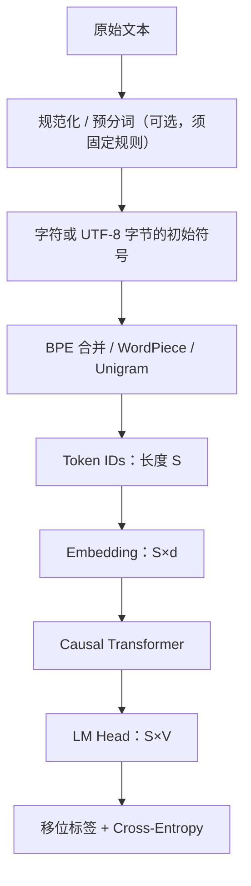

# 人工智能：理论、算法与系统 · 第22课

## Tokenization 与 BPE：为什么文本长度不等于 Token 数？

**2026年11月10日｜第4周第1课｜约18分钟**

上周我们把 Token Embedding、Attention、RoPE、LM Head 和交叉熵连接成完整的 Transformer。本周转向预训练。首先要弄清模型实际上看到的是什么：模型不直接处理“词”或 Unicode 字符，而是处理 Tokenizer 产生的一串整数 ID。

**本课目标：**（1）区分字符、词、字节和子词的表示边界；（2）手推 Byte Pair Encoding（BPE）的训练与编码；（3）比较 BPE、WordPiece、Unigram 和 byte-level 的关系；（4）从序列长度、Embedding、LM Head 与公平评估的角度理解 Tokenizer 的系统代价。

### 一、Tokenizer 是模型的一部分，不只是文本预处理

对于原始文本 \(x\)，Tokenizer 定义一个离散化映射：

\[
\tau(x)=(t_1,\ldots,t_S),\qquad t_i\in\{0,\ldots,V-1\}.
\]

其中 \(S\) 是编码后 Token 数，\(V\) 是词表大小。模型通过 \(E\in\mathbb R^{V\times d}\) 查表，得到 \([S,d]\) 的输入向量。Tokenizer、词表版本、特殊 Token ID 与模型权重共同决定模型含义；把已经训练好的模型换上一套 ID 不同的 Tokenizer，通常会破坏输入 Embedding 与输出分类索引的一致性。

一条典型的数据流是：



一个容易忽视的事实是：**Token 不是“词”的同义词**。英文单词可能是一个 Token，也可能分成多个；中文字符可能是一个 Token，也可能被拆成数个字节级符号；空格、标点和特殊标记也可能占用 Token。具体分解完全取决于 Tokenizer 与文本输入。

### 二、四种粒度：为什么需要子词？

| 表示单位 | 优点 | 主要代价 |
|---|---|---|
| 整词 Word | 常见词通常序列较短 | 词表巨大，未登录词（OOV）及多语言覆盖困难 |
| 字符 Character | 不常依赖固定词典 | 序列更长，字符集合可能大；Unicode 字符不等于字节 |
| 字节 Byte | 固定 256 种基本 byte 值，覆盖 UTF-8 文本 | 某些字符需多步表示，序列可能很长 |
| 子词 Subword | 常见片段合并，罕见词拆小，折中词表与序列长度 | 切分不一定符合语言学词素；不同语言压缩率可能不同 |

一个精确数值例子：字符「中」的 UTF-8 编码是十六进制字节 `E4 B8 AD`，共 **3 字节**；英文字母 `A` 的 UTF-8 编码为 `41`，只有 **1 字节**。Byte-level BPE 可从 256 种字节值开始，但经过合并后，「中」在某个具体词表中**可能**成为一个 Token，也可能仍需要多个 Token；不能简单断言“一个汉字=三个 Token”。

若规范化、非法字节替换或预分词发生了不可逆修改，就不能仅凭“基于字节”断言能无损恢复**原始**文本。下文讨论可逆性时假设采用可逆的字节映射与兼容的处理流程。

### 三、BPE 训练：寻找“当前最常出现的相邻符号对”

BPE 的一种经典子词训练形式是：先将每个预分词单元拆成初始符号，再反复统计**单元内部**相邻符号对的出现次数，选择出现次数最多的 pair，合并成新符号并记录规则。一个最简抽象：

\[
(a^\*,b^\*)=\arg\max_{(a,b)}\sum_{w\in\mathcal C}\#_w(a,b),
\]

其中 \(\#_w(a,b)\) 是单元 \(w\) 中相邻 pair 的次数。需要规定平局处理规则，且每轮合并后必须重新统计相邻 pair。真实实现可能包含预分词、词频权重、结束标记、字节映射和其他约束。

**手算例子**：把每个串视为独立的预分词单元，训练语料为

\[
\mathcal C=[\texttt{abab},\,\texttt{abab},\,\texttt{abac}].
\]

初始符号序列：

\[
[a,b,a,b],\quad[a,b,a,b],\quad[a,b,a,c].
\]

相邻对的计数为：

\[
\#(a,b)=5,\quad \#(b,a)=3,\quad \#(a,c)=1.
\]

**第一次合并**：\((a,b)\to ab\)。序列变成：

\[
[ab,ab],\quad[ab,ab],\quad[ab,a,c].
\]

这时 \((ab,ab)\) 出现两次，其他两个相邻对各出现一次。

**第二次合并**：\((ab,ab)\to abab\)。得到：

\[
[abab],\quad[abab],\quad[ab,a,c].
\]

整个语料从初始 12 个字符符号减少为 5 个 Token。请检查：最初两个 `abab` 各有 4 个符号，`abac` 也有 4 个，共 12；合并完成后是 \(1+1+3=5\)。

训练得到的词表不仅包括基础符号，还包括 `ab` 和 `abab`；**训练语料里出现过的字符串，不一定都成为独立 Token**。

### 四、BPE 编码：重放已学习规则，不重新训练

把新文本编码时，使用的是**已经学习并固定下来的 merge 排序和预分词规则**，不是在这条新句子内部重新统计最常见 pair。

上例中，按先前顺序执行：

\[
(a,b)\to ab,\qquad(ab,ab)\to abab.
\]

则新输入 `abab` 编成 `[abab]`，而 `abac` 编成 `[ab,a,c]`（均假设词边界与训练例子相同）。

教学伪代码如下：

```python
def learn_bpe(units, num_merges):
    rules = []
    for _ in range(num_merges):
        counts = count_adjacent_pairs_within_units(units)
        pair = deterministic_argmax(counts)
        rules.append(pair)
        units = merge_nonoverlapping_occurrences(units, pair)
    return rules

def encode_bpe(unit, learned_rules):
    pieces = initial_symbols(unit)
    for pair in learned_rules:  # 从训练中学到的优先级
        pieces = merge_nonoverlapping_occurrences(pieces, pair)
    return pieces
```

真实 BPE 编码器可用优先队列等结构加速，并不需要每次显式扫描所有规则。不要把 BPE 错写成“直接从词表里永远选最长片段”：**合并顺序本身是模型规范的一部分**，任意词表的最长匹配与规则重放不必相同。

### 五、BPE、WordPiece、Unigram：相近但不是同一算法

BPE 依据训练数据中 pair 的频次逐步建立合并规则；WordPiece 的常见编码策略是使用词表进行最长前缀匹配，训练时选择子词候选的准则与直接按原始 pair 频数排序不同；Unigram 则从较大的候选子词集合出发，学习每种片段的概率并逐渐删减不重要的候选，可基于概率为文本选择分段。

| 算法 | 核心训练/编码思路 | 需要谨慎的地方 |
|---|---|---|
| BPE | 频次驱动的逐步合并；编码遵循已学合并优先级 | 未必找到全局最短分段 |
| WordPiece | 常见实现依据词表最长匹配；训练评分不等同于原始 pair 频数 | 不能认为与 BPE 的 merge 列表完全一致 |
| Unigram | 给子词候选概率，搜索/采样合适切分 | 不应说它只有一种固定的逐次合并规则 |
| Byte-level BPE | **字节初始字母表 + BPE** | “Byte-level”描述初始符号，不是与 BPE 并列的训练算法 |

**SentencePiece 是一个分词工具框架**，能够支持 Unigram 或 BPE 等模型，而不等同于 Unigram 算法本身。对中文及多语言数据，是否先按空格拆词、如何保留空白和是否规范化，都可能改变分词结果。

### 六、为什么 Tokenizer 直接影响预训练计算与显存？

考虑词表 \(V\)、隐藏维度 \(d\)。

输入 Embedding 权重：

\[
E\in\mathbb R^{V\times d}\quad\Rightarrow\quad P_{\rm embed}=Vd.
\]

若不共享输出 LM Head，则

\[
W_{\rm out}\in\mathbb R^{d\times V},\quad
P_{\rm embed+head}=2Vd
\]

（忽略 bias）。若使用权重绑定 \(W_{\rm out}=E^\top\)，这两处只需**一份** \(Vd\) 权重（不计其他参数）。

**数值例子：** \(d=1024\)，把词表从 \(32768\) 增大到 \(65536\)，即 \(\Delta V=32768\)。

权重绑定时新增 \(32768\times1024=33{,}554{,}432\) 个参数；仅按 FP16 计算，新增权重存储 **64 MiB**。如果 Embedding 与 LM Head 不绑定，则是两份新增矩阵，**128 MiB**。这些都没有计入训练梯度、优化器状态和其他内存。

LM Head 对全部 \(B\times S\) 个隐藏向量计算词表 logits，朴素稠密投影的主要算术量：

\[
\Theta(BSdV).
\]

词表越大，输出层的参数和按全词表评分的计算往往越贵；但更大的词表有时减少同一段原始文本对应的 \(S\)。

标准密集 Attention 的主要两两交互是：

\[
\Theta(BS^2d).
\]

如果对**同一段原始内容**，Tokenizer A 产生 \(S\) 个 Token，B 产生 \(2S\) 个 Token，在其他维度固定的理想化比较中，Attention 的主导两两交互算术量约变为 **4 倍**，而 LM Head 与逐 Token FFN/投影对应的序列因子约变成 **2 倍**。实际时间还取决于 Kernel、HBM、Batching、Mask 以及词表宽度，不能直接把四倍算术量当作四倍墙钟时间。

序列长度还影响位置窗口和 KV Cache。上下文窗口标为“8192 tokens”，并不等于固定的 8192 个汉字、英文单词或 UTF-8 字节。

### 七、评估陷阱：两个 Tokenizer 的 Perplexity 能直接比较吗？

Decoder-only 对给定 token 序列的负对数似然：

\[
\operatorname{NLL}_{\rm tok}=-\sum_{i=1}^{S}\ln p_\theta(t_i\mid t_{<i}).
\]

平均 Token Cross-Entropy 和 Token Perplexity：

\[
\mathrm{CE}_{\rm tok}=\frac{\operatorname{NLL}_{\rm tok}}{S},
\qquad
\mathrm{PPL}_{\rm tok}=e^{\mathrm{CE}_{\rm tok}}.
\]

如果相同原始文本被两个 Tokenizer 切成不同数量的 Token，那么分母 \(S\) 不同；**不能只凭更低的 token-level PPL 宣称模型对原始文本更优**。

在可逆 tokenization、相同待评估原始字节、相同文档/EOS 约定和可比概率建模下，可以报告按字节归一化的指标：

\[
\boxed{
\mathrm{BPB}=\frac{\operatorname{NLL}_{\rm tok}}{N_{\rm bytes}\ln2}
}
\]

它表示 Bits Per Byte，其中 \(N_{\rm bytes}\) 是原始评估文本的字节数（必须固定计算规则）。若预处理丢弃信息、概率质量定义不同，或特殊 Token 与文档边界约定不一致，BPB 也不能自动保证公平。

### 八、实验设计：Tokenizer 不是“选一个词表大小”就结束

可以用同一批清洗后、按文档划分的数据，训练不同词表大小的 Byte-level BPE 与 Unigram Tokenizer，并固定规范化、特殊 Token 政策与评估文本。

需要检查：（1）`decode(encode(x))` 是否等于预期的规范化文本；（2）中文、英文、代码、数字/符号等各子集的 Token/字节分布及长尾；（3）相同原始文本下的序列长度分布、截断率、Mask/Label 对齐；（4）模型质量用 BPB、下游任务和约定一致的损失评估；（5）GPU 的 Attention/LM Head 延迟、峰值显存和吞吐。

**预算必须说明单位**：固定“训练 1000 亿 Token”与固定“读过同样多原始文档/字节”通常不是同一个实验。改变 Tokenizer 可能同时改变 Token 总量、Embedding 参数、输出算术量和训练数据覆盖量；不要把这些混杂因素全部归因为算法本身。

尤其在公开仓库同步课程或配置时，只提交教学示例和公开信息，**不要提交实际训练语料里的隐私数据、凭据或未获授权的文本**。

### 九、六个常见误区

1. “一个汉字就是一个 Token”——不一定，依赖具体词表及预处理。
2. “Byte-level BPE 没有未知字符，所以必然恢复原始文本”——需要整个处理流程可逆。
3. “BPE 编码每次都重新选择输入句子中最高频 pair”——训练学习规则，编码按固定规则执行。
4. “BPE 总能得到最少 Token 的切分”——局部合并规则不保证全局最优长度。
5. “词表越大，模型必然更快更准”——短序列收益与词表/参数/数据分布代价需共同测量。
6. “不同 Tokenizer 的 token-level PPL 可以直接横向比较”——先统一原始字节与概率口径。

以上离散映射、BPE 计数、参数量和复杂度关系属于经典可验证机制。BPE 用于神经机器翻译的代表性论文为 Sennrich 等人在 ACL 2016 的工作；WordPiece、Unigram 与具体字节级实现的工程选择因模型而异。参考：[Sennrich et al., 2016](https://aclanthology.org/P16-1162/)、[Hugging Face Tokenization Summary](https://huggingface.co/docs/transformers/main/tokenizer_summary)、[SentencePiece](https://github.com/google/sentencepiece)。

---

## 十、四级递进自测（100分）

**首版不展示标准答案。** 前三题客观判分，最后一题按评分要点批改；总分 ≥80 继续、60–79 针对性补练、低于60复习再练。

### Lv1｜BPE 训练/编码与模型索引一致性（15分｜预计2分钟｜单选）

固定一个已经训练好的 BPE Tokenizer 和 Decoder-only 模型，下列哪项解释最准确？

**A.** BPE 在编码每一条新句子时，都要重新统计该句中最高频的相邻符号对，才能复现训练效果。

**B.** Byte-level BPE 意味着每个 Unicode 字符必定只占一个 Token，而且无需考虑文本规范化。

**C.** Tokenizer 将文本映射为 Token ID；BPE 在训练时学习合并优先级、编码时执行固定规则，模型使用的 ID 映射必须和训练时保持一致。

**D.** 只要扩大词表，任何语言的 Token 数、模型参数和训练总成本都会同时下降。

*提示：区分学习合并规则与使用合并规则，并思考 Embedding 的第 i 行究竟对应哪个 Token。*

### Lv2｜BPE pair 频次与两轮合并计数（20分｜预计4分钟｜数值题）

把每个字符串视为独立预分词单元，训练语料为 [caca, caca, caba]，初始符号均为单个字符。进行两轮标准频次驱动 BPE：每轮选择语料内出现最多的相邻 pair 并在各单元内进行非重叠合并，之后重新统计。两轮结束时，整个训练语料总共有多少个 Token？填写整数。

*提示：先统计初始相邻 pair，合并最频繁的 pair，再基于新的符号序列统计第二轮；最后统计三个单元的符号总数。*

### Lv3｜词表参数、序列复杂度与压缩边界（25分｜预计6分钟｜多选）

设词表大小 V、隐藏宽度 d、输入长度 S；比较相同原始文本在两种 Tokenizer 下的序列长度，并忽略 bias、其他层及低阶项。选出所有成立的陈述。（多选）

**A.** 若输入 Embedding 与输出 LM Head 权重绑定，V 增加 ΔV 会使这一共享矩阵增加 ΔV·d 个参数。

**B.** 若 Embedding 与 LM Head 不共享参数，V 增加 ΔV 只会让这两处一共增加 ΔV·d 个参数。

**C.** 固定 B、d 等条件，若相同原始文本对应长度从 S 增至 2S，标准密集 Attention 的主要两两交互算术量大约变为原来 4 倍。

**D.** 在没有不可逆预处理的适当字节级表示中，以全部 256 个字节为基础符号，可以编码任意有效 UTF-8 文本而无需未知字符。

**E.** 即使 Tokenizer 切分长度不同，两个模型的 token-level Perplexity 仍可不作任何归一化直接比较。

**F.** 标准 BPE 根据固定 merge 优先级编码，总能找到给定词表中 Token 数最少的全局最优切分。

*提示：把词表维 V 与序列维 S 分开，注意计算复杂度中的 S²；另思考可逆字节表示的覆盖能力和 BPE 的局部规则。*

### Lv4｜跨 Tokenizer 公平评价与预训练系统实验（40分｜预计15分钟｜开放题）

综合研究设计题（40分）。A（12分）：对确定性、无损且边界约定相同的 Tokenizer，写出 token NLL、token PPL，以及把同一测试集按原始 UTF-8 字节数 N_bytes 归一化后的 Bits Per Byte（BPB）公式；说明为何 token PPL 不能跨切分长度直接比较。B（12分）：设计 Byte-level BPE（两个不同词表大小）与 Unigram Tokenizer 的对照：明确训练语料、预处理/规范化、特殊 Token、语料划分与编码回环测试，并说明如何衡量不同语言和代码的切分质量。C（10分）：设计在相同原始评估文档下的预训练与推理性能测量，比较序列长度、Attention 与 LM Head 成本、KV Cache、截断率、GPU 延迟和质量；解释固定训练 Token 数与固定训练原始字节数为什么不是等价预算。D（6分）：给出至少两条复现/安全检查，避免误换 Token ID、泄漏评估文档或将隐私数据推送至公开仓库。

*提示：A 统一对数的底与分母；B 让原始文档与处理规则可比；C 把词表 V 和长度 S 的变化分别报告；D 检查 Tokenizer 版本、特殊 Token ID 与数据来源。*

## 十一、下一课预告

**第23课｜2026年11月11日｜第四周第2课：预训练数据配比、去重与污染。**

下一课研究怎样从海量文本构建可训练语料：数据质量、Dedup、混合权重、文档边界、训练与评估泄漏、训练 Token 预算，以及质量与吞吐之间的权衡。第28课（11月16日）进行第四周复盘与第一次阶段考核。

**参考阅读：** [Sennrich 等：Neural Machine Translation of Rare Words with Subword Units（ACL 2016）](https://aclanthology.org/P16-1162/)；[Hugging Face Tokenization Summary](https://huggingface.co/docs/transformers/main/tokenizer_summary)；[SentencePiece 项目](https://github.com/google/sentencepiece)。
