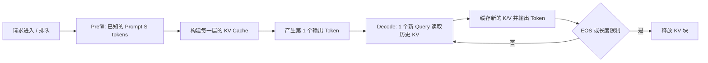
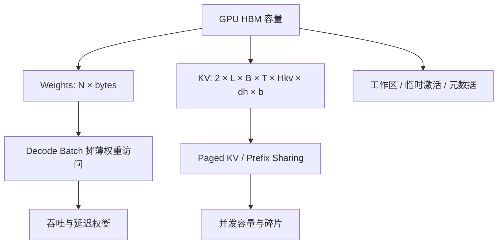

# 第 29 课｜Prefill、Decode 与 KV Cache：推理为什么受显存带宽限制？

**2026 年 11 月 17 日｜第 5 周第 1 课｜约 18 分钟**

上一课结束前四周的阶段考核，本周转向「推理/KV Cache/Batching/量化/Speculative Decoding/MoE」。今天要回答三个问题：**为何 Prompt 能并行处理，而后续生成通常逐步进行？KV Cache 具体保存什么？为何 FLOPs 不高的 Decode 仍可能很慢？**

本课假设标准稠密因果 Decoder-only Transformer，先不考虑滑窗 Attention、稀疏注意力、共享前缀或 KV 量化，随后再说明这些边界。学习目标是推导时间与空间复杂度，理解算力/带宽瓶颈，以及正确读懂 TTFT 与 TPOT。

## 一、Prefill 与 Decode：一个请求，两类负载

**Prefill** 处理已经给定的 S 个 Prompt Token。模型在因果 Mask 下，可以在一次或多个分块计算中并行构造每一层的 Key/Value，并从最后一个 Prompt 位置的 Logits 产生第一个输出 Token。

**Decode** 在 Prompt 后逐步产生未知输出。生成第 t+1 个 Token 需要此前实际生成的 Token，因此同一个请求的生成步骤存在顺序依赖；服务端可以在一个 Batch 中同时执行不同请求的各一个生成步骤，但这不等于同一请求的未来 Token 可以随意并行预测。



不要把「并行处理已知 Prompt」误解为「没有因果约束」。Prefill 依然需要正确 Causal Mask；只是所有输入 Token 已知，因此硬件能对多个位置同时进行矩阵计算。

## 二、为什么是 KV Cache，而不是 Q Cache？

单层一个 Attention Head 的简化公式为：

\[
q_t=x_tW_Q,\qquad k_t=x_tW_K,\qquad v_t=x_tW_V.
\]

\[
o_t=\operatorname{softmax}\left(\frac{q_t[K_1,\ldots,K_t]^\top}{\sqrt{d_h}}+M\right)[V_1,\ldots,V_t].
\]

在确定性的因果网络中，历史 Token 的层内表示不会因未来 Token 到来而改变。后续生成可以保存历史 K/V，只计算当前 Token 各层的新状态，把新 K/V 追加到缓存，再让新 Query 与缓存交互。

历史 Query 负责当时位置的输出；新位置计算不需要重复保存每一个历史 Query。**KV Cache 并非保存了完整历史注意力概率矩阵，也不会令新 Query 免于读取历史 Key/Value。**

没有 KV Cache 时，一种朴素生成方法是在每步对整个已知前缀重新执行 Transformer，导致对历史投影和网络层的大量重复计算。启用 Cache 后减少重复算术，但付出显存占用和逐步访问 KV 的代价。Cache 本身不是对 KV 的有损压缩。

## 三、从张量维度推导 KV 显存

设 L 个 Transformer 层、H_q 个 Query Head、H_kv 个 KV Head、Head Dimension d_h。B 条请求各缓存 T 个 Token，每个 KV 元素占 b 字节。

一个 Token 一层有 \(H_{kv}d_h\) 个 K 元素和同样多的 V 元素，合计 \(2H_{kv}d_h\)。乘上层数、请求数和历史长度：

\[
\boxed{M_{\mathrm{KV}}=2LBT H_{kv}d_hb\quad\mathrm{bytes}}.
\]

**为什么用 H_kv？** MHA 中 H_kv=H_q；GQA 由多个 Query Heads 共享较少的 KV Heads；MQA 可设 H_kv=1。在 Head Dimension 等其他条件相同时，缓存本体的比例为 H_kv/H_q，但最终吞吐不会自动同比例提高。

**数值示例：** L=32，H_q=32，H_kv=8，d_h=128，B=1，T=4096，BF16 每元素 2 bytes：

\[
M_{\mathrm{KV}}=2\cdot32\cdot1\cdot4096\cdot8\cdot128\cdot2
=536870912\;\mathrm{bytes}=512\;\mathrm{MiB}.
\]

同宽度 MHA 取 H_kv=32 时，本例为 2048 MiB。这里不包括权重、临时张量、分页碎片、分片副本与元数据。若使用滑动窗口或压缩 KV，式中的「全部历史 T」假设不再成立。



**为什么缓存会限制并发？** 一个 BF16 7B 稠密模型仅权重粗估就约 14 GB；多个长 Prompt 请求各要占据几百 MiB 甚至更多 KV。即使计算单元仍有空闲，HBM 可用容量也可能先耗尽。真实并发上限还由峰值临时内存、分配器与安全预留决定。

## 四、Prefill、单步 Decode 与长输出的复杂度

只数标准密集 Self-Attention 的 \(QK^\top\) 与 \(PV\)，略去常数、三角因果区域与实际 GQA Kernel 的广播方式。Prefill 有 S 个 Query，最多 S 个 Key，所以全层 Attention 复杂度为：

\[
\boxed{\Theta(LS^2H_qd_h)}.
\]

其 QKV 投影、FFN 等稠密层另有约 \(\Theta(SN)\) 的算术工作，N 为稠密模型参数量（粗略口径）。

有 Cache 的 Decode 单步仅一个新 Query，面对 T 个已缓存 Key，因此 Attention 工作约为：

\[
\boxed{\Theta(LTH_qd_h)}.
\]

每个新 Token 仍要经过稠密参数层，约另有 \(\Theta(N)\) 级别运算。**单步 Attention 随历史长度线性增长，不代表全部生成过程线性于 G**。生成 G 个 Token，历史长度约从 S 增长到 S+G−1：

\[
\sum_{j=0}^{G-1}(S+j)=GS+\frac{G(G-1)}2.
\]

故生成阶段累计注意力阶为 \(\Theta(LH_qd_h(GS+G^2))\)。这对全量上下文 Attention 成立；滑窗或稀疏访问会改变长度依赖。

## 五、Roofline：更少 FLOPs 不一定更快

算术强度定义为 \(I=F/M\)，即执行的 FLOPs 除以 HBM 传输 Bytes。令有效算力为 \(\Pi\) FLOP/s，有效带宽为 W bytes/s，一个简化的计算/访存时间下界为：

\[
\boxed{t\gtrsim\max(F/\Pi,M/W)}.
\]

Prefill 的大量已知 Token 能形成矩阵乘法和较高权重复用；较小 Batch 的 Decode 常以矩阵向量风格运算为主，需要反复读取巨大模型权重，并随历史增长读取 KV，因而常常**带宽敏感**。但短 Prompt、小模型、不同 Batch/Kernel 均可改变瓶颈，不可断言 Prefill 永远算力受限、Decode 永远带宽受限。

**估算权重读取：** 7B 参数若以 FP16 存放，约 14 GB。理想化地忽略跨步权重驻留，Batch=1 的单步 Dense 计算约 14 GFLOPs 且需读取约 14 GB 权重，权重侧算术强度约为 1 FLOP/byte。若 Batch=16 且一次读权重能服务 16 个新 Token，权重侧算术强度约为 16 FLOPs/byte。实际还要加上 KV 读取、内核开销及片上缓存，因而这不是实测 MFU 或完整 Roofline。

**KV 流量：** 第三节的单请求 4096 Token GQA KV 本体为 512 MiB；全上下文新 Query 的注意力通常需要访问相应的历史 KV。Paged Kernel、量化和缓存命中会改变真实 HBM 传输，不能简单把本体字节数等同于 profiler 的精确 Bytes。

## 六、TTFT、TPOT 与吞吐：用户到底感知什么？

**TTFT（Time to First Token）**：请求到达到首个输出 Token 到达用户的时间。通常包含排队、调度、Prefill、首 Token 处理与网络路径，埋点需清楚定义。

**ITL（Inter-Token Latency）**：相邻两个输出 Token 到达的时间差。**TPOT（Time Per Output Token）**：若某请求生成 G≥2 个 Token，常用 \((t_{\mathrm{last}}-t_{\mathrm{first}})/(G-1)\) 定义该请求的平均后续 Token 时间。

则同一请求有记账关系：

\[
\mathrm{E2E}\approx \mathrm{TTFT}+(G-1)\mathrm{TPOT}.
\]

**数值示例：** TTFT=0.6s，输出 5 Token，四个后续 ITL 分别为 0.10、0.12、0.08、0.10s；TPOT=0.10s，E2E=1.0s。若只报告总输出 tokens/s，无法判断 p95 TTFT 或单请求尾延迟是否达标。

服务质量通常还需同时报告 requests/s、输出 tokens/s、p50/p95/p99 TTFT/ITL 与满足双 SLO 的 Goodput。跨请求总体平均 TPOT 不可不加限定地代替各请求尾延迟。

## 七、PagedAttention 与 P/D 分离解决的不是同一个问题

**PagedAttention**（Kwon 等，SOSP 2023）以逻辑 KV Block 到物理 Block 的映射管理动态长度缓存，减少连续预留带来的碎片，便于按需分配、释放及前缀共享。它管理的是**存储布局和复用**，不是让稠密 Query-Key 交互从 T 次变为常数次。

**Prefill/Decode 分离（P/D Disaggregation）**在不同资源池执行两阶段，以避免长 Prefill 干扰流式 Decode，并分别调节 TTFT/TPOT 资源。分离时需传送或共享已构建的 KV，带来数据迁移、网络吞吐与资源利用率平衡问题。**DistServe**（OSDI 2024）是对此进行系统设计的代表研究。

本课 KV 容量和密集 Attention 复杂度来自张量维度与算术分析，属于经典可推导事实；PagedAttention 和 DistServe 的具体吞吐/延迟收益则属于特定硬件与负载下的实证结果，不得泛化为固定倍数。

## 八、可复现的性能实验与伪代码

在相同模型权重、Tokenizer、精度、采样策略和 Prompt/输出长度下，分别比较 Cache Off（每步重算完整前缀）、Cache On、分页 KV；有第二组 GPU 时再比较共置与 P/D 分离。扫描 S=128/2048/8192、G=32/256、并发 1/8/32（显存允许时），同时测试固定并发与开放到达率。

记录正确性（对齐位置的 Logits 误差、确定性生成一致性）、每请求 TTFT/ITL/TPOT 分位数、有效输出 tokens/s、requests/s、Goodput、KV 与总峰值显存、权重/KV 的 HBM Traffic、排队时间和 P/D KV 传输时间。测试前 Warmup，GPU 计时要同步；报告失败请求与 OOM，而不是只保留成功运行。

```python
# 教学伪代码：实际 cache API 可能具有不同追加语义
kv = empty_cache()
logits, kv = prefill(prompt_tokens, kv, causal=True)
next_token = sample(logits[-1])
while not is_eos(next_token) and not reached_limit():
    emit(next_token)
    logits, kv = decode_one_token(next_token, kv)
    next_token = sample(logits[-1])
release(kv)
```

注意第一个 Token 通常来自 Prefill 最末位置；它作为下一步的输入在 Decode 中产生自己的 KV。真实接口对 Cache 追加时点不同，必须避免重复追加或位置错位。

## 九、易错反例

| 错误说法 | 正确边界 |
|---|---|
| Prefill 不需要因果 Mask | Prompt 已知仍必须阻止较早位置读取未来 |
| KV Cache 保存全部历史 Q 或完整 P | 常规增量 Attention 保存 K/V |
| Cache 消除所有历史 KV 读取 | 新 Query 仍访问历史 K/V |
| GQA 减少四倍 KV 就必然快四倍 | 权重、Kernel、KV 流量、Batch 与调度共同决定 |
| Decode 永远是 bandwidth-bound | 取决于模型、Batch、序列长度和硬件 |
| PagedAttention 让精确稠密 Attention 变常数复杂度 | 它优化存储管理，不取消数学连接 |
| 高 tokens/s 保证低用户延迟 | 必须另测排队、TTFT 与 ITL 尾部分布 |
| P/D 分离总是无代价提速 | KV 迁移和跨池负载失衡可能抵消收益 |

参考资料：[vLLM/PagedAttention（SOSP 2023）](https://doi.org/10.1145/3600006.3613165)；[DistServe（OSDI 2024）](https://www.usenix.org/conference/osdi24/presentation/zhong-yinmin)；[Hugging Face KV Cache 文档](https://huggingface.co/docs/transformers/main/en/kv_cache)。


## 十、四级递进自测（100 分）

**首版不公布标准答案。** Lv1（15分）、Lv2（20分）、Lv3（25分）客观判分，Lv4（40分）按推导与设计评分。作答后逐题解析：80分及以上继续，60–79分补练，低于60分复习再练。

### Lv1｜Prefill/Decode 与缓存的机制（15分｜预计2分钟｜单选）

一个标准全量因果注意力 Decoder-only 模型，输入 Prompt 长 S，之后自回归生成 G 个 Token。关于 Prefill、Decode 与 KV Cache，哪种机制描述最准确？

A. Prefill 只能一次处理一个 Prompt Token，而 Decode 可以无依赖地并行生成同一请求的所有后续 Token。

B. Prefill 可以并行处理已知 Prompt 的不同位置并建立 KV；Decode 逐 Token 生成，KV Cache 避免重复计算历史 K/V，但仍须访问历史 KV。

C. KV Cache 保存完整历史 Attention Probability Matrix，因此后续不必访问 K 和 V。

D. 使用 KV Cache 后，单步全量 Attention 的计算量严格与历史长度无关。

*提示：区分 Prompt 已知与后续 Token 尚未确定；缓存的是历史 K/V，还是历史注意力概率？*

### Lv2｜GQA KV 容量手算（20分｜预计4分钟｜数值）

一个 GQA 模型有 L=28 层，每层 H_kv=4 个 KV Head，Head Dimension d_h=128。KV 使用 BF16（每元素 2 bytes）。B=3 条请求，各自缓存 T=2048 Token，不共享前缀，忽略分页碎片、元数据、量化 Scale、设备分片。求全体 KV Cache 容量，单位 MiB（1 MiB=2^20 bytes）。填写数值。

**填写数值（MiB）：** ______

*提示：K 和 V 各存一份；按层数、KV Head 数、维度、长度、Batch 和字节数相乘，再换算 MiB。*

### Lv3｜带宽、请求调度与缓存边界（25分｜预计6分钟｜多选）

针对标准全量因果注意力的 LLM 在线服务，不引入近似或稀疏注意力，下列哪些陈述成立？（多选）

A. 缓存历史 KV 可避免重复计算旧 Token 的 K/V，但单步全量 Attention 仍需随历史长度增长的 KV 读取。

B. Prefill 和小 Batch Decode 在任意 GPU 上都具有相同算术强度，因而必然同为 compute-bound。

C. TTFT 通常包括排队和 Prefill 等首 Token 路径开销；Prefill/Decode 分离可减小干扰，但存在 KV 传输与调度成本。

D. PagedAttention 让新 Query 对 T 个旧 Key 的精确全量 Attention 操作数直接由 Θ(T) 降成 Θ(1)。

E. 提高 Decode Batch 可能摊薄权重读取的单位输出 Token 成本，同时增加 KV 占用并可能改变单请求延迟。

F. 不开启 KV Cache 而每步重新运行完整前缀，与使用 Cache 的历史计算量严格相同。

*提示：分别考虑数学上 Q 要访问多少 Key、权重读取的 Batch 摊销、SLO 中的排队及跨设备 KV 传输。*

### Lv4｜KV 推导、延迟模型与完整系统实验（40分｜预计15分钟｜开放题）

为 L 层、H_q 个 Query Head、H_kv 个 KV Head、维度 d_h 的稠密因果 Decoder-only 模型设计推理服务分析。每请求 Prompt 长 S、生成 G 个 Token，KV 每元素 b 字节。

A（12 分）：从 K/V 张量形状推导 B 条请求各缓存 T 个 Token 的 KV 字节数；比较 MHA/GQA/MQA，说明公式限制与 PagedAttention 的作用。

B（10 分）：推导 Prefill 与单步 Decode 的全量 Self-Attention 算术阶和 G 步累积阶；用权重与 KV 读取解释 Roofline/带宽判断，指出 FLOPs 不等于实测时延。

C（10 分）：明确定义 TTFT、ITL/TPOT、吞吐与 Goodput，设计共享 GPU 和 P/D 分离对照，包含排队、传输和 p95 SLO。

D（8 分）：设计公平消融，至少覆盖上下文长度、Batch、Cache 开关、精度/硬件、输出一致性、显存峰值和同步计时。

**请按 A、B、C、D 分项作答。**

*提示：A 写 2×层数×请求数×缓存长度×KV Head×Head Dim×字节；B 分开 S 个 Prompt Query 和每步 1 个新 Query；C 关注尾延迟和 KV 迁移；D 必须固定模型与请求分布。*

## 十一、下一课预告

**第30课｜2026年11月18日｜第5周第2课：Continuous Batching 与请求级调度。** 将比较静态 Batch 与 Iteration-level Scheduling，推导队列、TTFT/TPOT 与吞吐之间的冲突、抢占和 KV 资源控制。
