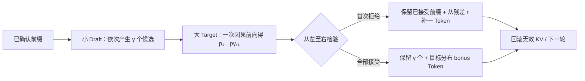

# 人工智能：理论、算法与系统 · 第 34 课

**第 5 周第 6 课｜2026-11-22｜讲授约 18 分钟（自测另计）**

## Speculative Decoding：精确性、接受率与系统收益

上一课研究了 W4A16 / W8A8 / FP8 量化。本课讨论另一条推理加速路线：**不改变目标模型采样分布，却尝试减少昂贵的顺序目标模型调用。** 理解其数学保证，也要理解它可能增加总 FLOPs，并且不一定改善在线 Goodput。

学习目标：推导 Draft–Verify 的条件分布；证明接受—修正采样精确；估算每轮输出长度与理想加速比；设计正确的 KV 提交/回滚和端到端基准。

## 一、动机：为什么“多验证几个 Token”可能比逐个生成快？

标准自回归解码在给定前缀 x_{<t} 下依次从目标模型分布 p_t 采样。要生成 γ 个新 Token，通常需要 γ 次顺序目标前向。对于单请求、小 Batch，Decode 往往需要反复读取庞大权重，容易出现内存带宽瓶颈。

Speculative Decoding 引入成本较低的草稿分布 q（例如小型 Draft 模型）：

1. 草稿模型**按自回归顺序**提出 γ 个候选 y₁…yγ，并记录各位置完整的 q_i 概率分布。
2. 大目标模型使用正确的因果位置和 Mask，对整条候选前缀一次并行验证，得到 p₁…pγ 以及全接受时下一位置的 p_{γ+1}。
3. 从左到右逐个进行接受/拒绝判定。首次拒绝时从校正分布补一个 Token，丢弃该位置之后所有候选；全接受时从 p_{γ+1} 再取一个 bonus token。
4. 只将最终确认的 Token 和与之对应的 KV 状态提交给下轮。

这里“目标并行验证”指**一次目标前向能算出各候选位置的条件 Logits**，不是取消 Causal Mask，也不是同一请求的真实未来 Token 预先已知。



## 二、单个 Token 的精确采样：核心不是“目标说行就行”

固定一个已经确认的上下文。令 p(x) 为目标模型的下一 Token 采样概率，q(x) 为 Draft 概率。两个分布均在同一目标 Token 空间中归一化，并且已一致地应用温度、top-k、top-p 等**实际**采样处理。

先从 q 采样候选 y。若 q(y)>0，按以下概率接受：

\[
\boxed{a(y)=\min\left(1,\frac{p(y)}{q(y)}\right).}
\]

候选 y 被采样且被接受的联合概率为

\[
q(y)a(y)=\min(q(y),p(y)).
\]

设总体接受概率：

\[
\boxed{\beta=\sum_x\min(p(x),q(x)).}
\]

它满足

\[
\boxed{\beta=1-\frac12\sum_x|p(x)-q(x)|=1-\operatorname{TV}(p,q).}
\]

推导：\(\min(p,q)=(p+q-|p-q|)/2\)，两概率总和各为 1。可见**接受率取决于两种分布的重叠质量**，并不只由草稿模型大小决定。

若发生拒绝（\(\beta<1\)），必须从**归一化的正部残差**采样：

\[
\boxed{r(x)=\frac{[p(x)-q(x)]_+}{\sum_z[p(z)-q(z)]_+}
=\frac{[p(x)-q(x)]_+}{1-\beta}.}
\]

原因：被接受的路径已经贡献 \(\min(p,q)\) 的概率质量，缺少的正好是 \(p-\min(p,q)=[p-q]_+\)。

完整证明对任意 x：

\[
\Pr(\mathrm{output}=x)
=\underbrace{\min(p(x),q(x))}_{\text{提案被接受}}
+\underbrace{(1-\beta)r(x)}_{\text{拒绝后修正}}
=p(x).
\]

这就是**分布精确性**。如果 q(x)=0，Draft 不会提案该 Token，仍可由残差产生它；若 p=q，则 \(\beta=1\)，不会发生拒绝，不需要计算零分母的 r。

**不能**在拒绝时简单从 p 再采一次，也不能把 \(\min(1,p/q)\) 当作一个阈值做确定性接受；两者都一般破坏目标分布。

## 三、一个可复核的 3-Token 数值例子

令词表为 A、B、C：

\[
p=(0.5,\ 0.2,\ 0.3),\qquad
q=(0.2,\ 0.6,\ 0.2).
\]

被接受路径的概率质量为 \((0.2,0.2,0.2)\)，因此 \(\beta=0.6\)。残差正部为 \((0.3,0,0.1)\)，归一化后得到：

\[
r=(0.75,\ 0,\ 0.25).
\]

最终输出 A 的概率 \(0.2+0.4\times0.75=0.5\)；输出 B 的概率 \(0.2+0.4\times0=0.2\)；输出 C 的概率 \(0.2+0.4\times0.25=0.3\)。确实回到目标 \(p\)。

强调：这是在**一个已固定前缀**上的证明。多 Token 情况每一步都要使用对应草稿前缀下的 \(q_i,p_i\)；一旦修正了某位置的 Token，后续原草稿前缀已不成立。

## 四、一次验证为何能产出 1 到 γ+1 个 Token？

一轮产生 γ 个候选：如果第一个候选被拒绝，修正后只提交 1 个 Token；如果第 i 个首次被拒绝，提交前 i−1 个接受的候选及 1 个修正 Token，一共 i 个；如果 γ 个全部接受，再从 Target 的下一位置分布采一个 bonus，一共 γ+1 个。

因此：\(\boxed{1\le K\le\gamma+1}\)。

用尾和公式：

\[
\mathbb E[K]=\sum_{j=1}^{\gamma+1}\Pr(K\ge j).
\]

若教学近似假定不同候选依次通过的条件概率都为固定 \(\alpha\)，得到：

\[
\boxed{\mathbb E[K]\approx1+\alpha+\alpha^2+\cdots+\alpha^\gamma
=\frac{1-\alpha^{\gamma+1}}{1-\alpha}}
\]

（\(\alpha=1\) 时为 \(\gamma+1\)）。真实接受率随上下文/位置变化，有相关性；用固定 \(\alpha\) 推导的是近似模型，不是所有请求的精确平均。

例如 \(\gamma=3,\alpha=0.75\)，每轮平均输出约 \(1+0.75+0.75^2+0.75^3=2.734375\) 个 Token。即使草稿“多数时候对”，也可能在较早位置拒绝，导致后续的目标验证计算被浪费。

## 五、期望 Token 数不是加速比

设目标模型普通 Decode 一个 Token 的耗时为 \(t_T\)，草稿生成每个候选的耗时为 \(t_D\)，验证整段的目标耗时为 \(t_V(\gamma)\)，接受判定、同步、KV 管理等开销为 \(t_O\)。

在相同上下文和输出长度、忽略边界效应的教学近似下：

\[
\boxed{
\mathrm{Speedup}\approx
\frac{\mathbb E[K]\,t_T}{\gamma t_D+t_V(\gamma)+t_O}.}
\]

若 \(\gamma=3,\alpha=0.75,t_T=2.0\mathrm{ms},t_D=0.15\mathrm{ms},t_V=2.2\mathrm{ms},t_O=0.10\mathrm{ms}\)，则分母 \(0.45+2.2+0.10=2.75\mathrm{ms}\)，理想速度比约 \(2.734375\times2/2.75\approx1.99\)。

但这不是实测值：目标模型验证 γ 个位置并非免费，GPU Batch、上下文长度、Kernel、Draft 与 Target 的资源竞争会改变每项开销；Draft 还可能显著增加总 FLOPs 和显存。最优 γ 不能只看接受率，还要衡量**草稿成本和验证长度增长**。

Speculative Decoding 的主要机会是用较廉价的 Draft 工作与目标并行验证，换取较少的**顺序大模型轮次**；不是从数学上减少必须考虑的目标条件分布。

## 六、实现正确性的三个陷阱

**位置和采样配置**：\(p_i\) 必须是目标模型在“已确认前缀 + 前 i−1 个草稿 Token”上的**下一 Token**分布，\(q_i\) 必须对应相同前缀；两边用于接受率的概率必须是实际采用的温度、top-k/top-p 等规则之后的完整概率分布。草稿与目标 Token ID 对齐及 EOS/Stop 的处理不能随意省略。

**KV Cache 提交与回滚**：目标可以并行得到所有候选对应的计算结果，但在第 i 个候选被拒绝后，目标与 Draft 中依赖于后续错误草稿的 KV 均不能视为已确认历史。只保留合法已接受前缀；修正 Token 的 KV 在后续正确前向中建立（或使用实现能够证明等价的状态路径）。全接受时按实现约定处理 bonus token 的输入/缓存时点，避免位置错位、重复追加。

**所谓“无损”**：严格的标准接受—残差修正维持的是目标采样**分布**，不是与另一段独立随机采样得到的文本逐 token 相同。某些 Greedy/树形接受方案、近似阈值或系统回退模式并不自动具有任意采样分布的同等保证。

```python
# 教学伪代码：p_i、q_i 都是正确对齐的完整采样分布
draft_tokens, q_dists, draft_state = draft_gamma(prefix, gamma)
p_dists, target_state = target_verify(prefix, draft_tokens)
committed = []
for i, token in enumerate(draft_tokens):
    a = min(1.0, p_dists[i][token] / q_dists[i][token])
    if uniform_0_1() < a:
        committed.append(token)
    else:
        residual = positive_part(p_dists[i] - q_dists[i])
        correction = sample(normalize(residual))
        committed.append(correction)
        break
else:
    committed.append(sample(p_dists[gamma]))  # bonus
commit_only_valid_prefix_and_repair_kv(committed, draft_state, target_state)
```

注意真实实现必须解决极小概率、分布归一化、采样数值稳定性、批内不同接受长度和 EOS 的分支逻辑。

## 七、方法族与证据边界

经典 Draft-model Speculative Sampling 的精确性来自上述概率质量分解。Leviathan、Kalman、Matias 的 ICML 2023 论文展示了在特定 T5/TPU 条件下的加速，**不能视为任意 GPU 或高并发的保证**。

后续还有 N-gram/Suffix 草稿、MTP、EAGLE、Medusa 等路径。它们改变的是草稿生成方式、树形候选或验证开销；**是否严格保留目标采样分布由具体接受/校正算法决定**，不能仅凭“Speculative”名称断言。vLLM 的推测解码文档区分不同方法与近似验证模式。

- [Fast Inference from Transformers via Speculative Decoding（ICML 2023）](https://proceedings.mlr.press/v202/leviathan23a.html)
- [Medusa（ICML 2024）](https://proceedings.mlr.press/v235/cai24b.html)
- [vLLM Speculative Decoding 文档](https://docs.vllm.ai/en/latest/features/spec_decode/)

## 八、怎么做可信的推理加速实验？

固定同一目标权重、Tokenizer、温度和 top-p、采样长度、KV 精度、硬件和请求序列。比较 Target-only、不同 Draft 模型，以及适用时的轻量草稿方法；扫描 \(\gamma=1,2,4,8\)、输入长度、输出长度、并发与到达率。

**正确性测试**：在小词表构造 \(p,q\) 做大量采样，验证实际输出频率逼近 p；对真实模型在可控制的概率分布上做统计一致性测试，并检查 EOS/拒绝/bonus/KV 回滚。检查该测试是否覆盖了真实采样器的 top-p/temperature 配置。

**系统指标**：平均接受率、平均每轮提交 Token 数、Draft ms、Target verification ms、回滚/同步 ms、真实 Tokens/s、TTFT/TPOT 的 p50/p95/p99、双 SLO Goodput、HBM 峰值与总 GPU FLOPs。区分单请求低 QPS 与高并发；在高负载时额外 Draft 可能与其他请求抢资源，使 Goodput 下降。

只有在**相同质量与 SLO 口径**下比较的端到端收益，才适合宣称推理加速。预期的 Token/轮收益不等于墙钟收益。

## 九、易错反例

| 错误直觉 | 更严谨的结论 |
|---|---|
| 草稿模型的 Token 要么全信，要么全拒 | 按位置接受，首次拒绝时补一个修正 Token |
| 拒绝后直接采 p 就保持精确 | 应采归一化的 \([p-q]_+\) |
| 全接受只输出 γ 个 Token | 正确实现通常还可输出一个目标 bonus Token |
| 目标一次验证了后续 Token，所以拒绝后也可保留 | 拒绝改变前缀，后续草稿不再有效 |
| 平均接受率 90% 就意味着快 10 倍 | 仍受草稿/验证/通信/KV 开销约束 |
| 分布无损意味着单次随机文本必定相同 | 分布等价不等于样本轨迹相同 |
| 离线一条请求的加速等于在线 Goodput 提升 | 并发与排队、额外 Draft 竞争可能改变结果 |

## 十、四级递进自测（100 分；首版不含答案）

前三题可客观判分，Lv4 按推导与实验评分。得分 80 及以上继续、60–79 针对性补练、低于 60 复习再练。
### Lv1（15 分）｜采样分布与 Draft–Verify 的精确性边界

**考点：**采样分布与 Draft–Verify 的精确性边界；**预计用时：**2 分钟；**题型：**单选。

一个目标模型的采样分布为 p，草稿模型的分布为 q。关于标准的精确 Speculative Sampling，以下哪项理解最严谨？

- A. 目标模型只需要验证整段草稿是否合理，拒绝时直接从原始 p 重新采样，便能始终精确保持 p。
- B. 只要草稿模型和目标模型共享 Tokenizer，草稿 token 就可以全部直接接受，无需目标概率。
- C. 对草稿 token 使用 min(1,p(x)/q(x)) 的接受概率，首次拒绝时从归一化的 (p−q) 正部采样；在分布与条件上下文正确对齐时保持目标分布。
- D. Speculative Sampling 能保证随机种子不同的两次生成逐 token 完全相同。

**不泄题提示：**区分“输出分布一致”与“单次随机样本一致”；思考被拒绝的概率质量如何补齐。


### Lv2（20 分）｜拒绝条件下残差分布的具体计算

**考点：**拒绝条件下残差分布的具体计算；**预计用时：**4 分钟；**题型：**数值。

某位置词表只有 A、B、C，目标分布 p=(0.4,0.1,0.5)，草稿分布 q=(0.1,0.6,0.3)。标准 Speculative Sampling 在该位置首次拒绝草稿时，从 r(x)∝max(p(x)−q(x),0) 采样。求条件于“拒绝已经发生”时，修正 token 是 C 的概率。填写 0 到 1 的小数。

**作答：**填写十进制数。

**不泄题提示：**逐类计算 p−q 的正部，再用三个正部之和归一化；题目问的是拒绝后的条件概率。


### Lv3（25 分）｜期望输出长度、并行验证、KV 与在线性能

**考点：**期望输出长度、并行验证、KV 与在线性能；**预计用时：**6 分钟；**题型：**多选。

考虑每轮草稿生成 γ 个 token、目标模型并行验证的标准精确 Speculative Decoding。以下哪些陈述正确？（多选）

- A. 若逐 token 接受事件近似独立且具有相同接受概率 α，则每轮平均输出 token 数近似为 Σ_{j=0}^{γ} α^j，其中全接受时还可输出一个目标模型 bonus token。
- B. 如果 γ 个草稿 token 全被接受，本轮最多只输出 γ 个 token；不存在额外输出的机会。
- C. 即使一轮比普通 Decode 提交更多 token，额外的草稿运行、目标验证工作和调度开销也可能使墙钟速度更慢。
- D. 第 i 个草稿 token 被拒绝后，后续的候选可无条件继续提交，因为目标模型已经并行算出了它们的 logits。
- E. 采用正确的接受—修正机制保持的是目标采样分布；不同随机数耦合方式下，单次生成文本不必与独立的 target-only 运行逐字相同。
- F. 只要离线单请求的 tokens/s 有所改善，就能保证高并发情况下 TTFT、TPOT 与 Goodput 同时改善。

**不泄题提示：**把数学上的分布正确性、每轮输出长度和 GPU 实测性能分开；检查拒绝后的条件前缀是否仍相同。


### Lv4（40 分）｜精确性证明、加速模型与系统实验

**考点：**精确性证明、加速模型与系统实验；**预计用时：**15 分钟；**题型：**开放。

为采用同一目标采样配置的 Decoder-only LLM 设计精确 Speculative Sampling。A（14分）：令 p(x) 为目标模型下一 Token 分布，q(x) 为草稿分布，写出接受率、拒绝修正分布，并证明最终输出是 p；说明 q(x)=0 和 p=q 的边界。B（10分）：推导在接受事件近似独立且概率 α 固定时，γ 个草稿候选一轮的期望输出长度，写出包含草稿生成、目标并行验证、采样/调度开销的近似加速比，分析何时不会加速。C（8分）：说明首次拒绝后为何必须丢弃后续候选，如何提交/回滚目标与草稿 KV，并确保温度、top-p 等实际采样分布、位置、EOS 正确。D（8分）：设计在同一硬件、模型、Tokenizer、采样分布和负载下与 Target-only 比较的实验；扫描 γ、草稿能力、上下文长度和并发，报告分布正确性、接受率、有效 tokens/轮、TTFT、TPOT、Goodput、HBM、总 GPU 工作量和尾延迟。

**作答：**按 A、B、C、D 四部分写出公式、说明和实验方案。

**不泄题提示：**A 从 accepted mass=min(p,q) 与残差质量相加；B 用尾和公式 E[K]=Σ Pr(K≥j)；C 想清楚拒绝后条件前缀已改变；D 必须区分数学上分布无偏与实际系统速度。

## 十一、下一课预告

**第 35 课｜2026-11-23｜第 5 周第 7 课：推理系统阶段复盘。**

联结 Prefill/Decode、KV 容量与缓存、Continuous Batching、量化和 Speculative Decoding，集中考察**质量不变的情况下，为什么更低 FLOPs / 更低显存不必然意味着更低 TTFT/TPOT**。随后第 6 周进入 VAE、Normalizing Flow、Diffusion 与 Flow Matching。
