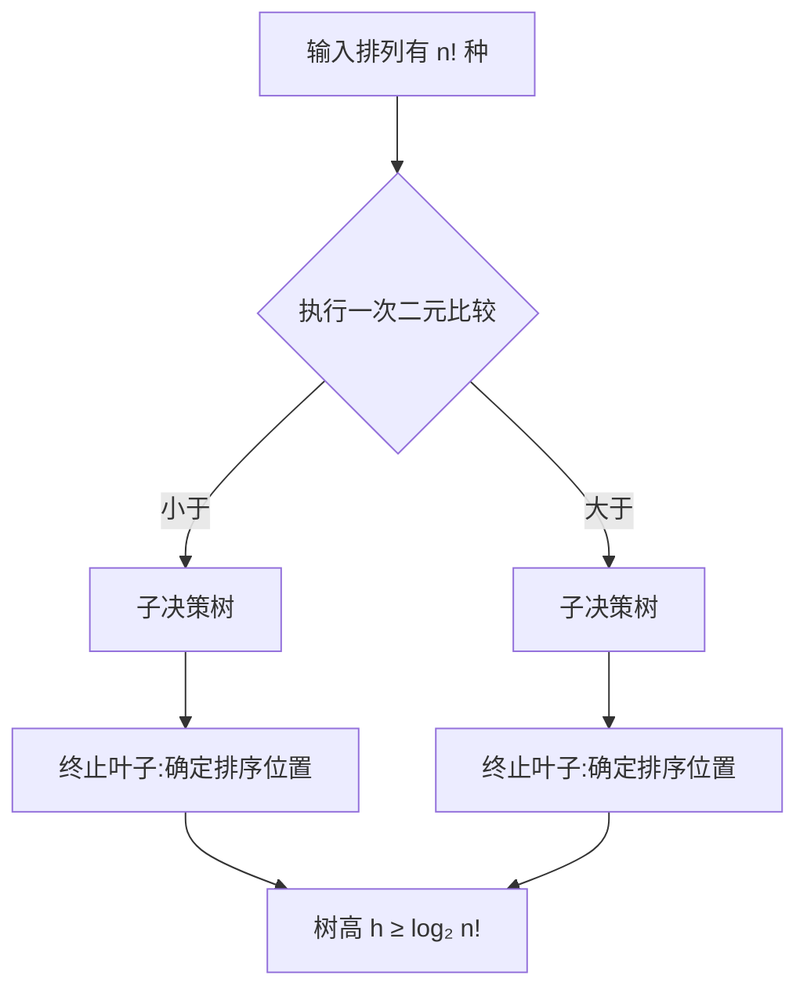

# 算法与数据结构 · 第 3 课
## 比较排序为什么无法普遍突破 n log n？

**2026 年 10 月 22 日｜第一周｜约 18 分钟**

> **归档说明：** 本讲义根据当天的课程主题和学习目标重新构建为完整教学版，而不是历史对话的逐字记录。四级测验的答案只保存在单独 JSON 中。

### 本课目标

建立“比较信息容量→决策树叶子数→最坏深度→Ω(nlogn)”的完整证明，进一步理解平均深度下界、排序算法的上界，以及计数排序为何并不构成反例。

## 一、先明确计算模型：什么叫比较排序？

给定 n 个**互异**的元素，唯一可获得关于元素相对大小的信息是二元比较，如 “$A_i<A_j$ 吗？”。算法可以重排数据、保存索引、选择下一次比较对象，但**不能**把元素当作有界整数直接作为数组下标使用。

为什么要求互异？如果有相等键，排序结果的不同可区分排列数可能减少。为了证明通用算法在最坏输入上的下界，我们可以只分析互异元素输入这一子类；通用正确算法必然也要处理它们。

关键是，一次比较最多有两个可能结果，因此最多提供 1 bit 二元信息。

## 二、把算法展开为一棵决策树

任意确定性比较算法可表示为一棵决策树：内部节点是比较 $A_i<A_j$，左、右边代表比较结果，终止叶节点对应算法知道了所有元素的相对次序、可以给出正确的排序排列。

对三个互异元素，有 $3!=6$ 种不同的输入相对次序。只比较一次只能产生两条分支；比较两次最多分成四种结果；要把 6 种情况全部区分，最长分支至少三次。

| 最多比较 h 次 | 可区分的结果最多 |
|---:|---:|
| 0 | 1 |
| 1 | 2 |
| 2 | 4 |
| 3 | 8 |

这不是说每个三元素输入都要做三次比较，而是说不可能对全部六种输入排列都使用不超过两次比较。

### 决策树示意

## 三、严谨证明：为什么必须有 n! 个叶子？

设输入为 n 个固定互异键的所有 n! 种排列。若两个不同的输入排列沿完全相同的比较结果路径到达同一个叶节点，算法会根据相同的相对信息做出同一输出索引排列；但两种输入的正确“元素所在位置→排序位置”映射不同，其中至少一个必须错误。这与算法对所有输入都正确矛盾。

因此，算法必须有至少 n! 个可达叶子。高度为 h 的二元树最多有 $2^h$ 个叶子，故

$$2^h\ge n!,\qquad \boxed{h\ge\lceil\log_2(n!)\rceil}.$$

这给出最坏比较次数下界。它是由可区分状态的数量得到的信息界，而不是对某个具体排序代码做逐行计时。

## 四、不调用 Stirling，也能得到 Ω(nlogn)

使用乘积 $n!=1\cdot2\cdots n$。在后半部分，至少约 $n/2$ 个因子都不小于 $n/2$，所以

$$n!\ge(n/2)^{n/2}.$$

对两边取二进制对数：

$$\log_2(n!)\ge\frac n2\log_2(n/2)=\Omega(n\log n).$$

上界也容易看出，$n!\le n^n$，所以 $\log_2(n!)\le n\log_2n$。因此

$$\log_2(n!)=\Theta(n\log n).$$

我们并没有跳到 Stirling 的精确近似，而是用两个简单乘积界证明了需要的数量级。

## 五、平均深度为何也不能普遍更小？

只考虑 n! 种排列等可能输入。每个叶子对应一条由比较结果构成的二进制码字，而且没有一个终止叶子的码字是另一个终止叶子的前缀，这形成前缀码。设叶深为 $d_1,\ldots,d_{n!}$，Kraft 不等式给出

$$\sum_{i=1}^{n!}2^{-d_i}\le1.$$

由 AM–GM 或 Jensen 不等式，对均匀分布有

$$\frac1{n!}\sum_i2^{-d_i}\ge2^{-(1/n!)\sum_i d_i}.$$

结合和不超过1，得到

$$n!\,2^{-\bar d}\le1\quad\Longrightarrow\quad\bar d\ge\log_2(n!).$$

所以对均匀随机排列的**平均比较次数**也有 Ω(nlogn) 下界。这里固定了输入分布，不代表每一种特殊分布都有同样下界；已近似有序的数据可以存在更快的自适应算法。

## 六、对上界：归并排序为什么达到最优阶？

归并排序将规模 n 分为两个规模约 n/2 的子问题，再在线性时间内合并。递推为

$$T(n)=2T(n/2)+\Theta(n)=\Theta(n\log n).$$

因为其最坏时间恰好等于比较模型的信息下界数量级，所以它在**渐近意义**上是最坏情况最优的比较排序之一。QuickSort 随机化通常获得期望 $O(n\log n)$，但不对每次随机结果保证最坏 $O(n\log n)$；避免把期望上界和确定性最坏上界混淆。

## 七、哪些“反例”实际上改变了计算模型？

**计数排序**：键是 $0,\ldots,K$ 之间的整数，直接以键值作为数组下标统计频数，时间 $O(n+K)$、额外空间 $O(K)$。这使用了比较之外的信息。只有 K=O(n) 才得到线性时间。

**基数排序**：假设每个键由有限位数的数字组成，能按某一位分配桶并进行稳定排序；复杂度取决于数字位数和基数。它不是无条件适用于无限精度任意实数的线性排序。

**自适应排序**：在某些接近有序的输入上时间可能接近 O(n)，但它仍可能在最坏输入上执行 Ω(nlogn) 次比较。

### 适用边界

“至少 n! 叶子”论证假设正确输出能区分各互异排列、算法获得的信息仅来自相对大小比较。若存在允许单步并行比较的并行模型，应区别总比较 Work 与并行 Span；若元素键有固定编码、可以算术索引或允许字级操作，下界的前提已改变。

## 八、下一讲

第 4 课将用随机化的 Quickselect 说明：为什么找第 k 小比完整排序更省工作量，以及随机期望、确定性最坏上界之间的区别。

## 四级分级测评（100 分；首次无答案）

前三题客观判分，最后证明题由自评或人工/ChatGPT 批改。

### Lv1｜信息限制｜15 分｜约 2 分钟

关于对 n 个互异键的通用比较排序，以下哪项说法严格成立？

**A.** 即使键是互异实数、只允许比较，仍可利用计数排序在最坏 O(n) 时间完成

**B.** 任何确定性比较排序在最坏情况下都需要 Ω(n log n) 次比较，因为比较结果必须区分 n! 种输入排列

**C.** 只要某个输入上比较次数少于 n log n，就违反排序下界

**D.** 比较排序下界不依赖它的输入和输出是否需要区分不同排列

*可选提示：决策树叶子必须代表哪些不同的结果？下界限制的是最坏情况还是每一次输入？*

### Lv2｜最坏比较次数下界｜20 分｜约 4 分钟

对 n=6 个互异元素，仅允许二元比较。利用决策树叶子数下界，最坏情况下至少需要多少次比较？只需填写由 ceil(log₂(6!)) 得到的整数下界。

*可选提示：先计算 6!，再找满足 2^h≥6! 的最小整数 h。*

### Lv3｜模型与量词边界｜25 分｜约 5 分钟

关于排序下界适用范围及期望复杂度，选择所有正确说法（多选）。

**A.** 如果键都位于已知的小整数范围，计数排序可以在 O(n+K) 时间完成，这不违反比较排序下界

**B.** 采用随机 pivot 的比较排序，只要随机化就能在任何输入上保证最坏 O(n) 次比较

**C.** 在全部 n! 个互异键排列均匀分布时，对任一正确的比较决策树，其平均比较深度有 Ω(log₂(n!)) 下界

**D.** 如果一个排序算法能利用元素已经近似有序这一结构，在某些输入上 O(n)，就推翻了所有输入的 Ω(nlogn) 最坏下界

*可选提示：“所有输入最坏”与“特定分布平均”是不同量词；比较与非比较算法的信息来源也不同。*

### Lv4｜最坏和平均下界证明｜40 分｜约 12 分钟

A（12分）用比较决策树严格证明 n 个互异元素的通用确定性比较排序最坏至少需要 ceil(log₂(n!)) 次比较，并说明为何必须有 n! 个不同叶子。B（10分）不用直接引用 Stirling 定理，仅用 n! 的后半部分乘积给出 Ω(nlogn) 下界。C（10分）利用叶深度与 Kraft 不等式或等价的二元树计数，说明对均匀随机排列，正确比较排序的平均比较次数仍是 Ω(nlogn)。D（8分）解释为什么计数排序、基数排序或近似有序自适应排序的某些性能不矛盾，并列出前提。

*可选提示：对于 B，只看从 ceil(n/2) 到 n 的乘积；对于 C，考虑 n! 个不同输入对应的终止叶子的编码长度。*
