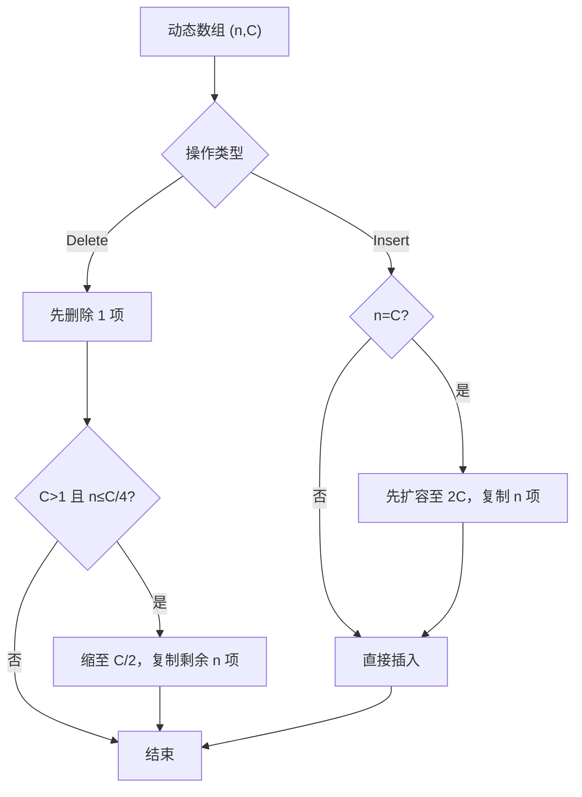

# 算法与数据结构 · 第 5 课
## 摊还分析进阶：为什么动态数组反复扩缩容仍能高效？

**2026 年 10 月 24 日｜第 1 周｜预计 18 分钟**

> **核心问题：** 动态数组插入时可能复制整个数组，删除后缩容也可能复制大量元素。为何某些扩缩策略对**任意操作序列**都能保持均摊常数时间，而某些看似合理的阈值却会产生灾难性的反复搬移？

### 学习目标与先修

本课延续第 1 课的摊还复杂度、第 3 课的下界与第 4 课的递归证明。学完应能：从总成本恒等式构造势函数；证明同时支持扩容与缩容的动态数组每次操作为 \(O(1)\) 摊还；识别扩缩容抖动的对抗序列；把方法迁移到二进制计数器。**摊还分析不是“平均随机输入”分析**，我们讨论的操作序列可以由对手选择。

## 一、先区别三种“平均”

对于操作序列 \(o_1,\ldots,o_m\)，令第 \(i\) 次真实成本为 \(c_i\)。

- **最坏单次成本**：某次插入恰逢扩容，复制 \(n\) 项，成本 \(\Theta(n)\)。
- **摊还成本**：在**任意**合法的 \(m\) 次操作序列上，证明总成本 \(\sum c_i=O(m)\)，不要求操作独立或随机。
- **概率意义上的期望成本**：先规定输入或算法的概率模型，再计算期望；它与摊还保证不是一回事。

摊还分析的关键不是把“很慢的一步”抹掉，而是证明昂贵操作发生前必须积累了足够多的便宜操作。

## 二、势函数法：给数据结构开一个“储蓄账户”

设 \(D_i\) 为第 \(i\) 次操作后的数据结构状态。选择一个**非负**势函数 \(\Phi(D)\ge0\)，定义本次摊还成本：

\[
\boxed{\hat c_i=c_i+\Phi(D_i)-\Phi(D_{i-1})}
\]

求和会望远镜相消：

\[
\sum_{i=1}^m\hat c_i
=\sum_{i=1}^m c_i+\Phi(D_m)-\Phi(D_0),
\]

因此：

\[
\boxed{\sum_{i=1}^m c_i
=\sum_{i=1}^m\hat c_i+\Phi(D_0)-\Phi(D_m)
\le\sum_{i=1}^m\hat c_i+\Phi(D_0).}
\]

**核心不变量：势能始终非负。** 某次摊还成本可以为负数，甚至很大；只要每次都被一个常数上界控制，且初始势能为常数，就得到整个序列的线性实际成本界。势函数不是程序运行时必须维护的字段，而是证明工具。

## 三、动态数组的正确扩缩策略

记 \(n\) 为元素数量、\(C\) 为容量。初态 \((n,C)=(0,1)\)，容量始终为 2 的幂。正常插入或删除的操作成本为 1；**每复制一个存活元素再计 1**。

- 插入 \(\texttt{InsertLast}(x)\)：如果 \(n=C\)，先分配容量 \(2C\)，复制旧的 \(n\) 个元素，再插入。
- 删除 \(\texttt{DeleteLast}()\)：要求 \(n>0\)。先删掉末尾元素；如果随后 \(n\le C/4\) 且 \(C>1\)，把容量缩为 \(C/2\)，复制**删除后**存活的 \(n\) 个元素。

```text
InsertLast(x):
    if n == C:
        resize(2*C)       # 复制 n 个旧元素
    A[n] = x; n = n+1    # 基础成本 1

DeleteLast():
    assert n > 0
    n = n-1               # 基础成本 1
    if C > 1 and n <= C/4:
        resize(C/2)       # 复制此时存活的 n 个元素
```

为何扩容阈值是 100%，缩容阈值却是 25%？二者之间必须有**迟滞（hysteresis）**：避免刚扩完就缩、刚缩完又扩。只说“扩容翻倍”而不说明缩容规则，无法证明混合操作的常数摊还界。

### 反例：用 50% 作为缩容阈值

假设满表状态为 \((n,C)=(m,m)\)，其中 \(m\) 很大。若改成“删除后负载率 \(\le1/2\) 就缩容”，则：

```text
(m,m) --插入--> (m+1,2m) --删除--> (m,m)
             复制 m 个           复制 m 个
       --插入--> (m+1,2m) --删除--> (m,m) -- ...
```

每两次逻辑操作都可能复制 \(2m\) 个元素，反复 \(r\) 轮需要 \(\Theta(rm)\) 搬移。**不能对所有操作序列宣称 \(O(1)\) 摊还！**

### 扩缩容过程的状态图



## 四、怎么“猜出”有效势函数？

满表即将扩容时，希望事先储蓄的势能是 \(\Theta(C)\)，以便扩容时释放它；删除后接近 \(C/4\) 时，也希望积累足够势能支付缩容复制。

因此按负载率分两段：

\[
\boxed{
\Phi(n,C)=
\begin{cases}
2n-C, & n\ge C/2,\\
C/2-n, & n<C/2.
\end{cases}}
\tag{1}
\]

它在每个合法状态都非负，并且在 \(n=C/2\) 两侧都取 0。靠近**满载**时 \(\Phi\) 随 \(n\) 增加；靠近**四分之一负载**时，\(\Phi\) 随删除而增加。这是一个双向储蓄账户。

初态 \(\Phi(0,1)=1/2\)，所以最终总成本界会多一个无关紧要的常数。

## 五、逐案证明：每次摊还 \(O(1)\)

### 情况 A：普通插入，不扩容

实际成本 \(c=1\)。处于高负载段时，元素数加一导致 \(\Delta\Phi=+2\)，故 \(\hat c=3\)；在低负载段内 \(\Delta\Phi=-1\)，故 \(\hat c=0\)。跨越 \(1/2\) 分界时势能不会突然上升超过 2。小容量 \(C=1\) 从空到满可直接核对 \(\hat c=1.5\)。

因此普通插入总有 \(\hat c\le3\)。

### 情况 B：满表插入，触发扩容

旧状态 \((n,C)=(C,C)\)，故旧势能为 \(\Phi_{\rm old}=C\)。

复制 \(C\) 项再插入 1 项：

\[
c=C+1.
\]

新状态 \((n',C')=(C+1,2C)\)，因此新势能：

\[
\Phi_{\rm new}=2(C+1)-2C=2.
\]

于是：

\[
\boxed{\hat c=(C+1)+(2-C)=3.}
\]

**一次复制 \(C\) 个元素的昂贵操作，却只有 3 的摊还成本。** 这不矛盾，因为之前积攒的势能已经提前支付了复制。

### 情况 C：普通删除，不缩容

实际成本 \(c=1\)。高负载段内 \(\Delta\Phi=-2\)，低负载段内 \(\Delta\Phi=+1\)，从高负载跨入低负载时 \(\Delta\Phi\le1\)，所以：

\[
\boxed{\hat c\le2.}
\]

出现负摊还成本也完全允许；它代表操作释放了先前储蓄的势能。

### 情况 D：删除触发缩容

当旧容量 \(C\ge4\) 时，可达状态下恰好从旧元素数 \(C/4+1\) 删到 \(C/4\)，然后缩容至 \(C'=C/2\)。

旧势能：

\[
\Phi_{\rm old}=C/2-(C/4+1)=C/4-1.
\]

新元素数 \(n'=C/4=C'/2\)，新势能为 0。实际成本为：

\[
c=1+C/4.
\]

因此：

\[
\boxed{\hat c=(1+C/4)-(C/4-1)=2.}
\]

**边界不要跳过：** 对 \(C=2\)，从 \(n=1\) 删至 0 后缩到 \(C'=1\)，真实成本为 1，势能从 0 变成 \(1/2\)，摊还成本为 \(1.5\)。这也满足常数界。

归纳所有情况：任何合法操作 \(\hat c_i\le3\)。因此对任何 \(m\) 次插入与删除混合序列：

\[
\boxed{\sum_{i=1}^{m}c_i
\le 3m+\Phi(D_0)=3m+1/2=O(m).}
\]

不是每次 \(O(1)\) 实际时间；是任意操作序列的总实际时间 \(O(m)\)。

**空间边界：** 对所有 \(n\ge1\) 的操作完成后状态，有 \(C\le4n\)；空表保持常数容量。因此空间 \(\Theta(n+1)\)。这里按实际分配的容量计空间，而不是按已经存储的元素数计。

## 六、数值 Trace：势能如何存入和释放？

下面按 \((n,C)\) 记录状态，并逐步计算 \(\hat c=c+\Delta\Phi\)。初态 \((0,1)\)，势能 \(0.5\)。

| 操作 | 操作后 \((n,C)\) | 实际成本 \(c\) | 新势能 \(\Phi\) | 摊还成本 \(\hat c\) |
|---|---:|---:|---:|---:|
| 插入 1 | (1,1) | 1 | 1 | 1.5 |
| 插入 2（扩容） | (2,2) | 2 | 2 | 3 |
| 插入 3（扩容） | (3,4) | 3 | 2 | 3 |
| 插入 4 | (4,4) | 1 | 4 | 3 |
| 插入 5（扩容） | (5,8) | 5 | 2 | 3 |
| 删除 | (4,8) | 1 | 0 | -1 |
| 删除 | (3,8) | 1 | 1 | 2 |
| 删除（缩容） | (2,4) | 3 | 0 | 2 |

表中“负的摊还成本”不是负的执行时间。它只意味着那一步释放的储蓄大于自己的实际成本。也可验证全部操作的实际成本与摊还成本，通过首尾势能变化完全一致。

## 七、迁移：二进制计数器为何能做到常数摊还？

一个不限固定位宽的二进制计数器执行 \(`Increment`\)：把末尾连续的 \(k\) 个 1 翻成 0，再把它们前面的一个 0 翻成 1。最坏可能翻转很多位，真实成本：

\[
c=k+1.
\]

选择势函数 \(\Phi=\text{当前二进制表示中 1 的个数}\)。该操作使势能变化：

\[
\Delta\Phi=1-k,
\quad
\hat c=(k+1)+(1-k)=2.
\]

例如：

```text
0000 → 0001 → 0010 → 0011 → 0100
       翻1位   翻2位   翻1位   翻3位
```

虽然 \(0011\to0100\) 翻转 3 位，但整个序列中每次加一的摊还成本都不超过 2。**潜在函数要追踪的是未来昂贵操作的“准备量”，并非当前数据量本身。**

## 八、适用边界和常见误区

上述证明依赖：数组容量按 2 倍扩缩、缩容阈值为 1/4、顺序复制每个存活元素花费常数、只分析 \(`InsertLast`\) 与 \(`DeleteLast`\)。如果复制元素自身有非恒定成本，或者需要维护复杂索引，上述 \(O(1)\) 摊还界不一定继续成立。分配器成本也被简化为与复制量同阶或常数额外开销；现实系统需要单独测量分配成本和内存碎片。

还需分清：**一个具体序列的平均真实成本**不等于**证明所有合法序列的摊还上界**；**势函数存在**不要求在代码里真的保存势能；**常数摊还时间**不意味着每次调用的最坏延迟可被常数限制。如果实时系统要求每次操作都不能长时间停顿，还需要渐进式迁移、增量复制等技术，而不只是一条摊还证明。

## 九、四级自测｜总分 100 分

前 3 题可客观判分，第 4 题考查证明。初次作答不提供标准答案或解析。

### Lv1｜关键机制：摊还上界的量词（预计 2 分钟）｜15 分

某数据结构的一次操作可能要复制 Θ(n) 个元素，但被证明每次操作的摊还成本至多为常数。以下哪项解释最准确？

A. 每次实际操作成本都必然是 O(1)。

B. 对任意合法操作序列，总实际成本可由各次摊还成本之和加初始势能控制；单次操作仍可能昂贵。

C. 只有输入操作服从均匀随机分布时，才能使用势函数证明摊还界。

D. 摊还成本就是将若干次操作的实际时间简单除以操作次数，不需要处理未来操作。

*可选中立提示：区分某一次操作的最坏成本与任意长序列的总成本；思考势能是否允许暂存。*

### Lv2｜手工 Trace：扩缩容与势能变化（预计 4 分钟）｜20 分

一个动态数组当前状态为 (n,C)=(3,8)。插入满则容量翻倍；删除后如果 n≤C/4 且 C>1，则容量减半（最低容量为1）。正常插入/删除各计成本1，每复制一个元素再计成本1。势函数定义为 Φ(n,C)=2n−C（n≥C/2）或 Φ(n,C)=C/2−n（n<C/2）。依次执行 Delete、Insert、Insert。求这三次操作的摊还成本总和（输入整数）；请列出每一步 (n,C)、真实成本与 Φ 的变化。

*可选中立提示：删除先更新元素数，再检查是否缩容；总摊还成本可以用望远镜求和核对。*

### Lv3｜反例与边界：为什么缩容阈值要有迟滞（预计 5 分钟）｜25 分

另一种动态数组策略是：满时扩容到两倍；每次删除后若负载率 ≤1/2 就把容量减半。初态 (n,C)=(m,m)，其中 m 是足够大的2的幂，反复执行 Insert、Delete 各一次算一轮，扩缩容需复制现存元素。以下哪些判断正确？（多选）

A. 这段交替序列可能每一轮都触发两次 Θ(m) 规模的元素复制。

B. 只要插入和删除次数相同，就能保证复制次数总计为 O(操作次数)。

C. 把缩容阈值改为负载率 ≤1/4、扩容规则不变，可避免这种扩缩容抖动，并有 O(1) 的摊还成本证明。

D. 因为每次操作只修改一个逻辑元素，任意扩缩容策略的实际最坏成本都是 O(1)。

*可选中立提示：从满表开始，先插入再删除，分别记录容量和存活元素数。比较扩容后与缩容前的负载率。*

### Lv4｜设计与证明：可扩缩动态数组的严格摊还分析（预计 12 分钟）｜40 分

设计支持 InsertLast 和 DeleteLast 的原地动态数组：初始 n=0、C=1，插入前若 n=C 则扩容至 2C；删除后若 n≤C/4 且 C>1，则缩容至 C/2。正常插删成本1，扩缩容额外按复制的现存元素个数计费。请完成：
A（8分）给出伪代码和一个非负势函数，说明为何不能仅凭单次最坏成本分析摊还界。
B（10分）按“不扩容/扩容”两种情形严格推导 InsertLast 的摊还成本上界。
C（12分）按“不缩容/缩容”两种情形严格推导 DeleteLast 的摊还成本上界，特别处理 C=2 的边界。
D（10分）利用望远镜求和证明任意 m 次合法操作总实际成本 O(m)，再说明 n≥1 时容量 C 与 n 的数量级关系。要求指出你的证明所依赖的复制成本模型。

*可选中立提示：可尝试用装载率1/2作为势函数切换点，扩容与缩容的势能变化要分别计算；小容量需单独核对。*

## 十、总结与下一课

**今天要带走的公式**是 \(\hat c_i=c_i+\Delta\Phi_i\) 和 \(\sum c_i=\sum\hat c_i+\Phi_0-\Phi_m\)。它们把局部的昂贵操作转化为对整个操作序列的严格控制。分段势函数 \(\Phi(n,C)\) 同时处理动态数组的扩容和缩容；采用 1/4 缩容阈值的迟滞，避免了 1/2 阈值的对抗性抖动。

**第 6 课（2026-10-25）预告：** 递归与分治的边界案例——如何用递归树和 Akra–Bazzi 思路理解 Master 定理不直接覆盖的不均匀递归，并与本周的选择算法做联系。第 7 课按计划进行第一周复盘，不引入新专题。

完成练习后，可按 Lv1—Lv4 提交答案。我会逐题批改、给出满分 100 分的总分：80 分及以上按计划继续；60–79 分补针对性例题；低于 60 分先复习势函数及扩缩容不变量。复习不会改变按自然日确定的课程编号。
