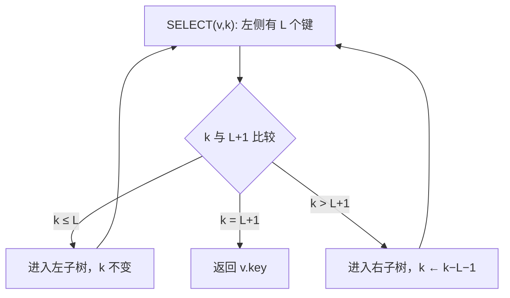

# 算法与数据结构 · 第 15 课

## 秩统计树：在平衡 BST 上用子树大小实现第 k 小与排名

**2026 年 11 月 3 日｜第 3 周 · 第 2 天｜讲授约 17 分钟（自测另计）**

> 昨天学过 AVL 旋转如何保持中序顺序和最坏对数高度。今天只加一个数字 `size`：节点所在子树有多少个键。这个小改动能让“找第 k 小”和“某键排第几”都只走一条根到叶路径。

### 一、学习目标与模型（约 1 分钟）

本课结束应能：(1) 区分普通 BST 搜索、SELECT(k) 和 RANK(x)；(2) 手工追踪两种查询；(3) 写出并证明 `size` 不变量，说明旋转后必须更新哪些节点；(4) 推出最坏时间与空间复杂度，并辨析重复键、越界与删除的边界。

约定：先存**互异整数键**，重复插入只更新 value；`RANK(x)` 对已存键返回从 1 开始的升序名次，未找到返回 `NOT_FOUND`；`SELECT(k)` 返回第 k 小的键，合法范围为 `1≤k≤n`。空子树 `size=0`、`height=−1`，叶子高度为 0。AVL 的平衡条件仍为每个节点 `|height(left)−height(right)|≤1`。

### 二、动机：有“序”还不够，还要知道每侧有多少（约 2 分钟）

普通 BST 能查找某个键，却不容易直接定位第 k 小：当进入节点时，仅凭键大小，不知道它的左边究竟有几个元素。笨办法是先中序遍历得到有序数组，查询一次耗 `O(n)` 时间；若结构不断变动，维护独立排序数组又有更新代价。

**增强型数据结构（augmentation）**的思路是：不改变 BST 的比较规则或 AVL 的旋转原则，只在每个节点增加可由孩子计算的摘要：

\[
\boxed{size(v)=1+size(v.left)+size(v.right),\qquad size(\varnothing)=0.}
\]

它统计的是**当前子树的节点数**，不是节点深度，也不是以根为单位的全局排名。

```text
                30 (size=7)
               /           \
       20 (size=3)       40 (size=3)
         /     \           /     \
      10(1)   25(1)     35(1)   50(1)

中序序列：10, 20, 25, 30, 35, 40, 50
根 30 左侧恰好有 3 个键，所以它是全树第 4 小。
```

### 三、SELECT(k)：每走一步都舍弃一段排名（约 3 分钟）

设当前子树根为 `v`，左子树大小为 `L=size(v.left)`。BST 顺序告诉我们：左侧的 L 个键全部小于根；根的**局部排名**恰好是 `L+1`。

因此把局部排名 k 和 L+1 比较，就能**只选一侧递归**：

```text
SELECT(v, k):
    if v == null or k < 1 or k > size(v):
        return INVALID
    L = size(v.left)
    if k <= L:
        return SELECT(v.left, k)
    if k == L+1:
        return v.key
    return SELECT(v.right, k-(L+1))
```

**核心不变量：** 每次进入 `SELECT(v,k)`，`k` 都是目标键在**当前子树**中的 1-based 排名。进入左子树时，前面没有需要减去的元素；进入右子树时，已经跳过左侧 L 个键与根 1 个键，所以新排名是 `k−(L+1)`。

**数值 Trace：** 在上图求 `SELECT(5)`：根 30 的 `L=3`，因 `5>4`，进右子树并令 `k=1`；到 40 时 `L=1`，因 `1≤1`，进入左孩子 35；到 35 时 `L=0` 且 `k=L+1`，返回 35。全程只看了 **3 个节点**，没有遍历其他子树。



### 四、RANK(x)：把已越过的左半边累加起来（约 2 分钟）

`RANK(x)` 是反方向的问题：不知 k，只知道目标键 x。搜索时用累计量 `passed` 记录已确定**严格小于 x**、且不在当前搜索子树中的键数。

```text
RANK(root, x):
    v = root; passed = 0
    while v != null:
        L = size(v.left)
        if x < v.key:
            v = v.left
        elif x > v.key:
            passed += L+1
            v = v.right
        else:
            return passed + L+1
    return NOT_FOUND
```

为什么向右才加 `L+1`？既然 `x>v.key`，当前节点及整个左子树都严格小于 x；向左时，当前根和右侧键都在 x 之后，不能计入。

继续用上图算 `RANK(35)`：在 30 处右转，`passed=3+1=4`；在 40 处左转，`passed` 不变；找到 35 时其左子树大小为 0，返回 `4+0+1=5`。

**循环不变量：** 在搜索当前节点 v 前，`passed` 恰好是从之前走过的右转处已确认小于 x、且不再属于当前子树的键数；当找到 x，当前子树内再添 `size(v.left)+1` 即得全局排名。

### 五、旋转之后：为什么只改两个节点的 size？（约 3 分钟）

先回忆标准左旋；A、B、C 为可能为空的子树：

```text
旋转前：                      旋转后：
       x                           y
      / \                         / \
     A   y                       x   C
        / \                     / \
       B   C                   A   B
```

旋转前后中序都是 `A, x, B, y, C`，所以**所有键的全局名次不变**。但 `x` 的子树变小了：它不再包含 y 与 C；`y` 变成新的局部根，获得 A 和 x。因此“旋转不改变键集合”**并不意味着每个节点的 size 都不变**。

```text
PULL(v):
    v.height = 1 + max(height(v.left), height(v.right))
    v.size = 1 + size(v.left) + size(v.right)

ROTATE_LEFT(x):
    y = x.right               # y 必须存在
    B = y.left
    y.left = x
    x.right = B
    PULL(x)                   # 先更新下降的旧根
    PULL(y)                   # 再更新上升的新根
    return y                  # 新根必须接回父节点
```

右旋完全对称。**A、B、C 内部完全没有变化**；转动后只需自底向上重新计算 `x`、`y` 的 height 和 size，每次 `PULL` 都是 `O(1)`。局部子树包含的键总数未变，因此它的**父节点**的 size 数值不会因这次旋转本身发生变化。不过插入新键本身会让相应祖先的 size 加一，需要正常沿插入路径更新。

数值看一次 LR：空树依次插入 `[30,10,20]`，插入 20 后形成 `30(3) → 10(2) → 20(1)` 的左-右折线。先对 10 左旋、再对 30 右旋，得到：

```text
           20 (size=3)
           /          \
     10 (size=1)    30 (size=1)
```

此时 `SELECT(2)=20`、`RANK(30)=3`。若漏掉旋转后 size 更新，结构可能仍是合法 BST/AVL，**但秩统计查询会按旧计数走错路**。

### 六、正确性证明与复杂度（约 3 分钟）

**① size 维护的归纳。** 空树满足 `size=0`；插入新叶时其 size 为 1；递归回溯对所有受影响祖先执行 `PULL`，使等式成立；若发生单旋或双旋，每个基本旋转都按“旧根 → 新根”顺序更新，所以旋转后的相关节点仍满足 size 等式。更新已有键值不改变节点数。由结构归纳，任意操作完成后所有节点的 size 都准确。

**② SELECT 正确性。** 对当前子树大小归纳。按 BST 顺序，左子树恰有 L 个较小键，根是局部第 L+1 小；目标要么在左，要么就是根，要么在右。三种情况穷尽且互斥；向右减去 L+1 后目标局部排名不变。每轮都进入严格更小的子树，最终在合法 k 下返回正确键。

**③ RANK 正确性。** 循环不变量表明 `passed` 永远只计算已跳过且严格小于 x 的键；向右一次正好新增当前左子树与根的 L+1 个键，向左不新增。找到 x 时，加当前左子树 L 个键和 x 自己，就得到 1-based 名次。未找到则返回 `NOT_FOUND`。

**④ 为什么最坏是对数？** 昨天证明 AVL 高度 `h=O(log n)`；两种查询各走一条根到叶路径、每层只做 `O(1)` 工作：

\[
\boxed{T_{SELECT}(n)=T_{RANK}(n)=O(\log n)\quad\text{（最坏）}.}
\]

`INSERT` 按 BST 路径下降再回溯，每层更新 size/height 为常数工作，AVL 插入只需常数次基本旋转，故最坏 `O(log n)`。存储 n 个节点占 `O(n)` 空间；上述 SELECT 递归与递归 INSERT 额外栈深 `O(log n)`，迭代 RANK 的额外空间为 `O(1)`。

### 七、边界与反例（约 2 分钟）

**只有 size 没有平衡并不够。** 若按 `1,2,3,…,n` 插入普通 BST 而不旋转，虽然每个 size 都可以完全正确，树却是一条链，`SELECT(n)` 依然要走 `Θ(n)` 层。**“size 提供排名跳转，AVL 提供高度保证”是两个独立条件。**

**k 越界与缺失键。** `k=0` 或 `k>size(root)` 不应继续递归；`RANK(x)` 对不存在的 x 不应冒充返回 x 的排名。若需要“有多少个键严格小于 x”，应另定义 `COUNT_LESS(x)`，它对不存在键也有意义，和这里的 `RANK` 不同。

**重复键的扩展。** 可在每个不同键的节点中存频数 `cnt(v)≥1`，把 `size(v)` 改为 `cnt(v)+size(left)+size(right)`。于是根占据的是从 `L+1` 到 `L+cnt(v)` 的整段名次，而非一个名次。若采用这个模型，删除一个副本使 cnt 减一，也必须更新沿途 size；删除完整节点还可能引发 AVL 旋转和多层重平衡。仅修改局部节点的计数、不维护祖先 size，会直接破坏 SELECT。

### 八、小结与下一课（约 1 分钟）

本节从一个很小的局部公式推出了两个全局查询：

\[
\text{AVL 高度 }O(\log n)
+\text{ 节点 size 正确}
\Longrightarrow
\begin{cases}
SELECT(k):O(\log n),\\
RANK(x):O(\log n).
\end{cases}
\]

记住两条不变量即可：**SELECT 的 k 始终是当前子树的局部名次；RANK 的 passed 始终是已越过且严格小于目标的键数。**

**下一课（2026-11-04，第 16 课）：持久化线段树的路径复制。** 为什么只复制更新路径的 `O(log n)` 个节点，就能同时保留旧版本并支持区间查询？这将把今天的“子树摘要”推广到有版本的区间数据结构。

### 九、四级自测（共 100 分；首次不给答案）

前 3 题可客观判分；Lv4 按证明与设计步骤评阅。提示不包含选项答案，**解析只保存在对应的互动 JSON 中**。

#### Lv1｜局部排名不变量｜15 分｜预计 2 分钟｜单选

在一棵每个节点都正确维护 size(v)=1+size(left)+size(right) 的 AVL 树中，SELECT(k) 走到节点 v，设 L=size(v.left)。若 k>L+1，下列哪种处理正确？

A. 进入左子树，保持 k 不变。

B. 进入右子树，令 k←k−(L+1)。

C. 直接返回 v.key，因为右边还有元素。

D. 进入右子树，保持 k 不变。

*中立提示：把左子树的 L 个键和当前根的 1 个键看成已经越过的有序前缀。*

#### Lv2｜AVL 旋转后 SELECT / RANK Trace｜20 分｜预计 4 分钟｜单选

从空 AVL 树依次插入互异键 [50,20,40,10,30,60,70]，每次插入后立即再平衡并更新 size。最终树根、SELECT(6) 返回的键值、RANK(50)（已存键的 1-based 排名）分别是什么？

A. 根 40，SELECT(6)=60，RANK(50)=5。

B. 根 50，SELECT(6)=60，RANK(50)=5。

C. 根 40，SELECT(6)=50，RANK(50)=5。

D. 根 40，SELECT(6)=60，RANK(50)=6。

*中立提示：前三次插入检查 LR；最后插入 70 时检查以 50 为根的局部子树。然后依次按左子树大小做排名跳转。*

#### Lv3｜复杂度、旋转信息与重复键边界｜25 分｜预计 4 分钟｜多选

关于带子树大小的 AVL / BST，下面哪些判断成立？（多选，选出全部正确项）

A. 即使所有 size 都正确，未平衡的普通 BST 上 SELECT 仍可能花费 Θ(n) 时间。

B. 左旋后只需更新上升的新根的 size，下降的旧根 size 一定保持原值。

C. 若重复键压缩在节点的 cnt 中，令 size=cnt+size(left)+size(right)，并把本节点占据的排名区间视为 (L,L+cnt]，仍可支持多重集合 SELECT。

D. 删除一个节点后，即使不需要旋转，也可能必须更新其祖先的 size，才能保证后续 RANK / SELECT 正确。

*中立提示：size 是计数信息，不会自动降低树高；旋转可能改变单个节点所管的子树；删除会减少若干祖先子树中的键数。*

#### Lv4｜增强 AVL 的设计、正确性与边界｜40 分｜预计 10 分钟｜开放推导

设计一个同时支持 INSERT、SELECT(k)、RANK(x) 的 AVL 秩统计树，键互异，空子树 size=0、height=−1，RANK(x) 只对已存在的键返回从 1 开始的排名，不存在时返回 NOT_FOUND。要求：(a)（12 分）给出 size 不变量和 SELECT、RANK 的伪代码，包含 k 越界处理；(b)（12 分）给出 AVL INSERT 与左旋（右旋对称）时 size、height 的维护顺序，并证明旋转保序且只需 O(1) 次局部信息更新；(c)（10 分）证明 SELECT、RANK 的正确性和最坏 O(log n) 时间，说明 INSERT 的时间、整树与递归栈空间；(d)（6 分）说明将重复键改成节点计数 cnt 时应如何修改 size 与 SELECT，以及删除一个键时为何必须沿路径更新 size。

*中立提示：先写 size=1+size(left)+size(right)，再考察节点把当前区间排名切为左侧 L 个、根 1 个和右侧；旋转后先更新下降的旧根，再更新上升的新根。*

### 十、提交与反馈

回复 **Lv1：选项；Lv2：选项与关键旋转；Lv3：全部正确选项；Lv4：(a)–(d) 的推导**。我会按 15/20/25/40 分逐题批改：**80–100** 按计划继续；**60–79** 加一道针对性巩固；**低于 60** 重点复习局部排名和旋转后的 `size` 维护。补练不改变按自然日确定的课号。
