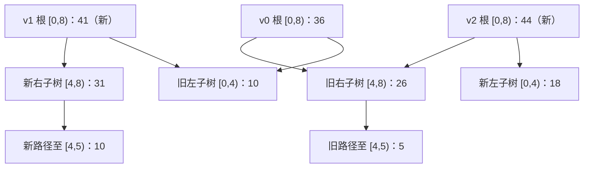

# 算法与数据结构 · 第 16 课

## 持久化线段树：为什么只复制一条路径，就能永久保留旧版本？

**2026 年 11 月 4 日｜第 3 周 · 第 3 天｜讲授约 17 分钟（自测另计）**

> 昨天的秩统计树在每个节点维护 `size`，用局部摘要回答全局排名。今天换一个摘要：**区间元素之和 `sum`**。更进一步，每次修改都要保留原先的数组，允许随时查旧版本，甚至从旧版本再分叉出新版本。关键技术是 **path copying（路径复制）**。

### 一、学习目标与模型（约 1 分钟）

完成后应能：解释线段树的区间划分；写出单点赋值、连续区间求和；准确画出一次更新哪些节点新建、哪些子树共享；证明旧版本不变；计算各版本的时间和空间成本。

用长度 `n≥1` 的定长数组 `A[0..n−1]`，下标从 **0** 开始；所有区间都采用半开形式 `[L,R)`。每个节点存 `(L,R,sum,left,right)`，表示某一版本中 `A[L]+…+A[R−1]`。叶区间长度为 1。单点操作是**赋值** `A[i]←x`，不是在旧值上加 `x`；区间查询返回和，空区间的和为 0。暂不支持改数组长度。

### 二、动机：旧数组不能被新修改抹掉（约 2 分钟）

设最初数组为：

[
A_0=[2,1,3,4,5,6,7,8],qquad sum A_0=36.
]

要支持如下历史：

- `v0`：原数组。
- `v1=SET(v0,4,10)`：只把下标 4 从 5 改成 10，故总和 41。
- `v2=SET(v0,1,9)`：**从 v0 而不是 v1** 分叉，把下标 1 从 1 改成 9，故总和 44。

如果直接在共享数组上原地改写，`v0` 可能被后来的修改污染。每次都复制完整数组虽然正确，却要 `Θ(n)` 时间和新空间。线段树的优势在于：**一个位置变化，只会影响包含该位置的祖先区间。**

### 三、线段树的形状与第一次路径复制（约 3 分钟）

`n=8` 时，根表示 `[0,8)`，中点 4 将它拆为 `[0,4)` 与 `[4,8)`；继续二分，直到单元素。每个内部节点满足

[
oxed{sum(v)=sum(v.left)+sum(v.right).}
]

`v0` 根和为 36，左右孩子分别为 10、26。执行 `SET(v0,4,10)` 时，只复制以下四个区间的节点：

[
[0,8) longrightarrow [4,8) longrightarrow [4,6) longrightarrow [4,5).
]

新叶 `[4,5)` 的 `sum` 为 10；新 `[4,6)` 为 `10+6=16`；新 `[4,8)` 为 `16+(7+8)=31`；新根为 `10+31=41`。**其余节点不复制，直接引用旧节点。**



图中省略了中间孩子；`v1` 与 `v0` **共享整个左子树**，`v2` 与 `v0` **共享整个右子树**。三份版本由三个根指针表示，不需要复制三棵完整的树。共享是**指针共享**，前提是被共享的节点永远不再原地改写。

### 四、建树、更新与查询伪代码（约 3 分钟）

这里用不可变节点构造函数 `Node(L,R,sum,left,right)`；`null` 不作为查询的合法子树根。保存所有历史根的数组为 `roots`。

```text
BUILD(A, L, R):                      # 前提：0 <= L < R <= n
    if R-L == 1:
        return Node(L,R,A[L],null,null)
    M = (L+R)//2
    a = BUILD(A,L,M)
    b = BUILD(A,M,R)
    return Node(L,R,a.sum+b.sum,a,b)

SET(old_root, i, x):                 # 0 <= i < n
    UPDATE(v):
        if v.R-v.L == 1:
            return Node(v.L,v.R,x,null,null)
        M = (v.L+v.R)//2
        if i < M:
            a = UPDATE(v.left)
            b = v.right               # 共享，不修改
        else:
            a = v.left
            b = UPDATE(v.right)
        return Node(v.L,v.R,a.sum+b.sum,a,b)
    new_root = UPDATE(old_root)
    roots.append(new_root)
    return new_root

SUM(root, ql, qr):                   # 0 <= ql <= qr <= n
    QUERY(v):
        if qr <= v.L or v.R <= ql: return 0
        if ql <= v.L and v.R <= qr: return v.sum
        return QUERY(v.left)+QUERY(v.right)
    return QUERY(root)
```

实际实现须在公开接口中校验 `i`、`ql`、`qr`；非法索引不能静默落到错误叶子。`SET` 返回一个新根，**即使赋的值与原来相同，上述简单实现仍复制一条路径**（可优化成返回旧节点）。

### 五、数值 Trace：两个更新可以从同一旧版本分叉（约 2 分钟）

第一次更新已经得到 `v1`。第二次从 `v0` 更新下标 1，复制的路径是 `[0,8)→[0,4)→[0,2)→[1,2)`，新左子树和为 18，新根和为 44，而右子树直接复用 `v0` 的旧右子树。

| 版本 | 由哪个版本生成 | 根的总和 | `SUM([2,6))` |
|---|---|---:|---:|
| `v0` | 初始构建 | 36 | `3+4+5+6=18` |
| `v1` | `SET(v0,4,10)` | 41 | `3+4+10+6=23` |
| `v2` | `SET(v0,1,9)` | 44 | `3+4+5+6=18` |

计算 `SUM(v1,[2,6))` 时，完整覆盖的子区间可以直接取已存 `sum`：`[2,4)=3+4=7`，`[4,6)=10+6=16`，所以返回 `7+16=23`，无需逐个访问四个叶子。

原始树有 `2n−1=15` 个节点；两次更新各新建 4 个节点，故本例保留所有版本时总共分配 `15+4+4=23` 个树节点（另有三个根指针）。这比为三个版本各存 8 个数组元素更能体现**后续多次更新时的增量优势**；不能拿这一个小例子的绝对内存量就判断实际实现一定更省。

### 六、核心不变量与正确性证明（约 3 分钟）

**版本不变量 (I)：** 对任意保存的版本根 `r`，树中每个节点 `v` 的 `sum` 等于**该版本**在区间 `[v.L,v.R)` 上的真实元素和；其左右孩子覆盖两个不交叉的子区间，合并恰好是父区间。所有已创建节点都不再修改。

**建树正确。** 对区间长度做归纳：长度为 1 时叶子的和显然正确；更长时，左右孩子由归纳假设正确，区间不相交且合并成父区间，所以父节点的和也正确。

**更新正确且保留历史。** 仍对区间长度归纳。若到达目标叶，新叶的和为 `x`；若在内部节点，含下标 `i` 的一侧递归生成正确的新子树，另一侧没有变化，原指针可共享；新父节点把两侧之和重新计算。与此同时，`UPDATE` 从不写旧节点，故 `old_root` 及从它能到达的所有节点保持原样，旧版本的查询不会改变。**从任意历史根继续更新**也依此成立。

**查询正确。** 不相交部分贡献 0；若当前节点区间完全被包含，直接返回其正确的 `sum`；否则左右孩子把父区间划成不交叉两部分，分别查询后相加。递归归纳得到 `SUM` 恰是目标半开区间元素和。

注意这两个命题不同：**新版本的数值正确**还不足以保证持久化，必须额外证明**旧版本所共享的任何节点都不发生修改**。

### 七、时间、空间与边界（约 2 分钟）

树每次把区间大致二分，高度至多 (lceillog_2 n
ceil)。不引入懒标记、只支持单点赋值与连续区间和时：

| 操作 | 最坏时间 | 新增节点 / 额外空间 |
|---|---|---|
| `BUILD` | `O(n)` | 初始 `2n−1` 个节点，递归栈 `O(log n)` |
| `SET`（单点赋值） | `O(log n)` | 每层新建 1 节点，共 `O(log n)`；栈 `O(log n)` |
| `SUM`（单个连续区间） | `O(log n)` | 不建节点；递归栈 `O(log n)` |
| `t` 次任意版本分叉更新后 | — | 保留所有版本时总存储 `O(n+t(1+log n))` |

对 `n=1`，高度、更新和查询都是常数；上表的 `O(log n)` 按通常 `n≥2` 的渐近记法理解，也可统一写成 `O(1+log n)`。

**为什么一次连续区间查询是 `O(log n)`？** 查询只有与边界部分重叠的节点才继续展开。每个深度至多有两个这样的“边界节点”；完全被包含的整段直接返回 `sum`，不再访问其后代。因此每层只访问常数多个节点，共 `O(log n)` 层。若要查询的是任意分散的多个位置而不是一个连续区间，不能直接套用这个证明。

**反例：** 版本 `v0=[1,2]`，要从它创建 `v1=[9,2]`。如果新根复用旧叶 `[0,1)`，然后**原地把这片共享叶的 `sum` 从 1 改为 9**，那么从 `v0` 查询 `[0,1)` 也会错误地得到 9；即使旧根对象完全没有修改，旧版本仍被破坏。正确做法是新建叶及其祖先。

路径复制适用于**任意旧版本可继续更新**的完全持久化（full persistence）场景。它不是通用的“原地指针修改自动回滚”方案，也没有自动解决并发写入、节点回收或区间批量更新；下一课会讨论后者。

### 八、今日小结与下一课（约 1 分钟）

核心逻辑是：

[
	ext{区间摘要 `sum`}+
	ext{仅修改一个位置}
Rightarrow	ext{只影响一条祖先路径}
Rightarrow	ext{路径复制 }O(log n)
Rightarrow	ext{旧根仍代表旧快照}.
]

**下一课（2026-11-05，第 17 课）：线段树的 Lazy Propagation。** 当一次操作需要给整个区间加上某个数时，为什么不能再只更新一条根到叶路径？懒标记如何把区间加与区间和都做到 `O(log n)`？本课的“节点摘要不变量”将继续派上用场。

### 九、四级自测（100 分；首次不公布答案）

四题依次考察**结构共享机制、分支版本数值计算、复杂度与反例、完整设计证明**。前三题客观判分，Lv4 按过程给分；下面只有中立提示，标准答案及解析仅在对应互动测验 JSON 中。

#### Lv1｜路径复制与版本隔离｜15 分｜预计 2 分钟｜单选

对一棵节点不可变的持久化线段树，从旧版本根 r0 执行一次单点赋值生成 r1。以下哪项严格正确？

A. 直接修改 r0 所指向的旧叶子即可，因为旧根没有变化。

B. 只复制目标叶子即可；路径上的祖先无需改变指针或区间和。

C. 复制根到目标叶子的路径节点，未受影响的兄弟子树可以共享，r0 仍能查询旧数据。

D. 每增加一个版本，查询任意旧版本必然多花一次遍历所有历史版本的时间。

*中立提示：分别检查：旧版本节点能否修改、祖先的 child 指针和区间和是否需要更新、查询从哪个根开始。*

#### Lv2｜分支版本与半开区间手工计算｜20 分｜预计 4 分钟｜数值/开放推导

初始数组 A=[2,1,3,4,5,6,7,8]（下标从 0 开始）。由 v0 生成 v1：把 A[4] 赋值为 10；另由 v0（不是 v1）生成 v2：把 A[1] 赋值为 9。区间查询采用左闭右开 [l,r)。求 SUM(v1,[2,6)) + SUM(v2,[0,3)) 的数值。

*中立提示：先明确 v1、v2 是从同一份 v0 分叉出来；分别列出两个半开区间包含的下标，再相加。*

#### Lv3｜节点复制数量、复杂度与共享内存反例｜25 分｜预计 4 分钟｜多选

设初始数组长度 n=8，树按区间二分直到单元素叶子，保留所有版本且节点不可变。以下哪些判断成立？（多选，选出全部正确项）

A. 一次单点赋值会沿根到叶路径新建 4 个节点（含根和叶），其余旧节点可共享。

B. 由于历史版本越积越多，查询任一固定版本的连续区间和在最坏情况下需要遍历全部历史版本。

C. 若允许从任意旧版本继续更新并保存新根，就可以形成分叉的版本关系，而不必只保留线性版本链。

D. 只要没有修改旧根对象，即使原地改写旧根所共享的后代叶子，所有旧版本的查询结果也一定不变。

*中立提示：先数 n=8 的树深；再区分版本根之间的共享图、查询过程以及共享对象原地修改的后果。*

#### Lv4｜持久化数据结构设计、归纳证明与时空界｜40 分｜预计 10 分钟｜数值/开放推导

设计支持从任意历史版本执行单点赋值 SET(version,i,x)、并在任意版本查询区间和 SUM(version,[ql,qr)) 的持久化线段树。数组下标为 0..n−1，节点保存 [L,R)、sum、left、right。要求：(a) 给出 BUILD、SET、SUM 的关键伪代码与下标边界处理（12 分）；(b) 写出每个版本的区间和不变量，用结构归纳证明 SET 正确且不会改变任何旧版本，并证明 SUM 正确（12 分）；(c) 推出建树、一次更新、一次连续区间查询的时间界，说明为什么更新仅新建 O(log n) 节点、查询是 O(log n)（10 分）；(d) 给出错误共享修改的最小反例，写出 t 次更新后的总存储空间和单次操作额外栈空间（6 分）。

*中立提示：证明时把每个节点区间划成左右两个不交叉的半开区间；更新只进入含 i 的孩子、另一孩子共享；区间查询只沿边界部分重叠的节点继续分裂。*


### 十、作答与反馈

回复 **Lv1：选项；Lv2：数值与计算过程；Lv3：全部正确选项；Lv4：(a)–(d) 分步证明**。我会按 **15/20/25/40** 分逐题评分：80–100 分按原计划继续，60–79 分补一道针对练习，低于 60 分优先复习“版本不变量、共享节点不可变、查询边界复杂度”。补练不改变自然日课号。
