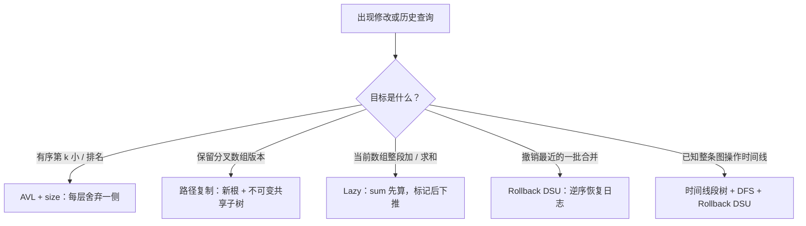

# 算法与数据结构 · 第 20 课

## 第三周复习：树上摘要、版本共享、懒标记与回滚，究竟有什么共同点？

**2026 年 11 月 8 日｜第 3 周 · 第 7 天（复习日）｜讲授约 17 分钟，自测另计**

> 本周第 14–19 课，看似学了五种数据结构，实际上都在回答一个问题：**某一部分发生变化后，怎样只处理必要的信息，同时保证后续查询正确？** 但它们对“旧状态”的处理截然不同：有的保留，有的延迟修改，有的撤销。今天复习这些区别，不引入新算法。

### 一、学习目标：识别“摘要、修改、历史”三个维度（约 1 分钟）

复习后应能：(1) 从查询类型选择 AVL 秩统计或线段树；(2) 区分持久化、Lazy Propagation 与回滚；(3) 手工 trace 分支版本和图连通性；(4) 对每种方法写出一个真正足以证明正确性的不变量；(5) 避免把“单次最坏对数”“分摊”“版本可回访”混为一谈。

本课约定：数组下标从 0 开始，区间为半开 [l,r)；AVL 中排名从 1 开始；图为 n 个顶点的无向图，离线操作时间 t=0,…,T−1，某边在 REMOVE 时刻之后不再活跃。

### 二、先画总地图：五个结构在保存什么？（约 2 分钟）

| 结构 | 节点或状态保存什么 | 修改时的关键策略 | 历史能力 |
|---|---|---|---|
| AVL 秩统计树 | height、size | 旋转后重新计算局部摘要 | 默认仅最新状态 |
| 持久化线段树 | 区间 sum、不可变孩子指针 | 复制单点更新路径，共享无变化子树 | 多个旧根可并存，并可从旧根分叉 |
| Lazy Segment Tree | sum、lazy | 整段先计入当前 sum，推迟传给孩子 | 标准可变版不保存旧版本 |
| Rollback DSU | parent、size、修改日志 | 按大小合并，不做无日志路径压缩 | 当前分支沿历史栈 LIFO 回滚 |
| 时间线段树 + DSU | 某时间区间始终有效的边 | DFS 进入 UNION、退出 ROLLBACK | 离线回答不同时间的连通性 |

**一个辨析：** 持久化中的“共享”意为多个根指向同一个**不可变**对象；Lazy 的“延迟”意为真实区间和已更新，而孩子还没收到增量；回滚的“历史”意为有办法撤销当前分支的写入。三者并不是同一种版本机制。



### 三、复习 AVL 秩统计：局部 size 怎样得到全局名次？（约 2 分钟）

AVL 的**顺序不变量**是左子树所有键 < 根 < 右子树所有键；**平衡不变量**是每个节点 |height(left)−height(right)|≤1；秩统计再加

\[
\boxed{size(v)=1+size(v.left)+size(v.right),\quad size(\varnothing)=0.}
\]

```text
             30 [size=7]
            /           \
       20 [3]         40 [3]
       /   \          /    \
    10[1] 25[1]    35[1] 50[1]
```

求 SELECT(5)：在根 30，左侧 L=3，目标在右侧，局部 k 变为 5−(3+1)=1；到 40，左侧 L=1，进入左子树；到 35 返回。求 RANK(35)：在 30 右转，累计越过 3+1=4 个键；在 40 左转不增加；命中 35，名次为 4+0+1=5。

**证明模板：** SELECT 中 k 始终是目标在当前子树的局部名次；RANK 中 passed 是已确定小于目标、且不在当前搜索子树内的键数。旋转保持中序顺序，但局部节点所管子树变化，必须先更新下降的旧根，再更新上升的新根的 height 与 size。AVL 高度 O(log n)，每层常数工作，所以两查询最坏 O(log n)。**只有 size 而没有平衡**，树仍可退化为链。

### 四、复习路径复制与 Lazy：一个保留版本，一个延期分发（约 3 分钟）

从 \(v_0=[2,1,3,4,5,6,7,8]\) 出发：

```text
                 v0  总和 36
                /             \
      SET(4,10)                 SET(1,9)
         /                          \
      v1 总和 41                 v2 总和 44

v1 = [2,1,3,4,10,6,7,8]
v2 = [2,9,3,4,5,6,7,8]  ← v2 不是在 v1 上修改
```

每次单点赋值只复制目标位置到根的路径；n=8 时包含根与叶共 **4 个新节点**，其他子树直接共享。版本不变量是：任一版本中节点 [L,R) 的 sum 等于该版本数组在区间上的真实和，且创建后的节点**绝不原地改写**。因此 v1 的 SUM([2,6))=23，v2 相同区间的和仍为 18；互不污染。

如果目的不是“保留旧版本”，而是“给当前数组整段加 δ”，使用 Lazy Segment Tree。对内部节点维持

\[
\boxed{sum(v)=sum(left)+sum(right)+lazy(v)\cdot len(v).}
\]

完全覆盖时 APPLY(v,δ)：sum+=δ·len、lazy+=δ；只有部分覆盖要访问孩子时才 PUSH：对两个孩子分别 APPLY(旧 lazy)，父 lazy 清零，**父 sum 不变**。随后必要时按孩子之和重算父 sum。

**最小反例：** 数组 [1,2] 整段加 5 后，根 sum=13，孩子可能仍是 1、2。若部分查询 [0,1) 时不 PUSH，也不传递祖先标记，会错误地得到 1 而不是 6。

**不能直接混用：** 可变 PUSH 会写孩子。若孩子正被旧版本共享，不先复制就会污染旧版本。做“持久化 + 懒标记”必须在任何写入前复制涉及的节点，或在纯只读查询中携带祖先增量而不修改共享节点。

### 五、复习 Rollback DSU：只记真正写过的东西（约 2 分钟）

DSU 的 parent 构成森林，根的 size 是连通块大小；按大小合并时，把小根 a 挂到大根 b 下。历史栈记录 (a,b,old_size_b)，足以撤销以下修改：

```text
UNION(x,y):
    a=FIND(x); b=FIND(y)        # 不进行路径压缩
    if a==b: return            # 无修改，通常不压栈
    if size[a]>size[b]: swap(a,b)
    history.push((a,b,size[b]))
    parent[a]=b
    size[b]+=size[a]

ROLLBACK(s):
    while len(history)>s:
        (a,b,old)=history.pop()
        parent[a]=a
        size[b]=old
```

根数 components 如有维护，成功合并减 1、撤销加 1。**回滚不变量**是：栈顶总是最近一次未撤销的成功合并；先撤销更晚的操作，才能准确恢复先前被改的 parent、size。按大小合并保证节点深度每增加 1，其所在集合大小至少翻倍，故无路径压缩 FIND 仍最坏 O(log n)，撤销一条成功合并 O(1)。

**路径压缩陷阱：** 先把 {1,2} 和 {3,4} 各自合并，再合并两个集合，对 4 做路径压缩；若随后只回滚最后一次 UNION 而不撤销压缩写入，4 可能仍错误地指向 {1,2} 的根。**Rollback DSU 不等于任意历史版本均可并存**：它只保有当前状态和一条可逆的执行历史。

### 六、复习离线动态连通性：把“删除边”改写成“离开一段时间”（约 3 分钟）

读完全部操作后，先生成每条边的半开**活跃区间**。以下共有 10 个时间点，初始无边：

| t | 操作 | 该时刻询问的结果（如适用） |
|---:|---|---|
| 0 | ADD(1,2) | — |
| 1 | ADD(2,3) | — |
| 2 | ASK(1,3) | 连通 |
| 3 | REMOVE(2,3) | — |
| 4 | ADD(3,4) | — |
| 5 | ASK(1,4) | 不连通 |
| 6 | ADD(2,4) | — |
| 7 | ASK(1,3) | 连通 |
| 8 | REMOVE(1,2) | — |
| 9 | ASK(1,3) | 不连通 |

因此边的生命周期为 (1,2):[0,8)，(2,3):[1,3)，(3,4):[4,10)，(2,4):[6,10)。尤其 t=8 删除之后，(1,2) **不能继续算活跃**。

把每个生命周期分解成 O(log T) 个不相交的时间线段树规范节点，并在各节点 bucket 存对应边。随后 DFS：

```text
DFS(node):
    s = DSU.SNAPSHOT()
    for edge in bucket[node]: DSU.UNION(edge.u,edge.v)
    if node 是时间叶 t:
        if op[t] 是 ASK: answer[t] = DSU.CONNECTED(u,v)
    else:
        DFS(node.left); DFS(node.right)
    DSU.ROLLBACK(s)
```

**正确性核心是两个不变量的组合。** 对每条边 e 和叶 t，e 在 t 活跃，当且仅当**根到叶 t 的路径上恰有一个 bucket 存有 e**（规范区间互不重叠）。DFS 在进入节点时加入沿途所有边，退出时回滚，因此叶 t 的 DSU 正好代表时刻 t 的图，兄弟子树不会互相污染。

例如 t=5 路径上只有 (1,2)、(3,4)，所以 1 与 4 不连通；t=7 再有 (2,4)，就通过 1–2–4–3 连通；到 t=9 时 (1,2) 已删除，1 与 3 又不连通。

### 七、复杂度速查与常见越界反例（约 2 分钟）

| 工作 | 最坏时间 | 空间或附加成本 |
|---|---|---|
| AVL 的 SELECT、RANK、INSERT | O(log n) | 节点 O(n)；递归栈 O(log n) |
| 持久化线段树单点 SET、连续 SUM | O(log n) | 初始 O(n)；每次 SET 新建 O(log n) 个节点 |
| 可变 Lazy 区间 ADD、SUM | O(log n) | 总节点 O(n)；递归栈 O(log n) |
| Rollback DSU FIND、UNION | O(log n) | parent、size、当前日志合计 O(n) |
| SNAPSHOT、撤销 k 条成功合并 | O(1)、O(k) | 每条合并记录 O(1) |
| 时间线段树 + Rollback DSU | O(T+K log T log n+Q log n) | O(T+K log T+n) |

其中 K 为边活跃区间数，Q 为 ASK 数，n 为顶点数，T 为操作数；对 n=1、T=1 等小值把 log 统一理解为 1+log。构造区间的字典操作按预期 O(1) 或用有序映射另计 O(log T)；空间也包括当前 DSU 日志，成功合并不超过 n−1 条。

不要混淆三个反例：**旧根不变≠共享叶可变；懒标记已计入父 sum≠孩子已更新；SNAPSHOT 保存历史栈长度≠能任意跳回所有旧分支**。这三处正是把一种数据结构迁移到另一种需求时最容易犯的错误。

### 八、本周结论与下一课（约 1 分钟）

这周形成的统一思路是：

\[
\boxed{\text{先定义局部摘要/历史不变量}\to
\text{确定修改影响范围}\to
\text{只处理必要节点}\to
\text{证明查询仍与真实状态一致}.}
\]

**下一课（2026-11-09，第 21 课）**进入第 4 周的最短路专题：从最短路松弛（relaxation）及 Bellman–Ford 的不变量讲起，再过渡到 Dijkstra、负边、Johnson 重赋权与 MST；届时会特别补上 Johnson 的完整基础推导。

### 九、四级自测（共 100 分；首次不给答案）

前三题客观判分，Lv4 开放推导；题目考不同知识维度。课堂只提供中立提示，标准答案与解析仅保存在独立测验 JSON 中。

#### Lv1｜历史语义与不变量｜15 分｜预计 2 分钟｜单选

比较持久化线段树、Lazy Segment Tree 与 Rollback DSU，哪一项同时正确？

**A.** 路径复制可以原地修改旧版本共享的叶子，只要旧根指针不变。

**B.** Rollback DSU 的 SNAPSHOT 必须复制整个 parent 数组，否则不能回滚。

**C.** 持久化线段树用不可变节点与新根保存可并存版本；标准 Lazy Segment Tree 延迟更新孩子但不自动保存版本；Rollback DSU 沿当前执行分支逆序撤销日志。

**D.** 只要按大小合并，Rollback DSU 就能安全使用不记日志的路径压缩。

*中立提示：分别想想：旧版本是否仍可直接查询？PUSH 会不会改写节点？回滚允许撤销哪个时间顺序的修改？*

#### Lv2｜分叉版本与区间懒更新 Trace｜20 分｜预计 4 分钟｜数值

初始 A=[2,1,3,4,5,6,7,8]，从 v0 单点赋值 A[4]←10 得到 v1；另从 v0（不是 v1）赋值 A[1]←9 得到 v2。现在仅从 v1 复制出一份独立的可变数组 B，在 B 上执行 ADD([1,5),+2)，区间均为半开。计算 SUM_B([2,6)) + SUM_v2([0,3)) 的数值。

*中立提示：v1 和 v2 是兄弟版本；B 的更新不改变 v1/v2。先列出 B 中下标 2、3、4、5 的当前值。*

#### Lv3｜复杂度、共享修改反例、时间覆盖不变量｜25 分｜预计 4 分钟｜多选

关于第 14–19 课的数据结构，下列哪些判断成立？（多选，选出全部正确项）

**A.** AVL 树同时维护正确 size 时，SELECT 和 RANK 的最坏时间为 O(log n)；只有正确 size 而不平衡则不能保证这个界。

**B.** 若持久化树的旧根对象不变，就允许直接改写旧根共享的后代叶子，旧版本结果仍一定不变。

**C.** 标准可变 Lazy Segment Tree 对完整覆盖区间执行 APPLY(δ) 时，同时令 sum+=δ·len、lazy+=δ；部分访问孩子前可通过 PUSH 传递增量。

**D.** 离线动态连通性中，将每条边活跃区间作互不重叠的规范节点分解后，边在时刻 t 活跃当且仅当根到叶 t 的路径上恰有一个对应 bucket 含该边。

*中立提示：把树高保证与摘要正确性分开；再问旧根之外的共享对象能否变动；最后检查一个半开活跃区间如何覆盖一个时间叶。*

#### Lv4｜统一证明与算法组合设计｜40 分｜预计 10 分钟｜开放推导

设计并证明两个互不混淆的系统：(a)（10 分）在 AVL 节点维护 size，给出 SELECT(k) 与 RANK(x) 的核心决策，并说明旋转后应更新哪些节点的信息，证明最坏 O(log n)；(b)（10 分）分别写出单点赋值持久化线段树的路径复制不变量，以及可变 Lazy Segment Tree 的 sum/lazy 不变量，说明两者怎样安全地支持历史版本（或为何普通 PUSH 不能直接复用）；(c)（14 分）对预先给定的 T 次无向图 ADD/REMOVE/ASK，写出“半开活跃区间→时间线段树规范覆盖→DFS 中 Rollback DSU”的关键步骤，证明叶 t 的连通性正确；(d)（6 分）给出上述三类查询或更新的主要时间与空间界，说明一个不记日志的路径压缩或共享节点原地修改导致错误的具体反例。

*中立提示：按三种不变量分别组织证明：BST 左子树大小、版本节点不可变与区间摘要、根到时间叶路径上的有效边集合。反例要指出哪次写入没有被正确隔离或撤销。*

### 十、提交与反馈

回复 **Lv1：选项；Lv2：数值与区间计算过程；Lv3：全部正确选项；Lv4：(a)–(d) 分步推导**。我会按 **15/20/25/40** 分逐题批改：80–100 分继续原课表；60–79 分补一道针对性巩固；低于 60 分优先回看错误对应的不变量与反例。复习补练不改变自然日课号。
