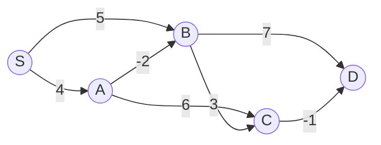

# 算法与数据结构 · 第 21 课

## Bellman–Ford：为什么反复松弛能找到负权最短路？

**2026 年 11 月 9 日｜第 4 周 · 第 1 天｜讲授约 17 分钟（自测另计）**

> 上周我们靠树上的局部不变量维护全局查询。今天开始最短路专题：图中一条边权值可以为负，走过某条边反而让总代价下降。此时“当前看起来最近的点一定已经最优”不再可靠；Bellman–Ford 采用更稳妥的思路：**逐步增加允许使用的边数，每轮保证一项可证明的最优性。**

### 一、学习目标与问题模型（约 1 分钟）

本节学会：(1) 写出最短路的松弛操作；(2) 理解同步 Bellman–Ford 第 k 轮的**至多 k 条边**不变量；(3) 手工计算含负边图的逐轮距离；(4) 证明为什么通常 n−1 轮足够、为什么第 n 轮能检测**源点可达**的负环；(5) 分清负边、负环、不可达与 Dijkstra 的边界。

考虑有向图 G=(V,E)，n=|V|≥1，边权 w(u,v) 可正、零、负，源点 S 固定。路径代价是沿途边权之和；为方便证明，允许重复顶点的路线称为**游走（walk）**。不可达记为 +∞。下标 k 表示**完成 k 轮同步松弛**，不是算法已经访问了 k 个顶点。

### 二、松弛是什么：只要发现更便宜的路径就改距离（约 2 分钟）

如果当前知道到 u 的路线代价为 d[u]，而存在边 u→v，权重为 w，那么沿此路线再走一条边到 v，代价为 d[u]+w。于是有松弛（relaxation）：

[
\boxed{d[v]\leftarrow\min\{d[v],d[u]+w(u,v)\}.}
]

例如已知 d[A]=4，边 A→B 权重 −2，则可为 B 提供候选距离 2；如果 B 原先是 5，便将其改为 2。**松弛只会让估计下降，不会直接证明该估计已经是全局最优。**

必须检查 d[u] 是否有限；不可达节点即使有一条负边，也不能凭空形成来自 S 的路径。若用整数常量模拟 +∞，还须防止溢出；数学推导中的 +∞ 只是哨兵符号。

### 三、最关键的选择：本节先用“同步轮次”（约 2 分钟）

实际程序经常直接在同一个 d 数组上依次更新，这叫**原地松弛**；若先准备 prev（上一轮），把结果写进 curr（本轮），则叫**同步松弛**。两种做法都可实现 Bellman–Ford，但“第 k 轮恰好对应至多 k 条边”的干净不变量，下面**只针对同步版**证明。

设 d₀[S]=0，其余 d₀[v]=+∞。每轮定义：

[
\boxed{d_k[v]=\min\left(d_{k-1}[v],\min_{(u,v)\in E}\{d_{k-1}[u]+w(u,v)\}\right).}
]

其中只允许有限的 dₖ₋₁[u] 参与第二项。外层的 dₖ₋₁[v] 表示“即使本轮不走新边，也保留原有更短方案”，所以这里是**至多** k 条边，不是**恰好** k 条边。

```text
BELLMAN_FORD_SYNC(G, S):
    prev = array(+INF, n)
    prev[S] = 0
    for k = 1 .. n-1:
        curr = copy(prev)                # 本轮只读 prev
        for each edge (u,v,w):
            if prev[u] != +INF:
                curr[v] = min(curr[v], prev[u] + w)
        if curr == prev:
            break                        # 已到固定点
        prev = curr

    # 再检查一轮：无可达负环时不应再改善
    for each edge (u,v,w):
        if prev[u] != +INF and prev[u] + w < prev[v]:
            return REACHABLE_NEGATIVE_CYCLE
    return prev
```

若提前停止，prev 已是递推的不动点；再扫一轮也不会产生变化。最后的负环检测只检查有没有**严格**改善，无须真的生成下一轮数组。

### 四、数值 Trace：负边允许“绕一点反而更便宜”（约 3 分钟）

考虑以下五点有向图，边上的数是权重：



我们每轮必须**只读取上一轮**。比如第 2 轮刚得到 B=2，不可在同一轮立即用这个新 B 去改善 C；必须等下一轮。

| 同步轮次 k | d(S) | d(A) | d(B) | d(C) | d(D) | 新出现的关键路线 |
|---:|---:|---:|---:|---:|---:|---|
| 0 | 0 | ∞ | ∞ | ∞ | ∞ | 只允许空路线 |
| 1 | 0 | 4 | 5 | ∞ | ∞ | S→A，S→B |
| 2 | 0 | 4 | 2 | 8 | 12 | S→A→B；S→B→C；S→B→D |
| 3 | 0 | 4 | 2 | 5 | 7 | S→A→B→C；S→B→C→D |
| 4 | 0 | 4 | 2 | 5 | 4 | S→A→B→C→D |

最终到 D 的最优路线使用四条边，总代价为 4−2+3−1=4。这个例子特意让它在第 4 轮才出现：**“负权图”不是问题本身，问题是途中发现的更优路径能否继续传播。**

### 五、核心不变量及正确性：为什么 n−1 轮够？（约 3 分钟）

**不变量 I：** 完成同步第 k 轮后，dₖ[v] 是从 S 到 v、使用**至多 k 条边**的所有游走中的最小代价；若没有这种游走，取 +∞。

**基例 k=0：** 只允许零条边，只有 S 到自身的空游走，代价 0；其他点均不可达，初始化正确。

**归纳步骤：** 对至多 k 条边到 v 的任意游走，要么实际只用至多 k−1 条边，已经被 dₖ₋₁[v] 覆盖；要么最后走边 (u,v)，此前是至多 k−1 条边到 u 的游走，其最小代价为 dₖ₋₁[u]，再加 w(u,v)。递推取所有可能的最小值，恰好无遗漏地覆盖两种情况。归纳成立。

**为什么是 n−1 轮？** 假设**不存在从 S 可达的负权环**。任何从 S 到可达 v 的游走中，如果重复某个顶点，重复段就是一个闭合游走；在该假设下，其权重非负，可以删掉而不增加总代价。反复删除重复段，得到一条不重复顶点的**简单路径**，最多经过 n 个顶点、n−1 条边。因此真正的最短路总能由至多 n−1 条边实现，dₙ₋₁ 就是答案。

这里需要的是“没有**可达负环**”，不是“所有边权非负”。负边完全允许。

### 六、第 n 轮如何检测负环？为什么必须可达？（约 2 分钟）

若已经完成 n−1 轮，还存在某条边 u→v 使

[
d_{n-1}[u]+w(u,v)<d_{n-1}[v],quad d_{n-1}[u]<+\infty,
]

那就说明“增加到至多 n 条边”还能改善距离。上一节已证明**无可达负环时 n−1 轮就足够**，所以这必然意味着存在可达负环。

反过来，设从 S 可达的某个环 C 总权重为负。若所有环边都无法进一步松弛，则沿环每条边都有 d[v]≤d[u]+w(u,v)。把这些不等式加起来，左、右两侧的顶点距离抵消，得到 0≤环总权重<0，矛盾。所以可达负环必使至少一条边可以继续改善。

例如在前面的图中新增 D→B，权重 −5，则 B→C→D→B 的权重为 3−1−5=−3；这条环从 S 可达，反复绕环可让代价无限下降。对从该环还可到达的顶点，最短代价不存在有限最小值（通常记为 −∞）。**但一个完全无法从 S 到达的负环，不应被这个源点的 Bellman–Ford 报告。**

### 七、边界、反例与复杂度（约 2 分钟）

**Dijkstra 不是“只要没有负环就能用”。** 考虑 S→A 权重 2，S→B 权重 5，B→A 权重 −10。图没有环，但标准 Dijkstra 从 S 出发先把 A 以距离 2 **定型**，之后 B 提供的更短路线 S→B→A（代价 −5）却无法改正已定型的 A。标准 Dijkstra 的正确性需要非负边权；下节会专门解释其“定型不变量”。

**实现与复杂度：** 每轮复制 n 个距离并扫描 m=|E| 条边，最多 n−1 轮，再扫描一次检测，最坏时间为 O(n(n+m))，若图有至少 n−1 条边或使用原地更新，可常写为 O(nm)。在可达边非常稀少的图中，不能忽略同步版每轮的 O(n) 复制开销。两份距离数组的**额外空间** O(n)，输入图本身另占 O(n+m)（取决于存储格式）。提前停止是优化，不改变最坏界。

**不可达点与负环传播：** 没有路径到达的点仍是 +∞；若可达负环存在，算法首先报告环，并不会自动为每个顶点给出 −∞。如需标出哪些点的最短代价为 −∞，还要从第 n 轮能改善的顶点沿有向边做一次可达传播；不可从负环到达的点未必受影响。浮点运算时还要考虑比较误差。

### 八、小结与下一课（约 1 分钟）

今天真正需要掌握的逻辑链是：

[
\boxed{\text{松弛} \Rightarrow
\text{至多 k 条边的 DP 不变量} \Rightarrow
\text{无可达负环时 n−1 轮足够} \Rightarrow
\text{第 n 轮仍可改善则检测到可达负环}.}
]

**下一课（2026-11-10，第 22 课）：Dijkstra 与优先队列。** 我们将证明非负边权为何允许“一次出堆就永久定型”，并对比 Bellman–Ford 的 O(nm) 与堆优化 Dijkstra 的 O((n+m)log n)；接下来才进入 Johnson 重赋权，补齐其中的势函数和保序证明。

### 九、四级自测（总分 100；首次不给答案）

前三题可客观判分；最后一题要求设计与证明。**本次讲义只给中立提示，不公布标准答案、选项解析或开放题示范证明。**

### Lv1｜松弛不变量与同步轮次｜15 分｜预计 2 分钟｜单选

使用两份距离数组的同步 Bellman–Ford：第 k 轮只读取第 k−1 轮的距离，写入第 k 轮的距离。哪项表述严格正确？

**A.** 第 k 轮后，每个 d[k][v] 是恰好使用 k 条边的最短路长度。

**B.** 第 k 轮后，每个 d[k][v] 是从源点到 v 使用至多 k 条边的最小游走代价；不可达则为 +∞。

**C.** 只要图存在负权边，Bellman–Ford 就一定报告负环。

**D.** 每轮同步松弛后，所有顶点距离都必须严格下降。

*中立提示：区分“恰好 k 条边”和“至多 k 条边”；也要检查不可达顶点以及没有更新的轮次。*

### Lv2｜同步松弛数值 Trace｜20 分｜预计 4 分钟｜数值

有向图以 S 为源点，边为 S→A(4)、S→B(5)、A→B(−2)、A→C(6)、B→C(3)、B→D(7)、C→D(−1)。同步 Bellman–Ford 初始化 d0(S)=0、其余 +∞，每轮只使用上一轮距离。计算 d2(C)+d3(D) 的数值。

*中立提示：先算只允许一条边时的距离，再逐轮扩大允许的边数。特别注意第 2 轮本轮才改善的 B，不能立刻用于同一轮改善 C。*

### Lv3｜负环、提前停止与 Dijkstra 适用性｜25 分｜预计 4 分钟｜多选

对有限有向加权图和固定源点 S，以下哪些结论成立？（多选，选出全部正确项）

**A.** 同步 Bellman–Ford 第 k 轮得到的是至多 k 条边的最小游走代价，即使图中存在可达负环，这个有限轮数的结论仍成立。

**B.** 只要不存在负环，含负权边的图就必然满足标准 Dijkstra“出堆定型后不再修改”的正确性前提。

**C.** 若第 |V| 轮仍能严格改善某个可达顶点的距离，则存在从 S 可达的负权环。

**D.** 若某一同步轮与上一轮的所有距离完全相同，此后继续同步松弛不会产生新变化。

*中立提示：把“有限边数的动态规划”与“无界最短路”区分开；再考虑负边如何影响已定型节点，以及递推是否有固定点。*

### Lv4｜算法设计、动态规划不变量与负环证明｜40 分｜预计 10 分钟｜开放推导

给定 n=|V|≥1 的有向图 G=(V,E)，边权可为负，源点 S 固定，使用 +∞ 表示不可达。(a)（12 分）设计使用两份数组的同步 Bellman–Ford，包含初始化、按轮松弛、提前停止与第 n 轮负环检测，并避免对 +∞ 加权。(b)（12 分）严格证明第 k 轮的距离等于从 S 出发、使用至多 k 条边的最小游走代价；进而证明没有可达负环时 n−1 轮足够得到真实最短路。(c)（10 分）证明第 n 轮仍可严格改善当且仅当存在可达负环；说明不可达负环为何不触发，以及负环可到达的目标为何没有有限最短路。(d)（6 分）给出最坏时间与额外空间复杂度，并构造无负环但存在负边、标准 Dijkstra 过早定型出错的三顶点反例。

*中立提示：用“保留原游走”与“最后一条边”分情况归纳；无负环的最优游走可以删去非负环。证明负环检测反向时考虑循环上的全部松弛不等式相加。*

### 十、提交与反馈

回复 **Lv1：选项；Lv2：数值及逐轮变化；Lv3：全部正确选项；Lv4：(a)–(d) 分步证明**。按 15/20/25/40 分逐题批改：80–100 分按原计划进入 Dijkstra；60–79 分补“同步松弛轮次”或“负环检测”定向题；低于 60 分先重做边数归纳和负环反例。**复习补练不修改自然日课号。**
