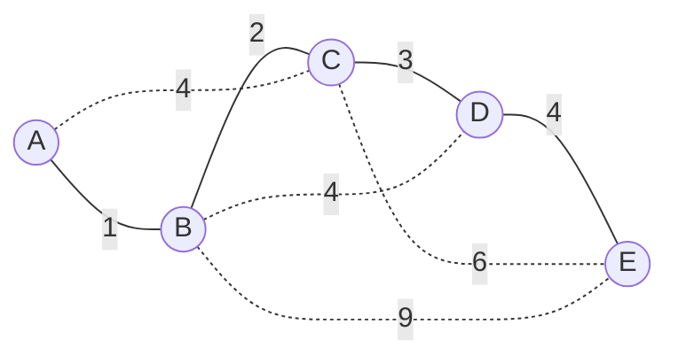

# 算法与数据结构 · 第 26 课

## MST 唯一性、边敏感性与次小生成树：换一条边会贵多少？

**2026 年 11 月 14 日｜第 4 周 · 第 5 天｜讲授约 17 分钟（自测另计）**

> 上节学过 MST 的割性质：跨割最轻边可以安全加入。今天把问题倒过来：**如果现在已经有了一棵 MST，怎样判断它是不是唯一的？如果一条边涨价，最优树什么时候会改变？第二便宜的生成树比最优贵多少？** 三个问题都可从一次「加边成环、删边成割」的交换操作得到答案。

### 一、学习目标与前提（约 1 分钟）

本节要掌握：① 非树边诱导的基本环和路径最大边；② MST 唯一性的充要条件；③ 树边替代成本（replacement cost）与权重敏感性；④ 唯一 MST 时严格次小生成树的计算与证明；⑤ 一个朴素 O(mn) 算法及其适用边界。

图 G=(V,E) 是**连通无向加权图**，有 n 个顶点、m 条边；权重可正、零、负、相等，忽略自环，平行边如存在则按边 ID 区分。T 是已知的一棵 MST，权重和记作 W(T)。除特别说明外，后面说的「第二小」是**权重严格大于 W(T)** 的最轻生成树，而不是简单地要求边集合不同。

### 二、一条非树边只产生一个环（约 2 分钟）

树上任意两点 u、v 之间恰好只有一条路径，记作 P_T(u,v)。若把非树边 e=(u,v) 加入 T，就会形成**唯一的基本环（fundamental cycle）**。要恢复生成树，必须从这个环上删除一条原树边 f。

新树权重是

$W(T+e-f)=W(T)+w(e)-w(f).$

为了让增加的成本尽可能小，应删除路径上权重最大的树边。定义

$M(e)=\max_{f\in P_T(u,v)}w(f),\qquad \Delta(e)=w(e)-M(e).$

由于 T 已经是 MST，必然有 $\Delta(e)\ge0$，否则用 e 换掉最大边就能构造更便宜的生成树，与 T 最优矛盾。

请先记住两个方向：**加入非树边看环；删除树边看割。** 今天所有公式都由此而来。

### 三、完整例子：最轻的换边增量是 1（约 3 分钟）

下面实线构成一棵 MST T；虚线是原图中未选的其他边，数字为边权。



实线总权重为 $1+2+3+4=10$。逐条试着加入虚线：

| 非树边 e | T 中端点路径的边权 | M(e) | 换边增量 Δ(e) |
|---|---|---:|---:|
| AC(4) | 1, 2 | 2 | 2 |
| BD(4) | 2, 3 | 3 | 1 |
| CE(6) | 3, 4 | 4 | 2 |
| BE(9) | 2, 3, 4 | 4 | 5 |

例如加上 BD(4)，就形成 B→C→D→B 的环；删去 CD(3)，得到树 AB、BC、BD、DE，总权重 $10+4-3=11$。这是一个**只用一次换边**就比最优略贵的方案。

本例所有非树边的 Δ 都严格大于零，因此 MST 唯一。注意虽然图中有两条权重为 4 的边，**全图边权不互异也完全可能有唯一 MST**。

### 四、唯一性的充要条件：等号意味着还能换（约 3 分钟）

对任意给定的生成树 T，有一个很强的判据：

$\boxed{T\text{ 是 MST}\iff \forall e\notin T,\;w(e)\ge M(e).}$

其中「只有当」刚才已经用环交换证明。证明「如果」也不难：设 T' 是任意另一棵生成树，从 T' 选一条不在 T 中的边 e，暂时删去它，T' 就断成两部分。由于 T 中 e 两端的路径必跨越这两部分，一定能找到路径边 f∈T 连接它们；而 f 不在 T' 中。用 f 替换 e 后仍是生成树，并且

$w(f)\le M(e)\le w(e).$

这样一步步把 T' 的非 T 边换成 T 的边，权重不增加，最终变成 T。所以 W(T)≤W(T')，T 的确最优。

进一步：

$\boxed{T\text{ 是唯一 MST}\iff \forall e\notin T,\;w(e)>M(e).}$

如果有一条边满足等号，换掉环上一条最大树边就得到**另一棵同权 MST**；反过来，若对所有非树边都严格大于，那么刚才从任何不同 T' 换回 T 的过程中至少有一次**严格降成本**，其他树不可能同为最优。

特别注意：所有边权互不相等是 MST 唯一的**充分条件**，但不是必要条件。

### 五、树边涨价：删掉它形成的割能告诉我们阈值（约 2 分钟）

设树边 f 被删除，T 立即分成两棵树 U 和 V\U。任何仍想连通全部顶点的生成树，都必须用一条跨越该割的边重新连接。定义

$r(f)=\min\{w(e):e\in E\setminus T,\; e\text{ 跨越 }(U,V\setminus U)\}.$

若不存在替代边，令 r(f)=+∞；此时 f 是原图的**桥**，任何生成树都必须选它。

现在只把 f 的权重增加 x≥0，其他边不变。原树仍是一棵 MST 的准确条件为

$\boxed{x\le r(f)-w(f).}$

当 x 小于阈值时，原树仍最优；当 x 恰等于阈值时，原树**仍最优，但可以出现同权替代树**；超过阈值时，替代边比涨价后的 f 更便宜，原树不再最优。若 r(f)=∞，任意有限幅度涨价都无法把这条桥换掉。

对示例 CD(3)：删去后，{A,B,C} 与 {D,E} 分开；跨割的非树边有 BD(4)、CE(6)、BE(9)，所以 r(CD)=4，允许涨价的阈值为 1。与此对称：**若一条非树边 e 降价，只要新权重仍 ≥M(e)，T 就仍最优；等号处可能出现并列最优解。**

### 六、严格次小生成树：唯一 MST 时的一个公式（约 2 分钟）

现在**额外假设 T 唯一**，故所有非树边的 Δ(e)>0。若原图至少还有一条非树边，则

$\boxed{W_2=W(T)+\min_{e\notin T}[w(e)-M(e)].}$

上面的例子给出 $W_2=10+1=11$。

为什么不需要一次换两条或三条边？令 $g=\min_{e\notin T}\Delta(e)>0$。一次选择达到 g 的非树边，已经构造出权重为 W(T)+g 的生成树。反过来考虑任意另一棵生成树 T'，选 e∈T'\T，从 T' 删 e 形成割，再找到 T 上跨割的边 f。因为 f 位于 P_T(e)，所以

$w(e)-w(f)\ge w(e)-M(e)\ge g.$

把 T' 中的 e 换成 f，会得到一棵生成树 T''，其权重至少为 W(T)。故 $W(T')\ge W(T)+g$。上下界相等，公式成立。

**重要边界：** 如果原图本身只有一棵生成树（原图就是树），就不存在「次小树」。如果 MST 不唯一，某些 Δ=0，对应的是同权的另一棵 MST，而不是严格次小树；严格第二权重需要另外处理，不应直接把上述唯一性前提删掉。

### 七、朴素算法、复杂度与反例（约 2 分钟）

使用 Kruskal 先求 MST T。对每条非树边 e，在 T 中用 DFS 找到端点唯一路径，扫描整条路径，得到 M(e)；并对路径上的每条树边 f，更新 $r(f)=\min(r(f),w(e))$。

```text
T = KRUSKAL(G)
for each tree edge f: replacement[f] = +INF
unique = true
bestGap = +INF

for each non-tree edge e=(u,v,w):
    path = FIND_PATH_IN_TREE(T,u,v)
    M = max(weight(f) for f in path)
    gap = w - M
    assert gap >= 0              # 否则给定的 T 不是 MST
    if gap == 0: unique = false
    if gap > 0: bestGap = min(bestGap,gap)
    for f in path:
        replacement[f] = min(replacement[f], w)

if unique and bestGap < +INF:
    strictSecondWeight = W(T) + bestGap
```

每条非树边的路径最多有 n−1 条树边，故这套**可理解、可证明的朴素实现**在 Kruskal 排序之外花 O(mn) 时间；总时间 $O(m\log(m+1)+mn)$，额外空间 O(n+m)（存图、树、DSU 及路径暂存）。若只求唯一性和次小树，可用二进制提升（binary lifting）预处理路径最大边，把每次查询压到 O(log n)，预处理 O(n log n) 时间与空间；但求全部 r(f) 仍需专门的路径更新优化，不能直接套用同一个查询上界。

反例：三角形三条边权都是 1。任何两条边构成 MST，权重都为 2；若要求「边集合不同的第二棵树」，答案仍为 2，但若要求「严格大于 2 的最轻生成树」，则根本不存在。**题目必须先定义第二小的含义**。

### 八、总结与下一课（约 1 分钟）

今天把 MST 的三种问题统一到了基本环和基本割：

$\boxed{\text{非树边 }e:\;w(e)-\max(P_T(e))\quad\Longrightarrow\quad\text{唯一性与换边增量}}$

$\boxed{\text{树边 }f:\;\min(\text{跨割替代边权})-w(f)\quad\Longrightarrow\quad\text{涨价敏感性}}$

**下一课（2026-11-15，第 27 课）：树上路径最大值与二进制提升。** 我们将把今天「每条非树边 DFS 扫路径」的 O(mn) 瓶颈改成高效路径查询，同时复习 LCA 和倍增不变量；随后第 4 周第 7 天进行综合考核。

### 九、四级自测（100 分；首次不公布答案）

前 3 题均可客观判分，最后一题为开放证明。题目考查不同维度；下面只给中立提示，标准答案、解析与评分细则仅保存在独立测验 JSON 中。

#### Lv1｜唯一性的精确判据｜15 分｜预计 2 分钟｜单选

设 T 是连通无向加权图的一棵 MST，P_T(u,v) 是 T 上 u 到 v 的唯一路径。下列哪个条件足以且必要地保证 T 是唯一的 MST？

**A.** 对每条非树边 e=(u,v)，都有 w(e)>max{w(f):f∈P_T(u,v)}。

**B.** 整张图中存在两条不同边权相同。

**C.** 每条树边的权重都严格小于每条非树边的权重。

**D.** 所有树边权重都为正数。

*中立提示：尝试把非树边加入 T，观察所形成的环，并考虑是否能不增成本地替换一条树边。*

#### Lv2｜Kruskal 与次小生成树手工计算｜20 分｜预计 4 分钟｜数值

无向图顶点为 A、B、C、D、E，边为 AB(1)、BC(2)、CD(3)、DE(4)、AC(4)、BD(4)、CE(6)、BE(9)。已知其 MST 唯一，求严格大于 MST 总权重的最小生成树总权重（只填数值）。

*中立提示：先找出 MST；每加入一条非树边形成一个环，删除该环上权重最大的树边，比较总权重的增量。*

#### Lv3｜等权交换与单边权重敏感性｜25 分｜预计 4 分钟｜多选

对连通无向图的一棵 MST T，记非树边 e=(u,v) 的 M(e)=max{w(f):f∈P_T(u,v)}；对树边 f，记 r(f) 为删除 f 所成割上的最轻非树边权重，若没有则 r(f)=+∞。一次只改变一条边的权重。以下哪些说法成立？（多选）

**A.** 若某非树边 e 满足 w(e)=M(e)，可通过一次换边得到另一棵等权 MST。

**B.** 若将树边 f 的权重增加恰好 r(f)-w(f)（该值有限），原 T 仍是 MST，但可能不再唯一。

**C.** 若 f 是原图的桥，任意有限幅度地增加 f 的权重都必使最优生成树换边。

**D.** 若把一条非树边 e 的权重降低，但新权重仍不小于 M(e)，T 仍为 MST。

*中立提示：把非树边变化与基本环相比较；把树边变化与删边所形成的基本割相比较。等号是否允许最优解并存？*

#### Lv4｜基本环、唯一性、敏感性与严格次小树证明｜40 分｜预计 10 分钟｜开放推导

给定连通无向图 G=(V,E) 及一棵已知 MST T，允许负权和等权。(a)（12 分）定义非树边的基本环与 M(e)，证明 T 是 MST 当且仅当对所有非树边 e 有 w(e)≥M(e)，且 T 唯一当且仅当严格不等式对所有非树边成立。(b)（10 分）假定 T 唯一，证明严格次小生成树（总权重大于 W(T) 的最轻生成树）可由 T 一次换边得到，并写出其权重公式；讨论原图本身只有一棵生成树的情形。(c)（10 分）定义每条树边 f 的最轻跨割替代边权重 r(f)，推导单独增加 w(f) 时 T 保持最优的阈值；分析等号以及 f 为原图桥的边界。(d)（8 分）给出求唯一性、严格次小权重、全部 r(f) 的朴素伪代码与最坏时间/额外空间复杂度，并解释等权时为何不能直接把严格正增量公式不加说明地应用到任意 MST。

*中立提示：比较两种交换方向：非树边加进 T 形成环；从任意其他生成树删掉一个非 T 边形成割，再找 T 路径上的替代边。对敏感性则删除树边看割。先给出 O(mn) 的简单算法，不要求实现 HLD。*

### 十、提交与反馈

请回复 **Lv1：选项；Lv2：数值和换边过程；Lv3：所有正确选项；Lv4：(a)–(d) 分步证明**。我会按 **15／20／25／40 分**逐题批改：80–100 分按课表进入二进制提升；60–79 分补一题针对性巩固；低于 60 分先复习「基本环交换」与「基本割替换」。补练**不修改自然日课号**。
