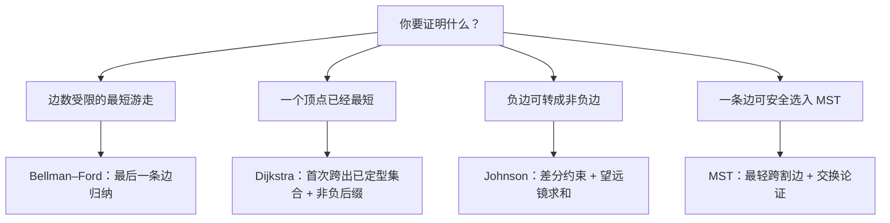
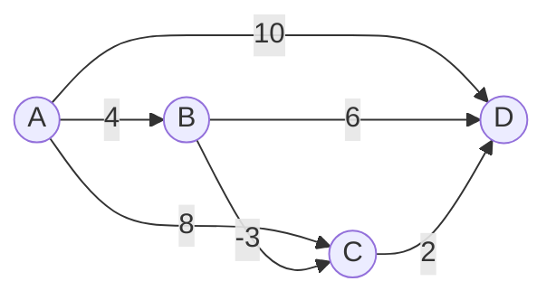

# 算法与数据结构 · 第 28 课

## 四周综合考核：一个算法的正确性与复杂度，究竟靠什么保证？

**2026 年 11 月 16 日｜第 4 周 · 第 7 天（综合考核）｜讲授约 18 分钟，自测另计**

> 前四周依次学习了复杂度与摊还分析、随机化与哈希、可持久化／可回滚数据结构，以及最短路与 MST。今天不再加入新算法，而是用一条主线回顾：**你声称的结论是什么？它由哪个不变量或概率前提保证？当条件改变时，证明会在哪一步失效？**

### 一、学习目标与四周地图（约 2 分钟）

完成今天课程应能：（1）分清最坏、摊还和期望复杂度；（2）从状态更新判断应当保留旧版本、延迟下推还是用日志回滚；（3）复核 Bellman–Ford、Dijkstra、Johnson 与 MST 的正确性证书；（4）独立识别负边、哈希随机性、树上共享修改与回滚日志的边界；（5）完成四道跨周分级考核题。

| 周次 | 研究的问题 | 要保留的“证书” |
|---|---|---|
| ① 复杂度／摊还 | 操作序列究竟付出多少工作？ | 总成本上界或势函数变化 |
| ② 随机化／哈希 | 随机性在哪个对象上取期望？ | 碰撞概率及线性期望 |
| ③ 树／持久化／回滚 | 修改局部后怎样保持查询正确？ | 子树摘要、不可变版本或逆序日志 |
| ④ 最短路／MST | 什么时候能确定局部选择最优？ | 路径归纳、定型、可行势或割交换 |

### 二、复杂度：三个 O(1) 不能混为一谈（约 3 分钟）

**最坏 O(1)** 表示每一次操作都有常数上界。**摊还 O(1)** 表示任意长度为 n 的合法操作序列总成本 O(n)，允许个别操作很贵。**期望 O(1)** 则要明确随机变量与随机性来自哪里，不能直接变成确定性最坏保证。

以容量从 1 起、满时翻倍的动态数组为例：连续 n 次 append，每次写入自身花 O(1)，合计 n；扩容时搬迁的元素数是 1+2+4+…，小于 2n。所以总工作量小于常数倍 3n，摊还为 O(1)。但是恰逢扩容的一次 append，仍可能搬运 Θ(n) 个元素。

哈希也类似。若从通用哈希函数族随机选取 h，满足对不同键 x、y 有
\(\Pr[h(x)=h(y)]\le 1/m\)，并且待存的 n 个键在选择 h 前已经固定，则令 \(I_y\) 表示键 y 是否与 x 撞桶：

\[
\mathbb E\left[\sum_{y\ne x}I_y\right]
=\sum_{y\ne x}\Pr[h(y)=h(x)]
\le\frac{n-1}{m}.
\]

这是对**固定键集合、随机哈希函数**的期望碰撞数上界。它并未证明某一次哈希表操作必为 O(1)，也不能不加条件地用于观察哈希函数后自适应构造键的对手。

### 三、数据结构：摘要、保留与撤销分别保证什么？（约 3 分钟）

AVL 秩统计树存储 \(size(v)=1+size(left)+size(right)\)，维护平衡后才能保证 SELECT／RANK 最坏 O(log n)；路径复制持久化线段树**不改旧节点**，只新建受影响路径，旧根才可继续查询；Lazy Segment Tree 的区间 sum 已经包含暂存增量，部分访问孩子前必须正确 PUSH。

Rollback DSU 则采取不同策略：**当前状态可以原地修改，但每一次可逆修改都必须有日志**。使用按大小合并、关闭无日志路径压缩，FIND 最坏 O(log n)，成功 UNION 只改常数个字段，撤销该次成功合并 O(1)。快照为当前分支 history 的栈长，而不是永久版本 ID。

当图上的边会随时间增删，利用“时间线段树 + 回滚并查集”：

```text
对每条边的活跃区间 [l,r)：
    分配到 O(log T) 个不重叠的时间线段树节点

DFS(node):
    s = DSU.SNAPSHOT()
    for e in bucket[node]: DSU.UNION(e.u, e.v)
    if node 是时间叶 t 且 ops[t] 是 ASK:
        answer[t] = DSU.CONNECTED(u,v)
    else if node 不是叶子:
        DFS(left); DFS(right)
    DSU.ROLLBACK(s)
```

在叶 t，根到该叶路径的所有 bucket 恰好覆盖**时刻 t 活跃的边集合**；退出子树时恢复快照，兄弟分支不会互相污染。这是正确性不变量。若 K 条边生存区间、Q 次查询、T 个操作，典型时间界为 \(O(T+K\log T\log n+Q\log n)\)，空间 \(O(T+K\log T+n)\)（n,T≥2；区间匹配字典按预期常数操作计算）。

### 四、图算法：四张不同的最优性证书（约 3 分钟）



Bellman–Ford 同步第 k 轮得到至多 k 条边的最小游走代价。无源点可达负环时，删去非负闭合段可得到至多 n−1 条边的简单最短路。

Dijkstra 的已定型集合 S 保证 \(dist[u]=\delta(s,u)\)。证明假想更短路径时，要找到第一个尚未定型的顶点并利用**后续边权非负**推出矛盾；没有负环并不能代替这个条件。

Johnson 先增设超级源点 q，以零权边连接全部原顶点；Bellman–Ford 给出 \(h(v)=\delta(q,v)\)。因为 \(h(v)\le h(u)+w(u,v)\)，所以
\[
w'(u,v)=w(u,v)+h(u)-h(v)\ge0.
\]
沿一条 s→t 路径求和，中间势函数抵消，因此 \(w'(P)=w(P)+h(s)-h(t)\)。同端点路径排序不变，而原距离恢复为 \(\delta(s,t)=d'(s,t)-h(s)+h(t)\)。

MST 的割性质处理的是另一种目标：若某割尊重当前已选无环边 A，那么最轻跨割边 e 可以安全加入，因为把 e 加入一棵包含 A 的 MST 后，可删去环上的另一跨割边 f，且 \(w(e)\le w(f)\)。这只保证**存在一棵**最优树包含 e，而不是每一棵都必须包含 e。

### 五、数值复核：Johnson 的两个关键检查（约 2 分钟）

考虑下列有向图（全部箭头按图中方向）：



超级源点 q 到四点的边权均为 0。Bellman–Ford 计算得到：

| 顶点 | A | B | C | D |
|---|---:|---:|---:|---:|
| h | 0 | 0 | −3 | −1 |

相应的新边权为 A→B:4、A→C:11、A→D:11、B→C:0、B→D:7、C→D:0。它们全部非负。从 A 运行 Dijkstra，最短路线 A→B→C→D 的新权代价为 4；恢复原图得到 \(4-h(A)+h(D)=3\)，直接用原权计算也是 \(4-3+2=3\)。

这次 Trace 要检查两件事：**每条新边非负**，以及**路径还原后的长度与原图一致**。只验证其中一件不够。

### 六、正确性、复杂度与反例速查（约 3 分钟）

| 算法／结构 | 主要时间界 | 容易误用的前提 |
|---|---|---|
| 动态数组容量翻倍 | n 次 append 总 O(n) | 摊还 ≠ 单次最坏 |
| 通用哈希，负载 \(\alpha=n/m\) | 固定键的期望碰撞数 ≤(n−1)/m | 期望 ≠ 确定性保证 |
| Rollback DSU | FIND／UNION O(log n)，撤销成功合并 O(1) | 不能无日志路径压缩 |
| 同步 Bellman–Ford | O(n(n+m)) | n−1 轮收敛需无源点可达负环 |
| 二叉堆 Dijkstra | O(n+m+(m+1)log(m+2))（lazy heap） | 原边权必须非负 |
| Johnson | 一次 Bellman–Ford + n 次 Dijkstra | 全图负环须先排除 |
| Kruskal + DSU | O(m log(m+1)+(n+m)α(n)) | 无向图；生成树需连通 |

图中 n 是顶点数、m 是边数，K 与 T 只用于离线动态连通性；不同数据结构的 n 代表其各自问题规模。Johnson 若保留完整点对答案矩阵，还需要 Θ(n²) 输出空间。

**四个最小反例：** 扩容时的一次 append 花 Θ(n)，驳倒“摊还就是每次最坏”；共享的持久化节点若原地改写，会污染旧版本；三顶点有向边 s→a(2)、s→b(5)、b→a(−10) 虽没有环，标准 Dijkstra 仍会过早定型 a；三角形三边全为 1 时 MST 不唯一，说明割性质中的“安全”不是“唯一必选”。

### 七、结论与下一课（约 1 分钟）

过去四周最值得带走的不是某个 API 或公式，而是一个通用检查顺序：

```text
问题目标 → 算法前提 → 状态／概率不变量
        → 单步保持证明 → 总复杂度 → 最小反例
```

**下一课（2026-11-17，第 29 课）**进入第 5 周网络流：从容量约束、流守恒、残量网络与增广路开始；之后逐步走向最大流最小割、二分图匹配及对偶。本次综合考核即使需要补练，也不改变自然日课号。

### 八、四级综合自测（满分 100；首次不公布答案）

四题从机制辨析、数值 Trace、跨域边界判断，逐步到完整设计与证明。讲义只提供答案中立的提示，标准答案、解析和评分细则仅保存在独立测验 JSON 中。

#### Lv1｜摊还分析与最坏复杂度｜15 分｜预计 2 分钟｜单选

一个动态数组从容量 1 开始，每次容量满时扩容为原来的 2 倍，并复制旧元素。关于连续 n 次 append（n≥2），哪项说法严格正确？

**A.** 由于 n 次 append 的平均代价为 O(1)，所以每次 append 的最坏代价也是 O(1)。

**B.** 单次 append 可能花费 Θ(n)，但 n 次 append 的总成本为 O(n)，所以摊还代价为 O(1)。

**C.** 只要有扩容，连续 n 次 append 的总成本必为 Θ(n²)。

**D.** 摊还 O(1) 的结论依赖于随机输入；固定的最坏操作序列无法成立。

*中立提示：分别数一数正常写入的次数和所有扩容搬迁的元素总数；分清单次最坏与整个序列的总量。*

#### Lv2｜Johnson 势函数与 Dijkstra 数值追踪｜20 分｜预计 4 分钟｜数值

有向图包含顶点 P、Q、R、T，边为 P→Q(5)、P→R(9)、P→T(12)、Q→R(−4)、Q→T(8)、R→T(3)。添加超级源点 q，并向每个原顶点连一条权重为 0 的边。令 h(v)=δ(q,v)，按照 w'(u,v)=w(u,v)+h(u)−h(v) 重赋权后从 P 运行 Dijkstra。求 d'(P,T)+δ(P,T) 的数值（δ 为原图最短距离）。

*中立提示：先求 h(R)、h(T)，再求新权最短距离；不要把 d' 直接当成原距离，还原时注意势函数的符号。*

#### Lv3｜随机化前提、负边反例、回滚不变量与 MST 边界｜25 分｜预计 4 分钟｜多选

下列哪些结论成立？（多选，选出全部正确项；其中哈希集合在随机选择哈希函数前已固定。）

**A.** 若哈希函数族满足对不同键 x,y 有 Pr[h(x)=h(y)]≤1/m，则固定键 x 与其他 n−1 个键碰撞的期望数量至多 (n−1)/m。

**B.** 只要有向图没有负权环，即使存在负边，也可以直接运行标准 Dijkstra 并永久定型顶点。

**C.** 时间线段树 DFS 的 Rollback DSU 若采用按大小合并、禁用无日志路径压缩，进入节点时合并、退出时回滚，可避免兄弟时间区间相互污染。

**D.** 对无向连通图，只要出现负权边，MST 的割性质就失效，Kruskal 不能使用。

*中立提示：把期望碰撞的线性性、Dijkstra 的非负边权前提、回滚的逆序恢复，以及割交换证明是否要求正权分别检查。*

#### Lv4｜跨四周不变量、证明与算法设计｜40 分｜预计 12 分钟｜开放推导

完成一份跨四周的算法正确性审计：(a)（10 分）分析容量翻倍动态数组 n 次 append 的总时间，解释为什么摊还 O(1) 不意味着每次最坏 O(1)；并用指示变量证明一个通用哈希族对固定键 x 的期望碰撞数上界。(b)（10 分）设计 Rollback DSU 结合时间线段树，回答离线 ADD/REMOVE/ASK 连通性查询；说明半开活跃区间、快照、进入/退出 DFS 的操作，并陈述叶节点正确性不变量。(c)（10 分）对含负边但无负环的有向图，证明 Johnson 势函数使重赋权边非负，证明任意同端点路径保持优劣次序，并写出距离恢复公式。(d)（10 分）对连通无向图，陈述并用交换论证证明 MST 割性质；说明 Kruskal 的安全选择与负边、等权边的影响。给出 (b)–(d) 主要时间/空间复杂度及必要的前提。

*中立提示：每部分先写出被维护的量：总搬迁量／碰撞指示量、根到时间叶的活跃边、差分约束与势函数望远镜和、跨割最轻边。证明中务必明确适用前提。*

### 九、提交与反馈

请回复 **Lv1：选项；Lv2：数值及关键计算；Lv3：全部正确选项；Lv4：(a)–(d) 的分步推导**。我会按 **15／20／25／40 分**逐题批改并给出总分：80–100 分直接进入下周；60–79 分安排相应薄弱环节的定向补练；低于 60 分优先重建错误所在的不变量与证明，再进入后续课程。**复习或补练不修改预定课号。**
