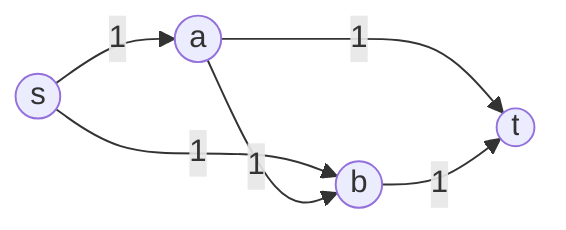
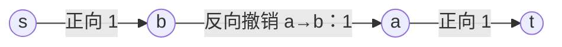

# 算法与数据结构 · 第 29 课

## 网络流入门：为什么一条“反向边”能纠正之前的选择？

**2026 年 11 月 17 日｜第 5 周 · 第 1 天｜讲授约 17 分钟（自测另计）**

> 上周的最短路优化一条路径的长度，MST 优化整棵树的成本。今天换一个目标：**在每条边有容量上限的网络里，源点最多能向汇点输送多少流量？** 一个关键困难是：先选择的路线可能占住后续更需要的边。残量网络中的反向边，提供了合法地撤销、重排旧流量的办法。

### 一、学习目标与模型（约 2 分钟）

完成本课，你应能：（1）检查容量约束、流守恒和流值；（2）建立残量网络，区分正向剩余容量与反向可撤销容量；（3）手工执行三次增广；（4）证明增广保持流可行，以及“无增广路”为什么意味着最大流；（5）知道 Ford–Fulkerson 的整数容量复杂度和非整数边界。

给定有向图 \(G=(V,E)\)，源点 \(s\ne t\)（汇点），每条边 \(e\) 的容量 \(c_e\ge0\)。为便于入门，假定原始图没有同向重边、也没有反向成对的原始边；一般实现可以用独立边 ID 和成对残量弧支持它们。流量 \(f_e\) 满足：

\[
\boxed{0\le f_e\le c_e}\qquad\text{（容量约束）}
\]

\[
\boxed{\sum_{(u,v)\in E}f_{uv}=\sum_{(v,w)\in E}f_{vw}\quad(v\ne s,t)}\qquad\text{（流守恒）}
\]

流值定义为源点的**净流出**（允许源点有入边）：

\[
|f|=\sum_{(s,v)\in E}f_{sv}-\sum_{(u,s)\in E}f_{us}.
\]

由内部节点守恒，也等于汇点的净流入。要最大化的是 \(|f|\)，不是选择一条容量最大的单独路径。

### 二、反例动机：一次“看起来合理”的路径可能挡住其他路径（约 2 分钟）

考虑所有边容量均为 1 的网络：



如果先沿 \(s\to a\to b\to t\) 发送 1 单位流量，三条边 \(s\to a,\ a\to b,\ b\to t\) 都饱和了。此时单看**原图尚有正向余量的边**，似乎找不到新的 \(s\to t\) 路径。但直接宣称最大流为 1 是错误的：我们本可以用 \(s\to a\to t\) 和 \(s\to b\to t\) 两条路线同时送出 2。

真正的问题不是第一次送错了就无药可救，而是我们需要一种运算，**把 \(a\to b\) 上原先的流量撤回来**，同时安排另一条路线。反向残量边正是为此而生。

### 三、残量网络：能增加多少，也能撤销多少（约 3 分钟）

对原始有向边 \(e=(u,v)\)，容量为 \(c\)，当前流量为 \(f\)，残量网络中建立两条与该原始边关联的残量弧：

\[
\boxed{r_f(u,v)=c-f\quad\text{（正向：还能增加多少）}}
\]

\[
\boxed{r_f(v,u)=f\quad\text{（反向：最多能撤销多少）}}
\]

只在残量容量严格大于零时把弧用于寻路。这里的 \(v\to u\) **不是原图新出现的物理输送通道**；沿它增广 \(\Delta\) 的含义是把原始 \(u\to v\) 的流量减少 \(\Delta\)。若原图原本还存在真正的 \(v\to u\) 边，程序要用边 ID 区分两者，不能随便混为一条原始边。

例如容量 \(c(a,b)=1\)，已有 \(f(a,b)=1\)：正向余量为 0，反向 \(b\to a\) 的残量为 1。利用这个反向弧，相当于撤销先前错误分配给 \(a\to b\) 的 1 单位。

下图只展示**第一轮之后可用于第二轮增广的关键正残量弧**：



**增广路**是残量网络里从 s 到 t 的一条所有弧残量都大于零的路径。该路径可增加的流量受最窄弧限制：

\[
\boxed{\Delta=\min_{e\in P}r_f(e)}\quad\text{（瓶颈容量）}.
\]

### 四、完整数值 Trace：两次增广、一次撤销（约 3 分钟）

回到五条容量均为 1 的原始边，初始所有 \(f=0\)。

| 阶段 | 选择的残量路径与瓶颈 | 非零原始流量 | 总流值 |
|---|---|---|---:|
| 初始 | — | 无 | 0 |
| 第 1 次 | \(s\to a\to b\to t,\ \Delta=1\) | \(f_{sa}=1,f_{ab}=1,f_{bt}=1\) | 1 |
| 第 2 次 | \(s\to b\to a\to t,\ \Delta=1\) | \(f_{sa}=1,f_{sb}=1,f_{at}=1,f_{bt}=1\)，且 \(f_{ab}=0\) | 2 |

第二条路径上的 \(b\to a\) 是原始 \(a\to b\) 的反向残量弧，所以把 \(f_{ab}\) 从 1 减回 0；其他正向残量弧对应的流量加 1。最后两个内部节点都守恒：a 收到来自 s 的 1 并发往 t，b 也一样。

**为什么已经最优？** 源点 s 的两条出边容量之和只有 2，所以无论怎么安排都有 \(|f|\le2\)；我们已经送出 2。下节会把这一上界正式推广为“任意 s–t 割容量”。

### 五、Ford–Fulkerson 的核心伪代码（约 2 分钟）

```text
FORD_FULKERSON(G, s, t):
    f[e] = 0 for each original edge e
    build residual adjacency with forward/reverse arc pairs
    while FIND_PATH(residual, s, t) returns a path P:
        delta = min(residual_capacity[a] for a in P)
        for each residual arc a in P:
            residual_capacity[a] -= delta
            residual_capacity[reverse(a)] += delta
    return f, value(f)
```

在实现中，可以用 DFS 或 BFS 找一条增广路，并在每条残量弧上保存反向弧索引。**一次更新同时减去本弧残量、增加配对反向弧残量**；这等价于正向增加原始流、反向减少原始流。若显式维护原始 \(f[e]\)，也必须与这些残量数据保持一致。

**核心不变量：** 每次增广前后，所有原始边都满足 \(0\le f_e\le c_e\)，所有内部顶点都满足流守恒，且流值恰好增加 \(\Delta\)。证明要点是：每条残量弧限制了对应的合法增减幅度；增广路上的每个内部顶点获得的净流入变化，与净流出变化相同；路径起点 s 净流出增加 \(\Delta\)、终点 t 净流入增加 \(\Delta\)。

### 六、从“找不到路径”到最大流：用割作证书（约 3 分钟）

一个 **s–t 割** 是把顶点分成 \(S\) 与 \(V\setminus S\)，满足 \(s\in S,\ t\notin S\)。割容量只累计**原始图中从 S 指向外部**的边：

\[
c(S,V\setminus S)=\sum_{u\in S,v\notin S}c(u,v).
\]

对任意可行流，由内部流守恒把各点的净流出相加，内部边相互抵消，得到

\[
|f|=\sum_{u\in S,v\notin S}f_{uv}
-\sum_{u\notin S,v\in S}f_{uv}
\le c(S,V\setminus S).
\]

因此**任意割容量都是最大流的上界**。

当残量网络已经没有从 s 到 t 的路径时，让 S 为**从 s 沿正残量弧能够到达的全部顶点**。显然 t 不在 S。若存在从 S 到外部的原始边仍有未用容量，就有正向残量弧，外部顶点也应可达，矛盾；所以跨出的原始边全饱和。若有从外部指向 S 的原始边仍带正流量，则它的反向残量弧从 S 指向外部，也矛盾；所以这些回流边的流量全为 0。

代入上式可得 \(|f|=c(S,V\setminus S)\)。既然可行流达到一个对所有流都成立的上界，它就是最大流，对应割也是最小割。这就是**最大流–最小割定理**的核心证明：

\[
\boxed{\text{不存在 s→t 增广路}\iff\text{当前可行流为最大流}}.
\]

注意“没有路径”必须在**残量网络**而不是原图的剩余正向边子图中判断；本课第一轮的反例正说明了区别。

### 七、复杂度、边界和下一课（约 2 分钟）

假设所有容量是**非负整数**，每次增广的瓶颈 \(\Delta\ge1\)，流值至少增加 1。令最大流值为 \(F\)，最多增广 F 次。用邻接表 DFS/BFS，每次找路、回溯和更新需要 \(O(n+m)\) 时间，因此朴素 Ford–Fulkerson 总时间上界是

\[
\boxed{O((n+m)F),\qquad \text{额外工作空间 }O(n+m).}
\]

它是**依赖容量数值的伪多项式界**，不是只依赖 n、m 的强多项式界。若容量是一般实数，任意选路的 Ford–Fulkerson 不一定有限步终止；下一课将通过规定用 BFS 找最少边数的增广路（Edmonds–Karp）得到与 F 无关的时间界。

其他边界：容量为 0 的边无法参与正残量寻路；图可不连通，若无增广路初始流 0 就是最大流；并行边和双向原始边须正确维护各自的反向残量配对；**不要把某一次找到的“瓶颈最小”路径误认为全局最大流**。

**下一课（2026-11-18，第 30 课）：Edmonds–Karp 与最大流最小割。** 重点证明为什么 BFS 增广能避免任意选路造成的迭代次数失控，以及其 \(O(nm^2)\) 时间界。

---

## 四级自测（总分 100；首次不给答案）

前三题客观判分，最后一题开放证明。题目从反向残量机制、数值追踪、边界与复杂度逐步推进到完整不变量证明。只给中立提示，标准答案与解析单独保存在测验 JSON 中。

### Lv1｜反向残量弧究竟代表什么？｜15 分｜预计 2 分钟｜单选

某原始有向边 u→v 容量为 7，当前流量为 5。关于它对应的残量弧与增广操作，哪项严格正确？

**A.** 正向残量为 5、反向残量为 2；沿反向弧增广会增加原边流量。

**B.** 正向残量为 2、反向残量为 5；沿反向弧增广 Δ 表示原边流量减少 Δ。

**C.** 反向残量弧意味着原图自动增加了一条可以独立输送 5 单位的新边。

**D.** 只要原边已有正流量，就不允许再通过任何方式调整它。

*中立提示：分别计算还没使用的容量与已经能够撤回的流量；不要把残量弧当作新建的物理边。*


### Lv2｜三轮增广与撤销的数值 Trace｜20 分｜预计 4 分钟｜单选

网络有边 s→a(3)、s→b(2)、a→b(2)、a→t(2)、b→t(3)，括号内是容量，初始流为 0。依次沿残量路径 P1=s→a→b→t、P2=s→b→a→t（b→a 是 a→b 的反向残量弧）、P3=s→a→b→t 增广，每次都取该路径当时最大瓶颈。三次完成后 (总流值 |f|, 原始边流量 f(a,b)) 是哪一对？

**A.** (4, 0)

**B.** (5, 1)

**C.** (5, 3)

**D.** (3, 1)

*中立提示：每轮重新计算残量瓶颈。特别注意第二轮对原始 a→b 做的是减法，第三轮则可再次使用该边的正向剩余容量。*


### Lv3｜无增广路、割与复杂度边界｜25 分｜预计 4 分钟｜多选

设有 n 个顶点、m 条有向原始边，初始零流，并用残量网络执行 Ford–Fulkerson。下列哪些结论成立？（多选）

**A.** 对任意可行流，任意 s–t 割的容量都是该流值的上界。

**B.** 只要原图中所有尚未饱和的正向边无法形成 s→t 路径，就一定已经得到最大流，不必检查反向残量弧。

**C.** 容量为非负整数、用 DFS/BFS 每次寻找任意增广路时，可给出 O((n+m)F) 的时间上界，其中 F 是最大流值。

**D.** 若容量允许任意实数且选择增广路不受限制，朴素 Ford–Fulkerson 依然保证有限步终止。

*中立提示：分别检查割的净流出恒等式、反向弧能否重排旧流、每次整数增广最少增加多少，以及容量非整数时的终止前提。*


### Lv4｜残量网络、流守恒与最大流证书｜40 分｜预计 10 分钟｜开放推导

给定有向容量网络 G=(V,E)、源点 s、汇点 t，容量为非负整数，初始零流。(a)（10 分）严格定义可行流、流值、正反残量弧和增广瓶颈；写出关键增广伪代码。(b)（10 分）证明沿任何残量 s→t 路径增广 Δ 后，容量约束和内部顶点流守恒仍成立，流值恰增加 Δ；特别解释反向残量弧的作用。(c)（12 分）以残量网络中从 s 可达的点集 S 为基础，证明若不存在增广路，当前流值等于某个 s–t 割容量，因此是最大流；说明割容量为何是任何可行流值的上界。(d)（8 分）推导整数容量 Ford–Fulkerson 使用 DFS/BFS 选路的 O((n+m)F) 时间与 O(n+m) 工作空间界，解释该界为何不是强多项式，并给出仅检查原图正向剩余边会误判的反例。

*中立提示：先看每个原始边的可增与可撤两种方向，再检查一条增广路径的内部顶点净流量变化；割的证明要同时处理从 S 跨出去的边和从外部指向 S 的边。*

### 作答与反馈

请回复 **Lv1：选项；Lv2：选项与逐轮计算；Lv3：全部正确选项；Lv4：(a)–(d) 的证明**。我会按 **15／20／25／40 分**逐题批改；80–100 分按计划前进，60–79 分补反向残量或割证明的定向练习，低于 60 分先重做容量／守恒／残量三个不变量。**补练不修改自然日课号。**
