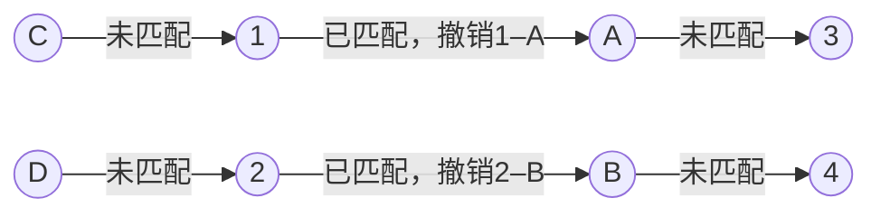

# 算法与数据结构 · 第 33 课

## Hopcroft–Karp：为什么一次 BFS 能同时增加多条匹配边？

**2026年11月21日｜第5周 · 第5天｜讲授约17分钟，自测另计**

> 昨天证明了“匹配 = 单位容量最大流”，并用交替增广路重排旧配对。朴素算法每找到一条增广路就重新搜索。今天借鉴 Dinic：**先一次 BFS 找出最短增广路的层次，再 DFS 尽量找一批互不共享顶点的最短增广路，一起翻转。** 关键是证明为什么这样可以把阶段数降到 O(√n)。

### 一、学习目标与前提（约2分钟）

目标：①区分最短增广路、极大路径批次和最大匹配；②理解多源 BFS 与交替层次；③手工追踪两条同时增广的路径；④证明阶段之间最短增广路长度增长；⑤推导 O((n+m)√n) 时间界。

设无权二分图 G=(L∪R,E)，n=|L|+|R|，m=|E|。每个顶点最多匹配一次。M 为当前匹配；未被匹配的顶点叫**空闲顶点**。相对于 M 的**增广路**从空闲左点出发，以空闲右点结束，路径上的边依次“未匹配、已匹配、未匹配……”交替。翻转一条增广路，会使 |M| 增加1。

### 二、为什么朴素增广重复工作？（约2分钟）

朴素搜索每次只找到一条增广路，就修改配对，再从头搜索。即使本轮还存在许多与第一条完全不冲突、而且同样短的增广路，也要重复扫描边。

Hopcroft–Karp 将这种重复搜索合并：**一个阶段（phase）= 一次多源 BFS + 一组 DFS 增广**。BFS 只确定当前最短交替增广路长度；DFS 找一组**极大的、顶点不相交的最短增广路**。“极大”只指无法继续加入另一条不冲突的同长度增广路，**不要求找出数量全局最多的那一组**。

因为路径之间不共享顶点，逐条翻转不会争抢同一个左点或右点；一次阶段可能让匹配数增加很多。

### 三、路径示意：两条长度为3的增广路（约3分钟）

设 L={A,B,C,D}，R={1,2,3,4}。边为 A–1、A–3、B–2、B–4、C–1、D–2。假设已有合法匹配 M={A–1,B–2}，空闲左点是 C、D，空闲右点是 3、4。



图中从右往左的箭头是**沿已匹配边回退**，不代表原二分图增加了新的无向边。两条交替增广路为 C→1→A→3 和 D→2→B→4，长度都为3，并且顶点不相交。

| 步骤 | 匹配边集合 | 匹配数 |
|---|---|---:|
| 开始 | A–1、B–2 | 2 |
| 翻转 C→1→A→3 | C–1、A–3、B–2 | 3 |
| 翻转 D→2→B→4 | C–1、A–3、D–2、B–4 | 4 |

这两条路径可以共用**同一次 BFS 的层次信息**，不必一条一条重建 BFS。

### 四、多源 BFS 与 DFS 如何配合？（约3分钟）

**BFS：** 把所有空闲左点同时放进队列，深度为0。从左点 u 沿未匹配边走向右点 v；若 v 已匹配，则沿它的匹配边走到左点 w=pairR[v]，把 w 放入下一层。若 v 空闲，就找到一个可能的终点。记录第一次到达空闲右点的最短终止层 D，搜索不再扩张比 D 更深的层。

对刚才的例子，BFS 从 C、D（左层0）出发，经 1→A、2→B 到达左层1，再经 A→3、B→4 到达两个空闲右点。这意味着最短增广路有 **3 条二分图边**。注意实现中可能把“左点层数”加1定义为“一对未匹配+已匹配边”，不要和真实路径边数混淆。

**DFS：** 从各个空闲左点出发，只沿 BFS 允许的层次向前走；找到最短长度的空闲右点才完成一次增广。对于已经匹配的右点 v，只能递归到它的匹配左点 w，并要求 dist[w]=dist[u]+1。DFS 失败的左点标记为不可达，避免本阶段重新扫描失败分支。成功时沿递归返回方向更新 pairL、pairR。

```text
HOPCROFT_KARP(G):
    pairL[u] = NIL; pairR[v] = NIL
    matching = 0
    while BFS_LAYERS() 得到有限的最短终止层 D:
        for each 空闲左点 u:
            if DFS(u,D): matching += 1
    return matching, pairL

BFS_LAYERS():
    所有空闲左点 dist=0 入队；已匹配左点 dist=INF
    D=INF
    while 队列非空:
        u=pop()
        if dist[u]>=D: continue
        for v in adj[u]:
            w=pairR[v]
            if w==NIL: D=min(D, dist[u]+1)
            else if dist[w]==INF:
                dist[w]=dist[u]+1; enqueue(w)
    return D

DFS(u,D):
    for v in adj[u]:
        w=pairR[v]
        if w==NIL and dist[u]+1==D:
            pairL[u]=v; pairR[v]=u; return true
        if w!=NIL and dist[w]==dist[u]+1 and DFS(w,D):
            pairL[u]=v; pairR[v]=u; return true
    dist[u]=INF               # 本阶段失败剪枝
    return false
```

这里 pairL、pairR 始终互为逆映射。伪代码用左点层数压缩两条交替边；成功后配对在 DFS 回溯时逐级更新。只接受最短终止层，不能见到任意空闲右点就停止，否则失去复杂度证明。

### 五、核心正确性：一阶段后最短路为什么变长？（约2分钟）

先把二分图转换成昨天的单位容量流网络：s→L→R→t。增广路就是其残量网络中的 s→t 路径，二分图增广路长度与残量路径长度只相差首尾两条固定边。

当前最短增广路长度记为 ℓ。一阶段 DFS 得到**极大、顶点不相交**的这类路径并翻转，相当于阻塞当前层次网络的全部最短增广路：任何仍未选的同长度路径都必须与已选路径发生顶点冲突，因而无法继续沿原来的层次增广。新出现的反向残量弧只指向旧 BFS 的较低层，不能凭空制造一条同样短或更短的路径。

因此有不变量：

\[
\boxed{\ell_{\mathrm{next}}>\ell_{\mathrm{current}}}
\]

这里讨论的是**成功增广阶段之间**的最短增广路长度；若已无增广路，则根据 Berge 定理当前匹配已最大。每次翻转还保持“每点最多匹配一次”的匹配不变量，并令匹配数增加1。

### 六、为什么只有 O(√n) 个阶段？（约3分钟）

这一证明把两个观察接起来：

**前半段：最短长度增长。** 每个成功阶段最短增广路长度严格增长。因此经过约 √n 个阶段后，若算法还没结束，当前任何增广路都至少长 √n 条边。

**后半段：剩余可增加的匹配已经不多。** 设 M* 为最大匹配，令差距 δ=|M*|−|M|。考察 M 与 M* 的**对称差**：其连通分量是交替路径或偶环，其中至少有 δ 条关于 M 的增广路径。这些路径彼此顶点不相交。若最短增广路长度至少 √n，那么每条这样的路径至少占用约 √n 个不同顶点。总共只有 n 个顶点，故

\[
\delta\le \frac{n}{\sqrt n}=\sqrt n.
\]

之后每个成功阶段至少增广一条路径，所以再经过至多约 √n 个阶段就会结束。合并前后两段：

\[
\boxed{\text{阶段数}=O(\sqrt n).}
\]

这不是说一次 DFS 必须找到最多条路径，也不是说任何长度的增广路都能在同一阶段使用；**恰恰是限制为最短路径，才获得阶段数证明。**

### 七、时间、空间与边界（约1分钟）

一次 BFS 扫描各邻接边 O(n+m)；DFS 只走层次递增的交替路，配合失败节点剪枝（或当前弧指针），保证同阶段邻接边合计只被检查 O(m) 次，因此一阶段 O(n+m)。与 O(√n) 阶段相乘：

\[
\boxed{T=O((n+m)\sqrt n),\qquad S=O(n+m).}
\]

没有孤立顶点时 n=O(m)，常简写为 O(m√n)；原论文也使用 (n+m)√n 的表达。这里的空间含图的邻接表，配对数组、BFS 队列、层数和 DFS 栈。

**边界：** 空图直接返回空匹配；孤立点不能参与配对；普通无权二分图是适用前提，带权最大收益匹配、非二分图的一般匹配不能直接用该算法；必须用**最大基数**作为目标。贪心逐路增广也能最终正确，但一般缺少相同的 O(√n) 阶段保证。复杂度不依赖网络容量的数值，因为每个顶点最多匹配一次。

### 八、总结与下一课（约1分钟）

\[
\boxed{\text{多源 BFS 分层}
\longrightarrow \text{极大批次的最短增广路}
\longrightarrow \text{最短长度严格增长}
\longrightarrow O((n+m)\sqrt n).}
\]

**下一课（2026-11-22，第34课）：Kőnig 定理——最大匹配为什么等于最小顶点覆盖？** 将从交替可达集合构造顶点覆盖，开始理解匹配问题中的原始–对偶关系。

参考：[Hopcroft–Karp 原论文（1973）](https://doi.org/10.1137/0202019)；[算法与分层解释](https://en.wikipedia.org/wiki/Hopcroft%E2%80%93Karp_algorithm)。

---

## 九、四级自测（100分；首次不给答案）

前3题可客观判分；第4题开放证明。下面只有中立提示，标准答案和解析仅存于独立测验 JSON。

### Lv1｜最短路径与极大批次｜15分｜预计2分钟｜单选

Hopcroft–Karp 每阶段先 BFS 后 DFS。关于它要找的“路径批次”，哪一项严格正确？

**A.** BFS 要选择瓶颈容量最大的增广路，然后 DFS 必须找到数量最多的一组增广路。

**B.** BFS 确定当前最短增广路长度，DFS 找一组极大的、顶点不相交的最短增广路；不要求这组路径数量全局最多。

**C.** 每阶段只允许翻转一条路径，否则可能使某个顶点被重复匹配。

**D.** 极大的最短增广路集合意味着当前匹配已经最大，无需再进行下一轮 BFS。

*中立提示：区分路径长度最短、所选路径集合“极大”和集合数量“最大”，并考虑一轮结束后是否可能还有更长增广路。*

### Lv2｜一阶段双路径翻转 Trace｜20分｜预计4分钟｜数值

二分图左侧 L={A,B,C,D}，右侧 R={1,2,3,4}，边为 A–1、A–3、B–2、B–4、C–1、D–2；当前匹配 M={A–1,B–2}。用一轮 Hopcroft–Karp BFS+DFS，将所有能找到的顶点不相交的最短增广路组成极大批次并翻转。本轮结束的匹配边数 |M'| 是多少？

*中立提示：从空闲左点 C、D 同时开始；已匹配右点只能沿匹配边返回左侧，再走尚未匹配的边到空闲右点。*

### Lv3｜阶段上界与目标边界｜25分｜预计4分钟｜多选

关于 Hopcroft–Karp 的正确性、复杂度与适用边界，下列哪些说法成立？（多选）

**A.** 每完成一批极大的、顶点不相交的最短增广路，若仍有增广路，下一阶段的最短增广路长度严格增长。

**B.** 为获得 O((n+m)√n) 上界，每阶段必须选择数量全局最多的顶点不相交最短增广路集合。

**C.** 在 n=|L|+|R|、m=|E| 的邻接表实现中，每阶段 O(n+m)，总阶段数 O(√n)。

**D.** 标准 Hopcroft–Karp 求无权二分图的最大基数匹配；边带权且目标是收益总和最大时不能不加修改直接使用。

*中立提示：分别判断‘极大’与‘最大’的需求、阶段后最短长度变化、每阶段图遍历成本，以及目标函数是否包含权重。*

### Lv4｜正确性与平方根复杂度证明｜40分｜预计12分钟｜开放推导

给定二分图 G=(L∪R,E)，n=|L|+|R|、m=|E|。(a)（10分）写出 Hopcroft–Karp 的多源 BFS 分层与只沿层次递增交替路进行 DFS 翻转的关键伪代码，说明 NIL/空闲右点与失败剪枝。(b)（10分）证明每次找到的增广路翻转后仍是匹配、匹配数增加1，并解释一批顶点不相交路径为何可以在一阶段内共同翻转。(c)（12分）证明极大批次阻塞所有当前最短增广路，使下一阶段最短增广路长度严格增加；再用当前匹配 M 与最大匹配 M* 的对称差，推导总阶段数 O(√n)。(d)（8分）推导总时间 O((n+m)√n)、工作空间 O(n+m)，比较一次只增广一条路的朴素算法，并讨论孤立点、非二分图与带权目标的边界。

*中立提示：把交替路看成单位容量流网络中的最短残量路径；对称差的增广路径彼此顶点不相交且每条至少使用当前最短长度那么多条边。用前后两段阶段数量作界。*

### 十、提交与反馈

回复 **Lv1：选项；Lv2：数值及翻转过程；Lv3：所有正确选项；Lv4：(a)–(d)证明**。我将按15/20/25/40分逐题批改：80–100分进入 Kőnig 定理；60–79分补 BFS/DFS 层次及批处理练习；低于60分优先复习交替增广路和对称差。补练不改变原定课号。
