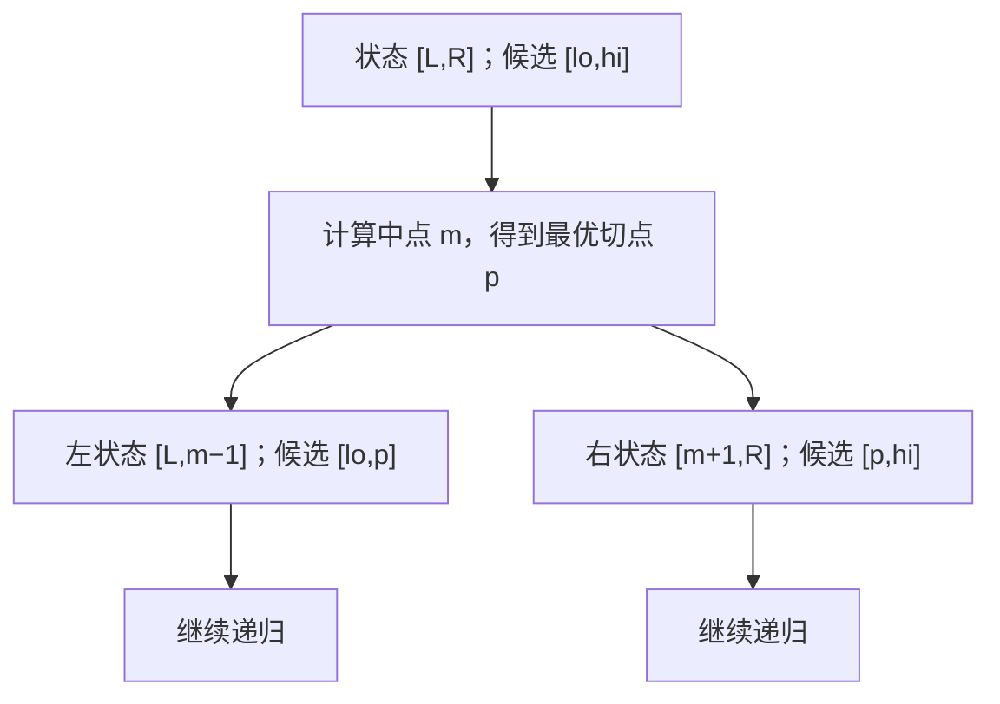
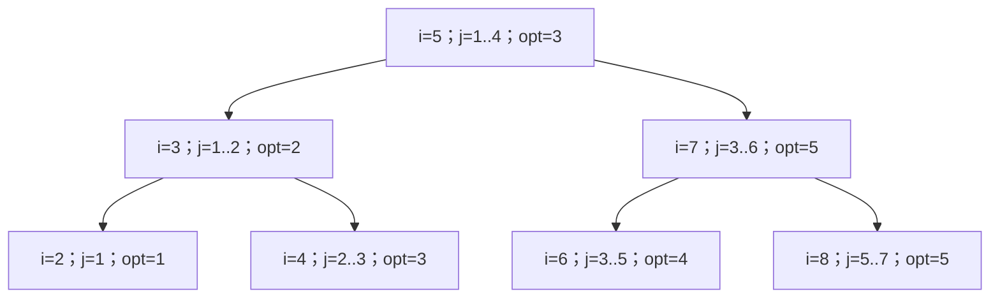

# 算法与数据结构 · 第37课

## 分治 DP 优化：为什么求出中间一个状态，就能减少两侧的搜索？

**2026年11月25日｜第6周第2天｜讲授约17分钟，自测另计**

### 一、目标与动机（2分钟）

上一课证明了非负数组的平方段和代价满足 Monge 性质，从而同一 DP 层的最优切点单调不降。今天把这一数学性质真正变成算法：先求中点，再缩小左右两侧的搜索区间。目标是掌握递归设计、手算搜索范围、证明剪枝安全，以及理解 O(Kn log n) 如何得到。

设 S[i] 为前缀和，C(j,i)=(S[i]−S[j])²。恰好分成 K 个非空连续段的状态为

$$
dp[k][i]=\min_{k-1\le j<i}\{dp[k-1][j]+C(j,i)\}.
$$

第一层 dp[1][i]=C(0,i)，不可行状态为 +∞。记 opt[k][i] 为取得最小值的最小切点。本课假设已证明同层 opt[k][i] 随 i 单调不降，且 C 可 O(1) 求值。朴素算法每层 O(n²)，但很多候选实际上不必重复检查。

### 二、分治究竟缩小了什么？（3分钟）

固定第 k 层，上一层 prev 已经全部算完。定义 SOLVE(L,R,lo,hi)：计算 cur[L..R]，并保证这些状态真正的最小最优切点都在 [lo,hi] 中。取中点 m=⌊(L+R)/2⌋，扫描 lo≤j≤min(hi,m−1)，求最优切点 p。

由单调性，i<m 时 opt[i]≤p，i>m 时 opt[i]≥p。因此左侧递归传 [lo,p]，右侧传 [p,hi]。注意 p 必须在两个子区间中都保留，单调不降并不意味着严格递增。每个状态仍须检查 j<i。



这里分治的是同一层的状态下标 i，而不是把原始数组切成互不依赖的两半。能先算中点，是因为转移只依赖已经完成的上一层。

### 三、伪代码（3分钟）

```text
PARTITION(a,K):
    S = PREFIX_SUM(a)
    prev[0] = INF
    for i = 1..n:
        prev[i] = C(0,i)
    for k = 2..K:
        cur[0..n] = INF
        SOLVE(k,n,k-1,n-1)
        swap(prev,cur)
    return prev[n]

SOLVE(L,R,lo,hi):
    if L > R: return
    m = floor((L+R)/2)
    best = INF; p = NONE
    for j = lo..min(hi,m-1):
        if prev[j] == INF: continue
        val = prev[j] + C(j,m)
        if val < best:
            best = val; p = j
    cur[m] = best
    SOLVE(L,m-1,lo,p)
    SOLVE(m+1,R,p,hi)
```

这里 1≤K≤n，所有合法状态均有限，所以每个非空递归调用必能找到 p。候选 j 按升序扫描，只有严格改善才更新，从而自动保留最小最优切点。如果需要还原分段，同时记录每层的 p。不要在求完一个中点后覆盖 prev；整层结束后才能交换数组。

### 四、数值 Trace：一层到底少算多少次？（3分钟）

取数组 [1,2,3,4,5,6,7,8]，K=2，S=[0,1,3,6,10,15,21,28,36]，prev[j]=S[j]²。初始调用 SOLVE(2,8,1,7)。

根中点 i=5，扫描 j=1,2,3,4，候选代价为 197、153、117、125，因此 p=3。递归结果如下：

| 中点 i | 实际扫描 j | 最小代价 | 最小最优切点 |
|---:|---|---:|---:|
| 5 | 1..4 | 117 | 3 |
| 3 | 1..2 | 18 | 2 |
| 2 | 1 | 5 | 1 |
| 4 | 2..3 | 52 | 3 |
| 7 | 3..6 | 394 | 5 |
| 6 | 3..5 | 221 | 4 |
| 8 | 5..7 | 666 | 5 |



i=8 时 j=5 和 j=6 都得到 666，按规则选择较小的 5。按 i 从小到大排列，opt 为 1,2,3,3,4,5,5。分治只计算了 4+2+1+2+4+3+3=19 次候选；朴素方法需要 1+2+3+4+5+6+7=28 次。小例子节省有限，大规模时才体现渐近优势。

### 五、正确性证明：递归不变量（2分钟）

不变量：每次调用 SOLVE(L,R,lo,hi) 时，对于所有 i∈[L,R]，真正的最小最优切点 opt[i] 都在 [lo,hi] 中，且 prev 已是上一层的精确最优值。

根调用的候选范围 [k−1,n−1] 包含本层所有合法切点，不变量成立。假设某次调用满足不变量，那么中点的真正最优切点在扫描范围内（它也满足 j<m），所以扫描必然得到精确的 cur[m] 和正确的最小最优切点 p。单调性保证左侧所有 opt≤p、右侧所有 opt≥p；结合原范围，两次递归均保持不变量。区间不断缩小，每个状态恰好成为一次中点。因此整层正确；再按 k 归纳，最终 dp[K][n] 正确。

本质上，分治只是安全地减少候选枚举，没有改变 DP 的目标或转移。

### 六、复杂度：为什么不是 O(n²)？（3分钟）

容易误以为二叉递归有 O(n) 个节点、每个节点可能扫描 O(n)，所以仍是 O(n²)。真正的分析需要按递归深度统计候选总宽度。

设某节点候选区间宽度 W=hi−lo+1。两个子节点的候选区间分别为 [lo,p]、[p,hi]，宽度之和为

$$
(p-lo+1)+(hi-p+1)=W+1.
$$

多出来的 1 正是共享端点 p。若只有一个非空子节点，其宽度不超过 W。设第 d 层的总候选宽度为 B_d，节点数至多 2^d，则 B_{d+1}≤B_d+2^d，故 B_d≤B_0+2^d−1。根的 B_0≤n，而平衡的状态区间分治深度至多 ⌊log₂n⌋，所以任一深度的总宽度都是 O(n)。实际扫描还会被 j<i 截断，只会更少。

| 算法 | 单个 DP 层 | K 层总时间 |
|---|---|---|
| 朴素枚举 | O(n²) | O(Kn²) |
| 分治优化 | O(n log n) | O(Kn log n) |

滚动数组与前缀和占 O(n)，递归栈 O(log n)，总工作空间 O(n)。保存全部最优切点用于回溯需要 O(Kn) 空间。若单次 C 查询不是 O(1)，须把对应成本计入候选计算。

### 七、边界与下一课（1分钟）

反例：取 [1,2,3,−4]，K=2。i=3 时 j=1,2 的代价为 26、18，opt=2；i=4 时 j=1,2,3 的代价为 2、10、52，opt=1。若先算中点3，右侧会被限制为 j≥2，错误地得到10而非2。负数破坏了本例决策单调性的保证。另一个常见错误是两侧分别传 p−1 和 p+1，这会排除合法的相等最优切点。

分治优化只需要已经证明的决策单调性，Monge 是常见充分条件，不是必要条件。若状态依赖同层尚未计算的值，也不能直接按本课顺序求解。

**下一课（2026年11月26日，第38课）：Knuth 优化。** 将从分段 DP 转向区间 DP，理解双侧最优决策界如何进一步将某些 O(n³) 转移降为 O(n²)。

---

## 四级自测（满分100分；首次不给答案）

### Lv1｜候选范围与剪枝机制｜15分｜预计2分钟｜单选

已证明同层最小最优切点 opt[i] 单调不降。递归处理状态区间 [L,R]，候选范围 [lo,hi]，中点 m 的最小最优切点为 p。哪种范围传递一定安全？

A. 左侧 [lo,p−1]，右侧 [p+1,hi]。
B. 左侧 [lo,p]，右侧 [p,hi]，各状态仍须满足 j<i。
C. 左侧 [p,hi]，右侧 [lo,p]。
D. 两侧都只检查 p。

*中立提示：考虑相邻状态的最优切点能否相等，以及非空最后一段的约束。*

### Lv2｜候选枚举次数 Trace｜20分｜预计4分钟｜数值

数组 [2,1,3,2,4,1]，K=2，段代价为段和的平方。第一层直接计算，第二层调用 SOLVE(2,6,1,5)。严格按本课伪代码取向下取整中点，平局选最小 j。只统计第二层实际计算候选代价的次数（每个合法 j 算一次），总共多少次？

*中立提示：画出递归树，逐个写出每个中点的合法候选区间，再把区间长度相加。*

### Lv3｜前提、复杂度与边界｜25分｜预计4分钟｜多选

关于分治 DP 优化的正确性与复杂度，下列哪些说法成立？

A. 即使区间代价 O(1) 可求，只要没有决策单调性的保证，分治剪枝仍可能丢掉最优解。
B. 同一递归深度的候选区间会有端点重叠，因此不能简单地声称它们完全不相交。
C. 决策单调意味着相邻状态的最优切点最多增加 1。
D. 如果转移代价查询为 O(log n)，且其余条件不变，则按本课分析，K 层的时间上界为 O(Kn log² n)。

*中立提示：分别检查剪枝前提、候选区间的共享端点、单调性与增长幅度的区别，以及单次代价查询成本。*

### Lv4｜递归设计和证明｜40分｜预计12分钟｜开放推导

给定 dp[k][i]=min_{k−1≤j<i}(dp[k−1][j]+C(j,i))，所有合法状态有限，C 可 O(1) 求值，且最小最优切点关于 i 单调不降。(a)（10分）写出逐层分治伪代码及边界、平局处理。(b)（12分）以候选区间包含真正最小最优切点为不变量，证明递归正确。(c)（12分）证明同一深度的候选区间总长度为 O(n)，必须处理共享端点；推导一层及 K 层时间、空间界。(d)（6分）构造一个不同于课堂例子的含负数数组，使平方段和代价的 K=2 最优切点不单调，并说明为什么不宜直接使用该优化。

*中立提示：对每个父候选区间长度 W，考察两个子区间长度之和；将每层区间长度上界递推。反例可先让前缀和增长，再加入负数。*

### 提交与反馈

回复 Lv1 选项、Lv2 数值及递归 Trace、Lv3 全部正确选项、Lv4 (a)–(d) 推导。按15/20/25/40分逐题批改：80–100分继续 Knuth 优化，60–79分补候选区间与层宽分析，低于60分先复习决策单调性和递归不变量。补练不改变原定课号。
