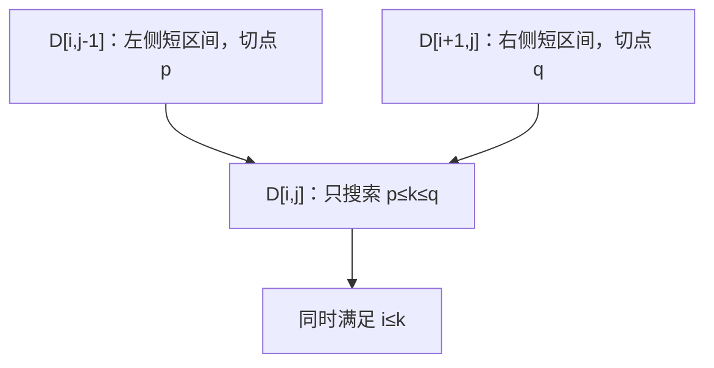
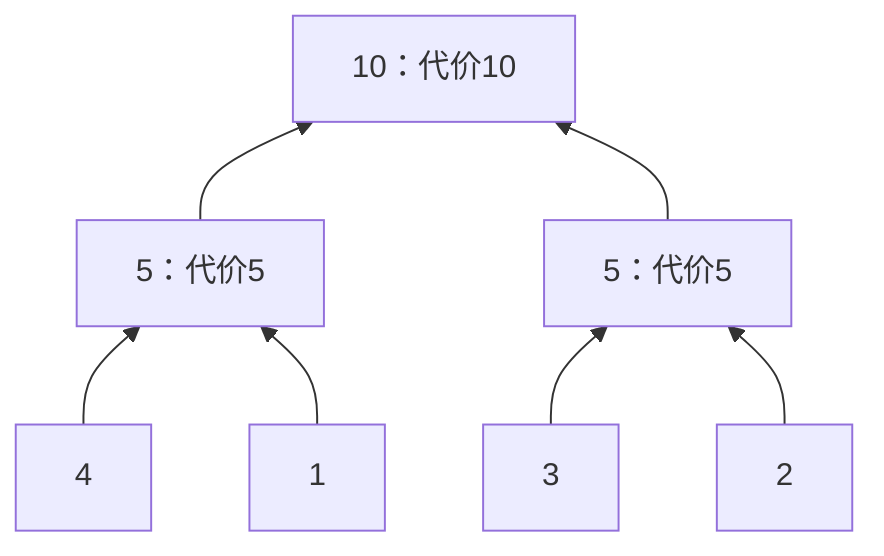

# 算法与数据结构 · 第38课

## Knuth 优化：为什么区间 DP 可以从 O(n³) 降到 O(n²)？

**2026年11月26日｜第6周第3天｜讲授约17分钟，自测另计**

上一课的分治 DP 利用同一层的决策单调性。今天研究另一类 DP：一个区间由两个更短的区间合并而成。Knuth 优化利用两侧短区间的最优切点，直接夹住当前区间的最优切点。

## 一、动机与学习目标（2分钟）

有 n 堆按顺序排列的石子，重量为非负数。每次只能合并相邻两堆，代价为两堆重量之和。求合并成一堆的最小总代价。今天要掌握区间状态、双侧决策界的证明、手工填表以及平方时间界的来源。

令 \(S[i]\) 为前缀和，\(w(i,j)=S[j]-S[i-1]\)，\(D[i,j]\) 为合并第 i 到第 j 堆的最小总代价：

\[
D[i,i]=0,\qquad
D[i,j]=w(i,j)+\min_{i\le k<j}(D[i,k]+D[k+1,j]).
\]

最后一次合并必然把区间分为 [i,k] 和 [k+1,j]；两个子区间必须各自最优，否则替换其中一个即可降低总代价。反之任意合法切点的两个最优子解都能拼成合法方案。按区间长度归纳即得正确性。

朴素方法有 O(n²) 个状态，每个状态扫描至多 O(n) 个切点，因此时间 O(n³)。

## 二、Knuth 的双侧决策界（2分钟）

定义 opt[i,j] 为使转移最小的**最大切点**，并设 opt[i,i]=i。Knuth 定理在下列两个充分条件下成立（a≤b≤c≤d）：

\[
w(a,c)+w(b,d)\le w(a,d)+w(b,c)
\]
\[
w(b,c)\le w(a,d).
\]

前者叫四点不等式（Monge），后者叫区间包含单调性。非负石子重量的区间和满足前者的等式，且大区间包含小区间，所以也满足后者。结论为：

\[
\boxed{opt[i,j-1]\le opt[i,j]\le opt[i+1,j]}.
\]



注意：这两个短区间都已经算好。Knuth 优化没有假设最佳切点总在区间中点，也不是局部贪心。

## 三、数值 Trace（3分钟）

石子重量为 [4,1,3,2]，前缀和为 [0,4,5,8,10]。按长度递增填表；平局取最大切点。

| 区间 | 实际候选 k | D | opt |
|---|---|---:|---:|
| [1,2] | 1 | 5 | 1 |
| [2,3] | 2 | 4 | 2 |
| [3,4] | 3 | 5 | 3 |
| [1,3] | 1,2 | 12 | 1 |
| [2,4] | 2,3 | 10 | 3 |
| [1,4] | 1,2,3 | 20 | 2 |

最后一个状态的三个子成本分别为 10、10、12，加上区间重量10，得到20、20、22。选择最大最优切点2，对应先合并 (4,1) 和 (3,2)，再将两堆重量5的石子合并，总代价 5+5+10=20。



这个小例子未必节省计算；优化的价值是大规模时的总扫描量，而不是每个状态一定少算。

## 四、核心证明：先证明 D 也满足四点不等式（4分钟）

这是不能跳过的一步：w 具有 Monge 性质，不代表任意 DP 自动具有该性质。对本课转移，证明

\[
D[a,c]+D[b,d]\le D[a,d]+D[b,c]
\]

对 a≤b≤c≤d 成立。按外区间长度 d−a 归纳。a=b 或 c=d 时等式成立。

若 b=c，令 x 为 D[a,d] 的最优切点。若 x<c，使用 x 作为 D[a,c] 的候选，再用更短区间的归纳式 \(D[x+1,c]+D[c,d]\le D[x+1,d]\)，以及 \(w(a,c)\le w(a,d)\)，便得 \(D[a,c]+D[c,d]\le D[a,d]\)。若 x≥c，则改用 x 作为 D[c,d] 的候选，并对 D[a,c]+D[c,x] 使用归纳，同样成立。由于 D[c,c]=0，结论正是所需不等式。

若 b<c，令 x、y 分别为 D[a,d]、D[b,c] 的最优切点。

当 x≤y 时，用 x 作为 D[a,c] 的切点，用 y 作为 D[b,d] 的切点。两式相加后，应用归纳式

\[
D[x+1,c]+D[y+1,d]\le D[x+1,d]+D[y+1,c].
\]

再用 w 的四点式，即得所求不等式。

当 x>y 时，改用 y 切分 D[a,c]、x 切分 D[b,d]，应用

\[
D[a,y]+D[b,x]\le D[a,x]+D[b,y].
\]

同理得到结论。两种情况下用到的归纳区间都严格短于 [a,d]，且候选切点合法，故证明完成。

## 五、核心证明：D 的四点性质如何夹住最优切点？（3分钟）

记 \(F(i,j,k)=D[i,k]+D[k+1,j]\)。固定 i、j，w 与 k 无关。只需证明 j−i≥2 的情形，相邻两堆的界由单点定义直接成立。

左侧界：反设 p=opt[i,j−1] 大于 q=opt[i,j]。两个切点在两个区间内都合法。D 的四点式给出：

\[
F(i,j,q)-F(i,j,p)
\ge F(i,j-1,q)-F(i,j-1,p)\ge0.
\]

第二个不等式来自 p 在旧区间的最优性。但 q 在新区间最优，左侧又必须≤0，所以只能等号。于是 p 也是新区间的最优切点，却比 q 大，与取最大切点矛盾。

右侧界：反设 p=opt[i,j] 大于 q=opt[i+1,j]。D 的四点式给出：

\[
F(i,j,p)-F(i,j,q)
\ge F(i+1,j,p)-F(i+1,j,q)\ge0.
\]

p 的最优性迫使等号；于是 p 也是 [i+1,j] 的最优切点，却比该区间选择的 q 大，再次矛盾。

因此双侧界成立。**平局规则是证明的一部分**，不能随意选择最优切点。

## 六、伪代码、不变量与复杂度（2分钟）

```text
KNUTH(a):
    S = PREFIX_SUM(a)
    for i = 1..n:
        D[i,i] = 0
        opt[i,i] = i
    for length = 2..n:
        for i = 1..n-length+1:
            j = i+length-1
            lo = opt[i,j-1]
            hi = min(j-1,opt[i+1,j])
            D[i,j] = INF
            for k = lo..hi:
                v = D[i,k]+D[k+1,j]+S[j]-S[i-1]
                if v <= D[i,j]:
                    D[i,j] = v
                    opt[i,j] = k
    return D[1,n]
```

不变量：开始计算长度 L 时，所有更短区间的 D 和最大最优切点均正确。双侧界保证候选闭区间含真正的最大最优切点，升序扫描并在等号时更新可保留该切点。归纳即证明优化后 DP 与朴素 DP 等价。

复杂度的关键是**望远镜求和**，而不是假设每个区间只需常数次扫描。固定长度 L，令 N=n−L+1，记 \(b_i=opt[i,i+L-2]\)。第 i 个状态最多扫描 \(b_{i+1}-b_i+1\) 次。所有状态相加：

\[
\sum_{i=1}^{N}(b_{i+1}-b_i+1)
=b_{N+1}-b_1+N=O(n).
\]

每条长度对角线总扫描 O(n)，共有 n 条，故总时间 O(n²)。D 和 opt 两张表占 O(n²) 空间，前缀和 O(n)。由于转移依赖任意更短区间，一般不能直接套用上一课的两行滚动数组。

## 七、边界、反例与下一课（1分钟）

允许负重量时，取 [-3,-2,-3,-3]。长度2的 D 为 -5、-5、-6；长度3的 D 为 -13、-14，最大最优切点 opt[1,3]=2、opt[2,4]=2。全区间三个候选的子成本为 -14、-11、-13，因此真正的唯一最优切点是1，而 Knuth 只会扫描2。最优值为 -25，错误剪枝得到 -22。

区间和的四点式依旧是等式，但包含单调性失败。这说明两个充分条件不能仅验证其中一个。对其他问题，若能独立证明双侧决策界，仍可使用该优化；没有证明就应回退到朴素 DP。

**下一课（2026年11月27日，第39课）：凸包优化（CHT）。** 将 DP 转移改写成直线查询，用斜率和交点维护候选下包络。

## 八、四级自测（满分100；首次不给答案）

### Lv1｜双侧决策界｜15分｜预计2分钟｜单选

已证明 Knuth 双侧决策单调性，当前计算 D[3,9]，已知 opt[3,8]=5、opt[4,9]=7。哪一候选区间由该性质保证安全？

**A.** [3,5]

**B.** [5,7]

**C.** [6,6]

**D.** [7,8]

*中立提示：分别写出当前决策的下界和上界，考虑等号。*

### Lv2｜手工执行区间 DP｜20分｜预计4分钟｜数值

石子重量为 [2,4,1,3]，按本课 Knuth 伪代码、区间长度递增、平局取最大 k。统计所有长度至少为2的区间实际计算候选代价的总次数（不计单点初始化）。求该次数，并建议写出每个区间的 D 与 opt。

*中立提示：先填长度2，再填长度3；每个区间的扫描范围由两个短一格区间的 opt 决定。*

### Lv3｜条件与反例｜25分｜预计4分钟｜多选

关于本课区间合并 DP 与 Knuth 优化，下列哪些说法成立？（多选）

**A.** Monge 四点不等式与区间包含单调性共同构成本课定理的充分条件。

**B.** 只要区间权重能 O(1) 求值，就可以直接使用 Knuth 优化。

**C.** 非负区间和满足本课的两个充分条件；允许负权重后，四点等式仍成立，但包含单调性可能失败。

**D.** 每个区间的候选数量一定是 O(1)，所以总时间为 O(n²)。

**E.** 即使不能证明这两个充分条件，只要另有正确证明得到所用平局规则下的双侧决策界，仍可安全使用该优化。

*中立提示：区分充分条件与必要条件，以及单区间扫描宽度和一整条对角线的总宽度。*

### Lv4｜正确性与平方复杂度证明｜40分｜预计12分钟｜开放推导

给定非负重量的相邻石子合并问题。(a)（8分）建立区间 DP、边界与转移，证明原始 DP 正确，并证明区间和满足四点不等式及包含单调性。(b)（12分）证明双侧最优决策界：可以引用讲义中已经证明的 D 的四点不等式，但必须写出两侧比较及平局处理。(c)（12分）写出 Knuth 伪代码，给出按区间长度归纳的不变量，并用望远镜求和证明 O(n²) 时间与空间界。(d)（8分）构造一个不同于讲义的含负权重反例，使双侧决策界失效，说明哪项充分条件被破坏。

*中立提示：固定区间长度，将相邻两个候选区间的端点对齐；证明决策界时假设最优切点逆序，然后比较两个候选的代价差。*

## 九、提交与反馈

回复 Lv1 选项、Lv2 数值和填表过程、Lv3 全部正确选项、Lv4 (a)–(d) 推导。按15/20/25/40分批改：80–100分进入凸包优化，60–79分补四点不等式或望远镜求和，低于60分先复习区间状态与双侧界。补练不改变原定课号。
