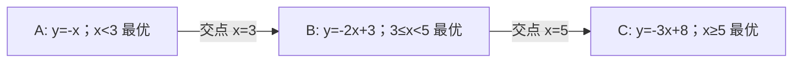

# 算法与数据结构 · 第39课

## 凸包优化（Convex Hull Trick）：为什么枚举切点可以变成查询直线？

**2026年11月27日｜第6周第4天｜讲授约17分钟，自测另计**

第36课证明了平方段和 DP 的决策单调性，第37课利用它做分治优化，将时间降至 \(O(Kn\log n)\)。今天利用更强的代数结构，把同一问题降至 \(O(Kn)\)。

### 一、学习目标与代数变换（3分钟）

今天掌握：如何把候选切点转化为直线；如何维护直线的下包络；证明两种删除操作安全；用摊还分析得到线性单层复杂度。

给定非负数组 a[1..n]，恰好分成 K 个非空连续段，最小化各段元素和的平方之和。令 S[i] 为前缀和，S[0]=0，prev[j]=dp[k−1][j]。固定第 k 层：

\[
dp[k][i]=\min_{k-1\le j<i}\{prev[j]+(S[i]-S[j])^2\}.
\]

展开平方：

\[
dp[k][i]=S[i]^2+\min_{k-1\le j<i}
\{\underbrace{-2S[j]}_{m_j}\underbrace{S[i]}_x+
\underbrace{prev[j]+S[j]^2}_{b_j}\}.
\]

每个有限的 prev[j] 对应直线 \(f_j(x)=m_jx+b_j\)。计算状态 i，只需在合法直线中查询 x=S[i] 处的最小高度，再加 S[i]²。

非负数组使前缀和单调不降，因此插入斜率单调不增，查询 x 单调不降。注意两者是不同条件。为保证非空段，扫描 i 时必须先插入 j=i−1，再查询；不能提前插入 j≥i。第一层直接计算 dp[1][i]=S[i]²。

### 二、几何直觉：下包络（3分钟）

以三条直线 A: y=−x，B: y=−2x+3，C: y=−3x+8 为例。A 与 B 的交点横坐标为3，B 与 C 为5。最优直线随 x 增加依次为 A、B、C。三条直线的逐点最小值构成下包络。

| 查询 x | A | B | C | 最优线 |
|---:|---:|---:|---:|---|
| 1 | −1 | 1 | 5 | A |
| 4 | −4 | −5 | −4 | B |
| 6 | −6 | −9 | −10 | C |



图中箭头是查询点向右移动时最优直线的切换顺序；交点处统一选择较晚插入的线，对应较大切点。

如果把 C 改成 y=−3x+4，B 与 C 的交点会提前到1，而 A 与 B 仍在3相交。B 必须在 x≥3 时才不输给 A，却要在 x≤1 时才不输给 C，所以 B 永远不可能最优。插入 C 时可以删除 B。

### 三、两种删除规则与正确性（4分钟）

**规则1：插入时删除冗余队尾。** 设三条线斜率严格递减 m1>m2>m3，交点为

\[
x_{12}=\frac{b_2-b_1}{m_1-m_2},\qquad
x_{23}=\frac{b_3-b_2}{m_2-m_3}.
\]

线2要同时不高于线1和线3，必须满足 x≥x12 且 x≤x23。若 x12>x23，无这样的 x；若相等，线2仅在三线平局时有机会，但本课取较晚插入的线3。因此 x12≥x23 时可删线2。

两个分母均为正，等价于无除法判据：

\[
\boxed{(b_2-b_1)(m_2-m_3)\ge
(b_3-b_2)(m_1-m_2)}.
\]

插入时反复检查队尾两条线与新线，直到相邻交点严格递增，再加入新线。相同斜率不能直接求交点：保留截距较小者；截距也相同则保留较晚插入者。

**规则2：查询时删除过期队首。** 设队首线 A、次首线 B，且 mA>mB。若当前 x0 处 B(x0)≤A(x0)，则对任何未来 x≥x0，

\[
B(x)-A(x)=[B(x_0)-A(x_0)]+(m_B-m_A)(x-x_0)\le0.
\]

故 A 永远不会重新优于 B，可以永久弹出 A。反复比较队首两条线，直到首线优于次首线或只剩一条。由于交点严格递增，此时后面的所有线也不能在当前 x 处更优。

核心不变量：队列中斜率严格递减、相邻交点严格递增；被删的线在当前及未来合法查询中都不会成为按平局规则选定的最优线。新候选只能降低包络，不能让旧冗余线恢复优势。结合合法插入顺序，查询结果与朴素 DP 完全相同。

### 四、手工 Trace（3分钟）

取 a=[1,2,1,3,2]，K=2，S=[0,1,3,4,7,9]，prev[j]=S[j]²。直线截距为 2S[j]²。

| i | 新线（j；m,b） | 查询 x | 查询后的队列 j | 最优 j | dp[2][i] |
|---:|---|---:|---|---:|---:|
| 2 | 1；−2,2 | 3 | [1] | 1 | 5 |
| 3 | 2；−6,18 | 4 | [2] | 2 | 10 |
| 4 | 3；−8,32 | 7 | [3] | 3 | 25 |
| 5 | 4；−14,98 | 9 | [3,4] | 3 | 41 |

第3轮状态 i=4 时，线2和线3在 x=7 相交，两者高度均为−24；平局取较大 j=3，故弹出线2，dp=49−24=25。

最后一轮，线3与线4的交点为11，而查询 x=9 尚未到11，仍选择线3。dp=81−72+32=41。对应分段 [1,2,1] 和 [3,2]，成本 4²+5²=41。

这个例子主要展示队首删除；第二节修改 C 的例子则展示了插入阶段的队尾删除。两种删除的理由不同。

### 五、伪代码、复杂度与边界（3分钟）

```text
BAD(A,B,C):
    return (B.b-A.b)*(B.m-C.m) >= (C.b-B.b)*(A.m-B.m)

ADD(Q,L):
    if Q not empty and Q.back.m == L.m:
        if Q.back.b < L.b: return
        Q.pop_back()            # 截距相等时保留新线
    while size(Q)>=2 and BAD(Q[-2],Q[-1],L):
        Q.pop_back()
    Q.push_back(L)

QUERY(Q,x):
    while size(Q)>=2 and Q[1](x) <= Q[0](x):
        Q.pop_front()
    return Q[0](x), Q[0].j

PARTITION(a,K):
    S = PREFIX_SUM(a)
    prev[0] = INF
    for i=1..n: prev[i]=S[i]^2
    for k=2..K:
        Q=empty deque; cur[0..n]=INF
        for i=k..n:
            j=i-1
            if prev[j]!=INF:
                ADD(Q,line(-2*S[j],prev[j]+S[j]^2,j))
            y,p=QUERY(Q,S[i])
            cur[i]=S[i]^2+y
        swap(prev,cur)
    return prev[n]
```

假设 1≤K≤n，所有合法状态有限，则查询时队列非空。每条线至多入队一次，出队至多一次（无论从首还是尾）。虽然单次插入或查询可能弹出 O(n) 条线，但全层的总操作数为 O(n)。这就是摊还分析，而不是每次操作的最坏时间都为 O(1)。

\[
\boxed{T=O(Kn),\quad S_{\rm work}=O(n).}
\]

前缀和、两层 DP 和队列均占 O(n)；若要直接回溯切点，可额外存 O(Kn) 个决策。整数实现注意平方、直线求值和交叉乘法可能溢出，应根据输入范围使用足够宽的整数类型。上述时间界采用常数时间算术模型。

**反例：查询不单调时不能永久弹首。** 两条线 y=0 与 y=5−x，先查询 x=10，后一条更优，若删除第一条，再查询 x=0 就会错误返回5而不是0。

允许负数时，平方展开仍成立，但斜率及查询顺序不再保证单调。斜率单调而查询任意时，可保留完整下包络并二分交点，查询 O(log n)；两种顺序都任意时，下一课介绍 Li Chao Tree。CHT 优化依赖转移能分离成直线查询，而不是任意具有 Monge 性质的 DP 都可直接使用。

### 六、总结与下一课（1分钟）

| 方法 | 依赖的结构 | 本问题总时间 |
|---|---|---|
| 朴素分段 DP | 正确的状态转移 | O(Kn²) |
| 分治 DP | 最优切点单调 | O(Kn log n) |
| 单调队列 CHT | 线性分离、斜率与查询顺序单调 | O(Kn) |

今天的核心是把枚举候选变成几何查询，再证明不可能成为最优的候选可以永久删除。

**下一课（2026年11月28日，第40课）：Li Chao Tree（李超线段树）。** 研究直线插入与查询不再有单调顺序时，如何仍然高效求最小值。

---

## 四级自测（满分100；首次不公布答案）

### Lv1｜三线冗余判据｜15分｜预计2分钟｜单选

已按斜率 m1>m2>m3 插入三条直线，做最小值查询。若相邻交点横坐标 x12=6、x23=2，哪项处理正确？

**A.** 删除第一条线，因为它斜率最大。

**B.** 删除第二条线，因为不存在它严格优于另外两条线的查询区间。

**C.** 删除第三条线，因为它最后插入。

**D.** 三条线均须保留，因为查询 x 可能取任意实数。

*中立提示：分别写出第二条线不高于第一条和不高于第三条的 x 范围。*

### Lv2｜分段 DP 与直线查询 Trace｜20分｜预计4分钟｜数值

数组 [2,1,3,2,1]，恰好分为两段非空连续段，代价为各段元素和的平方之和。按本课单调队列 CHT 先插入 j=i−1 再查询，平局取较大 j。求 dp[2][5]（建议同时写出各轮直线、队首变化和最优切点）。

*中立提示：先计算前缀和及每条线的斜率、截距，按 i 递增模拟插入与查询。*

### Lv3｜前提与反例｜25分｜预计4分钟｜多选

关于本课的最小值凸包优化，下列哪些说法成立？（多选）

**A.** 斜率单调但查询 x 任意时，仍可维护下包络并二分查询，但不能直接永久弹出队首。

**B.** 数组存在负数时，平方段和 DP 的直线代数变换本身仍成立。

**C.** 只要 DP 满足决策单调性，就必能改写成一次直线最小值查询。

**D.** 相同斜率的直线在求最小值时，可保留截距较小者；截距也相同则按统一平局规则保留一条。

*中立提示：分别检查代数恒等式、斜率与查询顺序、队首删除的永久性及平行直线。*

### Lv4｜算法设计、正确性与摊还证明｜40分｜预计12分钟｜开放推导

给定非负数组，恰好分成 K 个非空连续段，最小化段和平方之和。(a)（10分）推导直线查询形式并说明合法插入顺序。(b)（12分）证明三线冗余判据，写出不使用除法的交叉乘法条件，并处理相同斜率和平局。(c)（12分）证明单调查询的队首删除安全，写出完整的单层队列伪代码，推导摊还时间与滚动数组空间。(d)（6分）构造查询顺序不单调时永久删除队首出错的反例，并说明应如何修改算法。

*中立提示：对两条线求交点，比较中间线的最优区间；分别统计每条线进入和离开队列的次数。*

### 提交与反馈

回复 Lv1 选项、Lv2 数值和 Trace、Lv3 全部正确选项、Lv4 (a)–(d) 推导。我将按15/20/25/40分逐题批改：80–100分继续 Li Chao Tree；60–79分补直线交点或摊还分析；低于60分先复习平方展开与下包络。补练不修改自然日课号。
