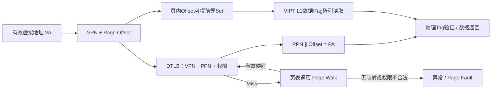

# 计算机体系结构 · 第23课
## TLB、VIPT与地址别名：为什么虚拟索引快，物理Tag仍不可省？

**2026年11月11日｜第4周第2节｜预计18分钟**

上一讲学了Set/Tag/Offset与AMAT，但真正的程序发出的是**虚拟地址（VA）**；物理内存与一致性系统通常需要**物理地址（PA）**。如果每次L1命中之前都必须完整完成页表遍历，Cache的低延迟优势就会大幅削弱。

今天解决四个问题：TLB为什么是地址翻译的Cache？怎样把TLB与L1查询并行？为什么虚拟索引可能出现同一物理块的两个“名字”？为什么命中Cache也不能跳过访问权限检查？

## 一、动机：一次Load究竟经过哪些部件？（2分钟）

考虑 `r = *(uint64_t*)va`。高层程序提供VA，但Cache需要确认最终要访问哪一个**物理块**。



这里有两种不同意义的“Miss”：**TLB Miss是翻译缓存未命中**，通常可以通过页表遍历取得正确映射；**Page Fault是地址翻译或权限检查发现不符合架构要求的情况**，需要异常处理，可能由OS补页，也可能终止访问。TLB Miss不等于Page Fault。

为避免混淆，本讲默认单核、普通可缓存内存、4KiB基础页、字节寻址、64B Cache Line、地址和容量采用2的幂；暂时忽略Huge Page、TLB多级、页表更新同步和复杂地址哈希，随后再说明边界。

## 二、符号与地址翻译（2分钟）

定义：

| 符号 | 含义 |
|---|---|
| `V` / `P` | 虚拟/物理地址位数 |
| `Q=2^p` | 基础页大小，`p`为Page Offset位数 |
| `VPN` / `PPN` | 虚拟页号 / 物理页帧号 |
| `C` / `B` / `A` | L1数据容量 / Line大小 / Way数 |
| `S=C/(AB)` | Cache Set数量 |
| `b=log_2 B` / `s=log_2 S` | Line Offset / Set Index位数 |

地址翻译不改变页内偏移：

\[
VA = VPN \,\|\, pageOffset,\qquad
PA = PPN \,\|\, pageOffset.
\]

对于4KiB页，`p=12`，所以最低12位在翻译前后保持一致。

**例题：** 若 `VA=0x12ABC`，TLB记录 `VPN=0x12 → PPN=0x345`，则页内偏移为 `0xABC`，物理地址是 `0x345ABC`。这里PPN是页号，不要将其直接当成完整物理地址。

TLB缓存的不仅是PPN，通常还关联权限、页大小、有效性及地址空间标识等信息。一次TLB Hit并不表示该访问必然获得授权；实际架构权限仍必须得到正确验证。

## 三、PIPT、VIVT与VIPT：关键是查询次序（2分钟）

**PIPT（Physically Indexed, Physically Tagged）**：先取得PA，再由PA选择Set并比较物理Tag。简单、天然不受虚拟别名影响，但容易把地址翻译放到L1关键路径之前。

**VIVT（Virtually Indexed, Virtually Tagged）**：用VA选择Set并比较虚拟Tag；可以快速查询，但同一PA可能有两个VA（Synonym），同一VA也可能在不同进程映射不同PA（Homonym）。需要额外的地址空间标记、失效和别名管理。

**VIPT（Virtually Indexed, Physically Tagged）**：**Set提前用虚拟地址中不变的页内位选择，Tag最终用翻译后的PA比较。** TLB与Cache阵列查询可以重叠。

```text
VA:  [虚拟页号 VPN       | 页内Offset（最低12位）]
                              |          |
                             Index      Line Offset
                              |          |
                     访问L1对应Set       |
                              |          |
TLB: VPN → PPN + 权限         |
             |                |
             +-------物理Tag比较------> 数据返回
```

VIPT的“虚拟”指**提前选择Set**，不是用虚拟Tag确认物理身份。页内索引成立时，两个不同VA即使映射到同一个PA，也会选择同一个Set，并用同一个物理Tag进行匹配。

但“物理Tag”也不是权限检查的替代品：Tag相等只表示目标物理块已经缓存，不能允许一个原本没有访问权限的虚拟映射直接读取其数据。

## 四、推导VIPT最重要的不等式（3分钟）

假设Set Index是紧邻Line Offset的连续低位，且物理和虚拟地址的基础页偏移相同。

- Cache Line占 `b=log_2 B` 位。
- Cache有 `S=C/(AB)` 个Set，占 `s=log_2S` 位。
- 低 `p=log_2Q` 位是页内偏移。

为了能够在TLB翻译完成前安全地用VA索引，**Line Offset与全部Index位必须都落在页内偏移范围**：

\[
\boxed{b+s\le p}.
\]

因为：

\[
2^{b+s}=B\cdot S=B\cdot\frac{C}{AB}=\frac CA,
\]

所以等价于：

\[
\boxed{\frac CA\le Q}
\qquad\Longleftrightarrow\qquad
\boxed{C\le A Q}.
\]

这是一条**在本讲简单连续索引模型下，使VIPT不会因同一物理页的不同虚拟名字而落入不同Set的充分结构条件**，不是所有真实Cache容量必须服从的绝对限制。真实实现可以通过额外别名检测、页着色、改变索引/翻译阶段等手段突破它。

**数值例题A：** `C=32KiB, A=8, B=64B, Q=4KiB`。

\[
S=\frac{32768}{8\times64}=64,\quad
s=6,\ b=6,\ p=12.
\]

故 `b+s=12`；最低12位正好足够，虚拟Index和物理Index一致。等价地，`C/A=4KiB=Q`。

**数值例题B：** 仍为4KiB页、64B Line，若改为 `C=64KiB, A=8`：

\[
S=128,\quad s=7,\quad b+s=13>12.
\]

Index需要地址位12，而它属于VPN，不再保证VA与PA一致。相同的物理Line可因两种虚拟映射的第12位不同而查找不同Set。这不是“64KiB L1无法制造”，而是该朴素VIPT结构需要额外处理。

**设计选择：** 保持64KiB并改为16-way，可使 `S=64`、`b+s=12`；但提高相联度可能增加电路复杂度、能耗或Hit Time。增大基础页也可提供更多不变偏移位，但不能假设系统所有映射都使用Huge Page。

## 五、Synonym与Homonym：两种“名字冲突”不是一回事（2分钟）

**Synonym（同物异名）**：`VA_1≠VA_2`，但经过页表翻译 `PA_1=PA_2`，例如两个共享映射指向同一物理帧。对于额外使用VPN位的VIPT索引，同一物理Line可能出现于两个Set；如果允许两个独立副本，写入更新与一致性管理会变复杂。

**Homonym（同名异物）**：不同地址空间使用相同的VA，却对应不同PA。例如两个进程都有`VA=0x4000`，但PPN不同。纯虚拟Tag缓存需要区分地址空间；VIPT的物理Tag天然帮助区分对应的物理块，但**TLB本身**仍必须用ASID/PCID等地址空间标识或正确的失效协议，避免误用前一进程的翻译。

```text
Synonym：  VA_A ─┐
                 ├─→ 同一 PA     （一物两名）
           VA_B ─┘

Homonym：  进程A: VA_X → PA_M
           进程B: VA_X → PA_N    （同名不同物）
```

**反例：** “物理Tag可以解决所有别名问题”——不准确。如果虚拟索引把两个Synonym直接送往**不同Set**，只在已选Set内比较物理Tag并不能发现另一个Set已缓存同一PA。需要保证索引安全，或者用硬件别名探测、页着色/映射约束等机制。

具体实现各不相同：Arm的某些旧式L1配置采用别名检测来维持一致行为，而非简单地禁止超过 `A×PageSize` 的Cache。参见课末资料。

## 六、TLB Miss、Page Walk与Page Fault（2分钟）

TLB像一个缓存，它记录近期翻译。一次常见的Load可以经历：

```text
VA
 ├─ DTLB Hit + 权限合法 ──→ 取得PPN ──→ 物理Tag匹配
 └─ DTLB Miss
       └─ STLB命中，或Page-Table Walker访问页表
             ├─ 映射有效且权限合法 → 填充TLB → 继续Load
             └─ 映射不合法/权限不足 → 异常（Page Fault等）
```

Page Walk也会读内存中的页表项，这些读取本身可能命中Cache。一个四级页表不意味着必定有四次DRAM访问。真实系统还可能缓存页表中间级结果，支持并行Walk和多级TLB。

**数值例题：** 简化假设TLB命中率98%，命中翻译需2周期；未命中但可由页表找到映射时，在命中路径基础上额外增加80周期，且所有请求合法。则单独的平均翻译耗时：

\[
E[T_{\text{translate}}]=2+0.02\times80=3.6\text{ cycles}.
\]

注意这是**翻译耗时的教学期望**，并非把它直接加到一个VIPT L1 Hit Time上。因为TLB和Cache索引可能重叠，需要按执行路径分析关键路径，而不是把所有阶段无条件相加。

### 延迟重叠模型

定义 `T_T` 为TLB翻译（命中）耗时，`T_D` 为L1 Set数据和Tag阵列读取耗时，`T_C` 为物理Tag比较与必要的输出选择耗时。简化假设没有其他依赖或资源冲突：

- 顺序PIPT：`T_{\mathrm{PIPT}}=T_T+T_D+T_C`。
- 可并行VIPT：`T_{\mathrm{VIPT}}=\max(T_T,T_D)+T_C`。

若 `T_T=2,T_D=3,T_C=1`，则PIPT路径为6周期，VIPT路径为4周期。真实TLB保护验证、流水线分段、投机执行及输出Mux可能改变该模型。

## 七、权限、TLB一致性与大页：不能只追求命中快（2分钟）

**权限边界。** VIPT允许提前读取某个Set中的Tag和数据阵列，不等于架构可以在权限确认前向软件交付敏感值。必须保证未授权访问不会产生不允许的架构结果。瞬态侧信道的额外安全问题则需另行验证，正如第15—21课所述。

**翻译一致性。** OS修改页表后，旧的TLB翻译不能被不受约束地继续使用。某些ISA提供翻译同步与失效机制，如RISC-V的`SFENCE.VMA`；带ASID/PCID的设计也要正确处理标识复用和映射失效。页表写入本身不等于所有核的TLB都立即更新。

**Huge Page边界。** 2MiB页拥有21位页内偏移，相较4KiB页可以扩大TLB Reach（一定TLB条目数覆盖的字节数），也可在特定VIPT设计中提供更多不变地址位。但Huge Page也可能带来内存碎片、映射粒度和分配约束；不能把它当成所有缓存瓶颈的免费解药。

**与TSO复习相连。** TLB/Cache Hit说明访问路径和地址翻译情况，并不说明某条Store已经对其他核可见。即便Store已从ROB退休，也可能在Store Buffer等待传播。本核同址Load可以转发本核较老Store的数据，同时别的核暂未看到该写入；这与两个虚拟地址是否指向同一物理块的Synonym问题是**不同维度**。

## 八、反例与适用边界：五句容易犯错的话（1分钟）

| 错误推论 | 为什么不成立 |
|---|---|
| TLB Miss就是Page Fault | 翻译缓存Miss后可成功Page Walk |
| Cache Hit不需要权限检查 | 物理块在Cache中不意味着当前VA有权访问 |
| 物理Tag消除了任何VIPT Synonym风险 | 不安全的虚拟索引仍可能选择不同Set |
| `C>A×Q` 的L1绝对做不出来 | 可以采用别名检测、页着色或其他结构 |
| TLB优化减少的周期全部变成IPC收益 | TLB访问可能与Cache读取重叠，且OoO可隐藏部分等待 |

## 九、本课总结与下一讲（1分钟）

必须掌握的三条公式：

\[
VA=VPN\|Offset,\qquad PA=PPN\|Offset
\]

\[
S=\frac{C}{AB},\qquad
\boxed{b+s\le p\ \Longleftrightarrow\ C/A\le Q}
\]

\[
T_{\mathrm{VIPT}}\approx\max(T_T,T_D)+T_C
\quad\text{（仅限本讲重叠模型）}.
\]

**下一讲：第24课（2026年11月12日，第4周第3节）——《Cache写策略与一致性前奏：Write-back、Write-through、Write-allocate、Dirty与Store Buffer》。** 第28课仍按原计划进行四周阶段考核。

---

# 十、四级分级测评（100分）

首次作答不公布标准答案。前三题可客观判分；第四题采用人工或自评Rubric。每道题都是新题，与课堂示例不同。

### Lv1｜TLB Miss与架构权限（15分，单选，预计2分钟）

一个Load使用合法VA，当前DTLB找不到映射，但页表里确有有效、允许读取的PTE。哪种判断最严谨？

A. 只要DTLB Miss，就必须产生不可恢复的Page Fault。

B. CPU可以通过下一层TLB或Page Walk找到翻译，并在权限合法时继续访问；TLB Miss不等于Page Fault。

C. 若目标数据恰好L1 Hit，便可完全不验证当前虚拟映射的权限。

D. 只要Cache使用物理Tag，TLB中的地址空间标识和失效机制就不再需要。

<details><summary>可选提示</summary>
区分“最近翻译条目不存在”和“页表/权限判定该访问不合法”。
</details>

### Lv2｜VIPT Set Index与页内偏移（20分，数值，预计4分钟）

教学处理器：4KiB页，VIPT L1数据容量32KiB、8-way、64B Line，连续低位索引。某VA为 `0x12A80`，且TLB命中，映射合法。

**问题：该Load访问的十进制Cache Set Index是多少？** 仅填整数。

<details><summary>可选提示</summary>
先求Set数量；把VA右移Line Offset位数，再对Set数量取模。不要把VPN当作Set Index。
</details>

### Lv3｜VIPT别名、TLB与性能边界（25分，多选，预计5分钟）

选择所有成立的说法。沿用本课简化的4KiB页、连续低位Set索引模型。

A. 32KiB、8-way、64B的VIPT L1可让全部Set Index位落在4KiB页内偏移中。

B. 64KiB、8-way、64B的VIPT L1在4KiB基础页上，天然保证所有同一PA的不同VA都访问相同Set，无需其他机制。

C. 共享映射的两种VA指向同一PA是Synonym；相同VA在两个地址空间指向不同PA是Homonym。

D. 使用物理Tag后，OS修改页表时不再需要考虑TLB翻译失效或地址空间标识复用。

E. TLB命中路径与L1 Set读取可以重叠，所以把两段延迟无条件相加可能高估VIPT命中关键路径。

F. 一次Load命中L1便能证明先前同核Store已经对其他核全局可见。

<details><summary>可选提示</summary>
分别检查页内位数、同物异名/同名异物、物理Tag与TLB的职责，以及ROB退休和跨核可见性的差别。
</details>

### Lv4｜VIPT几何、Synonym Trace与访问延迟联合设计（40分，开放，预计10—12分钟）

假设基础页大小为4KiB，Cache Line为64B，Index均取Line Offset之上的连续低位，TLB映射与权限正常。比较两种L1设计：

- 设计A：48KiB，12-way；
- 设计B：64KiB，8-way。

**A｜位数与结构条件（12分）** 求两种设计的Set数、Index位数、`b+s`，判断是否满足不依赖额外Synonym处理的简单VIPT索引条件。说明该条件的适用边界。

**B｜同物异名Trace（10分）** 在设计B中，两个虚拟地址 `VA_1=0x2140`、`VA_2=0x3140` 映射到同一物理页帧，且指向该页内同一偏移。逐个计算它们访问的十进制Set Index，并解释为什么仅比较所选Set内的物理Tag可能不够。提出一种适用的处理思路。

**C｜延迟反事实（10分）** 教学模型设：TLB Hit翻译耗时2周期，L1 Set阵列读取3周期，最终物理Tag比较/输出选择1周期；PIPT按顺序进行，VIPT允许翻译与阵列读取并行。TLB Miss率1%，且每次Miss在Hit路径基础上增加70个完全暴露、无重叠的周期，全部映射合法；忽略L1数据Miss。计算两方案的TLB Hit访问延迟以及各自的平均访问延迟。说明为何真实IPC收益不一定等于这两种平均延迟的差值。

**D｜跨机制纠错（8分）** 说明为什么TLB Hit不等于访问权限被免除；为什么某条Store从ROB退休，不表示它立刻对其他核全局可见。指出本题Synonym问题与TSO Store Buffering分别解决的是什么问题。

<details><summary>可选提示</summary>
从 `S=C/(AB)` 出发；设计B的Index需要7位。别名地址的页内低12位一致，但地址位12不同。延迟部分分别用“顺序相加”与“并行取最大值”，再按1%的Miss比例计算额外平均代价。
</details>

---

## 十一、作答与评分

```text
Lv1：
Lv2：
Lv3：（所有选中字母）
Lv4：
A：
B：
C：
D：
```

四题分值为15、20、25、40，总分100。≥80分继续既定课号；60–79分补一个Synonym索引或TLB路径例子；<60分重点回顾页内偏移、TLB Miss/Page Fault和VIPT约束。补练**不改变**第24课日期或编号。

## 参考资料

- [RISC-V Privileged Architecture：Sv32虚拟页号与Page Offset、页表遍历和权限检查](https://docs.riscv.org/reference/isa/_attachments/riscv-privileged.pdf)
- [Arm Community：VIPT别名检测与PIPT/VIPT实现差异](https://community.arm.com/forums/f/architectures-and-processors-forum/3608/why-is-the-i-cache-designed-as-vipt-while-the-d-cache-as-pipt/9884)
- [大学体系结构课程笔记：VIPT每Way容量与页大小约束](https://github.com/drharris/cs6290-notes/blob/master/advanced-caches.md)
