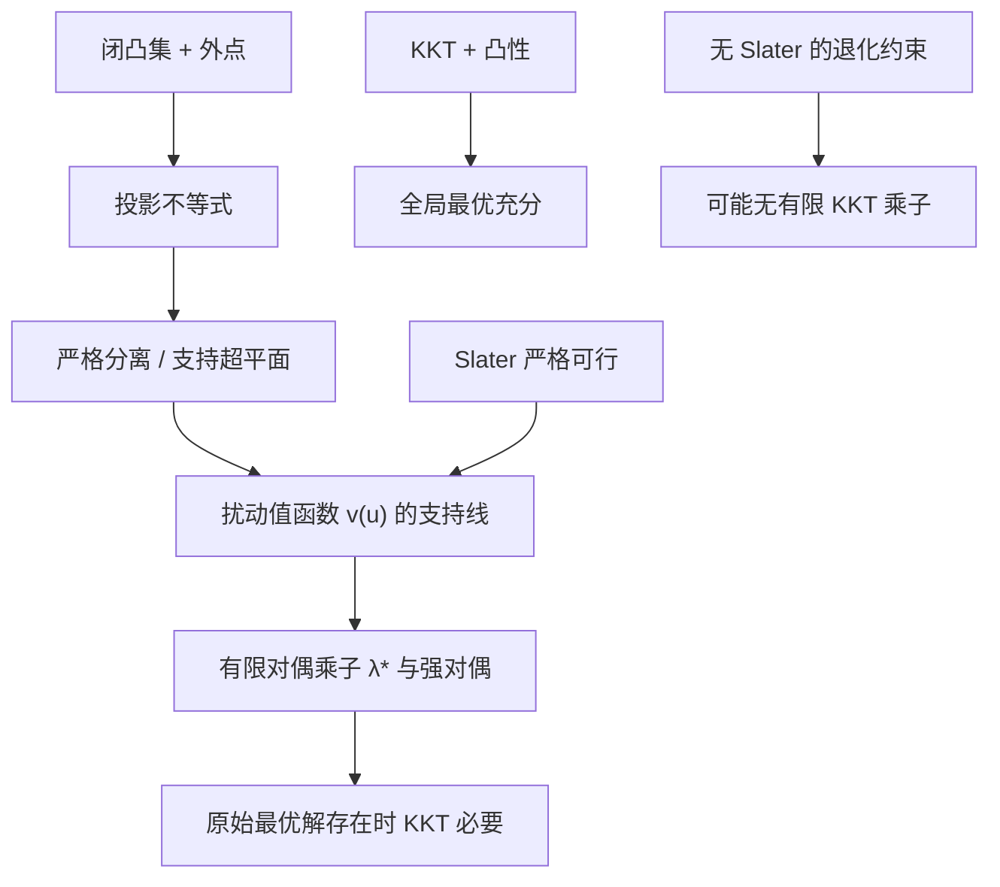

# 数学优化理论 · 第 5 课
## 支持超平面、凸集分离与 Slater：KKT 乘子为什么有时不存在？

**2026 年 10 月 24 日｜第 1 周｜约 18 分钟**

> **核心问题：** 第 4 课用法锥写出了约束最优性条件。可是把法锥写成「若干约束梯度的非负组合」时，什么时候真能找到有限的拉格朗日乘子？为什么一个明明是凸问题的最优解，也可能不存在 KKT 乘子？

**学习目标：**（1）从投影证明闭凸集与外点的严格分离；（2）区别「支持超平面」与「把两个集合严格分开」；（3）推导弱对偶，并通过扰动值函数理解 Slater 的作用；（4）手算对偶上升的数值迭代；（5）辨析「强对偶」「对偶最优解达到」「KKT 存在」三个不同命题。

## 一、从上一课法锥到新的疑问

上一课对非空闭凸集 \(C\) 和凸可微函数 \(f\) 证明：

\[
x^*\in\arg\min_{x\in C}f(x)
\iff
-\nabla f(x^*)\in N_C(x^*),
\qquad
N_C(x^*)=\{v:v^\top(y-x^*)\le0,\ \forall y\in C\}.
\]

这条最优性条件对**任意闭凸可行域**都成立。可是工程模型通常把约束写成 \(g_i(x)\le0\)。想继续写成

\[
\nabla f(x^*)+\sum_i\lambda_i\nabla g_i(x^*)=0,\qquad\lambda_i\ge0,
\]

就需要证明约束梯度足以生成所需的法向量。一般非线性凸不等式未必自动满足。缺少的关键前提之一就是 **Constraint Qualification（约束资格条件）**。

## 二、分离定理：凸性带来可证明的几何边界

设 \(C\subset\mathbb R^d\) 非空、闭、凸，点 \(z\notin C\)。令 \(p=\Pi_C(z)\)，投影存在且唯一，并满足：

\[
(z-p)^\top(y-p)\le0,\quad\forall y\in C.
\]

取法向量 \(a=z-p\ne0\)，则

\[
a^\top y\le a^\top p,\qquad \forall y\in C,
\]

但

\[
a^\top z=a^\top p+\|z-p\|^2>a^\top p.
\]

所以超平面 \(a^\top x=a^\top p\) 把 \(C\) 与 \(z\) **严格分离**：整个集合在一侧，而点 \(z\) 在另一侧，留有正的间隔 \(\|z-p\|^2\)（这是未按法向量归一化的线性间隔）。

这不是在说「任意两个互不相交的闭凸集都能严格分离」：两组无界闭凸集可能互不相交却渐近靠近，无法保证存在正间隔。这里我们只证明**外点与闭凸集**的严格分离。

**支持超平面**是另一种用法：在凸集的边界点 \(p\) 处，有非零 \(a\) 使 \(a^\top y\le a^\top p\) 对所有 \(y\in C\) 成立。它可以碰到集合，因而不叫严格分离。对非空闭凸集的边界点，存在至少一个支持超平面；当边界不光滑时，支持法向量可能不唯一。

### 例子：圆盘的支持线

令 \(C=\{(x,y):x^2+y^2\le1\}\)、\(p=(1,0)\)。向外法向量 \(a=(1,0)\) 给出支持线 \(x=1\)。外点 \(z=(2,0)\) 被它严格分开。注意「支持线」解释的是几何边界，并不自动产生某个具体非线性约束的有限梯度乘子。

## 三、从几何到代数：弱对偶几乎不需要凸性

先研究一条不等式的模型：

\[
\text{(P)}\quad p^*=\min_x f(x)\quad\text{s.t. }g(x)\le0.
\]

定义拉格朗日函数与对偶函数：

\[
L(x,\lambda)=f(x)+\lambda g(x),\qquad
q(\lambda)=\inf_x L(x,\lambda),\quad\lambda\ge0.
\]

对任意原始可行 \(x\) 与对偶可行 \(\lambda\ge0\)：

\[
q(\lambda)\le L(x,\lambda)
=f(x)+\lambda g(x)\le f(x).
\]

对所有原始可行点取下确界：

\[
\boxed{q(\lambda)\le p^*,\qquad
d^*=\sup_{\lambda\ge0}q(\lambda)\le p^*.}
\]

这叫 **弱对偶**，即使 \(f,g\) 非凸，逻辑也照样成立。特别地，\(q\) 对 \(\lambda\) 一定是凹的：因为每个固定 \(x\) 的 \(L(x,\lambda)\) 都是 \(\lambda\) 的仿射函数，而仿射函数族的逐点下确界是凹函数。

如果 \(d^*=p^*\)，称为**零对偶间隙/强对偶**。但「上确界恰等于原始最优值」和「存在有限 \(\lambda^*\) 真正取到这个上确界」是**两个不同命题**；后者才允许我们直接使用一组有限的最优乘子。

## 四、Slater 的直觉：允许把约束稍微收紧

对本课的简化设定，假设 \(f,g\) 都是在 \(\mathbb R^d\) 上有限值的凸函数，原始最优值有限且最优解存在。

**Slater 条件：** 存在某个 \(\bar x\) 满足 \(g(\bar x)<0\)。多条凸不等式时要求每条严格满足；允许仿射等式 \(Ax=b\) 时还须同时满足等式。如果函数有受限定义域，需要把点放在相对内点；对纯仿射不等式还可以采用更弱的 Slater 版本。

几何上，严格可行点给约束留下了「余量」。这个余量让原始最优值对轻微约束扰动具有足够良好的凸几何结构，能够在最优值附近找到一条具有**有限斜率**的支持线——它就是有限的拉格朗日乘子。

### 4.1 扰动值函数：把乘子变成支持线斜率

把右端的 \(0\) 改为可变化的 \(u\)：

\[
v(u)=\inf\{f(x):g(x)\le u\},\qquad p^*=v(0).
\]

重要性质：

- **非增性。** 当 \(u_1\le u_2\) 时，\(u_1\) 的可行集合包含于 \(u_2\) 的可行集合，所以 \(v(u_1)\ge v(u_2)\)。
- **凸性。** 若 \(x_1,x_2\) 分别对 \(u_1,u_2\) 可行，则由 \(g,f\) 凸性，对 \(x_\theta=\theta x_1+(1-\theta)x_2\)，有
\[
g(x_\theta)\le\theta u_1+(1-\theta)u_2,\quad
f(x_\theta)\le\theta f(x_1)+(1-\theta)f(x_2).
\]
取近似最优点并令误差趋零，得到
\[
v(\theta u_1+(1-\theta)u_2)
\le\theta v(u_1)+(1-\theta)v(u_2).
\]

在上述有限值凸模型、Slater 严格可行和有限最优值条件下，\(u=0\) 是 \(v\) 的有效定义域内点；可找到有限的支持斜率 \(s\)，使

\[
v(u)\ge v(0)+su,\qquad \forall u.
\]

由于 \(v\) 非增，可以取 \(s\le0\)。令 \(\lambda^*=-s\ge0\)，得到

\[
\boxed{v(u)\ge p^*-\lambda^*u.}
\tag{1}
\]

对任意 \(x\)，\(x\) 在放宽量 \(u=g(x)\) 下可行，故

\[
f(x)\ge v(g(x))\ge p^*-\lambda^*g(x).
\]

整理：

\[
L(x,\lambda^*)=f(x)+\lambda^*g(x)\ge p^*,\quad\forall x.
\]

于是

\[
q(\lambda^*)=\inf_x L(x,\lambda^*)\ge p^*.
\]

再结合弱对偶 \(q(\lambda^*)\le p^*\)：

\[
\boxed{q(\lambda^*)=d^*=p^*.}
\tag{2}
\]

这就是单条不等式情形下，**从扰动值函数的支持线获得强对偶与有限乘子**的核心证明路径。对多维 \(u\) 可使用支持超平面，斜率向量的每个分量对应一条不等式乘子。

> 说明：上面给出了一条标准凸分析论证路线；完整的广义 Slater 定理还需仔细处理函数的有效定义域、相对内点、等式约束和最优值有限性，不能直接把这段简化证明套到任意非凸模型。

## 五、从强对偶严格推出 KKT 的四个条件

若原始最优解 \(x^*\) 与有限最优乘子 \(\lambda^*\) 都存在，式 (2) 给出：

\[
p^*=q(\lambda^*)\le L(x^*,\lambda^*)\le f(x^*)=p^*.
\]

因此两边都必须取等号。

第一，\(L(x^*,\lambda^*)=f(x^*)\)，所以

\[
\lambda^*g(x^*)=0
\quad\text{（互补松弛）}.
\]

第二，\(q(\lambda^*)=L(x^*,\lambda^*)\)，所以 \(x^*\) 是无约束函数 \(L(\cdot,\lambda^*)\) 的全局最小点。若函数可微，则

\[
\nabla f(x^*)+\lambda^*\nabla g(x^*)=0
\quad\text{（驻点）}.
\]

另有原始可行 \(g(x^*)\le0\) 与对偶可行 \(\lambda^*\ge0\)。

| KKT 条件 | 数学形式 | 理解 |
|---|---|---|
| 原始可行 | \(g(x^*)\le0\) | 点在约束以内 |
| 对偶可行 | \(\lambda^*\ge0\) | 外法向量系数不为负 |
| 互补松弛 | \(\lambda^*g(x^*)=0\) | 严格不活跃 \(\Rightarrow\) 乘子为零 |
| 驻点 | \(\nabla f+\lambda^*\nabla g=0\) | 目标梯度被约束法向量抵消 |

**切勿反推错误方向：活跃约束 \(g(x^*)=0\) 不代表对应乘子必须大于零。** 乘子为零的活跃约束称为退化或弱活跃约束，在优化中很常见。

对凸问题，若有满足 KKT 的原始—对偶可行点，则可以直接由弱对偶证明其全局最优，**这条充分性并不依赖 Slater**；Slater 主要负责在合适条件下保证有限最优乘子存在，从而得到必要性。

## 六、数值例题：对偶上升与约束价格

考虑

\[
\min_x\;\frac12(x-3)^2
\quad\text{s.t. }x\le1.
\]

目标凸且强凸，约束仿射。取 \(\bar x=0<1\)，满足 Slater。

构造：

\[
L(x,\lambda)=\frac12(x-3)^2+\lambda(x-1),\quad\lambda\ge0.
\]

对固定 \(\lambda\)，内层无约束最小点满足

\[
\frac{\partial L}{\partial x}=x-3+\lambda=0
\quad\Rightarrow\quad x(\lambda)=3-\lambda.
\]

代入得

\[
\boxed{q(\lambda)=2\lambda-\frac{\lambda^2}{2},\quad\lambda\ge0.}
\]

这是一个凹二次函数。对偶最优乘子使 \(q'(\lambda)=2-\lambda=0\)；而原始最优点落在边界 \(x=1\)，两种途径完全一致。

从 \(\lambda_0=0\) 出发，演示一个**特定的**投影对偶梯度上升：

\[
\lambda_{k+1}=[\lambda_k+\eta\,g(x(\lambda_k))]_+,
\quad\eta=\tfrac12,\quad g(x)=x-1.
\]

| \(k\) | \(\lambda_k\) | \(x(\lambda_k)\) | \(g(x(\lambda_k))\) | 对偶下界 \(q(\lambda_k)\) |
|---:|---:|---:|---:|---:|
| 0 | 0 | 3 | 2 | 0 |
| 1 | 1 | 2 | 1 | 1.5 |
| 2 | 1.5 | 1.5 | 0.5 | 1.875 |
| 3 | 1.75 | 1.25 | 0.25 | 1.96875 |

**特别注意：** 中间的 \(x(\lambda_k)\) 可以违反原始约束 \(x\le1\)。它是拉格朗日函数的内层极小点，不是投影梯度法生成的可行点。对偶函数值则始终是原始最优值的下界。

在这个特定模型中（从 \(\lambda_0\in[0,2]\) 开始，\(\eta=1/2\)），令 \(e_k=2-\lambda_k\)，有

\[
e_{k+1}=\tfrac12 e_k,\qquad e_k=2^{1-k}.
\]

这是明确的几何收敛保证，来自这里的凹二次 \(q\) 和选定的步长。**不要推广成“任意凸问题的对偶上升都几何收敛”。** 一般对偶函数可能不可微，需要额外的光滑性或强凹性来获得相应速率。

## 七、失败反例：凸性为何仍不足以保证有限 KKT 乘子？

考虑

\[
\boxed{\min_x x\quad\text{s.t. }x^2\le0.}
\tag{3}
\]

目标 \(f(x)=x\) 凸，约束函数 \(g(x)=x^2\) 也凸。可行集只有 \(\{0\}\)，原始最优解 \(x^*=0\)、最优值 \(p^*=0\)。

可是严格可行 \(x^2<0\) 不可能，**Slater 失效**。如果写 KKT 驻点：

\[
f'(0)+\lambda g'(0)=1+\lambda\cdot0=1\ne0.
\]

任何有限 \(\lambda\ge0\) 都不能使驻点条件成立。法锥条件却仍然成立：\(C=\{0\}\) 的法锥是整个 \(\mathbb R\)，而约束梯度 \(g'(0)=0\) 的非负组合只能得到 \(\{0\}\)。这正好揭示两种表述不能无条件等同。

再进一步查看对偶：

\[
q(\lambda)=\inf_x(x+\lambda x^2)
=\begin{cases}
-\infty,&\lambda=0,\\
-\dfrac1{4\lambda},&\lambda>0.
\end{cases}
\]

因此

\[
d^*=\sup_{\lambda\ge0}q(\lambda)=0=p^*,
\]

但这个上确界要让 \(\lambda\to+\infty\) 才能逼近，**不存在有限的对偶最优乘子**。

这说明：**零对偶间隙不等于对偶最优解一定达到，也不等于 KKT 乘子一定存在。**

另一个方向也要记住：Slater 不是必要条件。例如

\[
\min_x x^2\quad\text{s.t. }x^2\le0
\]

同样不存在严格可行点，但 \(x^*=0,\lambda^*=0\) 就满足全部 KKT 条件。不能把「不满足充分条件」误读为「结论一定不成立」。

## 八、三个概念的关系图

这个图的箭头依赖明确前提：凸规划、合适的 Slater 条件、有限最优值，以及 KKT 讨论中的原始最优解存在；不能单凭“凸”二字就套用。

## 九、适用边界与失败检查

**检查一：** 可行域为凸集，并不代表写成 \(g(x)\le0\) 后的约束梯度必然生成完整法锥；退化的表示方式会使乘子失效。

**检查二：** 等式约束 \(Ax=b\) 通常不要求严格满足，而是必须满足等式；其乘子符号不受非负约束。若等式非仿射，普通凸规划的结构就需重新检查。

**检查三：** Slater 是一种容易验证的充分条件；在凸规划里也有线性约束专用的弱化版本和其他资格条件。遇到 Slater 不成立时，应继续检查，而非直接断言强对偶失败。

**检查四：** 对偶上升内层解可能不可行，乘子更新也可能震荡；实际收敛依赖步长与对偶函数的性质。今天的迭代只证明了明确给定的凹二次例子。

## 十、四级自测（首次授课不展示答案）

总分 **100 分**，难度按概念 → 迭代计算 → 反例逻辑 → 综合证明递增。前三题可依据独立测验数据客观判分；第四题需按推导评分。

### Lv1｜Slater 的逻辑地位（15 分｜约 2 分钟｜单选）

对凸可微优化问题，若最优值有限、最优解存在，且满足标准 Slater 严格可行条件，下面哪项必然成立？

**A.** 所有活跃不等式约束的最优乘子都严格大于零。

**B.** 存在达到最优值的对偶乘子，原始与对偶最优值相等；KKT 条件对原始—对偶可行点是最优性的充要条件。

**C.** 不满足 Slater 时必然出现严格正的对偶间隙。

**D.** 满足 Slater 即可保证任意初始点、任意步长的梯度法收敛。

*可选中立提示：分别审查「条件充分还是必要」「活跃约束与乘子的逻辑方向」以及「最优性与算法收敛」。*

### Lv2｜对偶上升数值迭代（20 分｜约 3 分钟｜数值）

求解 min_x 0.5(x−4)^2，约束 x≤1。令 L(x,λ)=0.5(x−4)^2+λ(x−1)，λ≥0。每轮先取 x_k=argmin_x L(x,λ_k)，再做 λ_{k+1}=[λ_k+0.25(x_k−1)]_+。从 λ_0=0 开始，求 λ_2（保留至少四位小数）。

*可选中立提示：先对 x 求导消去内层变量，再严格按 k=0、1 的顺序更新。*

### Lv3｜缺失资格条件与对偶函数（25 分｜约 5 分钟｜多选）

选择所有正确的说法（不额外假设 Slater；约束写作 g(x)≤0、乘子 λ≥0）。

**A.** min_x x，约束 x²≤0，是凸问题且最优解存在，但在最优点没有有限的 KKT 不等式乘子。

**B.** 若凸问题不满足 Slater，则其原始与对偶最优值必定不同。

**C.** 对偶函数 q(λ)=inf_x L(x,λ) 对 λ 总是凹函数，即使原始目标函数不是凸函数。

**D.** 不等式约束只要在最优点活跃，其对应的 KKT 乘子就必须严格大于零。

*可选中立提示：可直接求每个小模型的驻点方程；对偶函数是关于乘子的仿射函数族的逐点下确界。*

### Lv4｜支持线、KKT 与反例综合证明（40 分｜约 12 分钟｜开放题）

综合证明题（共40分）。A（12分）对凸可微 f,g 定义 v(u)=inf{f(x):g(x)≤u}。证明 v 的凸性和单调性，并说明在 Slater 与有限最优值等条件下，为什么 u=0 附近存在支持直线 v(u)≥v(0)−λ*u，λ*≥0；由此推导零对偶间隙。B（12分）对 min_x 0.5(x−3)^2 s.t. x≤1，求拉格朗日对偶函数 q(λ)、原始最优解与最优值、最优乘子；核对 KKT 的四组条件。C（10分）对 min_x x s.t. x²≤0，检查严格可行性与 KKT；求其对偶函数 q(λ)（分 λ=0 与 λ>0），并区分零对偶间隙与对偶最优值是否可达到。D（6分）给出一个不满足 Slater、但仍存在 KKT 乘子的凸优化例子，说明 Slater 是充分条件而非必要条件。

*可选中立提示：A 部分先利用两组近似可行点的凸组合；从 v 非增推支持直线斜率符号。B 部分先对 x 完全平方。C 部分留意 λ 趋向无穷时的上确界。*

## 十一、本课总结与下一讲

今天最重要的三组关系是：

\[
z\notin C,\;p=\Pi_C(z)\quad\Longrightarrow\quad
(z-p)^\top(y-p)\le0\quad(\forall y\in C);
\]

\[
q(\lambda)\le p^*\quad(\lambda\ge0),
\qquad
\text{Slater + 凸性 + 有限最优值}\Longrightarrow
\text{强对偶且最优乘子可达到};
\]

\[
\text{强对偶 + 双方最优解达到}
\Longrightarrow\text{KKT},
\qquad
\text{KKT + 凸性}\Longrightarrow\text{全局最优}.
\]

最重要的反例是 \(\min x\) 且 \(x^2\le0\)：虽然凸、最优值存在且对偶间隙为零，KKT 乘子依然不存在。理解它，比背诵 Slater 的定义更重要。

**下一讲（第 6 课，2026-10-25）：** 凸优化第一周收束——强凸与 Smooth 的作用边界、梯度映射与 KKT/对偶的综合案例；第 7 课按计划复盘与四级综合练习。第二周将系统进入 KKT、约束资格条件与对偶算法。

**参考资料：** Boyd 与 Vandenberghe《Convex Optimization》章节 5（Duality / Slater condition），以及 Stanford EE364A 的 Duality 讲义。

作答后按 Lv1—Lv4 逐题评分：80 分及以上按计划继续；60–79 分补充针对性例题；低于 60 分回顾支持线、KKT 与对偶反例后再练。日期课号不变。