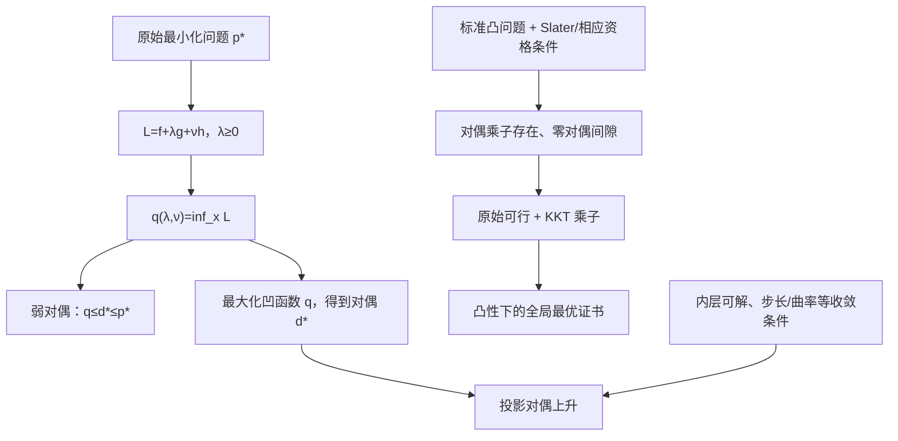

# 数学优化理论 · 第 9 课
## 拉格朗日对偶：为什么最小化可以构造下界？强对偶什么时候成立？

**2026 年 10 月 28 日｜第 2 周·第 2 天｜讲授约 18 分钟（自测另计）**

> **今天的问题。** 昨天我们学习了 LICQ、MFCQ 与 Slater，知道它们可以帮助保证 KKT 乘子存在。今天反过来问：乘子除了证明最优性，还能不能帮我们求解问题？为什么求解一个新的「最大化」问题，能给原来的「最小化」问题提供可靠下界？
>
> **学习目标。** 能正确写出 \(\mathcal L\)、\(q\)、\(p^*\)、\(d^*\)；亲自证明弱对偶和对偶函数凹性；区分「零对偶间隙」与「对偶最优点达到」；推导一个二次规划的原始—对偶解并手算两步对偶上升。

## 一、定义问题与假设：原问题为何有一个对偶问题？

考虑一般问题

\[
\boxed{\begin{aligned}
p^*=\inf_{x\in\mathcal D}\quad &f_0(x)\\
\text{s.t.}\quad &g_i(x)\le0,\quad i=1,\ldots,m,\\
&h_j(x)=0,\quad j=1,\ldots,r.
\end{aligned}}\tag{1}
\]

这里 \(\mathcal D\) 是各函数的公共定义域。为便于比较最优值，先假设原问题可行且 \(p^*\) 是有限实数；**弱对偶本身不要求目标或约束凸**。

采用约束形式 \(g_i\le0\)，定义

\[
\mathcal L(x,\lambda,\nu)
=f_0(x)+\sum_{i=1}^m\lambda_i g_i(x)+\sum_{j=1}^r\nu_j h_j(x),
\qquad \lambda_i\ge0,\ \nu_j\in\mathbb R.
\tag{2}
\]

对偶函数是在固定乘子时对 **全部定义域内的 \(x\)** 取下确界：

\[
\boxed{q(\lambda,\nu)=\inf_{x\in\mathcal D}\mathcal L(x,\lambda,\nu).}\tag{3}
\]

注意这里的内层 \(\inf\) **没有再施加原始不等式约束**，否则可能得到完全不同的函数。\(q\) 允许取 \(-\infty\)。

对偶问题是

\[
\boxed{d^*=\sup_{\lambda\ge0,\ \nu\in\mathbb R^r}q(\lambda,\nu).}\tag{4}
\]

「原始问题求最小，为什么对偶问题求最大？」答案来自下面的严谨不等式。

## 二、弱对偶：从两行不等式得到全局下界

任意取一组允许的乘子 \(\lambda\ge0,\nu\)，再取任意原始可行点 \(x\)。原始可行性意味着 \(g_i(x)\le0\)、\(h_j(x)=0\)，所以

\[
\mathcal L(x,\lambda,\nu)
=f_0(x)+\underbrace{\sum_i\lambda_i g_i(x)}_{\le0}
+\underbrace{\sum_j\nu_j h_j(x)}_{=0}
\le f_0(x).
\]

由下确界的定义：

\[
\boxed{q(\lambda,\nu)\le \mathcal L(x,\lambda,\nu)\le f_0(x).}\tag{5}
\]

让 \(x\) 在所有原始可行点中变化，再让乘子在对偶可行域内变化，得到

\[
\boxed{d^*\le p^*.}\tag{6}
\]

这叫**弱对偶（weak duality）**，对非凸问题同样成立。对偶问题最大化 \(q\)，是在所有合法的「可靠下界」中寻找尽可能紧的一个。

**方向千万别记反：** 原问题是 \(\min\)，对偶值是**下界**；对任意原始可行点，\(f_0(x)\) 给出**上界**。于是

\[
0\le f_0(x)-p^*\le f_0(x)-q(\lambda,\nu)
\]

当 \(x\) 可行、\((\lambda,\nu)\) 对偶可行时成立。右端是可计算的原始—对偶间隙证书；间隙小，代表这个可行解距离最优值不会太远。

## 三、对偶函数为什么一定是凹的？

固定任意 \(x\)，\(\mathcal L(x,\lambda,\nu)\) 对乘子是**仿射函数**。对偶函数是这一族仿射函数的逐点下确界。严格验证：取乘子 \(u=(\lambda,\nu)\)、\(v=(\lambda',\nu')\)，\(t\in[0,1]\)，

\[
\begin{aligned}
q(tu+(1-t)v)
&=\inf_x\big[t\mathcal L(x,u)+(1-t)\mathcal L(x,v)\big]\\
&\ge t\inf_x\mathcal L(x,u)+(1-t)\inf_x\mathcal L(x,v)\\
&=tq(u)+(1-t)q(v).
\end{aligned}\tag{7}
\]

中间不等式因为「对所有 \(x\)，两项分别不小于各自下确界」。所以

\[
\boxed{q\text{ 对乘子总是凹的，即使原问题非凸。}}
\]

但别据此误认为原问题变得容易：计算一次 \(q\) 要对 \(x\) 做全局最小化，非凸时内层可能很困难；且对偶通常可能存在严格间隙。

## 四、贯穿例子：一个约束二次规划的原始解和对偶解

考虑

\[
\boxed{\min_{x\in\mathbb R}\ \frac12x^2
\quad\text{s.t.}\quad 1-x\le0.}\tag{8}
\]

这是在 \(x\ge1\) 上寻找离原点最近的点。原始最优解显然 \(x^*=1\)，最优值 \(p^*=\tfrac12\)。

### 4.1 构造并消去原始变量

拉格朗日函数

\[
\mathcal L(x,\lambda)=\frac12x^2+\lambda(1-x),\qquad\lambda\ge0.
\]

对固定 \(\lambda\)，配方：

\[
\mathcal L(x,\lambda)
=\frac12(x-\lambda)^2+\lambda-\frac12\lambda^2.
\]

因此内层最小点 \(x(\lambda)=\lambda\)，得到

\[
\boxed{q(\lambda)=\lambda-\frac12\lambda^2,\qquad \lambda\ge0.}\tag{9}
\]

现在对偶问题变成一个容易求解的凹二次函数最大化：

\[
\max_{\lambda\ge0}\ \lambda-\frac12\lambda^2.
\]

由 \(q'(\lambda)=1-\lambda\) 得到

\[
\lambda^*=1,\qquad
d^*=q(1)=\frac12=p^*.
\]

这就是一个**强对偶**的例子：原始最优值与对偶最优值相等。其原问题为凸优化，且 \(x=2\) 严格满足 \(1-x<0\)，即满足 Slater 条件。

### 4.2 用 KKT 同时核对原始解和乘子

\[
\begin{cases}
1-x^*\le0, &\text{原始可行},\\
\lambda^*\ge0, &\text{对偶可行},\\
x^*-\lambda^*=0, &\text{驻点},\\
\lambda^*(1-x^*)=0, &\text{互补松弛}.
\end{cases}
\]

取 \((x^*,\lambda^*)=(1,1)\) 满足四式。这里唯一的不等式约束是**活跃的**，乘子为正；但不要推广为「所有活跃约束乘子必正」，前一课已经给过零乘子的反例。

### 4.3 亲自检查「上界－下界」

若你手中只有原始可行点 \(x=1.25\)，则

\[
f_0(1.25)=\frac12(1.25)^2=0.78125
\]

是原始最优值的上界。若对偶只算到 \(\lambda=0.5\)，则

\[
q(0.5)=0.5-\frac12(0.5)^2=0.375
\]

是下界。因此无需知道最优点，也可立即保证

\[
0.375\le p^*\le0.78125,\qquad
0\le f_0(1.25)-p^*\le0.40625.
\tag{10}
\]

注意 \(x(\lambda)=\lambda\)：当 \(\lambda=0.5\)，内层极小点 \(x=0.5\) **不满足** \(x\ge1\)。**最小化拉格朗日函数得到的 \(x(\lambda)\) 并不自动是原始可行解**，因此它的函数值不能随意当成原始上界。

## 五、强对偶、KKT、Slater：三个陈述不要混淆

| 概念 | 精确定义／作用 | 常见误解 |
|---|---|---|
| 弱对偶 | 对偶可行 \((\lambda,\nu)\) 总给 \(q(\lambda,\nu)\le p^*\) | 必须先假设凸 |
| 强对偶 | \(d^*=p^*\)，**只说最优值相等** | 误认为对偶最优乘子必达到 |
| 对偶达到 | 存在**有限**乘子 \((\lambda^*,\nu^*)\) 使 \(q=d^*\) | 上确界总能取到 |
| KKT 证书 | 凸问题中原始可行点与乘子满足 KKT，便得到最优性和零间隙 | 没有 Slater 就不能用 KKT 的充分性 |
| Slater | 标准凸优化中存在满足定义域/相对内部条件的严格可行点 | 是所有强对偶实例的必要条件 |

为什么「凸问题中 KKT 足以证明强对偶」？假设 \(f_0,g_i\) 凸、\(h_j\) 仿射，\(x^*\) 可行，且存在 \(\lambda^*\ge0,\nu^*\) 满足 KKT。对 \(x\) 而言 \(\mathcal L(x,\lambda^*,\nu^*)\) 凸，驻点条件给出它的**全局**极小点 \(x^*\)。于是

\[
\begin{aligned}
q(\lambda^*,\nu^*)
&=\inf_x\mathcal L(x,\lambda^*,\nu^*)\\
&=\mathcal L(x^*,\lambda^*,\nu^*)\\
&=f_0(x^*)\qquad(\text{由互补松弛}).
\end{aligned}\tag{11}
\]

再结合弱对偶：

\[
d^*\ge q(\lambda^*,\nu^*)=f_0(x^*)\ge p^*\ge d^*.
\]

所有不等号必须取等。这样 KKT 同时给出原问题最优、对偶最优达到和零间隙。

**Slater 的逻辑方向相反：** 在标准凸、仿射等式、适当相对内部/定义域与有限最优值等假设下，它是保证强对偶及对偶乘子存在的重要**充分条件**。当原始最优解达到时，进而能够使用 KKT 必要性；但 Slater 不是上面「给定 KKT 就能证明最优」所必需的条件。

## 六、迭代算法：从对偶函数得到投影对偶上升

例 (8) 中：

\[
q'(\lambda)=1-\lambda.
\]

对约束 \(\lambda\ge0\) 的凹最大化，可以用**投影梯度上升**：

\[
\boxed{\lambda_{k+1}=
\max\{0,\lambda_k+\alpha(1-\lambda_k)\}.}\tag{12}
\]

取 \(\alpha=0.5,\lambda_0=0\)，前几步为

| \(k\) | \(\lambda_k\) | \(q(\lambda_k)\)：可靠下界 | 到最优乘子的距离 |
|---:|---:|---:|---:|
| 0 | 0 | 0 | 1 |
| 1 | 0.5 | 0.375 | 0.5 |
| 2 | 0.75 | 0.46875 | 0.25 |
| 3 | 0.875 | 0.4921875 | 0.125 |
| 最优 | 1 | 0.5 | 0 |

因为 \(\lambda_k\in[0,1]\)，投影从未启动，且

\[
\lambda_{k+1}-1=(1-\alpha)(\lambda_k-1).
\]

因此本例在 \(0<\alpha<2\) 下，由投影非扩张性可得

\[
|\lambda_{k+1}-1|
\le |1-\alpha|\,|\lambda_k-1|,\qquad |1-\alpha|<1,
\tag{13}
\]

即乘子线性收敛。对 \(\alpha=0.5\)，距离每步减半。此结论是**这个二次对偶函数的严格结论**，并非「所有对偶上升都线性收敛」。

若一般问题的内层最小点 \(x(\lambda,\nu)\) 唯一且满足适当正则条件，Danskin 定理可给梯度为约束残差，例如 \(q'(\lambda)=g(x(\lambda))\)。若不能保证可微，但内层下确界由某 \(x(\lambda)\) 达到，则

\[
q(\lambda')\le q(\lambda)+g(x(\lambda))(\lambda'-\lambda),
\]

故约束残差是**凹函数的超梯度**。超梯度上升通常需要不同的步长与收敛分析，不能套用上面的线性收敛公式。

## 七、失败反例：零对偶间隙也可能没有有限最优乘子

考虑凸问题

\[
\boxed{\min_x (x-1)^2\quad \text{s.t. } x^2\le0.}\tag{14}
\]

可行集只有 \(x=0\)，所以 \(p^*=1\)。约束无法严格满足（Slater 失败），且 \(g'(0)=0\)。

对偶函数：

\[
\begin{aligned}
q(\lambda)
&=\inf_x\big[(x-1)^2+\lambda x^2\big]\\
&=\inf_x\big[(1+\lambda)x^2-2x+1\big]\\
&=1-\frac{1}{1+\lambda}
=\frac{\lambda}{1+\lambda},\quad\lambda\ge0.
\end{aligned}
\tag{15}
\]

于是

\[
\sup_{\lambda\ge0}q(\lambda)=1=p^*.
\]

**强对偶（零间隙）成立。** 但对任意有限的 \(\lambda\)，都有 \(q(\lambda)<1\)，所以对偶最优值**不能被有限乘子达到**。与此同时，在 \(x^*=0\) 的 KKT 驻点式为 \(-2+\lambda\cdot0=0\)，根本无解。

这是三个不同事实：①零对偶间隙；②有限对偶最优乘子存在；③原始最优点满足 KKT。它们在缺乏资格条件时不可以混为一谈。反过来，换成 \(\min_x x^2\) 且仍约束 \(x^2\le0\)，虽无 Slater，却存在有限 KKT 乘子，也能达到对偶最优。因此 Slater 是充分而非必要条件。

**另一个失败模式：步长过大。** 在例 (8) 的投影对偶上升中，从 \(\lambda_0=0\) 取 \(\alpha=2\)，则

\[
\lambda_1=2,\quad\lambda_2=0,\quad\lambda_3=2,\ldots
\]

始终在 \(0,2\) 之间振荡，并不收敛到 \(\lambda^*=1\)。所以「问题有强对偶」不意味着「随意采用的求解算法就会收敛」。

## 八、将概念串起来

今天必须牢牢记住的一条链：

\[
\boxed{
q(\lambda,\nu)\le p^*
\quad\text{（始终成立）};\qquad
q(\lambda^*,\nu^*)=p^*
\quad\text{（需要附加条件）}.
}
\]

---

## 九、分级自测（100 分；课堂不提供答案）

**请先独立提交四题的作答。这里不公布任何标准答案；标准答案、解析和开放题评分要点仅保存在独立测验 JSON 中。**

### Lv1｜弱对偶的必要假设｜15 分｜预计 2 分钟｜单选

设原问题有可行点、最优值有限，约束写为 \(g_i(x)\le0\)、\(h_j(x)=0\)，拉格朗日函数采用 \(+\lambda_i g_i(x)+\nu_jh_j(x)\)。对任意对偶可行乘子 \(\lambda\ge0\)，以下哪个结论必然成立？

A. 只有原问题是凸问题时，\(q(\lambda,\nu)\) 才能给出下界。

B. \(q(\lambda,\nu)\le p^*\)，即使原问题不是凸的。

C. 对偶函数 \(q\) 对乘子一定是凸函数。

D. 只要 \(q(\lambda,\nu)\) 有有限值，就必然没有对偶间隙。

*提示：从 \(q\le\mathcal L\le f_0(x)\) 出发，注意量词。*

### Lv2｜二次规划的对偶函数计算｜20 分｜预计 3 分钟｜数值

考虑 \(\min_{x\in\mathbb R}\tfrac12x^2\)，约束 \(2-x\le0\)。定义 \(q(\lambda)=\inf_x[\tfrac12x^2+\lambda(2-x)]\)，且 \(\lambda\ge0\)。请计算 **\(q(1.5)\)**，保留三位小数，只填写数字。

*提示：先对 \(x\) 求极小，不要把原始约束带进内层最小化。*

### Lv3｜强对偶不等于任意步长算法收敛｜25 分｜预计 5 分钟｜单选

考虑 \(\min_x\tfrac12x^2\)，约束 \(2-x\le0\)，其对偶函数为 \(q(\lambda)=2\lambda-\tfrac12\lambda^2\)（\(\lambda\ge0\)）。从 \(\lambda_0=0\) 出发，使用投影对偶梯度上升
\[
\lambda_{k+1}=\max\{0,\lambda_k+\alpha(2-\lambda_k)\}
\]
并取常数步长 \(\alpha=2\)。下面哪一项正确？

A. 第一步直接达到最优乘子，并永久停留在那里。

B. 因为原问题满足 Slater，任意正步长的对偶上升都收敛。

C. 乘子在两个不同值之间反复振荡；即使强对偶成立，迭代也不收敛。

D. 对偶函数是凹的，因此这个算法每一步都严格提高对偶目标值。

*提示：显式算出 \(\lambda_1,\lambda_2,\lambda_3\)。*

### Lv4｜二维原始—对偶构造、KKT 与线性收敛证明｜40 分｜预计 12 分钟｜开放题

考虑
\[
\min_{x,y\in\mathbb R}
\frac12(x-1)^2+\frac12(y+1)^2
\quad\text{s.t.}\quad 1-x-y\le0.
\]

**A（10 分）** 写出拉格朗日函数，对固定 \(\lambda\ge0\) 精确消去 \(x,y\)，推导 \(q(\lambda)\)；再求对偶最优乘子及对偶最优值。

**B（10 分）** 求原始最优点，检查原始可行性、对偶可行性、驻点和互补松弛；给出一个 Slater 严格可行点，说明本题强对偶为什么成立。

**C（12 分）** 不借助本题具体数字，从 \(g_i\le0,\lambda_i\ge0,h_j=0\) 出发，逐行证明弱对偶；再解释对凸目标、凸不等式及仿射等式问题，为什么存在满足 KKT 的原始—对偶点会构成全局最优性及零间隙证书。

**D（8 分）** 对 A 得到的 \(q\)，从 \(\lambda_0=0\) 出发，取步长 \(\alpha=\tfrac14\) 做两步投影对偶上升；写出 \(\lambda_1,\lambda_2\)，并证明本题此步长下到最优乘子的距离每步至多缩小为上一步的 \(1/2\)。

*提示：消去 \(x,y\) 可分别令对 \(x,y\) 的导数为零；证明收敛时结合投影的非扩张性。*

---

## 十、下一课

**第 10 课｜2026 年 10 月 29 日：对偶间隙、鞍点与原始—对偶证书。** 我们将从 \(q(\lambda^*)=p^*\) 进一步理解「为什么拉格朗日鞍点与 KKT 关联」，并通过带等式约束的二次规划比较原始解、对偶乘子、对偶间隙和停止准则。

**评分规则保持不变：** Lv1 15 分、Lv2 20 分、Lv3 25 分、Lv4 40 分；答卷提交后逐题反馈。80 分及以上继续，60–79 分补充薄弱知识点，低于 60 分复习；日期和课号不因分数改变。
