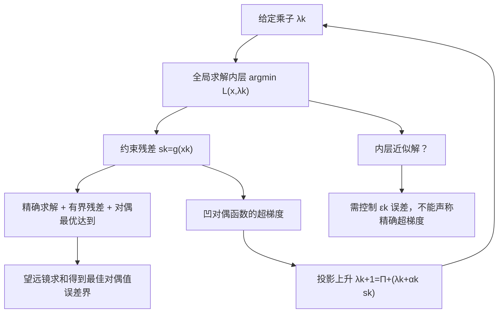

# 数学优化理论 · 第12课
## 对偶函数的超梯度与对偶次梯度法：为什么约束残差能更新乘子？

**2026年10月31日｜第2周第5天｜讲授约18分钟（自测另计）**

上一课我们证明，最优乘子可以反映放宽约束的边际价值。今天反过来问：**如果不知道最优乘子，怎样用算法把它找出来？** 更微妙的是，拉格朗日对偶函数一定凹，却未必可微。我们必须区分“导数”“超梯度”和“在何种假设下收敛”。

## 一、问题、定义与假设

考虑不等式约束问题：

\[
p^*=\min_{x\in X} f(x)\quad\text{s.t.}\quad g_i(x)\le0,\ i=1,\dots,m.
\]

这里 \(X\) 是易处理的基础集合，例如盒约束；\(g(x)=(g_1(x),\dots,g_m(x))^\top\)。采用符号约定 \(g_i\le0,\ \lambda_i\ge0\)。

拉格朗日函数和对偶函数分别为

\[
L(x,\lambda)=f(x)+\lambda^\top g(x),\qquad
q(\lambda)=\inf_{x\in X}L(x,\lambda),\quad \lambda\ge0.
\]

对偶目标是 \(d^*=\sup_{\lambda\ge0}q(\lambda)\)。弱对偶保证 \(q(\lambda)\le p^*\)，即使原问题非凸也成立。对固定的 \(x\)，\(L(x,\lambda)\) 对 \(\lambda\) 是仿射的；仿射函数族的逐点下确界是凹函数，所以 \(q\) 凹，但**不保证处处可微**。

以下“残差是超梯度”的推导要求内层极小值实际达到，且选到一个**全局**极小点。为讨论收敛界，可假设 \(X\) 非空紧致、\(f,g_i\) 在 \(X\) 上连续，从而内层极小点存在且 \(\|g(x)\|\) 有上界；还要另行假设存在有限的最优对偶乘子 \(\lambda^*\)。凸性和 Slater 可用于保证适当条件下的强对偶，但它们不是超梯度代数推导本身的必要条件。

## 二、为什么约束残差是对偶函数的超梯度？

对凹函数 \(q\)，向量 \(s\) 称为 \(\lambda\) 处的**超梯度**，若对任意合法 \(\mu\ge0\)，

\[
\boxed{q(\mu)\le q(\lambda)+s^\top(\mu-\lambda).}\tag{1}
\]

注意不等号是“\(\le\)”：凹函数的超梯度给出上方支撑平面。文献常把最大化凹对偶函数的方法称为“对偶次梯度法”（dual subgradient method），但此处按凹函数符号，更准确的是超梯度上升。

固定 \(\lambda_k\)，求出

\[
x_k\in\arg\min_{x\in X}L(x,\lambda_k).
\]

对任意 \(\mu\ge0\)，依次有

\[
\begin{aligned}
q(\mu)
&=\inf_{x\in X}L(x,\mu)\\
&\le L(x_k,\mu)\\
&=L(x_k,\lambda_k)+g(x_k)^\top(\mu-\lambda_k)\\
&=q(\lambda_k)+g(x_k)^\top(\mu-\lambda_k).
\end{aligned}
\]

与式(1)比较，得到

\[
\boxed{s_k=g(x_k)\in\partial^+q(\lambda_k).}\tag{2}
\]

这一步**完全不需要**对 \(x_k\) 关于 \(\lambda\) 求导，也不要求 \(q\) 光滑。若内层有多个全局极小点，不同极小点可能给出不同的合法超梯度；不能武断地说 \(q'(\lambda)=g(x_k)\) 总成立。

对偶投影超梯度上升为

\[
\boxed{\lambda_{k+1}=\Pi_{\mathbb R_+^m}\bigl(\lambda_k+\alpha_k g(x_k)\bigr).}\tag{3}
\]

它有直接的物理意义：若 \(g_i(x_k)>0\)，当前内层解违反第 \(i\) 条约束，对应乘子增大；若 \(g_i(x_k)<0\)，该约束有余量，乘子趋向减小；投影保证 \(\lambda_i\ge0\)。请注意：\(x_k\) 是内层极小点，**不一定是原问题可行点**。约束残差更新乘子，不等于已经找到原始可行解。

## 三、非光滑的完整例子：折点为什么出现？

考虑一维问题

\[
\min_{0\le x\le2}x,\qquad 1-x\le0.
\]

原问题等价于在 \([1,2]\) 上最小化 \(x\)，故 \(x^*=1,\ p^*=1\)。取 \(x=1.5\) 可严格满足不等式；本题为凸问题，具有 Slater 点。

拉格朗日函数

\[
L(x,\lambda)=x+\lambda(1-x)=\lambda+(1-\lambda)x.
\]

内层是在 \(0\le x\le2\) 上最小化一个关于 \(x\) 的线性函数：

\[
x(\lambda)=
\begin{cases}
0,&0\le\lambda<1,\\
\text{任意 }x\in[0,2],&\lambda=1,\\
2,&\lambda>1.
\end{cases}
\]

所以

\[
\boxed{
q(\lambda)=
\begin{cases}
\lambda,&0\le\lambda\le1,\\
2-\lambda,&\lambda\ge1.
\end{cases}
=1-|\lambda-1|,\quad\lambda\ge0.}\tag{4}
\]

这个对偶函数是凹的“倒 V”形，在 \(\lambda=1\) **不可微**；其最大值是 \(d^*=1=p^*\)，最优乘子 \(\lambda^*=1\)。

在 \(\lambda<1\) 时，内层极小点 \(x=0\)，残差 \(g(x)=1\)，所以算法向右走；在 \(\lambda>1\) 时，内层极小点 \(x=2\)，残差 \(g(x)=-1\)，算法向左走。折点处 \(x=0,1,2\) 都是内层极小点，分别给出 \(+1,0,-1\) 等合法超梯度；\(\partial^+q(1)\) 在本例包含区间 \([-1,1]\)。

**KKT 检查**：在原始最优点 \(x^*=1\) 处，约束活跃 \(1-x^*=0\)，乘子 \(\lambda^*=1\ge0\)；驻点为 \(1-\lambda^*=0\)；互补松弛为 \(\lambda^*(1-x^*)=0\)。活跃状态来自约束取等号，而非乘子符号的猜测。

## 四、手算五步：对偶值不一定单调上升

取 \(\lambda_0=0\)，步长 \(\alpha_k=0.6/(k+1)\)。根据式(3)，逐步得到：

| \(k\) | 当前 \(\lambda_k\) | 内层极小点 \(x_k\) | 残差 \(1-x_k\) | 步长 \(\alpha_k\) | 更新后 \(\lambda_{k+1}\) | 当前对偶值 \(q(\lambda_k)\) |
|---:|---:|---:|---:|---:|---:|---:|
| 0 | 0.00 | 0 | +1 | 0.60 | 0.60 | 0.00 |
| 1 | 0.60 | 0 | +1 | 0.30 | 0.90 | 0.60 |
| 2 | 0.90 | 0 | +1 | 0.20 | 1.10 | 0.90 |
| 3 | 1.10 | 2 | −1 | 0.15 | 0.95 | 0.90 |
| 4 | 0.95 | 0 | +1 | 0.12 | 1.07 | 0.95 |

由于 \(q(1.07)=0.93<q(0.95)=0.95\)，**对偶上升法并不保证每一步目标都上升**。本例内层解也会在不可行的 \(x=0\) 和可行但非最优的 \(x=2\) 之间切换；必须分别处理原始可行性和对偶最优值。

## 五、收敛保证：从投影非扩张性严格推导

令 \(s_k=g(x_k)\)。假设全部内层问题精确求解，最优对偶乘子 \(\lambda^*\) 存在，并且 \(\|s_k\|\le G\)。令初始距离 \(R=\|\lambda_0-\lambda^*\|\)。

由超梯度不等式：

\[
d^*-q(\lambda_k)=q(\lambda^*)-q(\lambda_k)
\le s_k^\top(\lambda^*-\lambda_k).\tag{5}
\]

又因为投影到闭凸集是非扩张的，并且 \(\Pi_{\mathbb R_+^m}(\lambda^*)=\lambda^*\)，

\[
\begin{aligned}
\|\lambda_{k+1}-\lambda^*\|^2
&\le\|\lambda_k+\alpha_ks_k-\lambda^*\|^2\\
&=\|\lambda_k-\lambda^*\|^2+
2\alpha_ks_k^\top(\lambda_k-\lambda^*)+\alpha_k^2\|s_k\|^2\\
&\le\|\lambda_k-\lambda^*\|^2-
2\alpha_k(d^*-q(\lambda_k))+\alpha_k^2G^2.
\end{aligned}
\]

移项，\(k=0,\ldots,K-1\) 累加，中间的距离平方项望远镜相消，得到

\[
2\sum_{k=0}^{K-1}\alpha_k(d^*-q(\lambda_k))
\le R^2+G^2\sum_{k=0}^{K-1}\alpha_k^2.\tag{6}
\]

由于每个对偶差距非负，**前 \(K\) 次的最佳对偶值**满足

\[
\boxed{
d^*-\max_{0\le k<K}q(\lambda_k)
\le\frac{R^2+G^2\sum_{k<K}\alpha_k^2}
{2\sum_{k<K}\alpha_k}.}\tag{7}
\]

这是有明确假设的收敛结论，不是对任意启发式更新的保证。

**步长方案与保证的差别：**

| 步长 | 由式(7)能保证什么 | 不可擅自推断 |
|---|---|---|
| 固定 \(\alpha>0\) | 最佳值差距 \(\le R^2/(2K\alpha)+\alpha G^2/2\) | 不能保证固定步长下精确收敛或逐步单调 |
| 已知运行轮数 \(K\)，取 \(\alpha=R/(G\sqrt K)\)（\(R,G>0\)） | 最佳对偶值差距 \(\le RG/\sqrt K\) | 不等于每个迭代点都有同样误差界 |
| \(\alpha_k=a/(k+1)\)，\(a>0\) | 因 \(\sum\alpha_k=\infty,\ \sum\alpha_k^2<\infty\)，式(7)右侧趋零 | 不代表每一步对偶值单调，也不自动给有限步原始可行性证书 |

上面的 \(O(K^{-1/2})\) 是一般有界超梯度情形下的**最佳对偶目标值误差**保证，不是一般的乘子距离线性收敛率。若对偶函数还具有光滑性、强凹性等条件，可以使用不同的更快收敛分析，但不能把这些额外条件省略。

## 六、失败反例与近似内层计算

**失败一：固定步长导致振荡。** 仍用式(4)，取常数步长 \(\alpha=0.6\)，从 \(\lambda_0=0\) 开始：

\[
0\longrightarrow0.6\longrightarrow1.2
\longrightarrow0.6\longrightarrow1.2\longrightarrow\cdots.
\]

在 1 左右反复越过折点，乘子不收敛。这并不与固定步长的误差上界冲突。

**失败二：内层没有求到全局极小。** 若 \(x_k\) 只是局部极小或任意候选点，则一般没有 \(L(x_k,\lambda_k)=q(\lambda_k)\)，式(2)最后一个等号不能成立；约束残差不再自动是精确超梯度。

如果能够严格保证内层误差

\[
L(x_k,\lambda_k)\le q(\lambda_k)+\varepsilon_k,
\qquad \varepsilon_k\ge0,
\]

那么仍有

\[
q(\mu)\le q(\lambda_k)+g(x_k)^\top(\mu-\lambda_k)+\varepsilon_k.
\]

即得到**带 \(\varepsilon_k\) 误差的超梯度**，并可把式(7)的分子改为

\[
R^2+G^2\sum_{k<K}\alpha_k^2+
2\sum_{k<K}\alpha_k\varepsilon_k.
\]

因此，内层精度不能毫无代价地忽略；内层误差若长期不能减小，算法可能只收敛到某个误差邻域。

**失败三：只看乘子更新或对偶值不能宣称原始最优。** 内层解可能不可行；强对偶、对偶值收敛与恢复原始可行最优解不是同一件事。应另行验证原始可行性、互补松弛以及原始—对偶间隙。

## 七、方法关系图

## 八、重点回顾与下一讲

今天可以用一条逻辑链记忆：

\[
\boxed{\text{内层全局最小点}\Rightarrow
\text{约束残差是超梯度}\Rightarrow
\text{投影乘子上升}\Rightarrow
\text{有条件的最佳对偶值收敛界}.}
\]

最值得记住的区别是：\(q\) **凹但未必可微**；约束违反量是正确的上升方向信息，但并不保证每一步单调；固定步长可能振荡；理论通常首先保证最佳对偶值，而非原始解每步可行或线性收敛。

**下一讲（2026年11月1日，第13课）**：对偶分解、原始解恢复与增广拉格朗日思想。我们将讨论多个子问题共享资源约束时如何分布式求解，以及为什么给拉格朗日函数增加二次罚项有助于抑制非光滑和振荡。11月2日第14课为第二周复盘。

---
## 九、今日四级自测（100分，答案不在讲义中）

**请先独立作答；首次发课不公布选项答案、数值答案或开放题评分标准，也请不要提前打开独立测验 JSON。**
### Lv1｜超梯度的必要前提｜15分｜预计2分钟

考虑 q(λ)=inf_{x∈X}[f(x)+λg(x)]，λ≥0，且内层下确界可达到。哪项一定正确？

A. 原问题凸就保证 q 在每个 λ 处可微。

B. 任取内层的全局极小点 x_λ，残差 g(x_λ) 是凹函数 q 在 λ 处的超梯度。

C. 任取一个原始可行点 x，其残差 g(x) 都是 q 的超梯度。

D. 用合法超梯度与任何固定正步长，都能保证每一步 q 严格上升。

*提示：先写出超梯度上支撑不等式，注意内层必须取到下确界。*

### Lv2｜一次投影对偶更新｜20分｜预计3分钟

原问题为 min_{0≤x≤2} x，约束 1−x≤0。给定 λ₀=0.5、步长 α₀=0.4；先精确求 x₀∈argmin_{0≤x≤2}[x+λ₀(1−x)]，然后做 λ₁=max{0,λ₀+α₀(1−x₀)}。求 λ₁（保留三位小数，只填数值）。

*提示：固定 λ₀ 后，内层目标是关于 x 的一次函数；先找端点再更新。*

### Lv3｜固定步长的多步反例｜25分｜预计5分钟

仍考虑 q(λ)=min{λ,2−λ}（λ≥0），用精确内层极小点的残差执行投影超梯度上升，常数步长 α=0.6，从 λ₀=0 开始。λ<1 时选 x=0，λ>1 时选 x=2。哪项描述正确？

A. λ₁=0.6，λ₂=1.2，λ₃=0.6；此算法发生振荡。

B. λ₁=0.6，λ₂=1.2，λ₃=1.8；对偶值单调上升。

C. λ₁=0.6，λ₂=1.2，λ₃=1.0；第三步命中最优乘子。

D. λ>1 时残差为 +1，因此此后乘子会一直增大。

*提示：先判断 λ 在折点两侧时的残差符号，再连续更新三次。*

### Lv4｜非光滑对偶、收敛界与近似内层｜40分｜预计12分钟

考虑 min_{0≤x≤2} x，s.t. 1−x≤0，L(x,λ)=x+λ(1−x)，λ≥0。A（10分）：分段推导 q(λ)，求原始与对偶最优值、最优乘子，并解释 λ=1 为什么不可微以及该点有哪些合法超梯度。B（14分）：从 q(μ)≤L(x_k,μ) 出发证明 s_k=g(x_k) 为超梯度；再利用投影非扩张性，在存在 λ*、||s_k||≤G、R=||λ₀−λ*|| 的假设下，推导前 K 步最佳对偶值误差 ≤[R²+G²Σ_{k<K}α_k²]/[2Σ_{k<K}α_k]。C（8分）：比较固定步长 α>0 与 α_k=a/(k+1) 的收敛结论，指出哪些量有保证、哪些没有。D（8分）：若内层仅满足 L(x_k,λ_k)≤q(λ_k)+ε_k，推导带 ε_k 的超梯度不等式，指出收敛界需增加的误差项。

*提示：B部分先展开 ||λ_k+α_ks_k−λ*||²，再由凹函数的超梯度不等式换成 q(λ*)−q(λ_k)；D部分记住不再有 L(x_k,λ_k)=q(λ_k)。*

---

**评分与课程安排：**Lv1 15分、Lv2 20分、Lv3 25分、Lv4 40分。作答后逐题评分；总分≥80继续，60–79补例子，<60复习；测评不改变日期课号。课堂不附答案，答案及开放题细则仅存于独立 JSON。
