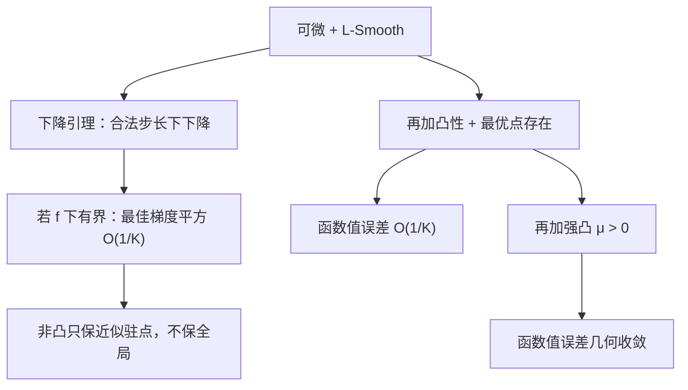

# 第 15 课：梯度下降的下降引理与收敛速度

**2026-11-03｜第 3 周·第 1 天｜讲授约 18 分钟（自测另计）**

前两周研究的是“什么是最优解”：从凸性、KKT 到对偶证书。今天进入第三周 **GD/AGD 收敛理论**，讨论另一个问题：**即使不知道最优解，按负梯度方向走，为什么能下降？要走多少步才能足够好？**

本节把三个常被混淆的结论放在同一个证明框架下：

- 只要求 **\(L\)-Smooth**：下降，并在有下界时获得**梯度范数**意义的非凸收敛界。
- 增加 **凸性**：得到最后一步**函数值误差**的 \(O(1/K)\) 界。
- 再增加 **\(\mu\)-强凸性**：得到**函数值误差**的几何（线性）收敛界。

## 一、问题、假设与更新规则

本节研究无约束优化
\[
\min_{x\in\mathbb R^n} f(x),\qquad x_{k+1}=x_k-\eta\nabla f(x_k).
\]
假设 \(f\) 可微，且其梯度满足 \(L\)-Lipschitz 条件：
\[
\|\nabla f(x)-\nabla f(y)\|\le L\|x-y\|,\quad L>0.
\]
这叫 **\(L\)-Smooth**。它限制“梯度变化得多快”，**不意味着 \(f\) 凸**。若 \(f\) 二阶可微，可以用 \(\|\nabla^2 f(x)\|_2\le L\) 作为一个方便的充分条件。

凸性的一阶定义是
\[
f(y)\ge f(x)+\nabla f(x)^T(y-x).
\]
若进一步有
\[
f(y)\ge f(x)+\nabla f(x)^T(y-x)+\frac{\mu}{2}\|y-x\|^2,\quad \mu>0,
\]
则称 \(f\) **\(\mu\)-强凸**。它比凸性更强；在全空间上配合 \(L\)-Smooth 时 \(0<\mu\le L\)。

特别注意：上一周的约束最优点可能有 \(\nabla f(x^*)\ne0\)，因为边界阻止继续沿负梯度移动。**本周的普通 GD 定理先只讨论无约束问题**；投影梯度法需要另外加入投影/法锥条件。

## 二、Descent Lemma：为什么小步梯度下降一定降低函数值？

设 \(d=y-x\)，沿 \(x\) 到 \(y\) 的线段积分：
\[
f(y)-f(x)=\int_0^1\nabla f(x+td)^Td\,dt.
\]
加减 \(\nabla f(x)^Td\)，由 Cauchy–Schwarz 与 Lipschitz 梯度，
\[
\begin{aligned}
f(y)-f(x)-\nabla f(x)^Td
&=\int_0^1[\nabla f(x+td)-\nabla f(x)]^Td\,dt\\
&\le\int_0^1 Lt\|d\|^2dt
=\frac L2\|d\|^2.
\end{aligned}
\]
得到**下降引理**：
\[
\boxed{f(y)\le f(x)+\nabla f(x)^T(y-x)+\frac L2\|y-x\|^2.}\tag{1}
\]
代入 \(y=x_k-\eta g_k\)，\(g_k=\nabla f(x_k)\)，得到
\[
\boxed{f(x_{k+1})\le f(x_k)-\eta\left(1-\frac{L\eta}{2}\right)\|g_k\|^2.}\tag{2}
\]
因此，**不需要凸性**，只要 \(0<\eta<2/L\)，就能保证非驻点处的严格下降。最方便的固定步长是 \(\eta=1/L\)：
\[
\boxed{f(x_{k+1})\le f(x_k)-\frac1{2L}\|g_k\|^2.}\tag{3}
\]
注意这是函数值下降条件，尚未说明会收敛到哪个点。

## 三、只要求 Smooth：非凸问题能保证什么？

再加假设 \(f(x)\ge f_{\inf}>-\infty\)。式 (3) 对 \(k=0,\dots,K-1\) 求和：
\[
\frac1{2L}\sum_{k=0}^{K-1}\|g_k\|^2
\le f(x_0)-f(x_K)
\le f(x_0)-f_{\inf}.
\]
因此
\[
\boxed{\min_{0\le k<K}\|\nabla f(x_k)\|^2
\le\frac{2L[f(x_0)-f_{\inf}]}{K}.}\tag{4}
\]
若希望至少找到一次 \(\|\nabla f(x_k)\|\le\varepsilon\) 的迭代，足够的迭代量是 \(K\ge 2L(f(x_0)-f_{\inf})/\varepsilon^2\)（取合适整数并处理等号即可）。

这证明了**最佳迭代梯度范数平方的 \(O(1/K)\) 界**，而不是非凸问题全局函数值误差 \(O(1/K)\) 界，也不是“每次迭代必然越来越接近全局最优点”。

## 四、增加凸性：为什么函数值误差变成 \(O(1/K)\)？

假设 \(f\) 凸、\(L\)-Smooth，且存在最优点 \(x^*\)。固定 \(\eta=1/L\)。

凸性给出
\[
f(x_k)-f(x^*)\le g_k^T(x_k-x^*).
\]
结合式 (3)：
\[
f(x_{k+1})-f(x^*)
\le g_k^T(x_k-x^*)-\frac1{2L}\|g_k\|^2.
\]
而梯度更新的平方距离恒等式为
\[
\|x_{k+1}-x^*\|^2
=\|x_k-x^*\|^2-\frac2L g_k^T(x_k-x^*)
+\frac1{L^2}\|g_k\|^2.
\]
由此得到望远镜形式：
\[
\boxed{
f(x_{k+1})-f(x^*)
\le\frac L2\big(\|x_k-x^*\|^2-\|x_{k+1}-x^*\|^2\big).
}\tag{5}
\]
将 \(k=0,\ldots,K-1\) 求和，右侧中间项抵消：
\[
\sum_{k=0}^{K-1}[f(x_{k+1})-f(x^*)]
\le\frac L2\|x_0-x^*\|^2.
\]
由于式 (3) 保证函数值单调不增，所有 \(f(x_{k+1})\ge f(x_K)\)，故
\[
\boxed{
f(x_K)-f(x^*)\le\frac{L\|x_0-x^*\|^2}{2K},\quad K\ge1.
}\tag{6}
\]
这才是**凸 Smooth 普通 GD 的最后一步函数值 \(O(1/K)\) 保证**。它要求凸性、极小点存在和选定合法步长，而非仅凭“函数值一直下降”。

## 五、再增加强凸：为什么收敛速度变快？

若 \(f\) 还是 \(\mu\)-强凸，则对任意 \(x,y\)
\[
f(y)\ge f(x)+g^T(y-x)+\frac\mu2\|y-x\|^2,\quad g=\nabla f(x).
\]
右侧关于 \(y-x\) 的最小值为 \(f(x)-\|g\|^2/(2\mu)\)。所以
\[
f^*\ge f(x)-\frac{\|g\|^2}{2\mu},
\quad\Longrightarrow\quad
\boxed{\|g\|^2\ge2\mu(f(x)-f^*).}\tag{7}
\]
这是强凸所蕴含的一类梯度支配不等式；不能在任意非凸问题中直接使用。

将式 (7) 代入式 (3)：
\[
f(x_{k+1})-f^*
\le f(x_k)-f^*-\frac\mu L(f(x_k)-f^*).
\]
因此
\[
\boxed{
f(x_K)-f^*
\le\left(1-\frac\mu L\right)^K[f(x_0)-f^*].
}\tag{8}
\]
当 \(0<\mu<L\) 时，误差几何下降；这里的 \(1-\mu/L\) 是**函数值误差的一个上界收缩因子**，不是每个函数/每一步的精确比例。

强凸还给出 \(\frac\mu2\|x_K-x^*\|^2\le f(x_K)-f^*\)，因此在此假设下也能由函数值误差控制最优点距离。非强凸问题则不能随意推出相同结论。

## 六、三步数值迭代：函数值真的按什么比例下降？

取二维二次函数
\[
f(x,y)=\frac12(x^2+4y^2),\qquad
\nabla f=(x,4y),\qquad
\nabla^2f=\begin{bmatrix}1&0\\0&4\end{bmatrix}.
\]
因此 \(\mu=1,L=4\)，最优点为 \((0,0)\)，且 \(f^*=0\)。选 \(\eta=1/4\)：
\[
x_{k+1}=\frac34x_k,\qquad y_{k+1}=0.
\]
从 \((x_0,y_0)=(4,2)\) 开始：

| \(k\) | 迭代点 \((x_k,y_k)\) | \(f(x_k,y_k)\) |
|---:|---|---:|
| 0 | \((4,2)\) | 16.000000 |
| 1 | \((3,0)\) | 4.500000 |
| 2 | \((2.25,0)\) | 2.531250 |
| 3 | \((1.6875,0)\) | 1.423828 |

手算首步：\(\nabla f(4,2)=(4,8)\)，所以 \((4,2)-\frac14(4,8)=(3,0)\)。第二步沿 \(x\) 方向继续缩小。

理论保证是
\[
f(x_{k+1})-f^*\le\frac34[f(x_k)-f^*].
\]
但第一步实际比值为 \(4.5/16=0.28125\)，并非 \(0.75\)。**理论收敛因子通常是最坏情况上界，而非算法每步的实测比例。**

## 七、失败反例与常见混淆

**反例一：强凸也挡不住过大的步长。** 令 \(f(x)=x^2/2\)，此时 \(\mu=L=1\)。若 \(\eta=3\)，梯度下降 \(x_{k+1}=-2x_k\)，则 \(f(x_{k+1})=4f(x_k)\)，从非零起点发散。合法步长是收敛结论不可缺少的前提。

**反例二：梯度为零仍可能不是全局最优。** 令 \(f(x)=1-\cos x\)。它全局 \(1\)-Smooth，但非凸。从 \(x_0=\pi\) 开始，\(\nabla f(\pi)=0\)，算法原地不动，目标值为 2；然而 \(f(0)=0\) 是全局最小值。故式 (4) 只能保证近似驻点，**不能保证非凸全局最优**。

| 假设与任务 | 可认证的量 | 典型保证（\(\eta=1/L\)） | 不能据此声称 |
|---|---|---|---|
| Smooth + 函数下有界（可非凸） | 最佳梯度范数平方 | \(O(1/K)\) | 全局最优误差 \(O(1/K)\) |
| 凸 + Smooth + 极小点存在 | 最后一步函数值误差 | \(O(1/K)\) | 强凸式线性收敛 |
| 强凸 + Smooth | 函数值误差；可进一步控制点距离 | \((1-\mu/L)^K\) | 任意正步长都安全 |

**一句话总结：** Smooth 负责“一步怎么下降”，凸性负责“下降通向全局最优值”，强凸性负责“速度由次线性变为几何收敛”。任何关于收敛的陈述都要写清楚**问题假设、步长与误差度量**。

## 八、四级自测（100 分）

**以下不包含标准答案和开放题评分要点，请先独立完成，避免提前泄题。**

### Lv1｜下降引理的充分条件｜15 分｜预计 2 分钟｜单选

设 \(f:\mathbb R^n\to\mathbb R\) 可微且梯度为 \(L\)-Lipschitz（\(L>0\)），使用梯度下降 \(x_{k+1}=x_k-\nabla f(x_k)/L\)。以下哪项**必然成立**？

A. 只有当 \(f\) 凸时，才能保证 \(f(x_{k+1})\le f(x_k)\)。

B. 即使 \(f\) 非凸，也有 \(f(x_{k+1})\le f(x_k)-\|\nabla f(x_k)\|^2/(2L)\)。

C. 每一次迭代都必然找到全局最小点。

D. 对任意非凸 \(f\)，都必有 \(f(x_K)-f^*=O(1/K)\) 的全局最优值误差保证。

*提示：先看下降引理是否用到凸性，再区分函数下降与全局最优。*

### Lv2｜二维二次函数的一步梯度下降｜20 分｜预计 3 分钟｜数值

令 \(f(x,y)=\tfrac12(x^2+4y^2)\)，起点 \((x_0,y_0)=(2,3)\)，步长 \(\eta=1/4\)，做一次梯度下降后，求 \(f(x_1,y_1)\)。只填写数值，保留三位小数。

*提示：先求两个坐标的梯度与更新点，再代入目标函数。*

### Lv3｜非凸、凸与强凸的收敛定理比较｜25 分｜预计 5 分钟｜单选

用步长 \(\eta=1/L\) 对 \(L\)-Smooth 的函数做梯度下降。下列哪条陈述在**所列假设**下有严格的通用保证？

A. 只要 \(f\) 是 \(L\)-Smooth，最后一步的全局最优值误差必为 \(O(1/K)\)，即使非凸也成立。

B. 若 \(f\) 还有有限下界 \(f_{\inf}\)，则 \(\min_{0\le k<K}\|\nabla f(x_k)\|^2\le 2L(f(x_0)-f_{\inf})/K\)。

C. 仅有 \(\mu\)-强凸而没有 \(L\)-Smooth，也足以保证固定步长 \(1/\mu\) 的梯度下降对一切问题线性收敛。

D. 只要迭代的函数值单调下降，迭代点就一定收敛到全局最优点。

*提示：检查每条结论究竟需要 Smooth、凸、强凸、下界和合法步长中的哪些条件。*

### Lv4｜GD 三种收敛结果的证明与反例｜40 分｜预计 12 分钟｜开放证明

对 \(f:\mathbb R^n\to\mathbb R\) 进行梯度下降 \(x_{k+1}=x_k-\nabla f(x_k)/L\)，其中 \(L>0\)。

**A（10 分）：** 假设 \(\nabla f\) 是 \(L\)-Lipschitz。由沿线段积分推导 Descent Lemma，并得到步长 \(1/L\) 下的充分下降式。

**B（12 分）：** 进一步假设 \(f\) 凸且存在全局极小点 \(x^*\)。通过比较 \(\|x_{k+1}-x^*\|^2\) 与 \(\|x_k-x^*\|^2\)，推导最后一步的函数值界
\[
f(x_K)-f(x^*)\le\frac{L\|x_0-x^*\|^2}{2K}\qquad(K\ge1).
\]

**C（10 分）：** 再假设 \(f\) 是 \(\mu\)-强凸（\(0<\mu\le L\)）。先从强凸性推出 \(\|\nabla f(x)\|^2\ge2\mu(f(x)-f^*)\)，再证明 \(f(x_K)-f^*\le(1-\mu/L)^K(f(x_0)-f^*)\)。

**D（8 分）：** 如果仅有 \(L\)-Smooth 且 \(f\) 下有界，请写出可保证的“最佳迭代梯度范数平方”上界（可引用 A 并求和）；再举出一个**梯度为零但不是全局最小点**的具体光滑函数和起点，说明为什么不能把该上界误读为非凸全局最优保证。

*提示：B 用凸性把函数值误差变为梯度内积，再用平方距离恒等式望远镜求和；C 对强凸下界中的位移变量求最小值。*

## 九、评分与下一讲

四题分别 15、20、25、40 分，共 100 分。先自行作答，课堂不公开答案；提交后逐题评分并解释：80 分及以上正常继续，60–79 分补针对性例子，低于 60 分先复习。成绩不改变课程编号。

**下一讲（2026-11-04，第 16 课）：** 从 GD 的 O(1/K) 到 Nesterov 加速梯度（AGD）的 O(1/K²)：动量为什么不只是“往前多走一步”，以及加速理论依赖哪些假设。
