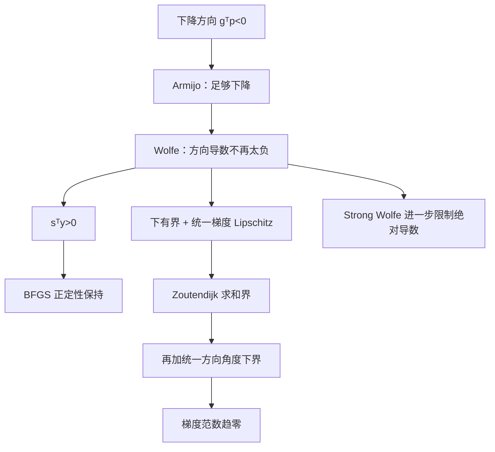

# 第 19 课｜Wolfe 条件、曲率控制与非精确线搜索

**2026 年 11 月 7 日｜第三周·第 5 天｜讲授约 18 分钟（自测另计）**

上一课证明了 Armijo 回溯线搜索：即使不知道精确的全局 Smooth 常数 \(L\)，也可以用函数值检查，保证沿下降方向获得充分下降。

今天更进一步：**函数值下降够多，是不是就代表选到了适合拟牛顿法的步长？** 答案是否定的。对 BFGS 一类方法而言，还需要控制**新点的方向导数**，以避免新旧梯度差产生不正确的曲率。

本课将推导 Wolfe / Strong Wolfe 条件、证明它们和 BFGS 正定性的关系、手算一次非精确线搜索，并说明它们究竟能保证什么收敛结论。

## 一、问题、符号与假设

考虑无约束最小化 \( \min_{x\in\mathbb R^n}f(x) \)。在点 \(x_k\) 处取方向 \(p_k\)，要求

\[
g_k=\nabla f(x_k),\qquad g_k^Tp_k<0.
\]

这是**严格下降方向**条件，若 \(g_k=0\)，需要单独按驻点停止或采取其他策略。沿搜索射线定义一维函数

\[
\phi(\alpha)=f(x_k+\alpha p_k),\quad
\phi'(0)=g_k^Tp_k<0.
\]

我们的任务不是精确求 \(\arg\min_{\alpha>0}\phi(\alpha)\)，而是找到**满足可验证条件的某个步长**，称为非精确线搜索。以下讨论假定沿射线连续可微；存在性证明还要求 \(\phi\) 在 \([0,\infty)\) 上有有限下界。分析收敛速率时再额外增加梯度 Lipschitz 与函数下界等条件。

## 二、为什么仅靠 Armijo 还不够？

Armijo 条件要求：对 \(c_1\in(0,1)\)，

\[
\boxed{\phi(\alpha)\le\phi(0)+c_1\alpha\phi'(0).}
\tag{1}
\]

因为 \(\phi'(0)<0\)，右侧小于 \(\phi(0)\)，因此确实有充分下降。

但是，当 \(\alpha\to0^+\) 时，利用 \(\phi(\alpha)=\phi(0)+\alpha\phi'(0)+o(\alpha)\)，可知**所有足够小的正步长**都满足 Armijo。仅靠它无法排除过小的步长。

对拟牛顿法还存在更深层问题：BFGS 试图从移动量

\[
s_k=x_{k+1}-x_k=\alpha_kp_k
\]

和梯度变化

\[
y_k=g_{k+1}-g_k
\]

中学习曲率。保持更新正定所需的关键条件为

\[
\boxed{s_k^Ty_k>0.}
\tag{2}
\]

Armijo 只约束**两个点的函数值**，并不直接约束梯度变化，所以不足以保证式 (2)。

## 三、弱 Wolfe 与 Strong Wolfe 条件

选取两个固定参数

\[
\boxed{0<c_1<c_2<1.}
\]

**弱 Wolfe 条件**同时要求 Armijo (1) 和

\[
\boxed{\phi'(\alpha)\ge c_2\phi'(0).}
\tag{3}
\]

由于 \(\phi'(0)<0\)，右侧仍为负数，但比初始方向导数更接近零。直观上：既要目标值降得足够多，也不能在坡度仍然很陡时过早停止。

**Strong Wolfe 条件**将曲率条件改为

\[
\boxed{|\phi'(\alpha)|\le c_2|\phi'(0)|.}
\tag{4}
\]

它限制了新点方向导数的**绝对值**，不但阻止过早停步，也限制越过谷底后产生过大的反向斜率。

| 检查 | 数学条件 | 主要防止 |
|---|---|---|
| Armijo | \(\phi(\alpha)\le\phi(0)+c_1\alpha\phi'(0)\) | 函数值下降不足 |
| 弱 Wolfe 曲率 | \(\phi'(\alpha)\ge c_2\phi'(0)\) | 仍在陡坡上就停步 |
| Strong Wolfe 曲率 | \(|\phi'(\alpha)|\le c_2|\phi'(0)|\) | 陡坡停步，也控制越过谷底的过冲 |

**关系辨析：Strong Wolfe 必然蕴含弱 Wolfe；反过来不成立。** 弱 Wolfe 允许新点方向导数很大且为正，只要 Armijo 仍成立；Strong Wolfe 不允许这种幅度过大的导数。

### 3.1 为什么合法 Wolfe 步长确实存在？

假设 \(\phi\in C^1([0,\infty))\)、\(\phi'(0)<0\)、且 \(\phi\) 沿射线下有界。证明甚至存在满足 **Strong Wolfe** 的正步长。

如果对每个 \(\alpha>0\) 都有 \(\phi'(\alpha)<c_2\phi'(0)<0\)，积分得到

\[
\phi(\alpha)-\phi(0)<c_2\alpha\phi'(0)\to-\infty,
\]

与下有界矛盾。因此方向导数必在某处达到或超过 \(c_2\phi'(0)\)。由连续性，存在首次穿过该水平的 \(\alpha_*>0\)，满足

\[
\phi'(\alpha_*)=c_2\phi'(0),
\]

并且对 \(0\le t\le\alpha_*\) 有 \(\phi'(t)\le c_2\phi'(0)\)。积分给出

\[
\phi(\alpha_*)-\phi(0)
\le c_2\alpha_*\phi'(0)
\le c_1\alpha_*\phi'(0),
\]

最后一步因为 \(c_2>c_1\) 且 \(\phi'(0)<0\)。所以 Armijo 成立，而 \(|\phi'(\alpha_*)|=c_2|\phi'(0)|\)，Strong Wolfe 也成立。

**这证明的是符合条件的步长存在，并非“任意缩步程序”都能找到它。** Wolfe 实现往往需要扩大候选步长、构造区间，再用 bracket/zoom 搜索。

## 四、关键定理：Wolfe 如何保证 BFGS 曲率为正？

用弱 Wolfe (3)：

\[
g_{k+1}^Tp_k\ge c_2g_k^Tp_k.
\]

两边减 \(g_k^Tp_k\)：

\[
(g_{k+1}-g_k)^Tp_k
\ge(c_2-1)g_k^Tp_k.
\]

两边乘正的 \(\alpha_k\)：

\[
\begin{aligned}
s_k^Ty_k
&=\alpha_kp_k^T(g_{k+1}-g_k)\\
&\ge\alpha_k(c_2-1)g_k^Tp_k.
\end{aligned}
\]

注意 \(c_2-1<0\) 且 \(g_k^Tp_k<0\)，所以

\[
\boxed{s_k^Ty_k\ge\alpha_k(1-c_2)(-g_k^Tp_k)>0.}
\tag{5}
\]

这不需要 \(f\) 凸！只要步长满足 Wolfe，且方向严格下降，曲率内积就为正。

BFGS 近似逆 Hessian 常记为 \(H_k\succ0\)，更新式：

\[
\boxed{
H_{k+1}=(I-\rho s_ky_k^T)H_k(I-\rho y_ks_k^T)+\rho s_ks_k^T,\quad
\rho=\frac1{s_k^Ty_k}>0.
}
\tag{6}
\]

对任意非零向量 \(v\)，令 \(w=(I-\rho y_ks_k^T)v\)，则

\[
v^TH_{k+1}v=w^TH_kw+\rho(s_k^Tv)^2.
\]

两项非负；若第二项为零，则 \(s_k^Tv=0\)，故 \(w=v\ne0\)，第一项严格为正。因此

\[
\boxed{H_k\succ0,\ s_k^Ty_k>0\ \Rightarrow\ H_{k+1}\succ0.}
\]

但**保持正定不等于无条件全局收敛**；BFGS 的收敛定理仍要求合适的函数、方向和矩阵控制假设。

## 五、完整数值例题：同时检查三个条件

取

\[
f(x)=\frac12x^2,\quad x_0=2,\quad
g_0=2,\quad p_0=-2,\quad
c_1=0.1,\quad c_2=0.5.
\]

则

\[
\phi(\alpha)=\frac12(2-2\alpha)^2=2(1-\alpha)^2,\quad
\phi'(\alpha)=-4+4\alpha,\quad \phi'(0)=-4.
\]

逐个解三组不等式。

**Armijo：**

\[
2(1-\alpha)^2\le2-0.4\alpha
\iff 0<\alpha\le1.8.
\]

**弱 Wolfe 曲率：**

\[
-4+4\alpha\ge-2
\iff\alpha\ge0.5.
\]

**Strong Wolfe 曲率：**

\[
|-4+4\alpha|\le2
\iff0.5\le\alpha\le1.5.
\]

因此单独满足 Armijo 的步长区间很宽，但**Strong Wolfe 的合法区间为 \([0.5,1.5]\)**。

| 候选 \(\alpha\) | \(f(x_0+\alpha p_0)\) | \(\phi'(\alpha)\) | Armijo | 弱 Wolfe | Strong Wolfe |
|---:|---:|---:|:---:|:---:|:---:|
| 0.25 | 1.125 | −3 | ✓ | ✗ | ✗ |
| 0.50 | 0.500 | −2 | ✓ | ✓ | ✓ |
| 1.00 | 0 | 0 | ✓ | ✓ | ✓ |
| 1.75 | 1.125 | 3 | ✓ | ✓ | ✗ |

假设我们的试探顺序是 \(0.25\to0.5\)，则**第一个通过 Strong Wolfe 的候选是 \(0.5\)**。注意：如果只是纯 Armijo Backtracking，从 \(0.25\) 开始只会继续变小，根本无法进入这个例子要求的 Wolfe 合法区间！

取 \(\alpha=0.5\)，则

\[
x_1=2-0.5\times2=1,\quad
s_0=x_1-x_0=-1,\quad
y_0=g_1-g_0=1-2=-1,
\]

所以

\[
s_0y_0=1>0.
\]

若起始 Hessian 近似 \(B_0=2\)，一维 BFGS Hessian 更新为

\[
B_1=B_0-\frac{B_0^2s_0^2}{s_0^2B_0}+\frac{y_0^2}{s_0y_0}
=2-2+1=1>0.
\]

这说明 Wolfe 与 BFGS 曲率条件之间不是经验相关性，而是**严格的不等式保证**。

### 5.1 再进行一次实际迭代

仍使用负梯度方向。在 \(x_1=1\) 处 \(p_1=-1\)。若仍从 \(\alpha=0.25\) 试探，则 Wolfe 曲率尚未达到；扩大到 \(\alpha=0.5\) 就接受，得到

\[
x_2=1-0.5=\frac12,\qquad f(x_2)=\frac18.
\]

| 迭代 | \(x_k\) | 接受步长 | \(f(x_k)\) |
|---|---:|---:|---:|
| 0 | 2 | — | 2 |
| 1 | 1 | 0.5 | 0.5 |
| 2 | 0.5 | 0.5 | 0.125 |

本例的最速下降方向与固定比例迭代很简单，**不能据此认为 Wolfe 或 BFGS 总是线性收敛**。

## 六、收敛理论：Wolfe 对下降方向能保证什么？

这部分连接第 15 课的下降引理与第 18 课的 Armijo 收敛证明。

再假设 \(f\) 下有界：\(f(x)\ge f_{\inf}>-\infty\)，并且所有搜索线段上梯度都满足统一的 \(L\)-Lipschitz 条件。沿严格下降方向 \(p_k\) 使用满足弱 Wolfe 的 \(\alpha_k\)。

由式 (5)：

\[
(1-c_2)(-g_k^Tp_k)\le (g_{k+1}-g_k)^Tp_k.
\]

Cauchy–Schwarz 与 Smooth 给出

\[
(g_{k+1}-g_k)^Tp_k
\le\|g_{k+1}-g_k\|\|p_k\|
\le L\alpha_k\|p_k\|^2.
\]

所以

\[
\boxed{
\alpha_k\ge
\frac{(1-c_2)(-g_k^Tp_k)}
{L\|p_k\|^2}.
}
\tag{7}
\]

代入 Armijo：

\[
\begin{aligned}
f(x_k)-f(x_{k+1})
&\ge c_1\alpha_k(-g_k^Tp_k)\\
&\ge\frac{c_1(1-c_2)}L
\frac{(g_k^Tp_k)^2}{\|p_k\|^2}.
\end{aligned}
\]

定义方向与**负梯度方向**的夹角 \(\theta_k\)：

\[
\cos\theta_k=
\frac{-g_k^Tp_k}{\|g_k\|\|p_k\|}>0.
\]

于是

\[
\boxed{
f(x_k)-f(x_{k+1})
\ge
\frac{c_1(1-c_2)}L\cos^2\theta_k\|g_k\|^2.
}
\tag{8}
\]

求和并利用函数下界：

\[
\boxed{
\sum_{k=0}^{\infty}\cos^2\theta_k\|g_k\|^2
\le
\frac{L[f(x_0)-f_{\inf}]}{c_1(1-c_2)}<\infty.
}
\tag{9}
\]

这就是常称的 **Zoutendijk 型条件**。

还不能仅凭式 (9) 得到 \(\|g_k\|\to0\)：如果方向与负梯度越来越接近垂直，\(\cos\theta_k\to0\)，它可能掩盖较大的梯度。

**若再假设统一角度下界** \(\cos\theta_k\ge\delta>0\)，则

\[
\sum_k\|g_k\|^2<\infty
\quad\Rightarrow\quad
\boxed{\|g_k\|\to0.}
\]

并有

\[
\boxed{
\min_{0\le k<K}\|g_k\|^2
\le
\frac{L[f(x_0)-f_{\inf}]}
{c_1(1-c_2)\delta^2K}.
}
\tag{10}
\]

对于最速下降方向 \(p_k=-g_k\)，有 \(\cos\theta_k=1\)，所以这个附加角度条件自动成立。但一般 BFGS 即使保持 \(H_k\succ0\)，也**不自动得到统一的角度下界**；需要控制近似矩阵的条件数等额外性质。这里的结论也只是梯度趋零，**非凸函数不保证全局最优**。

## 七、失败反例：Armijo 通过，但 BFGS 曲率为负

取非凸但下有界的函数

\[
f(t)=(t^2-1)^2,\qquad
f'(t)=4t(t^2-1).
\]

从 \(t_0=0.1\) 出发：

\[
f(t_0)=0.9801,\qquad g_0=-0.396.
\]

选下降方向 \(p_0=-g_0=0.396\)，步长 \(\alpha=0.1/0.396\)，得到 \(t_1=0.2\)。

这时

\[
f(t_1)=0.9216,\quad f'(t_1)=-0.768.
\]

取 \(c_1=0.1\)。Armijo 的右侧为

\[
0.9801+0.1\alpha(g_0p_0)
=0.9801-0.00396=0.97614.
\]

显然 \(0.9216<0.97614\)，所以 Armijo **通过**。

但

\[
s=t_1-t_0=0.1,\quad y=g_1-g_0=-0.372,
\]

因此

\[
\boxed{sy=-0.0372<0.}
\]

这时若不加检查地直接进行标准 BFGS 更新，**就不能沿用保持正定的证明**。

另外，强 Wolfe 可能允许新点方向导数为正，只要绝对值仍足够小；所以“新方向导数必须为负”也不是 Strong Wolfe 的定义。

## 八、实际 Wolfe 线搜索流程及限制

从试探步长开始，沿 \(p_k\) 评价 \(\phi\) 和 \(\phi'\)。若函数下降不足，说明候选可能过大，应缩小或建立上界；若下降充分但方向导数仍过于负（弱 Wolfe 失败），说明**步长可能太小，应尝试增大**；当区间已包围合适步长时，可通过插值或二分进行 zoom，检查是否同时满足两条条件。

这解释了为什么 Wolfe 搜索不能简单等价为“Armijo Backtracking 再加一个判断”：只会缩小步长的搜索可能永远到不了曲率条件所要求的区间。实际实现还需要处理数值精度、函数或梯度求值成本与最大尝试次数。理论上的存在性不等于带有限预算的每次软件调用必然成功。

**对 BFGS 而言，Wolfe 的重要意义是提供 \(s_k^Ty_k>0\)；对一般下降方向而言，Wolfe 还提供式 (9) 的全局梯度分析基础。两种保证都不等于无条件全局最优。**

## 九、知识关系图

## 十、课堂总结与下一讲

| 结论 | 成立条件 | 不能误推的结论 |
|---|---|---|
| Armijo 充分下降 | 严格下降方向及通过检查的步长 | 曲率 \(s^Ty>0\) |
| 弱 Wolfe \(\Rightarrow s^Ty>0\) | \(\alpha>0\)、严格下降方向、\(0<c_2<1\) | 无需其他假设的 BFGS 全局收敛 |
| Strong Wolfe \(\Rightarrow\) 弱 Wolfe | \(0<c_1<c_2<1\) | 新方向导数必须仍为负 |
| Zoutendijk 型求和界 | 下有界 + 统一 Lipschitz 梯度 + Wolfe | 单靠求和界就有梯度收敛 |
| \(\|g_k\|\to0\) | 上述条件 + 统一角度下界 | 非凸全局最优 |

今天的三个核心公式：

\[
\boxed{\phi'(\alpha)\ge c_2\phi'(0)}
\qquad
\boxed{|\phi'(\alpha)|\le c_2|\phi'(0)|}
\]

\[
\boxed{s_k^Ty_k\ge\alpha_k(1-c_2)(-g_k^Tp_k)>0}
\]

\[
\boxed{\sum_k\cos^2\theta_k\|g_k\|^2<\infty.}
\]

**下一讲：第 20 课（2026 年 11 月 8 日）——PL 条件、梯度主导与非强凸函数的线性收敛。** 将比较强凸、PL 与梯度主导性质，证明为什么有些非凸问题也能获得函数值的几何收敛保证，以及为什么这一结论不自动包含最优解唯一性。

第 21 课（11 月 9 日）为第三周复盘。今日四级自测总分 100 分，作答后按 80 分及以上正常推进、60–79 分补例子、低于 60 分重点复习；测评不改变日期课号。

---

## 十一、今日四级自测（100 分）

**首次课堂不附标准答案、正确选项、开放题评分要点；独立测验 JSON 含答案，作答前请勿查看，以免泄题。**

### Lv1｜Wolfe 曲率条件与正定性｜预计 2 分钟｜15 分｜单选

设当前方向 \(p\) 满足 \(\nabla f(x)^Tp<0\)，步长 \(\alpha>0\)，记 \(s=\alpha p,\ y=\nabla f(x+\alpha p)-\nabla f(x)\)。下列哪项一定正确？

**A.** 只要满足 Armijo 充分下降，就必然有 \(s^Ty>0\)。

**B.** 若满足弱 Wolfe 曲率条件 \(\nabla f(x+\alpha p)^Tp\ge c_2\nabla f(x)^Tp\) 且 \(0<c_2<1\)，就有 \(s^Ty>0\)。

**C.** Strong Wolfe 要求新位置沿 \(p\) 的方向导数必须仍为负。

**D.** 目标函数可微且下有界时，任意正步长都满足 Wolfe 条件。

*提示：将弱 Wolfe 两边减去旧的方向导数，再乘以正步长 α；注意旧方向导数为负。*

---

### Lv2｜强 Wolfe 的数值步长筛选｜预计 3 分钟｜20 分｜数值

取 \(f(x)=\frac12x^2\)，当前 \(x=2\)，搜索方向 \(p=-2\)，参数 \(c_1=0.1,\ c_2=0.5\)。依次测试候选步长 \(\alpha=0.25,\ 0.5,\ 1\)，找出**第一个同时满足 Armijo 与 Strong Wolfe** 的步长。只填写数值，保留三位小数。

*提示：写出 φ(α)=f(2−2α) 与 φ′(α)，逐个判断函数值充分下降和方向导数绝对值条件。*

---

### Lv3｜非凸函数中 Armijo 与 BFGS 曲率的反例｜预计 5 分钟｜25 分｜单选

考虑非凸但下有界的 \(f(t)=(t^2-1)^2\)。从 \(t_0=0.1\) 取最速下降方向 \(p=-f'(t_0)=0.396\)，选择步长 \(\alpha=0.1/0.396\)，使 \(t_1=0.2\)。设 \(c_1=0.1,\ c_2=0.5\)，并记 \(s=t_1-t_0,\ y=f'(t_1)-f'(t_0)\)。以下哪项正确？

**A.** 该步通过 Armijo，但 \(s y<0\)，说明 Armijo 本身不能保证 BFGS 的正定曲率条件。

**B.** 该步同时满足弱 Wolfe，因此 \(s y>0\)。

**C.** 由于目标函数下有界，\(f'(t_1)\) 必比 \(f'(t_0)\) 更接近零。

**D.** 只要沿负梯度方向且函数下降，任何 BFGS 近似 Hessian 都自动保持正定。

*提示：计算 f(0.1)、f(0.2)、f′(0.1)、f′(0.2)，分别检验 Armijo 和 s·y。*

---

### Lv4｜曲率证明、全局收敛界与线搜索设计｜预计 12 分钟｜40 分｜开放证明

设 \(f:\mathbb R^n\to\mathbb R\) 连续可微，方向 \(p_k\) 严格下降：\(g_k^Tp_k<0\)，\(g_k=\nabla f(x_k)\)。取 \(0<c_1<c_2<1\)，步长 \(\alpha_k>0\) 同时满足 Armijo 与弱 Wolfe；定义 \(s_k=\alpha_kp_k,\ y_k=g_{k+1}-g_k\)。

**A（12 分）** 从弱 Wolfe 曲率条件严格证明 \(s_k^Ty_k>0\)。写出 BFGS 逆 Hessian 更新
\[
H_{k+1}=(I-\rho s_ky_k^T)H_k(I-\rho y_ks_k^T)+\rho s_ks_k^T,\qquad \rho=(s_k^Ty_k)^{-1},
\]
并证明当 \(H_k\succ0\) 时 \(H_{k+1}\succ0\)。

**B（12 分）** 再假设 \(f\) 下有界、梯度在所有迭代线段上满足统一 \(L\)-Lipschitz 条件。定义 \(\cos\theta_k=-g_k^Tp_k/(\|g_k\|\|p_k\|)\)。利用弱 Wolfe、Lipschitz 梯度和 Armijo 依次导出对 \(\alpha_k\) 的下界，以及
\[
\sum_{k=0}^{\infty}\cos^2\theta_k\|g_k\|^2<\infty.
\]
解释：如果再有 \(\cos\theta_k\ge\delta>0\)，能对梯度范数得出什么结论？为什么仅有 BFGS 正定性不足以直接宣称该角度下界？

**C（10 分）** 对 \(f(x)=x^2/2,\ x_0=2,\ p_0=-2,\ c_1=0.1,\ c_2=0.5\)，比较 \(\alpha=0.25\) 与 \(\alpha=0.5\) 是否满足 Armijo、弱 Wolfe、Strong Wolfe；对被接受的 \(\alpha=0.5\) 计算 \(s_0,y_0,s_0^Ty_0\)，并以一维 Hessian 近似 \(B_0=2\) 做一次 BFGS Hessian 更新。

**D（6 分）** 给出一个非精确 Wolfe 线搜索的合理流程：分别说明“下降不足”和“曲率尚未达到”的试探步长应朝什么方向调整；解释为什么只会缩步的 Armijo Backtracking 不能普遍保证 Wolfe 曲率条件。

*提示：A 用弱 Wolfe 减去旧方向导数，并用向量二次型证明逆 BFGS 正定；B 用梯度 Lipschitz 推出 α 的下界，再对充分下降望远镜求和；D 关注小步长处方向导数仍过于负的现象。*
