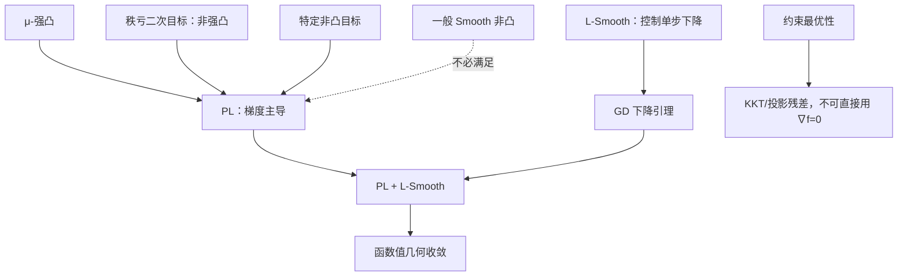

# 数学优化理论·第20课：PL 条件、梯度主导与非强凸线性收敛

**2026-11-08｜第3周·第6天｜约18分钟（自测另计）**

> 本课先独立做题：标准答案和开放题评分细则只放在独立 JSON，课堂讲义不包含答案。

## 1. 今天的问题：强凸真的是线性收敛的必要条件吗？

第15课证明：对于无约束、\(\mu\)-强凸且 \(L\)-Smooth 的目标，以步长 \(1/L\) 做梯度下降（GD），函数值误差满足
\[
f(x_k)-f^*\le(1-\mu/L)^k[f(x_0)-f^*].
\]
第18—19课又看到：线搜索能控制下降，但“梯度小”在一般非凸问题上只意味着接近驻点，不一定全局最优。

现在问：**如果函数不强凸、最优解也不唯一，仍能得到这种几何收敛吗？甚至函数非凸也行吗？** 答案是：在满足一种更弱的“梯度主导”条件时，可以。该条件称为 **Polyak–Łojasiewicz（PL）条件**。

## 2. 定义、假设与三个容易混淆的概念

设 \(f:\mathbb R^n\to\mathbb R\) 可微，最优值 \(f^*=\min_x f(x)\) 有限且可达到。称 \(f\) 满足常数 \(\mu>0\) 的 **PL 不等式**，如果对所有 \(x\) 都有
\[
\boxed{\frac12\|\nabla f(x)\|^2\ge\mu[f(x)-f^*].}\tag{PL}
\]
其中 \(f(x)-f^*\ge0\) 是函数值误差；PL 说：**远离最优值时，梯度不能太小**。注意这是关于*函数值*和*梯度范数*的关系，而不是直接关于 \(x-x^*\) 的距离界。

| 条件 | 直接限制的对象 | 是否要求凸性 | 是否保证最优点唯一 |
|---|---|---|---|
| \(L\)-Smooth | 梯度变化上界 | 否 | 否 |
| \(\mu\)-强凸 | 目标的一阶全局二次下界 | 是 | 是（存在极小点时） |
| PL（\(\mu>0\)） | 梯度平方与最优函数值误差 | 否 | 否 |

**PL 立刻排除非最优驻点。** 若 \(\nabla f(\bar x)=0\)，则由 PL：
\[
0\ge\mu[f(\bar x)-f^*]\ge0,
\]
从而 \(f(\bar x)=f^*\)。因此 PL 意味着**每个驻点都是全局最优点**，但不要求只有一个最优点。

## 3. 强凸为什么能推出 PL？严格推导

假设 \(f\) 是无约束、可微的 \(\mu\)-强凸函数：
\[
f(y)\ge f(x)+g^T(y-x)+\frac\mu2\|y-x\|^2,\quad g=\nabla f(x).
\]
右边关于 \(d=y-x\) 的最小值可通过配方得到：
\[
g^Td+\frac\mu2\|d\|^2
=\frac\mu2\|d+g/\mu\|^2-\frac{\|g\|^2}{2\mu}
\ge-\frac{\|g\|^2}{2\mu}.
\]
由于不等式对任意 \(y\) 成立，取 \(y=x^*\)：
\[
f^*\ge f(x)-\frac{\|\nabla f(x)\|^2}{2\mu}.
\]
移项即
\[
\boxed{\frac12\|\nabla f(x)\|^2\ge\mu[f(x)-f^*].}
\]
所以 **强凸 \(\Rightarrow\) PL**；下一节的反例会说明逆命题不成立。

## 4. 只有 Smooth + PL，也能证明 GD 几何收敛

**假设**：\(f\) 的梯度全局 \(L\)-Lipschitz，\(f^*\) 有限可达到，且满足参数 \(\mu>0\) 的 PL；不要求凸。固定步长 \(\eta=1/L\)：
\[
x_{k+1}=x_k-\frac1L\nabla f(x_k).
\]
下降引理（不需要凸性）：
\[
f(x_{k+1})\le f(x_k)-\frac1{2L}\|\nabla f(x_k)\|^2.
\]
由 PL：
\[
\|\nabla f(x_k)\|^2\ge2\mu[f(x_k)-f^*].
\]
因此
\[
\begin{aligned}
f(x_{k+1})-f^*
&\le f(x_k)-f^*-\frac\mu L[f(x_k)-f^*]\\
&=\left(1-\frac\mu L\right)[f(x_k)-f^*].
\end{aligned}
\]
迭代递推：
\[
\boxed{f(x_k)-f^*\le(1-\mu/L)^k[f(x_0)-f^*].}\tag{1}
\]
这就是**不依赖凸性的函数值几何收敛**。如果目标并非恒为常数，Smooth 下降引理与 PL 合用还能推出 \(0<\mu\le L\)，故收缩因子位于 \([0,1)\)。

更一般地，固定 \(0<\eta<2/L\) 时：
\[
f(x_{k+1})-f^*\le
\underbrace{[1-2\mu\eta(1-L\eta/2)]}_{\text{收缩因子}}
[f(x_k)-f^*].
\]
这不表示任意正步长都收敛；步长合法性仍须检查。

**停止准则的含义。** PL 给出 \(0\le f(x)-f^*\le\|\nabla f(x)\|^2/(2\mu)\)。当 \(\mu\) 已知且 PL 全局成立时，小梯度确实提供函数值误差证书；但它不是一般非凸优化普遍成立的结论。

## 5. 数值迭代：目标不强凸，GD 依旧线性收敛

考虑
\[
\boxed{f(x,y,z)=\tfrac12(x^2+4y^2).}
\]
Hessian：
\[
\nabla^2f=\operatorname{diag}(1,4,0).
\]
存在零特征值，所以目标**不是强凸**；全局最优点是 \((0,0,z)\)，任意 \(z\in\mathbb R\)，最优点不唯一。

但 \(L=4\) 合法，且
\[
\frac12\|\nabla f\|^2
=\tfrac12(x^2+16y^2)
\ge\tfrac12(x^2+4y^2)=f(x,y,z)-f^*.
\]
所以 **PL 常数 \(\mu=1\) 合法**。

从 \((4,2,5)\) 开始，步长 \(\eta=1/4\)：
\[
(x_{k+1},y_{k+1},z_{k+1})
=(3x_k/4,\,0,\,z_k).
\]

| \(k\) | 当前点 \((x_k,y_k,z_k)\) | \(f_k\) | PL 理论上界 \(16(3/4)^k\) |
|---:|---|---:|---:|
| 0 | \((4,2,5)\) | 16 | 16 |
| 1 | \((3,0,5)\) | 4.5 | 12 |
| 2 | \((2.25,0,5)\) | 2.53125 | 9 |
| 3 | \((1.6875,0,5)\) | 1.423828125 | 6.75 |

我们甚至可以写出 \(k\ge1\) 的精确形式：
\[
f_k=\frac92\left(\frac9{16}\right)^{k-1}.
\]
这是几何衰减；第三个坐标一直保持为 5。由此看出：**函数值收敛不要求最优点唯一，也不是说各坐标必须收敛到预先指定的某一个最优点。** 最终得到的是 \((0,0,5)\)，属于整个最优解集合。

## 6. 更意外的例子：非凸函数也能满足 PL

考虑一维
\[
\boxed{h(t)=\tfrac12t^2+2(1-\cos t).}
\]
有 \(h(t)\ge0=h(0)=h^*\)，且
\[
h'(t)=t+2\sin t,\qquad h''(t)=1+2\cos t.
\]
由于 \(h''(\pi)=-1<0\)，函数不是凸的；但 \(|h''(t)|\le3\)，所以 \(L=3\) 合法。

令 \(c=1-2/\pi>0\)。当 \(|t|\le\pi\)，\(\sin t\) 与 \(t\) 同号，因此 \(|h'(t)|\ge|t|\)。当 \(|t|\ge\pi\)，由反三角不等式
\[
|h'(t)|\ge |t|-2\ge(1-2/\pi)|t|=c|t|.
\]
合并：\(|h'(t)|\ge c|t|\) 对所有 \(t\) 成立。

利用 \(1-\cos t\le t^2/2\)：
\[
0\le h(t)\le\tfrac32t^2.
\]
于是
\[
\frac12|h'(t)|^2\ge\frac{c^2}{2}t^2
\ge\underbrace{\frac{c^2}{3}}_{\mu>0}h(t).
\]
故非凸的 \(h\) 满足全局 PL，可取
\[
\boxed{\mu=(1-2/\pi)^2/3\approx0.044.}
\]
结合上一节定理，步长 \(1/3\) 的 GD 对其**函数值**也有几何收敛保证。这里并未声称所有非凸函数都满足 PL，更未声称任意步长可用。

## 7. 两个失败反例：Smooth 不够，凸 + Smooth 也未必够

**失败反例一：全局 Smooth，但存在非最优驻点。**
\[
f(t)=1-\cos t,\quad f'(t)=\sin t,\quad |f''(t)|\le1.
\]
它是全局 \(1\)-Smooth，且 \(f^*=0\)。但 \(t=\pi\) 处 \(f'(\pi)=0\)、\(f(\pi)=2>0\)。若满足任何 \(\mu>0\) 的 PL，代入会得到 \(0\ge2\mu\)，矛盾。故 **Smooth \(\not\Rightarrow\) PL**。

**失败反例二：凸、全局 Smooth，也可能不满足 PL。** 令
\[
F(t)=t^2-\log(1+t^2).
\]
可以计算
\[
F'(t)=\frac{2t^3}{1+t^2},\qquad
F''(t)=\frac{2t^2(t^2+3)}{(1+t^2)^2}.
\]
它的 Hessian 始终非负且不超过 \(9/4\)，所以凸且 \(9/4\)-Smooth；\(F^*=F(0)=0\)。然而 \(t\to0\) 时，
\[
F(t)\sim\tfrac12t^4,\qquad F'(t)\sim2t^3,
\]
因此
\[
\frac{\tfrac12|F'(t)|^2}{F(t)-F^*}\sim4t^2\longrightarrow0.
\]
所以不存在正的全局 PL 常数。**凸 + Smooth 也不能自动获得本课的几何收敛界。**

## 8. 与 Armijo 和 KKT 的联系：不要跨越问题类别

第18课 Armijo + Backtracking 在全局 Smooth 下给出充分下降：
\[
f(x_{k+1})\le f(x_k)-c\underline\alpha\|\nabla f(x_k)\|^2.
\]
如果再满足 PL，则同理可推得
\[
f(x_{k+1})-f^*\le
(1-2c\mu\underline\alpha)[f(x_k)-f^*],
\]
故不仅强凸、**满足 PL 的函数也可得到相应几何收敛**。必须保持原来 Armijo 的统一正步长下界等假设。

但 PL 和本课 GD 都针对**无约束**目标。对于
\[
\min_{x\le1}\tfrac12(x-2)^2,
\]
最优点 \(x^*=1\) 的目标梯度 \(f'(1)=-1\ne0\)。约束 \(g(x)=x-1\le0\) 活跃，乘子 \(\lambda^*=1\)，满足
\[
f'(1)+\lambda^*g'(1)=-1+1=0,\quad
\lambda^*g(1)=0.
\]
所以不能将“无约束最优点梯度为零”强加给约束最优点。约束问题需要 KKT 残差、投影梯度映射或适当的原始—对偶证书。

## 9. 知识关系图

**本课总结：** 强凸 \(\Rightarrow\) PL；PL 不要求凸性或唯一最优点；L-Smooth + PL + 合法步长 \(\Rightarrow\) **函数值**几何收敛；一般 Smooth 仅能保证近似驻点，不能擅自声称全局最优。

## 10. 今日四级自测（100 分）

**首次发送不公布标准答案和开放题评分要点；请不要在作答前打开独立 JSON，避免泄题。**

### Lv1｜PL 条件的充分结论｜15 分｜预计 2 分钟｜单选

设可微函数 \(f\) 在全空间满足 PL 不等式 \(\frac12\|\nabla f(x)\|^2\ge\mu(f(x)-f^*)\)，其中 \(\mu>0\)，且全局最小值 \(f^*\) 可达到。以下哪项必然成立？

A. (f) 必须是强凸函数。

B. 每一个满足 (
abla f(x)=0) 的点都是全局最优点。

C. (f) 的全局最优点必然唯一。

D. 只要梯度 Lipschitz 连续，就必然满足某个正的 PL 常数。

*提示：把梯度为零代入 PL 不等式；不要把强凸的唯一解性质误加给 PL。*

### Lv2｜秩亏二次函数的两步 GD｜20 分｜预计 3 分钟｜数值

考虑 \(f(x,y,z)=\frac12(x^2+4y^2)\)。从 \((x_0,y_0,z_0)=(4,2,5)\) 出发，用固定步长 \(\eta=1/4\) 执行两次梯度下降 \(w_{k+1}=w_k-\eta\nabla f(w_k)\)。求 \(f(x_2,y_2,z_2)\)。只填写数值，保留三位小数。

*提示：梯度第三个分量为 0；更新两个坐标两次后再算目标值。*

### Lv3｜非凸 PL 与非 PL 反例比较｜25 分｜预计 5 分钟｜单选

比较两个全局 Smooth 函数 \(f_1(t)=\frac12t^2+2(1-\cos t)\) 与 \(f_2(t)=1-\cos t\)。下列哪项正确？

A. (f_1''(pi)<0)，所以 (f_1) 不可能满足任何全局 PL 不等式。

B. (f_1) 虽然非凸，但满足某个正的全局 PL 常数；(f_2) 在 (t=pi) 有非最优驻点，因此不满足任何正的全局 PL 常数。

C. (f_2) 的梯度全局 Lipschitz，因此它自动满足 PL 条件。

D. 只要 (f_1) 满足 PL，梯度下降用任意正步长都必然收敛。

*提示：检查二阶导数、驻点与全局最优值；PL 不要求凸，但排除非最优驻点。*

### Lv4｜PL 线性收敛、非强凸与非凸建模证明｜40 分｜预计 12 分钟｜开放题

请完成四部分证明与计算（总计 40 分）。

A（12 分）：设 \(f\) 为 \(L\)-Smooth、下确界可达到，且满足 \(\frac12\|\nabla f(x)\|^2\ge\mu(f(x)-f^*)\)，其中 \(0<\mu\le L\)。对步长 \(\eta=1/L\) 的 GD，从下降引理推导 \(f(x_k)-f^*\le(1-\mu/L)^k[f(x_0)-f^*]\)，说明这个结论是否要求凸性。

B（10 分）：对 \(f(x,y,z)=\frac12(x^2+4y^2)\)，证明 \(L=4\) 合法、PL 常数 \(\mu=1\) 合法，但函数不强凸且最优点不唯一。取初值 \((4,2,5)\)、步长 \(1/4\)，求前两步迭代点和函数值。

C（12 分）：对 \(h(t)=\frac12t^2+2(1-\cos t)\)，验证其 \(L=3\)-Smooth 但不是凸函数。利用 \(1-\cos t\le t^2/2\) 和 \(|t+2\sin t|\ge(1-2/\pi)|t|\) 推导一个正的全局 PL 常数，说明非凸也可能满足 PL。

D（6 分）：考虑 \(\min_{x\le1}\frac12(x-2)^2\)。求最优点与一个 KKT 乘子，写出活跃性、驻点和互补松弛，并解释为什么不可以直接要求约束最优点满足 \(\nabla f=0\)。

*提示：A 从充分下降出发；B 看 Hessian 的零特征值；C 在 |t|≤π 与 |t|≥π 分别控制导数；D 把约束写成 x−1≤0。*

## 11. 下一讲与评分方式

**第21课｜2026-11-09｜第三周复盘。** 将 GD 的下降引理、凸/强凸/PL 的不同收敛指标、Nesterov 势函数、Restart、Armijo/Wolfe 放在同一张条件—结论对照表中，并重点纠正“梯度小 = 全局最优”“目标值下降 = 迭代点收敛”“动量一定加速”等误解。

自测共 \(15+20+25+40=100\) 分。提交答案后逐题评分与反馈：**80 分及以上**继续按日进度；**60—79 分**补充对应例子；**低于60分**优先复习相关定理。成绩不改变日期课号。
