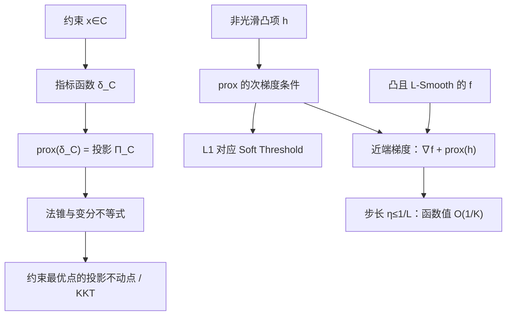

# 数学优化理论 · 第22课：投影与近端算子——从 KKT 到非光滑优化

**2026-11-10｜第4周·第1天｜讲授约18分钟（自测另计）**

前三周我们研究了光滑目标的梯度下降与加速；现在进入第四周：投影、Prox、Moreau 及非光滑优化。核心问题是：**当函数含 \(|x|\) 或必须满足 \(x\in C\) 时，梯度下降该怎样改造？**

## 一、问题与假设：光滑项 + 非光滑项

研究复合问题

\[
\boxed{\min_{x\in\mathbb R^n} F(x)=f(x)+h(x).}
\]

本课的**收敛定理**假设：\(f\) 凸、可微、梯度 \(L\)-Lipschitz（\(L>0\)）；\(h:\mathbb R^n\to(-\infty,+\infty]\) 是真、下半连续、凸函数；全局最优点 \(x^*\) 存在。\(h\) 允许不可微，也允许取 \(+\infty\) 来编码约束。学习定义和投影的部分只需集合 \(C\) 非空、闭、凸。

例如 Lasso 的 \(h(x)=\lambda\|x\|_1\) 不可微；约束 \(x\in C\) 可写为 \(h(x)=\delta_C(x)\)，其中指标函数在 \(C\) 内为 0、外部为 \(+\infty\)。**不能直接对不可微的 \(h\) 写普通梯度 \(\nabla h\)**，但可以用次梯度或近端算子。

## 二、欧氏投影：一个优化问题

对于非空、闭、凸集合 \(C\)，定义

\[
\boxed{\Pi_C(v)=\arg\min_{z\in C}\tfrac12\|z-v\|^2.}
\]

由于目标关于 \(z\) 严格凸且强制增长，且 \(C\) 闭非空，极小点存在并唯一。例如 \(C=[0,2]\times[0,2]\)，则 \(\Pi_C(3,-1)=(2,0)\)。

### 2.1 投影的最优性条件（严谨推导）

令 \(p=\Pi_C(v)\)。任取 \(z\in C\)，凸性保证 \(p+t(z-p)\in C\) 对 \(t\in[0,1]\) 成立。函数

\[
\psi(t)=\tfrac12\|p+t(z-p)-v\|^2
\]

在 \(t=0\) 处达到单侧最小值，所以

\[
\psi'(0)=(p-v)^T(z-p)\ge0.
\]

即

\[
\boxed{(v-p)^T(z-p)\le0,\quad\forall z\in C.}\tag{1}
\]

反过来若式 (1) 成立，展开

\[
\|z-v\|^2
=\|z-p\|^2+\|p-v\|^2+2(z-p)^T(p-v)
\ge\|p-v\|^2,
\]

故 \(p\) 的确是投影。于是式 (1) 是**必要且充分条件**。

定义凸集的法锥

\[
N_C(p)=\{w:w^T(z-p)\le0\text{ 对所有 }z\in C\}.
\]

投影最优性简写为

\[
\boxed{p=\Pi_C(v)\ \Longleftrightarrow\ v-p\in N_C(p).}\tag{2}
\]

### 2.2 为什么投影不会放大距离？

设 \(p=\Pi_C(u)\)、\(q=\Pi_C(v)\)。式 (1) 分别应用于 \(p\) 和 \(q\)：

\[
(u-p)^T(q-p)\le0,\qquad(v-q)^T(p-q)\le0.
\]

相加整理得

\[
\boxed{\|p-q\|^2\le(p-q)^T(u-v).}\tag{3}
\]

再用 Cauchy–Schwarz：

\[
\boxed{\|\Pi_C(u)-\Pi_C(v)\|\le\|u-v\|.}
\]

式 (3) 比普通 Lipschitz 更强，称为**Firm Nonexpansiveness（坚固非扩张性）**。这里凸性很关键。

## 三、连接前两周 KKT：边界最优不要求原梯度为零

设 \(f\) 可微凸，考虑 \(\min_{x\in C}f(x)\)。凸函数一阶最优性条件为

\[
\nabla f(x^*)^T(z-x^*)\ge0,\quad \forall z\in C,
\]

即

\[
-\nabla f(x^*)\in N_C(x^*).
\]

利用式 (2)，对**任意** \(\eta>0\)：

\[
\boxed{x^*=\Pi_C(x^*-\eta\nabla f(x^*)).}\tag{4}
\]

这称为**投影不动点形式的最优性条件**。它不是说任意步长的迭代都收敛；它只刻画最优点。

回顾例子：

\[
\min_{x\le1}\tfrac12(x-2)^2.
\]

最优点 \(x^*=1\)，但 \(f'(1)=-1\ne0\)。写 \(g(x)=x-1\le0\)，KKT：

\[
x^*-2+\lambda^*=0,\quad
\lambda^*\ge0,\quad g(x^*)\le0,\quad\lambda^*g(x^*)=0.
\]

解得 \(\lambda^*=1\)，约束活跃且互补松弛成立。因为 \(N_{(-\infty,1]}(1)=[0,\infty)\)，有 \(-f'(1)=1\in N_C(1)\)。同时

\[
\Pi_C(1-\eta(-1))=\Pi_C(1+\eta)=1.
\]

**提醒：活跃约束未必有正乘子。** 例如 \(\min_{x\le0}x^2/2\) 在 \(x^*=0\) 活跃，却有 \(\lambda^*=0\)。

## 四、Prox：把不可微项放进一个容易求的小优化问题

对真、下半连续、凸函数 \(h\)，定义

\[
\boxed{\operatorname{prox}_{\eta h}(v)
=\arg\min_z\left\{h(z)+\frac1{2\eta}\|z-v\|^2\right\},\quad \eta>0.}\tag{5}
\]

二次项使这个子问题强凸，故 prox 单值。最优性条件为

\[
0\in\partial h(p)+\frac{p-v}{\eta},
\quad\Longleftrightarrow\quad
\boxed{\frac{v-p}{\eta}\in\partial h(p).}\tag{6}
\]

这里 \(\partial h(p)\) 是凸次微分，不是普通梯度。

对于 \(h=\delta_C\)，式 (5) 只允许 \(z\in C\)，因此

\[
\boxed{\operatorname{prox}_{\eta\delta_C}(v)=\Pi_C(v).}
\]

**投影就是指标函数的 Prox。**

### 4.1 软阈值为什么自然出现？

令 \(h(z)=\lambda|z|\)，其中 \(\lambda>0\)。近端问题是

\[
\min_z \lambda|z|+\frac1{2\eta}(z-v)^2.
\]

若 \(z>0\)，一阶条件给 \(z=v-\eta\lambda>0\)；若 \(z<0\)，给 \(z=v+\eta\lambda<0\)；若 \(z=0\)，使用 \(\partial|0|=[-1,1]\)，有 \(v/\eta\in[-\lambda,\lambda]\)。

所以

\[
\boxed{
S_{\eta\lambda}(v)
=\operatorname{sign}(v)\max\{|v|-\eta\lambda,0\}.
}\tag{7}
\]

多维 \(h(x)=\lambda\|x\|_1\) 时按坐标分别软阈值。例：\(\eta=0.5,\lambda=1\)，\(v=2\) 输出 \(1.5\)，\(v=0.3\) 输出 \(0\)。

与硬截断不同，Soft Threshold 不但会把小值置零，还会将较大值向零收缩 \(\eta\lambda\)。

## 五、近端梯度法（Proximal Gradient / ISTA）

对 \(F=f+h\)，光滑项走梯度步，非光滑项走 Prox：

\[
\boxed{x_{k+1}=\operatorname{prox}_{\eta h}
\bigl(x_k-\eta\nabla f(x_k)\bigr).}\tag{8}
\]

这等价于最小化关于 \(u\) 的局部模型

\[
Q_x(u)=h(u)+\nabla f(x)^T(u-x)+\frac1{2\eta}\|u-x\|^2.
\]

**定理（凸复合优化）**：在第一节全部假设下，若 \(0<\eta\le1/L\)，则目标值单调不增，而且对 \(K\ge1\)：

\[
\boxed{
F(x_K)-F(x^*)\le\frac{\|x_0-x^*\|^2}{2\eta K}.
}\tag{9}
\]

### 5.1 一步不等式的关键证明

令 \(x^+\) 为一次近端梯度更新，\(g=\nabla f(x)\)，任意取 \(z\)。函数 \(Q_x\) 是 \(1/\eta\)-强凸且 \(x^+\) 最小化它，所以

\[
Q_x(x^+)+\frac1{2\eta}\|z-x^+\|^2\le Q_x(z).
\]

同时 \(L\)-Smooth 给出

\[
f(x^+)\le f(x)+g^T(x^+-x)+\frac L2\|x^+-x\|^2,
\]

凸性给出

\[
f(z)\ge f(x)+g^T(z-x).
\]

组合并消去梯度内积后得到：

\[
\begin{aligned}
F(x^+)-F(z)
&\le \frac{\|x-z\|^2-\|x^+-z\|^2}{2\eta}\\
&\quad-\left(\frac1{2\eta}-\frac L2\right)\|x^+-x\|^2.
\end{aligned}\tag{10}
\]

由于 \(\eta\le1/L\)，最后一项非正。取 \(z=x^*\)，得到一个相邻距离平方之差的上界；取 \(z=x\) 又得到 \(F(x^+)\le F(x)\)。从 \(k=0\) 至 \(K-1\) 求和，平方距离项望远镜抵消，结合单调性可得式 (9)。

**结论的边界**：这是凸复合目标的**最后一步函数值误差** \(O(1/K)\)。它不直接证明非凸全局最优，也不意味着任意 \(\eta\) 都合法。

## 六、两轮精确数值迭代：L1 正则改变了最优点

考虑

\[
F(x)=\frac12(x-3)^2+|x|,\quad x_0=0,\quad\eta=0.5.
\]

这里 \(f'(x)=x-3,\ L=1,\ h(x)=|x|\)，所以阈值 \(\eta\lambda=0.5\)。

第一轮先算 \(v_0=x_0-\eta f'(x_0)=1.5\)，再做软阈值：

\[
x_1=S_{0.5}(1.5)=1.
\]

第二轮 \(v_1=1-0.5(1-3)=2\)，故

\[
x_2=S_{0.5}(2)=1.5.
\]

由于 \(0\in x-3+\partial|x|\)，全局最优点为 \(x^*=2\)，最优值 \(F^*=2.5\)。

| 迭代 \(k\) | 输入 \(x_k\) | 梯度步 \(v_k\) | Prox 后 \(x_{k+1}\) | \(F(x_{k+1})\) |
|---:|---:|---:|---:|---:|
| 0 | 0 | 1.5 | 1 | 3.000 |
| 1 | 1 | 2.0 | 1.5 | 2.625 |
| — | — | — | 最优点 2 | 2.500 |

初始 \(F(0)=4.5\)。若完全忽略 \(h\)，光滑项的最优点是 \(3\)，并非原问题最优点 \(2\)。这就是近端梯度与普通 GD 的实质区别。

## 七、失败反例：哪些条件不能删？

**反例一：非凸集合使投影不唯一。** 取 \(C=\{-1,1\}\)，\(v=0\)。两点到原点距离都为 1，因此 \(\Pi_C(0)=\{-1,1\}\) 是多值的；第二节的单值和坚固非扩张结论需要凸性。

**反例二：步长过大可使迭代发散。** 令 \(f(x)=x^2/2\)、\(h=0\)、\(L=1\)、\(x_0=1\)，却取 \(\eta=3\)。近端梯度退化为 GD：

\[
x_{k+1}=x_k-3x_k=-2x_k,
\]

所以 \(1\to-2\to4\)，目标值 \(0.5\to2\to8\)。不能把 \(\eta\le1/L\) 的收敛定理应用到此例。

**反例三：非光滑不意味着不能优化。** \(h(x)=|x|\) 在 0 不可微，然而式 (7) 的 Prox 在 0 附近仍有明确、唯一的解；错误做法是把不可微直接当成“无法迭代”。

## 八、关系图与核心结论

今日要带走三个公式：

\[
\boxed{p=\Pi_C(v)\iff v-p\in N_C(p)}
\]

\[
\boxed{p=\operatorname{prox}_{\eta h}(v)\iff (v-p)/\eta\in\partial h(p)}
\]

\[
\boxed{x_{k+1}=\operatorname{prox}_{\eta h}(x_k-\eta\nabla f(x_k))}
\]

**下一讲（2026-11-11，第23课）**：Moreau Envelope、Moreau 分解与 Prox 为什么能把非光滑问题转化为光滑的梯度信息。我们将推导 Envelope 的梯度和 L1/投影的相关恒等式，并解释光滑化的收益与局限。

## 九、今日四级自测（100 分）

**首次课堂不公布答案或开放题评分标准。独立测验 JSON 包含答案，作答前不要打开，避免泄题。**

### Lv1｜投影与最优性条件辨析｜15 分｜预计 2 分钟

设 \(C\subset\mathbb R^n\) 非空、闭、凸，\(h=\delta_C\) 是其指标函数，\(\eta>0\)。以下哪项必然正确？

- A. 只要 \(C\) 闭，投影 \(\Pi_C(v)\) 就一定唯一，即使 \(C\) 非凸。
- B. \(\operatorname{prox}_{\eta\delta_C}(v)=\Pi_C(v)\)，且 \(p=\Pi_C(v)\) 当且仅当 \(v-p\in N_C(p)\)。
- C. 若约束在最优点活跃，它的 KKT 乘子一定严格为正。
- D. 对任意不可微函数 \(h\)，\(\operatorname{prox}_{\eta h}(v)\) 必须用普通梯度下降求解。

*提示：从指标函数的定义出发；回忆投影变分不等式及非凸集合的反例。*

### Lv2｜软阈值的一步近端梯度更新｜20 分｜预计 3 分钟

考虑 \(F(x)=\frac12(x-4)^2+1.5|x|\)，从 \(x_0=0\) 开始，取步长 \(\eta=0.5\)，执行一步近端梯度 \(x_1=\operatorname{prox}_{\eta h}(x_0-\eta f'(x_0))\)，其中 \(f(x)=\frac12(x-4)^2\)、\(h(x)=1.5|x|\)。求 \(x_1\)，保留三位小数。

*提示：先计算纯梯度试探点 v，再对 v 施加阈值 η×1.5 的 soft-thresholding。*

### Lv3｜两次迭代、模型比较与最优点核验｜25 分｜预计 5 分钟

对 \(F(x)=\frac12(x-5)^2+2|x|\)，从 \(x_0=0\) 开始，使用 \(\eta=1/2\) 的近端梯度法做两次迭代。该凸问题的全局最优点可由次梯度条件确定。以下哪项完全正确？

- A. \(x_1=2.5,\ x_2=3.75\)；因为只需对光滑项做梯度下降。
- B. \(x_1=1.5,\ x_2=2.25,\ F(x_2)=9.28125\)，且最优点为 5。
- C. \(x_1=1.5,\ x_2=2.25,\ F(x_2)=8.28125\)，且最优点为 3。
- D. \(x_1=x_2=0\)；因为 \(|x|\) 在零处不可微，算法无法启动。

*提示：每轮先对光滑项作梯度步，再执行阈值为 η×2 的软阈值；计算 F 时别忘记 2|x|。*

### Lv4｜投影最优性、近端梯度收敛与 KKT 证明｜40 分｜预计 12 分钟

完成四个部分，注明每一部分的假设。

A（10 分）设 \(C\subset\mathbb R^n\) 非空闭凸，证明 \(p=\Pi_C(v)\iff (v-p)^T(z-p)\le0\ \forall z\in C\)。进而证明可微凸函数在 \(C\) 上的最优点 \(x^*\) 满足 \(x^*=\Pi_C(x^*-\eta\nabla f(x^*))\)（任意 \(\eta>0\)）。

B（10 分）对适当的真、下半连续、凸函数 \(h\)，由近端子问题推导 \((v-p)/\eta\in\partial h(p)\)。解释为何 \(h=\delta_C\) 时 prox 就是投影，并分情况推导 \(h(t)=\lambda|t|\) 的软阈值公式。

C（14 分）考虑 \(F=f+h\)，其中 \(f\) 凸、可微且 \(L\)-Smooth，\(h\) 真、下半连续且凸，最优点 \(x^*\) 存在，取 \(0<\eta\le1/L\)。对 \(x^+=\operatorname{prox}_{\eta h}(x-\eta\nabla f(x))\)，证明
\(F(x^+)-F(z)\le[\|x-z\|^2-\|x^+-z\|^2]/(2\eta)\)（任意 \(z\)），并推导 \(F(x_K)-F^*\le\|x_0-x^*\|^2/(2\eta K)\)，\(K\ge1\)。说明用到了哪些条件。

D（6 分）对 \(\min_{x\le1}\frac12(x-2)^2\) 写出最优点、活跃约束、非负乘子、驻点与互补松弛，并给出一个投影失去唯一性的非凸集合反例。

*提示：A 用投影最优性的一阶变分不等式；B 用 Fermat 次梯度条件；C 比较近端二次模型在 x+ 与 z 的值，结合 Smooth/凸性及望远镜求和；D 注意约束活跃不等于一般地强制正乘子。*

作答后会逐题评分：80 分及以上正常继续；60–79 分补充针对性例题；低于 60 分优先复习投影最优性、法锥、次梯度与 KKT。评分不改变按日期计算的课号。
