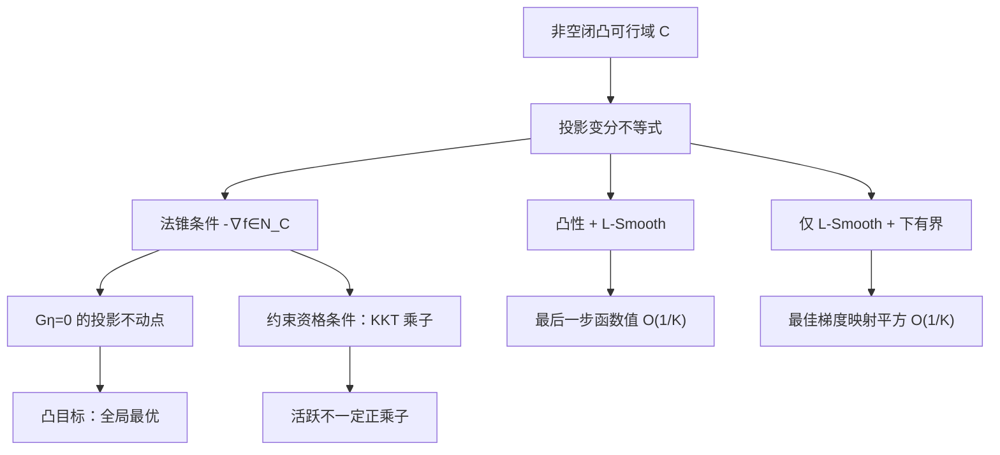

# 数学优化理论 · 第24课
## 投影梯度法与约束优化：从投影不动点到 KKT

**2026 年 11 月 12 日｜第 4 周·第 3 天｜讲授约 18 分钟（自测另计）**

上一课使用 Moreau 包络把非光滑凸函数与光滑梯度连接起来。今天处理另一个实际问题：**若梯度下降会走出可行域，为什么“先走一步、再投影”仍有数学保证？** 更重要的是，要分清普通梯度为零、投影梯度为零和 KKT 驻点条件。

### 一、问题、假设与算法

设 $C\subset\mathbb R^n$ **非空、闭、凸**，$x_0\in C$。考虑
$$
\boxed{\min_{x\in C}f(x)},\qquad
\boxed{x_{k+1}=\Pi_C(x_k-\eta\nabla f(x_k))}.
$$
其中 $\eta>0$，$\Pi_C(v)=\arg\min_{z\in C}\frac12\|z-v\|^2$。投影唯一，因为距离平方强凸，集合闭凸。算法先做试探点 $v_k=x_k-\eta\nabla f(x_k)$，再投影回 $C$；盒约束可按坐标截断，一般凸集未必能逐坐标处理。

区分后续不同定理的假设：最优性一阶条件只需 $f$ 可微；全局最优充要性需要 $f$ **凸**；凸收敛界需要 $f$ 凸且 $L$-Smooth、最优点存在及 $0<\eta\le1/L$；非凸驻点界只需 $f$ 为 $L$-Smooth 且在 $C$ 上下有界，并使用同样步长范围。

### 二、投影的变分不等式：必要且充分

记 $p=\Pi_C(v)$，任取 $z\in C$，因 $C$ 凸，$p+t(z-p)\in C$（$0\le t\le1$）。函数 $\psi(t)=\frac12\|p+t(z-p)-v\|^2$ 在 $t=0$ 取得单侧极小，故
$$
\psi'(0^+)=(p-v)^T(z-p)\ge0.
$$
因此
$$
\boxed{(v-p)^T(z-p)\le0,\qquad\forall z\in C.}\tag{1}
$$
反过来若 (1) 成立，展开平方：
$$
\|z-v\|^2=\|z-p\|^2+\|p-v\|^2+2(z-p)^T(p-v)\ge\|p-v\|^2,
$$
故 $p$ 确为最优投影点。

法锥定义 $N_C(p)=\{w:w^T(z-p)\le0,\ \forall z\in C\}$，于是
$$
\boxed{p=\Pi_C(v)\iff v-p\in N_C(p).}\tag{2}
$$

### 三、投影梯度映射：约束场景中真正的“零梯度”

定义
$$
\boxed{G_\eta(x)=\frac{x-\Pi_C(x-\eta\nabla f(x))}{\eta}},\qquad x\in C.\tag{3}
$$
当 $C=\mathbb R^n$ 时，它就是普通梯度。对于一般闭凸 $C$，
$$
G_\eta(x^*)=0\iff x^*=\Pi_C(x^*-\eta\nabla f(x^*))
\iff-\nabla f(x^*)\in N_C(x^*).
$$
等价于
$$
\boxed{\nabla f(x^*)^T(z-x^*)\ge0\quad(\forall z\in C).}\tag{4}
$$
这是约束优化的一阶变分不等式。对**凸可微** $f$，由
$f(z)\ge f(x^*)+\nabla f(x^*)^T(z-x^*)$，它充分保证全局最优；反方向也是一阶必要条件。因此
$$
\boxed{x^*\in\arg\min_{x\in C} f(x)\iff G_\eta(x^*)=0}
\quad(\text{凸可微 }f;\ \eta>0).\tag{5}
$$
若 $f$ 非凸，$G_\eta=0$ 一般只能说明一阶驻点性，不能证明全局最优。

### 四、与 KKT 相连：活跃约束不意味着正乘子

若 $C=\{x:g_i(x)\le0,\ Ax=b\}$，$g_i$ 为可微凸函数、等式仿射，并满足适当的约束资格条件（例如合适的 Slater 条件），法锥可以由活跃不等式的梯度与等式梯度表示，于是 (4) 变为
$$
\boxed{\nabla f(x^*)+\sum_i\lambda_i\nabla g_i(x^*)+A^T\nu=0,\quad
\lambda_i\ge0,\quad \lambda_i g_i(x^*)=0.}
$$
还必须检查原始可行性。以上就是 KKT 驻点、对偶可行与互补松弛。

例一：$\min_{x\le1}\frac12(x-2)^2$ 的最优点 $x^*=1$，普通梯度为 $-1$；约束 $x-1\le0$ 活跃，驻点 $-1+\lambda=0$ 得 $\lambda=1$，互补松弛成立。

例二：$\min_{x\le0}\frac12x^2$ 的最优点 $x^*=0$，约束也活跃，但梯度本身为 0，乘子 $\lambda=0$，仍满足互补松弛。**活跃只表示约束取等号；不能推出乘子一定正。**

### 五、严格证明凸投影梯度的最后一步 $O(1/K)$

现在假设 $f$ 凸、可微、$L$-Smooth（$L>0$），$C$ 非空闭凸，最优点 $x^*\in C$ 存在，且 $0<\eta\le1/L$。记
$$
x^+=\Pi_C(x-\eta g),\quad g=\nabla f(x),\quad d=x^+-x.
$$
由**凸性**：$f(z)\ge f(x)+g^T(z-x)$；由 **Smooth 下降引理**：
$f(x^+)\le f(x)+g^Td+\frac L2\|d\|^2$。相减得到
$$
f(x^+)-f(z)\le g^T(x^+-z)+\frac L2\|d\|^2.\tag{6}
$$
由投影变分不等式，以 $v=x-\eta g$ 代入：
$$
\eta g^T(x^+-z)\le(x-x^+)^T(x^+-z).
$$
使用三点平方恒等式
$$
2(x-x^+)^T(x^+-z)
=\|x-z\|^2-\|x^+-z\|^2-\|x-x^+\|^2.
$$
代回 (6)：
$$
\boxed{\begin{aligned}
f(x^+)-f(z)&\le
\frac{\|x-z\|^2-\|x^+-z\|^2}{2\eta}\\
&\quad-\frac{1-\eta L}{2\eta}\|x^+-x\|^2.
\end{aligned}}\tag{7}
$$
这条**三点不等式**是投影梯度收敛证明的核心。当 $\eta\le1/L$，最后一项非正。取 $z=x^*$：
$$
f(x_{k+1})-f^*\le
\frac{\|x_k-x^*\|^2-\|x_{k+1}-x^*\|^2}{2\eta}.
$$
从 $k=0$ 到 $K-1$ 求和，距离平方望远镜抵消：
$$
\sum_{k=0}^{K-1}[f(x_{k+1})-f^*]
\le\frac{\|x_0-x^*\|^2}{2\eta}.
$$
取 (7) 中 $z=x$，还得到
$$
f(x^+)-f(x)\le-\left(\frac1\eta-\frac L2\right)\|d\|^2\le0.
$$
所以函数值单调不增，左侧和至少为 $K[f(x_K)-f^*]$，最终
$$
\boxed{f(x_K)-f^*\le\frac{\|x_0-x^*\|^2}{2\eta K},\quad K\ge1.}\tag{8}
$$
这是**函数值最后一步**的 $O(1/K)$ 界，不意味着每一步变量距离都以 $O(1/K)$ 下降。

### 六、非凸时：仍能控制投影驻点残差

如果 $f$ 只要求 $L$-Smooth 且在 $C$ 上有有限下界 $f_{\inf,C}$，则不能再使用凸性的一阶全局下界。但由投影条件取 $z=x$，仍得
$$
g^Td\le-\frac1\eta\|d\|^2.
$$
结合 Smooth：
$$
f(x^+)\le f(x)-\left(\frac1\eta-\frac L2\right)\|d\|^2
\le f(x)-\frac\eta2\|G_\eta(x)\|^2
$$
（最后一步用了 $0<\eta\le1/L$ 及 $d=-\eta G_\eta(x)$）。迭代 $K$ 次并求和：
$$
\boxed{
\min_{0\le k<K}\|G_\eta(x_k)\|^2
\le\frac{2[f(x_0)-f_{\inf,C}]}{\eta K}.}\tag{9}
$$
若迭代无限进行，还可由非负平方和有限推出 $\|G_\eta(x_k)\|\to0$。这仍**不等于非凸全局最优**，也不自动推出整个点序列必然收敛。

### 七、完整数值例题：二维盒约束两轮更新

令 $f(u,v)=\frac12[(u-3)^2+(v+1)^2]$、$C=[0,2]^2$，Hessian 是单位阵，故 $L=1$。从 $x_0=(0,2)$、步长 $\eta=0.5$ 开始，$\nabla f(u,v)=(u-3,v+1)$。

第一轮：$g_0=(-3,3)$；试探点 $(1.5,0.5)$ 在盒内；$x_1=(1.5,0.5)$，$f(x_1)=2.25$。

第二轮：$g_1=(-1.5,1.5)$；试探点 $(2.25,-0.25)$ 越界；截断后 $x_2=(2,0)$，$f(x_2)=1$。

| 轮次 | 梯度 | 梯度试探点 | 投影后点 | 目标值 |
|---|---|---|---|---:|
| 初始 | $(-3,3)$ | — | $(0,2)$ | 9 |
| 第1轮 | $(-3,3)$ | $(1.5,0.5)$ | $(1.5,0.5)$ | 2.25 |
| 第2轮 | $(-1.5,1.5)$ | $(2.25,-0.25)$ | $(2,0)$ | 1 |

无约束最优点 $(3,-1)$ 不可行；约束最优点是 $(2,0)$。在此点梯度 $(-1,1)$ 并非零。活跃约束为 $u-2\le0$ 和 $-v\le0$；二者 KKT 乘子各为 $1$，其余不活跃约束乘子为零。第 2 轮恰好达到最优只是本题的特殊结构，不代表投影梯度算法一般有限步收敛。

### 八、失败反例：哪些条件不能省略？

**步长过大：** 取 $C=\mathbb R$、$f(x)=x^2/2$（$L=1$），错误采用 $\eta=3$。投影退化为恒等映射，$x_{k+1}=x_k-3x_k=-2x_k$。从 $1$ 出发得到 $1,-2,4,-8,\ldots$，函数值发散。这不违反我们要求的 $\eta\le1/L$ 的定理。

**非凸驻点不是全局最优：** 取 $C=[0,4]$、$f(x)=1-\cos x$，它全局 $1$-Smooth，且在 $C$ 上下有界。从 $x_0=\pi$ 出发，$\nabla f(\pi)=0$，故 $G_\eta(\pi)=0$，但 $f(\pi)=2>f(0)=0$。非凸时投影梯度为零只能保证一阶驻点性。

**可行集非凸：** 如 $C=\{-1,1\}$，在 $v=0$ 处最近点不唯一。闭凸投影的单值性和变分不等式不能无条件照搬。

### 九、关系图与结论

| 条件 / 观察量 | 能保证 | 不能直接保证 |
|---|---|---|
| $\nabla f(x^*)=0$ | 无约束驻点 | 约束最优必须如此 |
| $G_\eta(x^*)=0$ | 法锥驻点；凸可微目标时全局最优 | 非凸全局最优 |
| 活跃 $g_i(x^*)=0$ | 约束取等号 | $\lambda_i>0$ |
| 互补松弛 $\lambda_i g_i(x^*)=0$ | 乘子和约束残差不能同时严格非零 | 所有乘子唯一 |
| 凸 $L$-Smooth、$\eta\le1/L$ | 最后一步函数值 $O(1/K)$ | 非凸函数同样的全局值界 |
| 仅 $L$-Smooth、下有界 | 最佳 $\|G_\eta\|^2=O(1/K)$ | 函数值全局最优误差界 |

### 十、今日四级自测（100 分）

**本次课堂首次发送不公布标准答案、正确选项及开放题评分要点。请先独立作答，不要提前查看独立测验 JSON，以免泄题。**

### Lv1｜投影不动点与最优性充要条件｜15 分｜预计 2 分钟

设 $C\subset\mathbb R^n$ 非空、闭、凸，$f$ 在全空间可微且凸，$\eta>0$。对于某个 $x^*\in C$，下面哪项一定正确？

A. 只要 $x^*$ 是约束最优点，就一定有 $\nabla f(x^*)=0$。

B. $x^*$ 是 $\min_{x\in C}f(x)$ 的全局最优点，当且仅当 $x^*=\Pi_C(x^*-\eta\nabla f(x^*))$。

C. 任何活跃不等式约束的 KKT 乘子必须严格大于零。

D. 只要 $f$ 可微且凸，投影梯度法采用任意正步长都会收敛。

*提示：从投影变分不等式和凸函数一阶最优性出发；不要将有约束最优点误认为普通梯度必须为零。*

### Lv2｜二维盒约束的一步投影梯度｜20 分｜预计 3 分钟

令 $f(u,v)=\frac12[(u-3)^2+(v+1)^2]$，可行域 $C=[0,2]\times[0,2]$，初值 $x_0=(0,2)$，步长 $\eta=0.5$。进行一次投影梯度更新 $x_1=\Pi_C(x_0-\eta\nabla f(x_0))$，求 $f(x_1)$。只填写数值，保留三位小数。

*提示：先求梯度和未投影试探点，再逐坐标截断到盒约束，最后计算目标函数。*

### Lv3｜两步迭代、梯度映射与 KKT 乘子｜25 分｜预计 5 分钟

考虑 $\min_{0\le x\le1} f(x)=\frac12(x-3)^2$，从 $x_0=0$ 开始采用步长 $\eta=\frac14$ 的投影梯度法，连续迭代两次。令梯度映射 $G_\eta(x)=[x-\Pi_{[0,1]}(x-\eta f'(x))]/\eta$。最优点处约束 $x-1\le0$ 的乘子记为 $\lambda^*$。哪项正确？

A. $x_1=0.75,x_2=1$，但 $\lambda^*=0$，因为投影后梯度必为零。

B. $x_1=1,x_2=1$，且 $\lambda^*=2$。

C. $x_1=0.75,x_2=1$；虽然 $f'(1)=-2$，但 $G_\eta(1)=0$，且 $\lambda^*=2$。

D. $x_1=0.75,x_2=1.3125$，且 $\lambda^*=2$。

*提示：第一步的试探点可能可行，第二步会越界；投影点在上边界时可以与非零的普通梯度平衡。*

### Lv4｜投影变分不等式、凸收敛与非凸驻点｜40 分｜预计 12 分钟

完成四部分证明与建模，分别注明必要的假设：

**A（10 分）：投影与最优性。** 对非空闭凸集 $C$，证明 $p=\Pi_C(v)$ 当且仅当 $\langle v-p,z-p\rangle\le0$ 对所有 $z\in C$ 成立。进一步证明，若 $f$ 凸且可微，则 $x^*\in C$ 是全局最优点当且仅当 $G_\eta(x^*)=0$（任一固定 $\eta>0$）。

**B（14 分）：凸投影梯度法的 $O(1/K)$。** 设 $f$ 凸、$L$-Smooth，$C$ 非空闭凸，存在最优点 $x^*\in C$，$x_0\in C$，且 $0<\eta\le1/L$。令 $x^+=\Pi_C(x-\eta\nabla f(x))$。证明对任意 $z\in C$：
$$
f(x^+)-f(z)\le \frac{\|x-z\|^2-\|x^+-z\|^2}{2\eta}-\frac{1-\eta L}{2\eta}\|x^+-x\|^2.
$$
据此推导 $f(x_K)-f(x^*)\le\|x_0-x^*\|^2/(2\eta K)$。

**C（10 分）：非凸问题的保证边界。** 若 $f$ 仅 $L$-Smooth、在 $C$ 上下有界（不要求凸），$0<\eta\le1/L$，证明
$$
\min_{0\le k<K}\|G_\eta(x_k)\|^2\le \frac{2[f(x_0)-f_{\inf,C}]}{\eta K},
$$
其中 $f_{\inf,C}=\inf_{x\in C}f(x)$。说明 $G_\eta=0$ 为什么不能保证非凸全局最优。

**D（6 分）：KKT 活跃约束与零乘子。** 分别求解 $\min_{x\le1}\frac12(x-2)^2$ 与 $\min_{x\le0}\frac12x^2$，列出最优点、活跃约束、非负乘子、驻点及互补松弛，解释为什么活跃不必意味着正乘子。

*提示：A 沿凸集内的线段作单侧导数；B 对投影不等式代入 z，结合凸性与下降引理后利用三点恒等式；C 取投影比较点 z=x 先得充分下降，再求和；D 把每条约束写成 g(x)≤0。*

### 十一、下一讲

**第 25 课｜2026 年 11 月 13 日：FISTA 与加速近端梯度。** 将研究如何在包含不可微正则项的凸复合优化 $f+h$ 中设计加速外推，使函数值误差从近端梯度的 $O(1/K)$ 改善到 $O(1/K^2)$，以及为什么任意添加动量并不继承加速定理。

答题后逐题评分：**80 分及以上**正常继续；**60–79 分**补充投影不动点和三点不等式例题；**低于 60 分**复习法锥、活跃约束、KKT 乘子和互补松弛。课号仍按日期推进。第 28 课（11 月 16 日）为第四周复盘及阶段测验。
