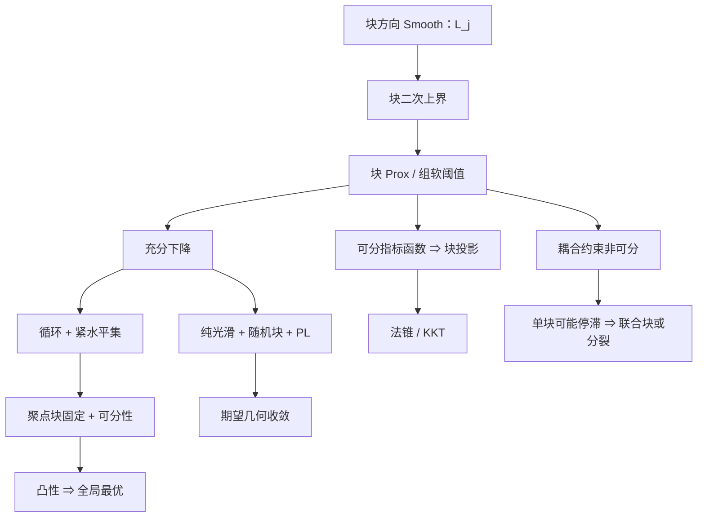

# 数学优化理论 · 第30课：块坐标下降与复合正则的坐标 Prox

**2026-11-18｜第5周第2天｜18分钟（自测另计）**

上一课从单坐标二次上界出发，学习了循环、随机和 GS-L 规则。今天把每次更新一个标量推广成更新一组向量：**怎样利用块结构处理 L1、组稀疏与盒约束？什么时候局部块最优能推出整个凸问题全局最优？**

## 一、模型与假设

将变量分成 $m$ 个不相交的块 $x=(x_1,\dots,x_m)$，考虑

$$
\boxed{\min_x F(x)=f(x)+H(x),\quad H(x)=\sum_{j=1}^m h_j(x_j).}
$$

假设 $f$ 凸且可微，每个 $h_j$ 真、下半连续、凸；对于任意块 $j$、向量 $d$，存在 $L_j>0$ 满足

$$
\|\nabla_j f(x+U_jd)-\nabla_j f(x)\|\le L_j\|d\|,
$$

其中 $U_jd$ 表示仅在第 $j$ 块添加 $d$。允许 $f$ **跨块耦合**，但 $H$ 在本课理论中必须按块可分。之后谈收敛时会额外加入解存在、水平集紧等条件。

| 对象 | 定义 | 作用 |
|---|---|---|
| $x_j$ | 第 $j$ 个标量或向量块 | 单轮更新单位 |
| $L_j$ | 块方向 Smooth 常数 | 决定局部二次上界 |
| $h_j$ | 块正则项或块约束指标函数 | 利用 Prox 直接处理 |
| $U_j$ | 块嵌入算子 | 其他块保持不变 |

## 二、块下降引理：严谨不等式

设 $g_j=\nabla_j f(x)$。沿块方向积分并用 Lipschitz 条件：

$$
\begin{aligned}
f(x+U_jd)-f(x)
&=\int_0^1\langle\nabla_j f(x+tU_jd),d\rangle dt\\
&\le \langle g_j,d\rangle+\int_0^1 tL_j\|d\|^2dt\\
&=\langle g_j,d\rangle+\tfrac{L_j}{2}\|d\|^2.
\end{aligned}
$$

即

$$
\boxed{f(x+U_jd)\le f(x)+\langle g_j,d\rangle+\frac{L_j}{2}\|d\|^2.}\tag{1}
$$

注意这个引理仅控制**一个块方向**，不需要整个 Hessian 的谱范数上界。

## 三、块近端更新与充分下降

固定其他块，构造

$$
q_j(u)=h_j(u)+\langle g_j,u-x_j\rangle+\frac{L_j}{2}\|u-x_j\|^2.
$$

记 $p=\arg\min_u q_j(u)$，则

$$
\boxed{
p=\operatorname{prox}_{h_j/L_j}\left(x_j-\frac{g_j}{L_j}\right),\quad
x^+=x+U_j(p-x_j).
}\tag{2}
$$

该块子问题的一阶最优性条件为

$$
\boxed{0\in g_j+L_j(p-x_j)+\partial h_j(p).}\tag{3}
$$

现在证明下降保证。$q_j$ 是 $L_j$-强凸，且 $p$ 为其最优点，因此

$$
q_j(p)+\frac{L_j}{2}\|p-x_j\|^2\le q_j(x_j)=h_j(x_j).
$$

结合块下降引理：

$$
F(x^+)-F(x)\le q_j(p)-h_j(x_j).
$$

于是

$$
\boxed{F(x)-F(x^+)\ge\frac{L_j}{2}\|p-x_j\|^2.}\tag{4}
$$

定义**块近端梯度映射** $G_j(x)=L_j(x_j-p)$，则

$$
\boxed{F(x)-F(x^+)\ge\frac{\|G_j(x)\|^2}{2L_j}.}\tag{5}
$$

这个结论是确定性的**单次下降**。它不自动赋予任意块选择规则全局线性收敛速率。

## 四、常见块 Prox：L1、组稀疏与指标函数

当 $h_j(u)=\lambda|u|$，Prox 是软阈值：

$$
\operatorname{prox}_{h_j/L_j}(v)=\operatorname{sign}(v)(|v|-\lambda/L_j)_+.
$$

当一个块是向量、$h_j(u)=\lambda\|u\|_2$，若 $u\ne0$，次梯度最优性给出

$$
0=\lambda u/\|u\|_2+L_j(u-v).
$$

因此 $u$ 与 $v$ 同方向。结合零点次微分条件，得到**组软阈值**：

$$
\boxed{
\operatorname{prox}_{(\lambda/L_j)\|\cdot\|_2}(v)
=\left(1-\frac{\lambda}{L_j\|v\|_2}\right)_+v,
}\tag{6}
$$

约定 $v=0$ 时输出零。与逐元素 L1 不同，组软阈值会根据整个块的二范数决定是否一起置零。

若 $h_j=\delta_{C_j}$，则 $\operatorname{prox}_{h_j/L_j}=\Pi_{C_j}$。只有可行域是笛卡尔积 $C=C_1\times\cdots\times C_m$ 时，约束指标函数才可按块分解。

## 五、循环块坐标下降的收敛条件

令块按 $1,2,\ldots,m$ 循环更新。为建立明确收敛定理，额外假设各 $h_j$ 在全空间有限且连续、初始水平集紧、$F$ 存在最优点且每块精确执行式 (2)。

由充分下降式：

$$
\sum_{k=0}^{K-1}\frac{L_{j_k}}2\|x^{k+1}-x^k\|^2
\le F(x^0)-F(x^K)\le F(x^0)-F^*.
$$

因为 $L_{\min}=\min_j L_j>0$：

$$
\boxed{\sum_{k=0}^\infty\|x^{k+1}-x^k\|^2<\infty,\quad
\|x^{k+1}-x^k\|\to0.}\tag{7}
$$

紧水平集保证聚点存在。沿每轮起点的一个收敛子列，由于每轮只有有限个更新且每一步移动趋零，该轮所有中间点也趋于同一个聚点 $\bar x$。利用 $\nabla_j f$ 与凸 Prox 的连续性，把每个块的更新式取极限：

$$
\bar x_j=\operatorname{prox}_{h_j/L_j}
\left(\bar x_j-\nabla_j f(\bar x)/L_j\right).
$$

于是

$$
0\in\nabla_j f(\bar x)+\partial h_j(\bar x_j),\qquad j=1,\ldots,m.
$$

由 $H$ 的**块可分性**，可将这些条件组合为 $0\in\nabla f(\bar x)+\partial H(\bar x)=\partial F(\bar x)$。由于 $F$ 凸，$\bar x$ 是全局最优点。再利用 $F$ 连续且函数值单调下降，得到

$$
\boxed{F(x^k)\to F^*.}\tag{8}
$$

这是目标值收敛和聚点最优保证；**不能由此直接断言普适的 $O(1/k)$ 或线性速率**。这些还需要更强的误差界、强凸或相应的块选择分析。

对纯光滑情形 $h_j=0$，回顾上一课：若以 $p_j=L_j/S$ 独立随机抽块，$S=\sum_jL_j$，目标满足 $\mu$-PL，则

$$
\mathbb E[f(x^{k+1})-f^*\mid x^k]
\le(1-\mu/S)[f(x^k)-f^*].
$$

由全期望递推得到期望几何收敛。**这是光滑目标与指定抽样的结论，不应未经额外证明直接套用到一般非光滑复合问题。**

## 六、完整数值迭代：耦合光滑项 + 可分 L1

考虑

$$
\boxed{
F(x,y)=\tfrac12(x-3)^2+\tfrac12(y+1)^2
+\tfrac12(x+y-1)^2+|x|+|y|.
}
$$

$\nabla f=(2x+y-4,\ x+2y)$，块常数 $L_x=L_y=2$。从 $(0,0)$ 出发，按 $x\to y\to x$ 更新，每次阈值为 $1/2$。

第一次：$g_x=-4$，试探点 $v_x=2$，故 $x_1=S_{0.5}(2)=1.5$。

第二次：$g_y(1.5,0)=1.5$，试探 $v_y=-0.75$，故 $y_2=S_{0.5}(-0.75)=-0.25$。

第三次：$g_x(1.5,-0.25)=-1.25$，试探 $v_x=2.125$，故 $x_3=1.625$。

| 微步 | 更新块 | $(x,y)$ | $F(x,y)$ |
|---:|---|---|---:|
| 0 | — | $(0,0)$ | $5.5$ |
| 1 | $x$ | $(1.5,0)$ | $3.25$ |
| 2 | $y$ | $(1.5,-0.25)$ | $3.1875$ |
| 3 | $x$ | $(1.625,-0.25)$ | $3.171875$ |

最优点可由次梯度条件得到：在 $x>0,y<0$ 的区间解 $2x+y-3=0$、$x+2y-1=0$，得

$$
\boxed{(x^*,y^*)=(5/3,-1/3),\qquad F^*=19/6.}
$$

这说明逐块优化可以逼近最优点，但示例中的前三步并非有限步求解。

## 七、失败反例：耦合约束会锁死单坐标

考虑凸且光滑的

$$
\boxed{\min_{x+y=1}\tfrac12(x-1)^2+\tfrac12y^2.}
$$

从可行初值 $(0,1)$ 出发，若固定 $y=1$，等式迫使 $x=0$；若固定 $x=0$，等式迫使 $y=1$。因此每次只改变一个坐标、并保持等式可行，**每一步都无法移动**。

但全局最优点是 $(1,0)$，目标值从 1 降到 0。问题出在耦合等式没有独立坐标可行方向，而不是凸性失效。可以合并 $(x,y)$ 为一个联合块，或者通过变量分裂与后续 ADMM/PDHG 等处理。

另一个边界：若永远只更新一部分块，即使强凸目标 $f(x,y)=\tfrac12(x^2+y^2)$ 也可能从 $(0,1)$ 卡住，因为 $y$ 从未更新。**块覆盖性与规则设计不可省略。**

## 八、KKT 复习：活跃不保证正乘子

考虑

$$
\min_{x\ge0,y\ge0}\tfrac12(x+1)^2+\tfrac12y^2.
$$

约束写作 $-x\le0,-y\le0$，最优点 $(0,0)$ 两约束都活跃。拉格朗日函数

$$
\mathcal L=\tfrac12(x+1)^2+\tfrac12y^2-\lambda_x x-\lambda_y y.
$$

KKT 驻点条件 $x+1-\lambda_x=0$、$y-\lambda_y=0$，给出 $\lambda_x=1,\lambda_y=0$。两个乘子非负，且互补松弛都成立。**活跃约束可以对应零乘子。** 块指标函数的次梯度就是相应法锥，这与块投影 Prox 完全一致。

## 九、关系图

## 十、今日四级自测（100 分）

首次课堂不公布答案、正确选项或开放题评分要点。**独立 JSON 含标准答案，请作答前不要打开，以免泄题。**

### Lv1｜块近端更新的最优性条件｜预计2分钟

设 F(x)=f(x)+Σ_j h_j(x_j)，其中 f 可微、每个块方向 L_j-Smooth，h_j 真、下半连续、凸，L_j>0。固定其余块，把第 j 块更新为 p=prox_{h_j/L_j}(x_j−∇_j f(x)/L_j)。下列哪项必然成立？

- A. 由于 f 整体可能耦合，p 一定等于整个 F 的第 j 块全局最优解。
- B. 必有 0∈∇_j f(x)+L_j(p−x_j)+∂h_j(p)；该条件来自近端子问题，而非整个问题的全局 KKT。
- C. 只要每个块 L_j-Smooth，F 就必定强凸。
- D. 即使 h 不是块可分函数，也总能把 prox_h 写成各块 prox_{h_j} 的并列组合。

*提示：把本轮块二次模型写出来，对它应用 Fermat 次梯度条件；分清块子问题和全局目标。*

### Lv2｜耦合二次函数的两次坐标 Prox｜预计4分钟

令 f(x,y)=0.5(x−4)^2+0.5(y+2)^2+0.5(x+y)^2，h(x,y)=|x|+|y|。从 (0,0) 出发，块顺序先 x 后 y，每块采用 L_x=L_y=2 的近端梯度步，更新后立即用于下一块。求两次块更新后的完整目标值 F=f+h；填写数值，保留四位小数。

*提示：∂_x f=2x+y−4，∂_y f=x+2y+2；对每次试探点做阈值为 0.5 的软阈值。*

### Lv3｜耦合等式约束使单坐标法停滞｜预计5分钟

考虑 min 0.5(x−1)^2+0.5y²，约束 x+y=1，从可行初值 (0,1) 出发。每次固定另一个坐标，对当前单个坐标进行精确可行最小化。哪项正确？

- A. 更新 x 一次便达到 (1,0)，因为目标严格凸。
- B. 因为约束集合凸，逐坐标可行最小化必然朝最优点移动。
- C. 每个单坐标可行切片只有当前点，因此算法停在 (0,1)，但全局最优点是 (1,0)；需要联合块或能维持耦合约束的其他策略。
- D. 该问题的 KKT 不能成立，因为最优点位于等式约束上。

*提示：固定 y=1 时等式给出什么 x？固定 x=0 时 y 又是多少？*

### Lv4｜块下降、循环收敛、组稀疏与 KKT｜预计13分钟

设 x=(x_1,…,x_m)，F(x)=f(x)+Σ_j h_j(x_j)，其中 f 凸且可微、每块沿本块方向有 L_j>0 的 Lipschitz 梯度，h_j 真、下半连续、凸。A（12分）：固定其余块，把 x_j 更新为 p=prox_{h_j/L_j}(x_j−∇_j f(x)/L_j)。从块二次上界与近端子问题强凸性证明 F(x)−F(x^+)≥(L_j/2)||p−x_j||²，并给出块梯度映射。B（12分）：另假设每个 h_j 全空间有限且连续、初始水平集紧，循环按固定顺序逐块精确执行 A。解释为何位移平方可求和、每轮更新幅度趋零；证明所有聚点都为全局最优点，目标值趋于 F*；说明为何不能直接用于非可分 h。C（10分）：令向量块的 h_j(u)=λ||u||_2，推导组软阈值 prox_{h_j/L_j}(v)；当 v=(6,8)、λ=5、L_j=2 时求一次更新结果。D（6分）：求 min_{x≥0,y≥0} 0.5(x+1)^2+0.5y² 的最优点，把约束写成 −x≤0、−y≤0，给出活跃约束的 KKT 乘子，验证互补松弛并说明活跃乘子可以为零。

*提示：A 将 u=x_j 代入块近端子问题的强凸性不等式；B 对微步下降量求和，再利用一轮有限个块、Prox 连续性与可分性；C 分 u=0 与 u≠0；D 约束梯度分别是 (−1,0)、(0,−1)。*

## 十一、下一讲

**第31课｜2026-11-19：ADMM 的增广拉格朗日与三步更新。** 将从带耦合等式约束的 $f(x)+g(z)$ 问题出发，推导 $x$ 更新、$z$ 更新与对偶更新，解释惩罚参数、原始/对偶残差与 KKT。

自测按 15/20/25/40 计分。80分及以上正常继续；60—79分补充块 Prox 例子；低于60分重点复习块下降不等式、可分性与 KKT。**日期课号不会因成绩改变。**
