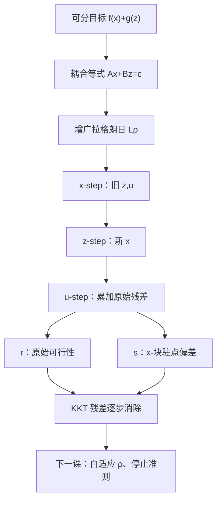

# 第31课：ADMM 的增广拉格朗日与三步更新

**2026-11-19｜第5周第3天｜讲授约18分钟（自测另计）**

上一课讨论块坐标下降及其在耦合约束下的停滞。本课处理 **min f(x)+g(z)，s.t. Ax+Bz=c**。我们要理解：固定二次罚函数为什么不够，ADMM 为什么交替更新 x、z 和对偶乘子，以及为什么原始残差和对偶残差都不可缺少。

## 一、模型与假设

考虑：

\[
\boxed{\min_{x,z} f(x)+g(z)\quad\text{s.t. } Ax+Bz=c.}
\]

其中 f、g 是真、下半连续、凸函数，允许非光滑。A、B 为维数匹配的线性映射，c 为约束右端。取固定正罚参数 \(\rho>0\)，并假设存在满足次梯度 KKT 的鞍点 \((x^*,z^*,y^*)\)，每个子问题能够精确求解。

最优性条件：

\[
\boxed{0\in\partial f(x^*)+A^\top y^*,\quad
0\in\partial g(z^*)+B^\top y^*,\quad
Ax^*+Bz^*=c.}\tag{1}
\]

这里 y 是**等式乘子**，可正可负；乘子非负与互补松弛只适用于 gᵢ(x)≤0 形式的不等式约束。

## 二、增广拉格朗日为什么比纯罚函数更合适？

如果单独最小化 f(x)+g(z)+(ρ/2)||Ax+Bz−c||²，固定有限 ρ 一般不能保证最终严格满足等式约束。ADMM 添加拉格朗日乘子项：

\[
\boxed{\mathcal L_\rho(x,z,y)=f(x)+g(z)
+y^\top(Ax+Bz-c)+\tfrac{\rho}{2}\|Ax+Bz-c\|^2.}\tag{2}
\]

其思想是：罚项抑制约束违反，乘子 y 根据违反量不断调整，从而推动整个 KKT 系统成立，而不是仅仅解一个固定罚函数。

## 三、三步 ADMM：从 unscaled 到 scaled

令 \(r=Ax+Bz-c\)。标准 unscaled ADMM 依次执行：

\[
\begin{aligned}
x^{k+1}&\in\arg\min_x\mathcal L_\rho(x,z^k,y^k),\\
z^{k+1}&\in\arg\min_z\mathcal L_\rho(x^{k+1},z,y^k),\\
y^{k+1}&=y^k+\rho r^{k+1}.
\end{aligned}\tag{3}
\]

顺序是 x 用旧 z，z 用新 x，乘子用新 x、新 z。它是 Gauss–Seidel 式交替更新。

引入 scaled dual \(u=y/\rho\)。配方：

\[
y^\top r+\tfrac{\rho}{2}\|r\|^2
=\tfrac{\rho}{2}\|r+u\|^2-\tfrac{\rho}{2}\|u\|^2.
\]

删去与 x、z 无关的最后一项，得到：

\[
\boxed{\begin{aligned}
x^{k+1}&\in\arg\min_x f(x)+\tfrac\rho2
\|Ax+Bz^k-c+u^k\|^2,\\
z^{k+1}&\in\arg\min_z g(z)+\tfrac\rho2
\|Ax^{k+1}+Bz-c+u^k\|^2,\\
u^{k+1}&=u^k+Ax^{k+1}+Bz^{k+1}-c.
\end{aligned}}\tag{4}
\]

**Scaled 变量不是原乘子：** 固定 ρ 时 \(y^k=\rho u^k\)。当约束为 x=z，取 A=I、B=−I、c=0。若 g(z)=λ||z||₁，则 z-step 是软阈值：

\[
\boxed{z^{k+1}=S_{\lambda/\rho}(x^{k+1}+u^k).}\tag{5}
\]

这说明 ADMM 直接复用了前几课的 Prox 算子。

## 四、原始残差与对偶残差对应什么？

定义：

\[
\boxed{r^{k+1}=Ax^{k+1}+Bz^{k+1}-c}\tag{6}
\]

为**原始残差**，衡量可行性。定义：

\[
\boxed{s^{k+1}=\rho A^\top B(z^{k+1}-z^k)}\tag{7}
\]

为**对偶残差**，衡量更新先后造成的 x-块驻点偏差。

由 x-step 最优性：

\[
0\in\partial f(x^{k+1})+
A^\top[y^k+\rho(Ax^{k+1}+Bz^k-c)].
\]

将 yᵏ⁺¹=yᵏ+ρrᵏ⁺¹ 代入：

\[
\boxed{0\in\partial f(x^{k+1})+A^\top y^{k+1}-s^{k+1}.}\tag{8}
\]

而 z-step 用新 x 更新，恰好有：

\[
\boxed{0\in\partial g(z^{k+1})+B^\top y^{k+1}.}\tag{9}
\]

所以：z-块驻点式已满足，x-块相差 s，等式可行性相差 r。**仅 r=0 绝不能推出完整 KKT。** 对一致性约束 x=z，s=−ρ(zᵏ⁺¹−zᵏ)，停止时通常检查范数。

## 五、核心收敛不等式：Lyapunov 下降

两块凸 ADMM 并不保证目标值每一轮下降。我们改用一个非负势函数。

记 \(\Delta z=z^{k+1}-z^k\)，\(b=B\Delta z\)，\(w=B(z^{k+1}-z^*)\)。由 (8)(9) 的凸次梯度不等式和鞍点最优性下界，可推得：

\[
\langle y^{k+1}-y^*,r^{k+1}\rangle
\le \rho\langle b,r^{k+1}-w\rangle.\tag{10}
\]

对 k≥1，由相邻两次 z-step 的最优性：
\(-B^\top y^{k+1}\in\partial g(z^{k+1})\)、\(-B^\top y^k\in\partial g(z^k)\)。
凸次微分单调性给出：

\[
\langle b,y^{k+1}-y^k\rangle\le0
\quad\Longrightarrow\quad
\boxed{\langle b,r^{k+1}\rangle\le0.}\tag{11}
\]

结合 (10)(11)：

\[
\langle y^{k+1}-y^*,r^{k+1}\rangle\le-\rho\langle b,w\rangle.
\]

定义：

\[
\boxed{
V^k=\frac1\rho\|y^k-y^*\|^2+\rho\|B(z^k-z^*)\|^2.}\tag{12}
\]

代入 \(y^k=y^{k+1}-\rho r^{k+1}\) 与 \(B(z^k-z^*)=w-b\)，展开平方距离：

\[
\boxed{
V^k-V^{k+1}
\ge \rho\|r^{k+1}\|^2+\rho\|B(z^{k+1}-z^k)\|^2,\quad k\ge1.}\tag{13}
\]

这是严谨的单调下降量，**不是** f(xᵏ)+g(zᵏ) 的单调下降。因为 V≥0，求和得两种残差平方可求和，从而：

\[
\boxed{r^k\to0,\quad s^k=\rho A^\top B(z^k-z^{k-1})\to0.}\tag{14}
\]

在两块凸、鞍点存在与精确求解等条件下，标准 ADMM 的目标值也趋近最优值。没有额外条件时，不能擅自声称线性收敛、唯一原始变量收敛，或将结论推广到任意非凸多块 ADMM。

## 六、数值迭代：一致性约束与软阈值

求：

\[
\boxed{\min_{x,z}\tfrac12(x-2)^2+|z|\quad\text{s.t. }x=z.}
\]

取 ρ=1、z⁰=u⁰=0。Scaled 三步成为：

\[
x^{k+1}=(2+z^k-u^k)/2,\quad
z^{k+1}=S_1(x^{k+1}+u^k),\quad
u^{k+1}=u^k+x^{k+1}-z^{k+1}.
\]

第一轮：x¹=1，z¹=0，u¹=1，r¹=1、s¹=0。
第二轮：x²=0.5，z²=0.5，u²=1，r²=0、s²=−0.5。
第三轮：x³=0.75，z³=0.75，u³=1，r³=0、s³=−0.25。

| 轮次 | x | z | u | 原始残差 r | 对偶残差 s |
|---:|---:|---:|---:|---:|---:|
| 1 | 1 | 0 | 1 | 1 | 0 |
| 2 | 0.5 | 0.5 | 1 | 0 | −0.5 |
| 3 | 0.75 | 0.75 | 1 | 0 | −0.25 |
| 最优 | 1 | 1 | 1 | 0 | 0 |

把 x=z=w 代回原问题得到 \(\min_w \frac12(w-2)^2+|w|\)，最优解 w*=1、目标值 1.5。注意第一轮的 f(x¹)+g(z¹)=0.5 **不是可行解的目标值**，不能凭此认为已经优于最优值。第二轮虽有 r²=0，但 s²≠0，仍未达到完整 KKT。

## 七、失败反例：固定罚参数不能取代乘子更新

只做固定 ρ=1 的二次罚最小化：

\[
\min_{x,z}\tfrac12(x-2)^2+|z|+\tfrac12(x-z)^2.
\]

在 (x,z)=(1,0) 处，x 导数为 (1−2)+(1−0)=0；z 方向次微分满足 0∈[-1,1]−1。目标凸，因此该点是全局极小点，但是 x−z=1≠0。**固定有限二次罚不确保可行；ADMM 则还更新乘子来逐步纠正可行性。**

## 八、KKT 补强：等式乘子和不等式乘子

等式 Ax+Bz=c 的乘子 y 不受符号限制，也没有互补松弛。不等式 g(w)≤0 的乘子 λ≥0，且 λg(w*)=0。两道对照题：

| 问题 | 最优点 | 活跃约束 | λ |
|---|---:|---|---:|
| min_{w≥0} ½(w+1)² | 0 | −w=0 | 1 |
| min_{w≥0} ½w² | 0 | −w=0 | 0 |

驻点分别为 w+1−λ=0 和 w−λ=0。两者的互补松弛都成立，因此**活跃不必有正乘子**。

## 九、知识关系图

## 十、下一讲

**2026-11-20，第32课：ADMM 的原始/对偶残差平衡、罚参数调整与停止准则。** 将讨论绝对和相对容差、自适应 ρ 时 scaled dual 的重标定，以及为什么经验性 residual balancing 不能被误称为具有无条件收敛保证。

---

## 十一、分级自测（100分）

**首次课堂不附答案，正确选项、数值解、开放题评分要点仅保存在独立 JSON。请勿提前查看，以免泄题。**

### Lv1｜ADMM 与 KKT 的概念辨析｜预计2分钟｜15分

考虑凸问题 min f(x)+g(z)，s.t. Ax+Bz=c，固定罚参数 ρ>0。以下哪项必然正确？

- A. 只要加入固定有限 ρ 的二次罚项，其极小点就必须严格满足 Ax+Bz=c。
- B. ADMM 完成每次 x、z 子问题更新后，就自动严格满足原始等式。
- C. 乘子更新 y⁺=y+ρ(Ax⁺+Bz⁺−c) 累计原始残差；原始、对偶残差分别用于检查可行性与驻点偏差。
- D. 只要原始残差 r=0，即使对偶残差 s≠0，也证明当前点已经满足完整 KKT。

*提示：区分二次罚函数与增广拉格朗日的乘子更新；r 与 s 检查不同的 KKT 条件。*

### Lv2｜Scaled ADMM 一步计算｜预计4分钟｜20分

求解 min ½(x−4)²+2|z|，s.t. x=z。取 ρ=2、z⁰=0、u⁰=0，u=y/ρ。进行一次 scaled ADMM：
x¹=argmin_x {½(x−4)²+(ρ/2)(x−z⁰+u⁰)²}，
z¹=S_{2/ρ}(x¹+u⁰)，
u¹=u⁰+x¹−z¹。
求**未缩放乘子 y¹=ρu¹**，只填写数值，保留三位小数。

*提示：先解一元二次问题，再用阈值 2/ρ 进行软阈值，最后将 u 乘以 ρ。*

### Lv3｜两轮 ADMM 与两类 KKT 残差｜预计6分钟｜25分

求解 min ½(x−3)²+2|z|，s.t. x=z。取 ρ=1、z⁰=u⁰=0。每轮：
x⁺=(3+z−u)/2，z⁺=S₂(x⁺+u)，u⁺=u+x⁺−z⁺。
定义 rᵏ=xᵏ−zᵏ，sᵏ=−ρ(zᵏ−zᵏ⁻¹)。完成两轮更新后，哪项正确？

- A. r²=0、s²=0，第二轮已经满足完整 KKT。
- B. r²=0.5、s²=−0.25、u²=2；原始等式仍未精确满足。
- C. r²=0.25、s²=0，说明所有驻点条件已经满足。
- D. r²=1、s²=+0.25，且 u²=0。

*提示：依次算 x¹,z¹,u¹，再算 x²,z²,u²；软阈值是 S₂，不是 S₁。*

### Lv4｜ADMM 推导、残差、Lyapunov 和活跃约束｜预计15分钟｜40分

假设 f,g 真、下半连续、凸，问题 min f(x)+g(z)，s.t. Ax+Bz=c 存在满足次梯度 KKT 的鞍点 (x*,z*,y*)，ρ>0，两个子问题均可精确求解。

A（10分）：从 Lρ=f(x)+g(z)+yᵀ(Ax+Bz−c)+(ρ/2)||Ax+Bz−c||² 配方，推出 scaled ADMM 的 x、z、u 三步更新。

B（10分）：定义 rᵏ⁺¹=Axᵏ⁺¹+Bzᵏ⁺¹−c 和 sᵏ⁺¹=ρAᵀB(zᵏ⁺¹−zᵏ)。由两步子问题最优性与 yᵏ⁺¹=yᵏ+ρrᵏ⁺¹，严格推导 0∈∂g(zᵏ⁺¹)+Bᵀyᵏ⁺¹，以及 0∈∂f(xᵏ⁺¹)+Aᵀyᵏ⁺¹−sᵏ⁺¹。

C（12分）：令 Vᵏ=(1/ρ)||yᵏ−y*||²+ρ||B(zᵏ−z*)||²。对 k≥1，用凸性、鞍点不等式、z-step 次梯度单调性和平方距离恒等式证明 Vᵏ−Vᵏ⁺¹≥ρ||rᵏ⁺¹||²+ρ||B(zᵏ⁺¹−zᵏ)||²。说明 rᵏ→0、sᵏ→0；指出该结论为何不等于任意非凸多块 ADMM 线性收敛。

D（8分）：证明 ρ=1 时纯罚函数 ½(x−4)²+2|z|+½(x−z)² 的 (x,z)=(2,0) 是不可行的全局最优点。再分别求 min_{w≥0}½(w+2)²、min_{w≥0}½w² 的活跃约束乘子并检查互补松弛。

*提示：A 用 y=ρu 配方；B 注意 s 的符号；C 首先得到 (y⁺−y*)ᵀr≤ρ⟨BΔz,r−B(z⁺−z*)⟩，再用 z-step 单调性；D 对 |z| 在 z=0 用次微分。*

**答题与反馈：** Lv1 15分、Lv2 20分、Lv3 25分、Lv4 40分。作答后按题评分，≥80 正常继续，60–79 补充针对性例题，<60 复习 KKT、scaled ADMM 与两种残差；不会改变日期与课号。
