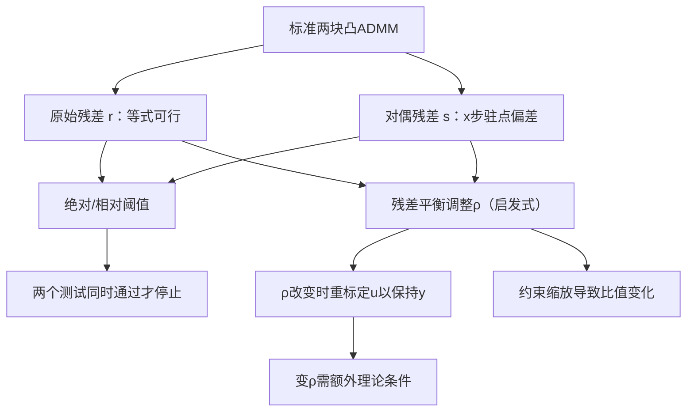

# 数学优化理论｜第32课：ADMM残差平衡、罚参数与停止准则

**2026年11月20日｜第5周·第4天｜讲授约18分钟，自测另计**

上一课从增广拉格朗日推导了ADMM的$x,z,u$三步更新。今天研究实际运行时三个关键问题：**什么时候停止？如何选择罚参数$\rho$？如果改变$\rho$，如何保证没有错误改变乘子？**

## 一、问题与理论假设

考虑两块凸问题：

$$
\min_{x\in\mathbb R^n,z\in\mathbb R^m} f(x)+g(z),
\qquad \text{s.t.}\ Ax+Bz=c.
$$

其中等式约束维数为$p$。假设$f,g$是真、下半连续、凸函数；两个ADMM子问题精确求解；存在原始—对偶KKT解$(x^*,z^*,y^*)$；标准理论使用固定$\rho>0$。KKT写成

$$
0\in\partial f(x^*)+A^Ty^*,\quad
0\in\partial g(z^*)+B^Ty^*,\quad
Ax^*+Bz^*=c.
$$

请先记住：**等式约束乘子$y$符号自由，不要求非负，也不使用不等式的互补松弛。**

## 二、ADMM三步与两种残差

固定$\rho$时，定义scaled dual $u^k=y^k/\rho$：

$$
\begin{aligned}
x^{k+1}&\in\arg\min_x f(x)+\frac\rho2\|Ax+Bz^k-c+u^k\|^2,\\
z^{k+1}&\in\arg\min_z g(z)+\frac\rho2\|Ax^{k+1}+Bz-c+u^k\|^2,\\
u^{k+1}&=u^k+Ax^{k+1}+Bz^{k+1}-c.
\end{aligned}
$$

两种标准残差为

$$
\boxed{r^{k+1}=Ax^{k+1}+Bz^{k+1}-c}
$$

和

$$
\boxed{s^{k+1}=\rho A^TB(z^{k+1}-z^k)}.
$$

$r\in\mathbb R^p$衡量原始约束是否满足，$s\in\mathbb R^n$衡量$x$-块KKT驻点条件的偏差。对一致性约束$x=z$，$A=I,B=-I,c=0$，于是$r=x-z$，$s=-\rho(z^k-z^{k-1})$。**注意$s$并不是乘子的增量；$y^{k+1}-y^k=\rho r^{k+1}$。**

## 三、严格推导KKT残差的含义

精确$x$-子问题给出

$$
0\in\partial f(x^{k+1})+
A^T\big[y^k+\rho(Ax^{k+1}+Bz^k-c)\big].
$$

由$y^{k+1}=y^k+\rho(Ax^{k+1}+Bz^{k+1}-c)$，括号等于$y^{k+1}-\rho B(z^{k+1}-z^k)$。因此

$$
\boxed{0\in\partial f(x^{k+1})+A^Ty^{k+1}-s^{k+1}}.\tag{1}
$$

精确$z$-子问题同理：

$$
\boxed{0\in\partial g(z^{k+1})+B^Ty^{k+1}}.\tag{2}
$$

式(1)(2)与$r^{k+1}=0$对比KKT，可知：**在凸与精确子问题假设下，若同一轮$r=s=0$，则当前原始—对偶点满足完整KKT，原始点全局最优。只有$r=0$则不够。**

| 检查量 | KKT意义 | 为零时保证 |
|---|---|---|
| $r=Ax+Bz-c$ | 原始等式可行性 | 耦合约束满足 |
| $s=\rho A^TB\Delta z$ | $x$-步驻点偏差 | 与新乘子兼容 |
| 精确$z$-步 | $z$-块驻点条件 | 已满足(2) |
| $r=s=0$ | 全部KKT | 凸情形全局最优 |

## 四、停止条件：绝对容差与相对容差

实际计算不会强求精确零。经典判停是**同时**满足

$$
\|r^k\|_2\le\varepsilon_{\rm pri},
\qquad
\|s^k\|_2\le\varepsilon_{\rm dual}.
$$

常用阈值（Boyd等，2011）：

$$
\boxed{
\varepsilon_{\rm pri}
=\sqrt p\,\varepsilon_{\rm abs}
+\varepsilon_{\rm rel}\max\{\|Ax^k\|_2,\|Bz^k\|_2,\|c\|_2\}
}\tag{3}
$$

$$
\boxed{
\varepsilon_{\rm dual}
=\sqrt n\,\varepsilon_{\rm abs}
+\varepsilon_{\rm rel}\|A^Ty^k\|_2.
}\tag{4}
$$

$\sqrt p$与$\sqrt n$对应两种残差的维数；相对项避免不同物理量级使用完全相同的绝对阈值。它们是**数值停止准则**，不是对所有问题都能独立给出严格目标误差百分比的证书。

## 五、四轮真实数值计算：原始残差为零还不能停

考虑

$$
\min\ \frac12(x-2)^2+|z|,\quad \text{s.t. }x=z.
$$

取$\rho=1,z^0=u^0=0$。软阈值$S_1(v)=\operatorname{sign}(v)\max(|v|-1,0)$，ADMM为

$$
x^{k+1}=\frac{2+z^k-u^k}{2},\quad
z^{k+1}=S_1(x^{k+1}+u^k),\quad
u^{k+1}=u^k+x^{k+1}-z^{k+1}.
$$

最优点$x^*=z^*=1$，最优值$F^*=1.5$。取示范用的**较宽松**容差$\varepsilon_{\rm abs}=0.05,\varepsilon_{\rm rel}=0.1$。因此$\varepsilon_{pri}=0.05+0.1\max(|x|,|z|)$，$\varepsilon_{dual}=0.05+0.1|y|$。

| 轮$k$ | $x$ | $z$ | $y$ | $r$ | $s$ | $\varepsilon_{pri}$ | $\varepsilon_{dual}$ | 停止 |
|---:|---:|---:|---:|---:|---:|---:|---:|---|
| 1 | 1 | 0 | 1 | 1 | 0 | .1500 | .1500 | 否 |
| 2 | .5 | .5 | 1 | 0 | −.5 | .1000 | .1500 | 否 |
| 3 | .75 | .75 | 1 | 0 | −.25 | .1250 | .1500 | 否 |
| 4 | .875 | .875 | 1 | 0 | −.125 | .1375 | .1500 | 是 |

第二轮已$r=0$，但$|s|=.5>.15$，所以**不能停止**。第四轮两项都通过，才按选定容差停止，此时原始目标为$1.5078125$，不是精确最优值$1.5$。

特别注意：第一轮$f(1)+g(0)=0.5<1.5$，原始目标竟比最优值还低！原因是第一轮$x\ne z$、点不可行。因此**不可行迭代的目标值不能被当作可行问题的最优性证明**。

## 六、把残差与最优值误差联系起来

由(1)(2)，选取

$$
\xi_f=-A^Ty^k+s^k\in\partial f(x^k),
\qquad
\xi_g=-B^Ty^k\in\partial g(z^k).
$$

对最优可行解$(x^*,z^*)$应用两个凸次梯度下界：

$$
\begin{aligned}
p^*&\ge f(x^k)+g(z^k)
+\xi_f^T(x^*-x^k)+\xi_g^T(z^*-z^k)\\
&=f(x^k)+g(z^k)+(y^k)^Tr^k-(s^k)^T(x^k-x^*).
\end{aligned}
$$

故

$$
\boxed{
f(x^k)+g(z^k)-p^*
\le -(y^k)^Tr^k+(x^k-x^*)^Ts^k.
}\tag{5}
$$

再由Cauchy–Schwarz，

$$
f(x^k)+g(z^k)-p^*
\le\|y^k\|\|r^k\|+\|x^k-x^*\|\|s^k\|.
$$

这解释了残差的意义，同时也解释其局限：若不知道$\|x^k-x^*\|$的上界，就不能单纯从小残差获得明确的严格数值目标误差界；当前点还可能不可行。

## 七、ρ应当怎么选？区分工程策略与定理

$\rho$影响二次约束惩罚的强度、两个子问题的条件数，以及对偶残差$s=\rho A^TB\Delta z$的尺度。$\rho$过小或过大都可能造成有限步计算慢，但并无所有问题通用的最优$\rho$。

经典**残差平衡启发式**为

$$
\rho_{k+1}=
\begin{cases}
\tau\rho_k,&\|r^k\|>\mu\|s^k\|,\\
\rho_k/\tau,&\|s^k\|>\mu\|r^k\|,\\
\rho_k,&\text{其余},
\end{cases}
\quad\mu>1,\tau>1.
$$

示例参数$\mu=10,\tau=2$只是经验设置。实践中也可以比较规范化比值$\|r\|/\varepsilon_{pri}$与$\|s\|/\varepsilon_{dual}$，但仍须考虑量纲和问题缩放。

**切勿将“残差平衡可能加快计算”写成“任意自适应$\rho$都继承固定$\rho$的收敛证明”。** 固定罚参数的标准两块凸ADMM渐近收敛；可变罚参数要额外控制更新或在一定轮数后固定。

## 八、改变ρ时必须同步重标定u

核心关系始终是$\boxed{y=\rho u}$。一次迭代结束后，若改变$\rho$但希望未缩放乘子$y$不突然跳变，则

$$
\boxed{
u_{new}=\frac{\rho_{old}}{\rho_{new}}u_{old}.
}\tag{6}
$$

例如旧$\rho=2,u=.75$，所以$y=1.5$。变成新$\rho=6$后应设$u=.25$；保留$.75$会令$y$虚假地变成$4.5$。

实现顺序应是：用本轮$\rho_k$完成原始变量与$y^{k+1}=y^k+\rho_k r^{k+1}$更新；再选新$\rho_{k+1}$，最后令$u^{k+1}=y^{k+1}/\rho_{k+1}$。这样避免把调参数误当成一次乘子梯度步。

## 九、失败反例：朴素残差比不具有尺度不变性

把一致性约束$x-z=0$乘以3，写成$3x-3z=0$。同时令$A'=3A,B'=3B,\rho'=\rho/9,y'=y/3$，则原始变量上的增广拉格朗日表达不变，原问题可行集也不变。但比较相同原始迭代点时：

$$
r'=3r,\qquad
s'=\rho'(A')^TB'\Delta z=s.
$$

因此$\|r'\|/\|s'\|$与原来不同。**朴素的残差平衡策略可以因为等价约束的单位变化而改变决策**。Wohlberg（2017）分析过这一尺度敏感缺陷，并提出改进思路。

## 十、KKT补强：活跃不等式乘子仍可为零

将约束写成$-w\le0$。比较两个问题：

| 问题 | 最优点 | 约束活跃 | 非负乘子 |
|---|---:|---|---:|
| $\min_{w\ge0}\frac12(w+2)^2$ | 0 | 是 | 2 |
| $\min_{w\ge0}\frac12w^2$ | 0 | 是 | 0 |

两者均满足驻点、可行性、非负乘子和互补松弛$\lambda(-w^*)=0$。**活跃约束并不必有正乘子**；ADMM等式乘子则无非负约束、无互补松弛要求。

## 十一、数学关系图

## 十二、四级自测（100分）

**首次课堂不附标准答案、正确选项或开放题评分细则。请先作答，不要提前打开独立测验JSON。**

### Lv1｜KKT 与停止条件｜15分｜预计2分钟

标准两块凸 ADMM 精确求解 x、z 子问题，令原始残差 r=Ax+Bz−c、对偶残差 s=ρAᵀB(z^k−z^{k−1})。哪项必然正确？

- A. 原始残差 r=0 就足以保证当前点全局最优。
- B. 同一轮 r=s=0 意味着本轮原始变量及未缩放乘子满足完整 KKT，凸情形下原始点全局最优。
- C. 两种残差低于任意自定容差就证明目标函数已精确达到最优值。
- D. 改变 ρ 时保持 u 不变也必然保持未缩放乘子 y 不变。

*提示：把 x-step、z-step 的最优性条件和原始等式一起看，区分残差精确为零和数值接近零。*

### Lv2｜scaled dual 重标定计算｜20分｜预计3分钟

某轮 ADMM 完成乘子更新后，旧罚参数 ρ_old=4，旧 scaled dual u_old=0.6。将罚参数改为 ρ_new=10，同时要求未缩放乘子 y 保持不变。求新的 u_new，保留三位小数。

**数值题：绝对误差容限0.001。**

*提示：由 y=ρu，先计算旧 y，再换算新的 u；不要再执行乘子更新。*

### Lv3｜约束缩放与残差平衡的反例｜25分｜预计5分钟

对约束 x−z=0，令 A=I、B=−I、罚参数 ρ、乘子 y。改写成 3x−3z=0，并选 ρ′=ρ/9、y′=y/3，以保证原始变量上的增广拉格朗日表达不变。比较相同相邻原始迭代点的残差 r、s，哪项正确？

- A. r′=r 且 s′=3s，因此原始残差不受缩放影响。
- B. r′=3r 且 s′=3s，因此原始/对偶残差比总保持不变。
- C. r′=3r 且 s′=s；直接按 ‖r‖/‖s‖ 做残差平衡对约束缩放不具有一般不变性。
- D. r′=r/3 且 s′=s/9，所以任意改变 ρ 都保证线性收敛。

*提示：分别代入 r=Ax+Bz−c 及 s=ρAᵀB(z^k−z^{k−1})；注意后者含两个线性算子。*

### Lv4｜残差—KKT 推导、停止容差、罚参数与互补松弛｜40分｜预计13分钟

标准两块 ADMM 问题：min f(x)+g(z)，s.t. Ax+Bz=c；设 f,g 真、下半连续、凸，子问题精确求解；固定 ρ>0 时存在 KKT 鞍点 (x*,z*,y*)，y^{k+1}=y^k+ρr^{k+1}。

A（12分）从两个子问题的次梯度最优性，严格推导 r^{k+1}=Ax^{k+1}+Bz^{k+1}−c、s^{k+1}=ρAᵀB(z^{k+1}−z^k) 对应的两条 KKT 驻点偏差关系，说明 r=s=0 时的结论。

B（10分）若等式约束维数为 p、x 的维数为 n，写出 ε_pri、ε_dual 的绝对/相对容差公式。证明 f(x^k)+g(z^k)−p*≤−(y^k)ᵀr^k+(x^k−x*)ᵀs^k，并解释为何小残差不自动给出已知严格数值最优值误差界。

C（10分）某轮完成后将 ρ_old 改为 ρ_new，要求未缩放乘子 y 不变。推导 u_new 与 u_old 关系；给出一个常用残差平衡更新规则，并说明其启发式属性与尺度敏感性。

D（8分）分别求 min_{w≥0} 0.5(w+2)^2 和 min_{w≥0} 0.5w^2。令 g(w)=−w≤0，求最优点、活跃约束、非负 KKT 乘子，验证驻点及互补松弛，并比较 ADMM 等式乘子的符号约束。

**开放题：按A、B、C、D分项作答。**

*提示：A 牢记 x-step 使用旧 z；B 对 f、g 分别写凸次梯度下界；C 保持 y=ρu；D 分开写各题的驻点方程。*

## 十三、下一讲

**第33课｜2026年11月21日｜第5周第5天：PDHG与原始—对偶鞍点法。** 将从$\min_x f(x)+g(Kx)$推导$\min_x\max_y$鞍点形式，理解Chambolle–Pock更新、Fenchel共轭、原始/对偶步长条件与残差。

作答后逐题评分，总分100：80分及以上正常推进；60–79分补充残差/罚参数计算；低于60分优先复习ADMM最优性条件、scaled dual和KKT。评分不改变日期课号。

参考资料：Boyd等（2011）https://stanford.edu/~boyd/papers/admm_distr_stats.html ；Wohlberg（2017）https://arxiv.org/abs/1704.06209 。
