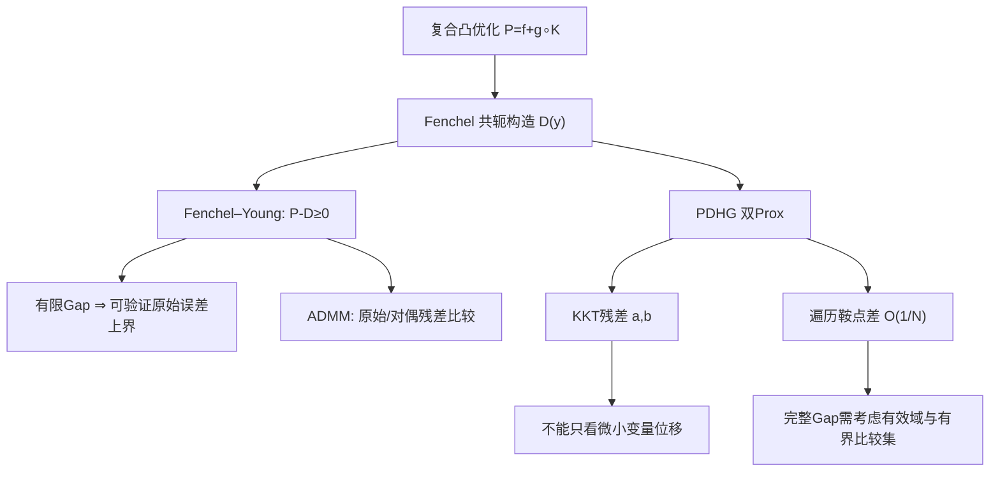

# 数学优化理论·第34课｜PDHG停止准则、原始—对偶Gap与ADMM比较

**2026-11-22｜第5周第6天｜讲授约18分钟（自测另计）**

上一讲推导了PDHG的Fenchel鞍点形式、双Prox更新，以及经典步长条件下的遍历鞍点间隙 \(O(1/N)\)。今天解决更实际的问题：**如何判断一次求解已经足够接近最优？为什么PDHG的Gap比单纯的迭代位移更像一份最优性证书？与ADMM的原始/对偶残差有什么不同？**

## 一、问题与假设

考虑有限维欧氏空间中的凸复合问题

\[
P^*=\min_x P(x),\qquad P(x)=f(x)+g(Kx),
\]

其中 \(f,g\) 为真、下半连续、凸函数，\(K\) 为线性映射。假设原始最优值有限且存在原始—对偶鞍点。若讨论PDHG的经典收敛定理，还要求两次Prox精确计算、固定正步长 \(\tau,\sigma\)、外推 \(\theta=1\) 及 \(\tau\sigma\|K\|^2<1\)。

注意：这些假设支持的是原始—对偶鞍点方法的收敛；**有限、可计算的完整Fenchel Gap另有共轭有效域条件**，不能仅凭鞍点存在就假定每一个迭代点都有有限Gap。

## 二、从Fenchel共轭推导可验证的Gap

由 \(g=g^{**}\)，

\[
g(Kx)=\sup_y\{\langle Kx,y\rangle-g^*(y)\}.
\]

构造鞍点函数

\[
\mathcal L(x,y)=f(x)+\langle Kx,y\rangle-g^*(y).
\]

对固定 \(y\)，把 \(x\) 消去：

\[
\begin{aligned}
D(y)&=\inf_x\mathcal L(x,y)\\
&=-f^*(-K^\top y)-g^*(y).
\end{aligned}
\]

这是Fenchel对偶目标；最大化 \(D(y)\) 给出对偶问题。**当且仅当 \(f^*(-K^\top y)\) 与 \(g^*(y)\) 都有限时，\(D(y)\) 才是有限的下界。**

定义完整Fenchel原始—对偶间隙：

\[
\boxed{\mathcal G(x,y)=P(x)-D(y)
=f(x)+g(Kx)+f^*(-K^\top y)+g^*(y).}
\]

它可以拆成两项：

\[
\begin{aligned}
\mathcal G(x,y)
={}&\underbrace{f(x)+f^*(-K^\top y)+\langle Kx,y\rangle}_{\ge0}\\
&+\underbrace{g(Kx)+g^*(y)-\langle Kx,y\rangle}_{\ge0}.
\end{aligned}
\]

每项非负都来自Fenchel–Young不等式：

\[
h(v)+h^*(w)\ge\langle v,w\rangle.
\]

因此只要 \(P(x)\)、\(D(y)\) 有限，

\[
\boxed{0\le P(x)-P^*\le P(x)-D(y)=\mathcal G(x,y).}
\]

**这是一份严格的目标函数误差上界证书**，不需要知道未知的 \(P^*\)。还可得 \(P^*-D(y)\le\mathcal G(x,y)\)。若完整Gap为零，两项Fenchel–Young余量同时为零，因而满足原始—对偶KKT包含式。

实际停止规则之一是：在可计算且有限的情况下，同时满足绝对阈值 \(\mathcal G\le\varepsilon_{\rm abs}\)，或使用有明确量纲和缩放解释的相对阈值。相对Gap的具体归一化并不是普遍唯一的，必须记录所使用的定义。存在约束指标函数时，**不可行点的 \(P(x)\) 可以是 \(+\infty\)**。

## 三、PDHG的可计算KKT残差

经典dual-first PDHG为

\[
\begin{aligned}
y^{k+1}&=\operatorname{prox}_{\sigma g^*}(y^k+\sigma K\bar x^k),\\
x^{k+1}&=\operatorname{prox}_{\tau f}(x^k-\tau K^\top y^{k+1}),\\
\bar x^{k+1}&=2x^{k+1}-x^k.
\end{aligned}
\]

从原始Prox最优性：

\[
\frac{x^k-x^{k+1}}\tau-K^\top y^{k+1}
\in\partial f(x^{k+1}).
\]

因此可以直接选取

\[
\boxed{a^{k+1}=\frac{x^k-x^{k+1}}\tau
\in\partial f(x^{k+1})+K^\top y^{k+1}.}
\]

对偶Prox最优性：

\[
\frac{y^k-y^{k+1}}\sigma+K\bar x^k
\in\partial g^*(y^{k+1}),
\]

因此

\[
\boxed{b^{k+1}=\frac{y^k-y^{k+1}}\sigma
+K(\bar x^k-x^{k+1})
\in\partial g^*(y^{k+1})-Kx^{k+1}.}
\]

鞍点KKT恰好要求：

\[
0\in\partial f(x^*)+K^\top y^*,\qquad
0\in\partial g^*(y^*)-Kx^*.
\]

所以 \(\|a^{k+1}\|\)、\(\|b^{k+1}\|\) 提供**具体的KKT残差候选向量的上界检查**；残差趋零指向驻点性，但有限容差通常不能单独转换成已知目标值误差界，除非另有误差界/有界性条件。

尤其不要只看 \(\|x^{k+1}-x^k\|\)：很小的步长会让未归一化位移很小，而 \(a^{k+1}=(x^k-x^{k+1})/\tau\) 仍可很大。

## 四、为什么理论中的 \(O(1/N)\) 与当前Gap不是一回事？

在上述凸性、鞍点存在、\(\theta=1\)、\(\tau\sigma\|K\|^2<1\) 条件下，令

\[
X_N=\frac1N\sum_{k=1}^Nx^k,\qquad
Y_N=\frac1N\sum_{k=1}^Ny^k.
\]

利用两次Prox的次梯度不等式、三点平方恒等式，以及

\[
\langle K\Delta x,\Delta y\rangle
\le\frac{\|\Delta x\|^2}{2\tau}
+\frac{\tau\|K\|^2}{2}\|\Delta y\|^2,
\]

通过外推项的望远镜求和，可对任何固定的有效比较点 \(x,y\) 得到

\[
\boxed{
\mathcal L(X_N,y)-\mathcal L(x,Y_N)
\le\frac1N\left[
\frac{\|x-x^0\|^2}{2\tau}
+\frac{\|y-y^0\|^2}{2\sigma}
\right].
}
\]

更具体地，一步推导先产生距离平方差与交叉项
\(\langle K(\bar x^k-x^{k+1}),y^{k+1}-y\rangle\)；
利用 \(\bar x^k-x^{k+1}=\Delta x^k-\Delta x^{k+1}\)，拆成相邻交叉项差与
\(\langle K\Delta x^k,\Delta y^{k+1}\rangle\)。后者由上面的Young不等式控制；严格步长条件使剩余二次项非负，求和望远镜后得到上界，再用Jensen不等式转为遍历平均点。

这个定理控制的是**固定比较点的鞍点差**，不是自动控制任意最后一步 \(\mathcal G(x^N,y^N)\)。

若把比较点限制在有界有效集合 \(X,Y\)，可进一步定义受限Gap：

\[
\mathcal G_{X,Y}(X_N,Y_N)=
\sup_{y\in Y}\mathcal L(X_N,y)
-\inf_{x\in X}\mathcal L(x,Y_N).
\]

对有界 \(X,Y\) 取上确界，可得

\[
\boxed{
\mathcal G_{X,Y}(X_N,Y_N)
\le\frac{R_X^2/(2\tau)+R_Y^2/(2\sigma)}{N},
}
\]

其中 \(R_X=\sup_{x\in X}\|x-x^0\|\)、\(R_Y=\sup_{y\in Y}\|y-y^0\|\)。如果把比较集合扩大到整个无界空间，这个常数可能无穷大，**不能简单宣称完整Fenchel Gap总有相同的有限 \(O(1/N)\) 上界**。

## 五、完整数值算例：计算一份真正的Gap证书

研究

\[
P(x)=\tfrac12(x-3)^2+|x|,
\quad f(x)=\tfrac12(x-3)^2,\quad g(t)=|t|,\quad K=1.
\]

共轭与对偶目标：

\[
f^*(s)=3s+\tfrac12s^2,\qquad
g^*(y)=\delta_{[-1,1]}(y),
\]

\[
D(y)=3y-\tfrac12y^2,\quad |y|\le1.
\]

最优点为 \(x^*=2\)，最优值 \(P^*=2.5\)，最优对偶点 \(y^*=1\)。

使用 \(\tau=\sigma=0.5,\theta=1,x^{-1}=x^0=y^0=0\)：

\[
y^{k+1}=\Pi_{[-1,1]}(y^k+0.5(2x^k-x^{k-1})),
\]

\[
x^{k+1}=\frac{x^k-0.5y^{k+1}+1.5}{1.5}.
\]

第1轮：\(y^1=0,x^1=1\)。

第2轮：外推 \(2x^1-x^0=2\)，所以 \(y^2=1,\ x^2=4/3\)。

第3轮：外推 \(2x^2-x^1=5/3\)，得到 \(y^3=1,\ x^3=14/9\)。

|轮次|原始 \(x^k\)|对偶 \(y^k\)|\(P(x^k)\)|\(D(y^k)\)|Gap|
|---:|---:|---:|---:|---:|---:|
|0|0|0|4.500000|0|4.500000|
|1|1|0|3.000000|0|3.000000|
|2|1.333333|1|2.722222|2.500000|0.222222|
|3|1.555556|1|2.598765|2.500000|0.098765|

第3轮已得到**无需知道最优值就可验证**的结论：

\[
0\le P(x^3)-P^*\le0.098765.
\]

本例Gap逐步缩小，但标准PDHG并不要求每一步完整Gap都单调下降。

## 六、ADMM 与 PDHG：怎样选择？

|比较维度|ADMM|PDHG（Chambolle–Pock）|
|---|---|---|
|典型问题| \(\min f(x)+g(z),\ Ax+Bz=c\)|\(\min f(x)+g(Kx)\)|
|每步计算|两块增广拉格朗日子问题+乘子更新| \(\operatorname{prox}_f,\operatorname{prox}_{g^*},K,K^\top\)|
|耦合处理|增广二次项，有时需解线性系统|显式算子乘法，不必显式求 \(K^\top K\) 的逆|
|停止指标|约束残差 \(r\)、对偶驻点残差 \(s\)|Fenchel Gap（有限时）与两条KKT残差|
|标准理论条件|凸两块、鞍点存在、固定 \(\rho>0\)、子问题精确可解|凸、鞍点存在、Prox精确、\(\theta=1,\tau\sigma\|K\|^2<1\)|
|典型结论|目标值及KKT残差渐近收敛|遍历鞍点差 \(O(1/N)\)，迭代点在经典条件下收敛|

这不是“PDHG必定比ADMM快”或相反的比较。若ADMM的子问题具有闭式解，可能非常高效；若 \(K\) 大且稀疏、矩阵乘法便宜但线性系统昂贵，PDHG通常更有吸引力。具体性能应比较**每步成本×迭代次数、预处理、内存与需要的精度**，不能只比较迭代轮数。

## 七、两个失败反例

**反例一：原始点已接近最优，完整Gap却可能为无穷大。**

取 \(f(x)=0,\ g(t)=|t|,\ K=1\)，原问题是 \(\min_x|x|\)，最优点为0。虽然 \(g^*(y)=\delta_{[-1,1]}(y)\)，但 \(f^*(s)=\delta_{\{0\}}(s)\)。例如 \(x=0.01,y=0.1\)，原始目标值仅0.01，但 \(-K^\top y\ne0\)，故 \(f^*(-K^\top y)=+\infty\)，于是 \(D(y)=-\infty\)、完整Gap为 \(+\infty\)。此时应使用有效域修正、受限Gap或KKT残差，不可把无穷Gap误写为0.01。

**反例二：很小的迭代位移不代表接近最优。**

对 \(\tfrac12(x-3)^2+|x|\) 从 \(x^0=10,y^0=0\) 出发，如果取 \(\tau=\sigma=10^{-6}\)，第一步变量更新可以非常小，但初始原始目标值为34.5，远高于最优值2.5。未除以步长的位移“很小”，只是步长选得极小；必须看归一化的KKT残差及可计算的Gap。

## 八、KKT补强：活跃约束与乘子

Fenchel对偶变量不总是非负；只有相应共轭有效域出现单侧约束时，才产生非负乘子。例如 \(g(t)=\delta_{(-\infty,0]}(t)\) 时 \(g^*(y)=\delta_{[0,\infty)}(y)\)。

对 \(\min_{x\le0}\tfrac12(x-2)^2\)，最优点 \(x^*=0\)，驻点 \(x^*-2+\lambda=0\) 得到 \(\lambda^*=2\)。对 \(\min_{x\le0}\tfrac12x^2\)，最优点同样在边界 \(x^*=0\)，但乘子 \(\lambda^*=0\)。两者都满足 \(\lambda\ge0,\ x\le0,\ \lambda x=0\)。

\[
\boxed{\text{约束活跃 }(g_i(x^*)=0)\ \not\Rightarrow\ \lambda_i^*>0.}
\]

## 九、知识关系图

## 十、四级自测（100分，首次不公布答案）

### Lv1｜Fenchel Gap 的必要条件与弱对偶（15分，预计2分钟）

设原始目标 \(P(x)=f(x)+g(Kx)\)、Fenchel 对偶目标 \(D(y)=-f^*(-K^\top y)-g^*(y)\)。假设原问题最优值 \(P^*\) 有限且存在，且所讨论的 \(P(x)\)、\(D(y)\) 都是有限实数。以下哪项一定正确？

**A.** \(P(x)-D(y)\ge0\)，且 \(P(x)-P^*\le P(x)-D(y)\)。

**B.** 只有当 \(y\) 已是最优对偶解，才能保证 \(P(x)-D(y)\ge0\)。

**C.** 只要 \(P(x)-D(y)\) 有限，它就必定等于零。

**D.** 只要 PDHG 连续两步的变量变化很小，就能保证 \(P(x)-P^*\) 很小，而不需要检查步长和残差。

**提示：** 分别利用 Fenchel–Young 不等式与弱对偶 D(y)≤P*。

### Lv2｜两轮PDHG与原始—对偶Gap计算（20分，预计4分钟）

考虑 \(P(x)=\tfrac12(x-4)^2+|x|\)，对应 \(f(x)=\tfrac12(x-4)^2,\ g(t)=|t|,\ K=1\)。令 \(\tau=\sigma=0.5,\ \theta=1,\ x^{-1}=x^0=y^0=0\)。执行两次 dual-first PDHG：\(y^{k+1}=\Pi_{[-1,1]}(y^k+\sigma(2x^k-x^{k-1}))\)，\(x^{k+1}=(x^k-\tau y^{k+1}+4\tau)/(1+\tau)\)。设 \(D(y)=4y-\tfrac12y^2\)（当 \(|y|\le1\) 时）。求第二轮的 Fenchel 原始—对偶 Gap \(P(x^2)-D(y^2)\)，保留三位小数。

**提示：** 先按旧原始变量的外推值算 y，再算 x；第二轮外推需要 2x¹−x⁰。计算 P 与 D 后相减。

### Lv3｜Fenchel有效域失败反例（25分，预计5分钟）

考虑 \(f(x)=0,\ g(t)=|t|,\ K=1\)，原问题为 \(\min_x|x|\)。给定 \(x=0.01,\ y=0.1\)。关于完整 Fenchel Gap \(P(x)-D(y)\) 的计算，下列哪项正确？

**A.** 因为 \(y\in[-1,1]\)，所以必有 \(D(y)=0\)，Gap 为 \(0.01\)。

**B.** 因为 \(x\) 已非常接近最优点，完整 Fenchel Gap 必定有限且很小。

**C.** \(f^*(s)=\delta_{\{0\}}(s)\)；由于 \(-K^\top y\ne0\)，\(D(y)=-\infty\)，完整 Gap 并不是有限的数值证书。

**D.** 由于 \(g(t)=|t|\) 不是凸函数，所以这里不能应用 Fenchel 共轭。

**提示：** 分别计算零函数 f 的共轭以及绝对值函数 g 的共轭；别只检查 y 是否落在 g* 的有效域内。

### Lv4｜Gap证书、残差、活跃乘子及算法比较（40分，预计15分钟）

完成以下四部分证明与建模（A 12分、B 10分、C 10分、D 8分），明确假设。

**A（12分，Fenchel 证书）** 对真、下半连续、凸 \(f,g\) 和线性 \(K\)，推导 \(P(x)=f(x)+g(Kx)\) 的 Fenchel 对偶 \(D(y)=-f^*(-K^\top y)-g^*(y)\)；将 \(P(x)-D(y)\) 分解为两项非负的 Fenchel–Young 余量。证明只要 \(P(x),D(y)\) 有限，就有 \(0\le P(x)-P^*\le P(x)-D(y)\)。

**B（10分，PDHG KKT 残差）** 对 dual-first PDHG：\(y^{k+1}=\operatorname{prox}_{\sigma g^*}(y^k+\sigma K\bar x^k)\)、\(x^{k+1}=\operatorname{prox}_{\tau f}(x^k-\tau K^\top y^{k+1})\)，推导两个可计算向量 \(a^{k+1}\in\partial f(x^{k+1})+K^\top y^{k+1}\) 与 \(b^{k+1}\in\partial g^*(y^{k+1})-Kx^{k+1}\)。解释为什么单看 \(\|x^{k+1}-x^k\|\) 很小不足以保证最优。

**C（10分，不等式约束与活跃乘子）** 将 \(\min_{x\le1}\frac12(x-2)^2\) 写成 \(f(x)+g(Kx)\)，求 \(f^*,g^*,D(y)\) 及对偶变量的符号约束；写出最优点、KKT 乘子与互补松弛，计算候选 \(x=1,y=0.5\) 的完整 Gap。再说明为何 \(\min_{x\le1}\frac12(x-1)^2\) 的活跃约束也可能有零乘子。

**D（8分，算法比较与失败模式）** 比较凸两块 ADMM 与经典 PDHG 在问题形式、单步计算代价、停止证书和基本收敛假设上的区别。给出一个使完整 Fenchel Gap 为无穷大的情形，或一个使“迭代位移很小”误判收敛的例子，并解释应如何检查。

**提示：** A 使用两次 Fenchel–Young；B 展开两次 Prox 的最优性包含式；C 的 g 为半直线指标函数，K=1；D 分清残差是驻点检验而 Gap 可提供函数值证书。

## 十一、下一讲与评分规则

**第35课｜2026-11-23｜第5周第7天：第五周复盘——坐标/块坐标、ADMM、PDHG与KKT证书。**

复盘将重点辨别：可分与耦合结构、块下降的充分条件、ADMM两种残差、Fenchel对偶及PDHG的Gap，避免把经验调参误认作收敛定理。

首次课堂不附标准答案。提交四题后按15/20/25/40分评分：80分及以上正常继续；60–79分补充对应例题；低于60分优先复习Fenchel–Young、Prox最优性、活跃约束与KKT乘子。成绩不改变日期课号。

**延伸阅读：** Chambolle–Pock 原始—对偶方法及收敛理论；Chambolle 与 Pock，《An Introduction to Continuous Optimization for Imaging》（2016）；Boyd 等，《Distributed Optimization and Statistical Learning via the Alternating Direction Method of Multipliers》（2011）。公开参考：https://www.cambridge.org/core/services/aop-cambridge-core/content/view/1115AA7E36FC201E811040D11118F67F/S096249291600009Xa.pdf/an-introduction-to-continuous-optimization-for-imaging.pdf 和 https://stanford.edu/~boyd/papers/admm_distr_stats.html 。

**归档说明：** 本文件仅有讲义与自测题，不包含答案；答案与开放题评分要点独立存于 microcourses/quizzes/opt-034.json 。
