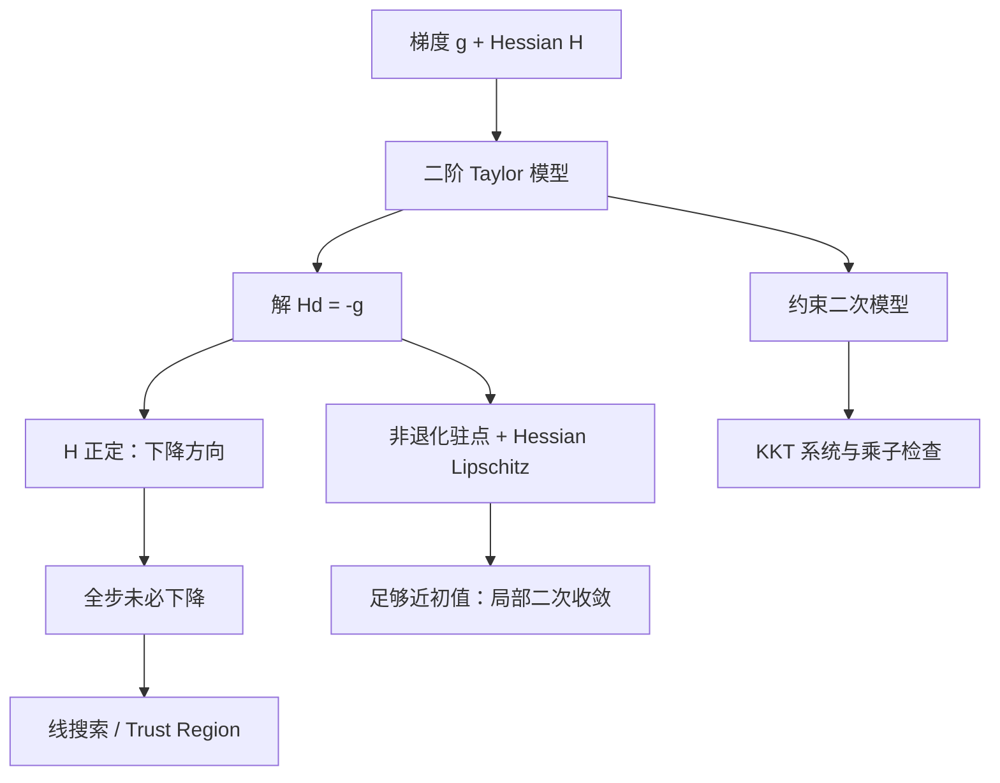

# 第36课｜Newton 法：二阶模型、Newton 方向与局部二次收敛

**2026-11-24｜第6周第1天｜讲授约16分钟（自测另计）。**

前五周主要利用一阶信息、Prox 和分裂。今天进入二阶优化：用局部曲率决定方向及尺度，而不仅沿负梯度移动。重点是区分下降方向、全步下降和局部二次收敛。

## 一、问题与二阶模型

考虑无约束问题 $\min_{x\in\mathbb R^n}f(x)$，设 $f\in C^2$。记 $g=\nabla f(x)$，$H=\nabla^2 f(x)$。二阶 Taylor 模型为

$$
m_x(d)=f(x)+g^Td+\tfrac12d^THd,\qquad
f(x+d)=m_x(d)+o(\|d\|^2).
$$

若 $H\succ0$，模型严格凸，唯一极小点满足 $Hd=-g$，于是

$$
d_N=-H^{-1}g,\qquad x^+=x+d_N.
$$

实现时应求解线性方程而非显式求逆。若 $g\ne0$，则 $g^Td_N=-g^TH^{-1}g<0$，因此存在足够小的正步长使真实目标下降；这不保证全步长 1 下降。模型预测下降为

$$
m_x(0)-m_x(d_N)=\tfrac12g^TH^{-1}g.
$$

若 $H$ 可逆但不正定，方程仍可能可解，却未必产生下降方向或模型极小点。

| 方法 | 方向 | 曲率利用 | 典型保证 |
|---|---|---|---|
| GD | $-g$ | 标量步长 | 强凸且 Smooth 时线性函数值收敛 |
| Newton | 解 $Hd=-g$ | 各方向曲率 | 非退化解附近、Hessian Lipschitz 时全步局部二次收敛 |

例如 $f(x)=\tfrac12(x_1^2+100x_2^2)$，Newton 从任意点一步到零；GD 用 $1/100$ 的步长时，第一坐标每轮乘以 0.99。对严格凸二次函数，Taylor 模型精确，所以 Newton 一步到解。一般函数的 Hessian 会变化，不能照搬。

## 二、严格局部二次收敛定理

设 $x^*$ 为驻点，$H(x^*)\succeq\mu I$（$\mu>0$），且闭球 $B(x^*,R)$ 内 Hessian 在谱范数下满足

$$
\|H(u)-H(v)\|\le M\|u-v\|,\quad M>0.
$$

$H(x^*)\succ0$ 使驻点为严格局部极小点；不要求全局凸。取 $r=\min\{R,\mu/(2M)\}$。对球内 $x$，记 $e=x-x^*$。对任意向量 $v$，

$$
v^TH(x)v\ge(\mu-M\|e\|)\|v\|^2\ge\tfrac\mu2\|v\|^2.
$$

故 $H(x)$ 可逆且 $\|H(x)^{-1}\|\le2/\mu$。

沿 $x^*$ 到 $x$ 积分梯度（$\nabla f(x^*)=0$）：

$$
\nabla f(x)=\int_0^1 H(x^*+te)e\,dt.
$$

代入 Newton 更新：

$$
\begin{aligned}
e^+&=e-H(x)^{-1}\nabla f(x)\\
&=H(x)^{-1}\int_0^1[H(x)-H(x^*+te)]e\,dt.
\end{aligned}
$$

由 Hessian Lipschitz 与逆范数界，

$$
\begin{aligned}
\|e^+\|&\le \tfrac2\mu\int_0^1 M(1-t)\|e\|^2dt\\
&=\tfrac M\mu\|e\|^2.
\end{aligned}
$$

又因 $\|e\|\le r\le\mu/(2M)$，故 $\|e^+\|\le\tfrac12\|e\|\le r$。归纳可知全步 Newton 一直留在球内并趋向 $x^*$，且满足二次误差界

$$
\boxed{\|x^{k+1}-x^*\|\le(M/\mu)\|x^k-x^*\|^2.}
$$

若 $q_k=(M/\mu)\|e_k\|$，则 $q_{k+1}\le q_k^2$，进而 $q_k\le q_0^{2^k}$。这就是精度在局部快速增长的原因。它是误差上界，实际也可能更快；不是从任意初值出发的全局保证。仅 Hessian 连续且非退化通常可得局部超线性，Lipschitz 提供上述二次界。

## 三、数值迭代

取全局强凸的标量函数 $f(x)=x^2/2+x^3/6+x^4/4$。

$$
g=x+x^2/2+x^3,\qquad H=1+x+3x^2\ge11/12.
$$

唯一最优点为0。取 $x^0=1$：

第一步 $g(1)=5/2,H(1)=5$，得到 $x^1=1/2$。

第二步 $g(1/2)=3/4,H(1/2)=9/4$，得到 $x^2=1/6$。

第三步 $g(1/6)=5/27,H(1/6)=5/4$，得到 $x^3=1/54$。

| k | x | 绝对误差 | 本轮误差/上轮误差平方 |
|---|---:|---:|---:|
| 0 | 1 | 1 | — |
| 1 | 1/2 | 0.5 | 0.5 |
| 2 | 1/6 | 0.166667 | 0.666667 |
| 3 | 1/54 | 0.018519 | 0.666667 |

精确递推为 $x^+=x^2(1/2+2x)/(1+x+3x^2)$，所以接近零时误差比 $\lvert e^+\rvert/\lvert e\rvert^2$ 趋于 1/2。数值体现局部二次收敛，但不是一般证明的替代。

## 四、失败反例：正定 Hessian 也不保证全步全局收敛

$f(x)=\sqrt{1+x^2}$ 严格凸，唯一最优点为0，且

$$
f'(x)=x/\sqrt{1+x^2},\quad f''(x)=(1+x^2)^{-3/2}>0.
$$

全步 Newton 给出 $x^+=x-x(1+x^2)=-x^3$。从2出发，序列为 $2,-8,512,-134217728,\ldots$，绝对值发散。每个非零点的 Newton 方向都是下降方向，但全步过大。正定性并不等于全局化。

另外，$f(x)=x^4/4-x^2/2$ 在0处梯度为零、Hessian 为−1；Newton 求驻点不等于求极小点。

工程中的全局化方向包括 Armijo 回溯（选择 $\alpha>0$ 使 $f(x+\alpha d)\le f(x)+c\alpha g^Td$，$0<c<1$）、修改 Hessian 保证正定、信赖域限制步长。对下降方向，足够小的正步长满足 Armijo；完整全局收敛结论仍需要附加条件。下一讲详述。

## 五、KKT 补强：约束 Newton 不能忽略可行性

有等式 $Ax=b$ 时，当前可行点上的二次模型还需 $Ad=0$。其 KKT 系统为

$$
\begin{bmatrix}H&A^T\\A&0\end{bmatrix}
\begin{bmatrix}d\\\nu\end{bmatrix}=
\begin{bmatrix}-g\\0\end{bmatrix}.
$$

若 $H\succ0$、$A$ 满行秩，系统非奇异；等式乘子无符号限制。

对不等式 $w\ge0$，统一写成 $-w\le0$。最小化 $(w+2)^2/2$ 时 $w^*=0,\lambda=2$；最小化 $w^2/2$ 时同为 $w^*=0$，却有 $\lambda=0$。两者均满足驻点、非负乘子及 $\lambda(-w)=0$。活跃约束不意味着严格正乘子；把活跃约束当等式求解后，还要检查原不等式乘子的符号。

## 六、关系图

## 七、四级自测（100分）

首次课堂不提供标准答案；不要提前打开独立 JSON。

### Lv1｜Newton 方向与正定性｜15分｜预计2分钟

设 g=∇f(x)≠0，H=∇²f(x) 对称且可逆，Newton 方向 d=−H⁻¹g。下列哪项必然正确？

A. H 可逆就足以保证 d 是下降方向。

B. H 正定时 gᵀd<0；但这并不保证任意全步长都使真实目标下降。

C. H 不正定时 Newton 方程一定无解。

D. H 正定就足以保证从任意初值二次收敛。

提示：区分方向导数的符号与有限步长的函数值变化。

### Lv2｜二阶模型预测下降量｜20分｜预计4分钟

当前点梯度 g=(2,−3)ᵀ，Hessian H=[[4,1],[1,2]]。解 Hd=−g，计算二次模型的预测下降量 −gᵀd−dᵀHd/2。只填数值。

绝对误差容限 0.001。

提示：先解二元线性方程，再利用 Hd=−g 简化预测下降量。

### Lv3｜退化 Hessian 与收敛阶｜25分｜预计5分钟

对 f(x)=x⁴，从 x⁰=1 做全步 Newton 法。关于迭代与局部收敛条件，哪项正确？

A. 每一步 x^{k+1}=x^k/2，因此二次收敛。

B. 因为 f 严格凸，Newton 法必在有限步到达零。

C. 每一步 x^{k+1}=2x^k/3，收敛是线性的；最优点 Hessian 为零，非退化局部二次收敛定理不适用。

D. 因为最优点 Hessian 不可逆，所有非零点的 Newton 步也不存在。

提示：计算一阶、二阶导数之比，再看误差比值和最优点 Hessian。

### Lv4｜局部二次收敛证明与 KKT 建模｜40分｜预计12分钟

A（24分）：设 f∈C²，∇f(x*)=0，H(x*)⪰μI，μ>0；闭球 B(x*,R) 内 Hessian 在谱范数下 M-Lipschitz（M>0）。取 r=min{R,μ/(2M)}。证明球内 H(x)⪰(μ/2)I，写出 Newton 误差的积分表达，推出 ‖x⁺−x*‖≤(M/μ)‖x−x*‖²，并证明从球内出发迭代保持在球内且局部二次收敛。B（16分）：求解 min ½[(x−3)²+(y−1)²]，约束 x+y≤2、y≥0。将约束写成 ≤0 形式，求最优点及两个乘子，逐项验证 KKT，并解释为何一个活跃约束的乘子可为零。

提示：A 沿 x* 到 x 的线段积分梯度，比较 H(x) 和线段上的 Hessian；B 先考虑仅有 x+y≤2 时的最优点，再检查 y≥0。

## 八、下一讲

第37课（2026-11-25）：阻尼 Newton、Armijo 回溯及从全局下降恢复局部全步。评分规则：80分及以上继续；60–79分补充曲率与误差递推例题；低于60分复习 Taylor、正定矩阵、KKT；不改变日期课号。
