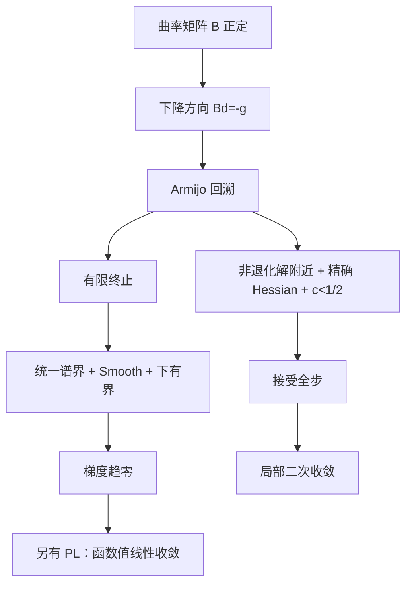

# 第37课｜阻尼 Newton、Armijo 回溯与全局化

**2026-11-25｜第6周第2天｜讲授约16分钟，自测另计。**

上一讲证明了 Newton 法在非退化极小点附近的二次收敛，但全步可能在远处发散。今天学习如何在远处安全下降、近处恢复全步。这里的“全局收敛”首先指从任意允许的初值出发趋向一阶驻点，不等于非凸全局最优。

## 一、方向与步长分离

考虑无约束问题 $\min_x f(x)$，$f\in C^2$。令 $g_k=\nabla f(x^k)$，$H_k=\nabla^2 f(x^k)$。使用对称正定的曲率矩阵 $B_k$：

$$
B_kd_k=-g_k,\qquad x^{k+1}=x^k+\alpha_kd_k.
$$

$B_k=H_k$ 时为精确阻尼 Newton（要求当前 Hessian 正定）；也可使用正定修正或近似矩阵。若 $g_k\ne0$，则 $g_k^Td_k=-g_k^TB_k^{-1}g_k<0$。方向是下降方向，但 $\alpha=1$ 未必下降。实现时求解线性系统，不显式求逆。

## 二、Armijo 充分下降与回溯

选 $c\in(0,1)$，$\beta\in(0,1)$，每轮从 $\alpha=1$ 开始，若

$$
f(x+\alpha d)\le f(x)+c\alpha g^Td
$$

不成立，则 $\alpha\leftarrow\beta\alpha$，直到成立。常见参数如 $c=10^{-4}$、$\beta=0.5$，并非唯一选择。由于 $g^Td<0$，接受步必使目标严格下降。右侧要求真实下降至少达到一阶预测下降的 $c$ 倍，不是二次模型预测下降的 $c$ 倍。

由可微性 $f(x+\alpha d)=f(x)+\alpha g^Td+o(\alpha)$，且 $(1-c)g^Td<0$，充分小的正 $\alpha$ 必满足 Armijo，故每次回溯有限终止。若 $g=0$，则停止或另行检查二阶条件。

若梯度全局 $L$-Lipschitz（或该次试探线段满足同样的下降引理），有

$$
f(x+\alpha d)\le f(x)+\alpha g^Td+\frac L2\alpha^2\|d\|^2.
$$

因此 $\alpha\le 2(1-c)(-g^Td)/(L\|d\|^2)$ 是充分条件，并不一定是最大的可接受步长。

## 三、统一步长下界与全局驻点收敛

增加假设：$f$ 下有界，梯度全局 $L$-Lipschitz（$L>0$），所有 $B_k$ 满足 $mI\preceq B_k\preceq MI$，其中 $0<m\le M<\infty$ 为固定常数。每次从 1 回溯。

利用 $-g^Td=d^TB_kd\ge m\|d\|^2$，得到 $\alpha\le T=2(1-c)m/L$ 即足够。若第一步被接受，则 $\alpha_k=1$；否则最后一次被拒绝的步长 $\alpha_k/\beta$ 必大于 $T$。故

$$
\alpha_k\ge a=\min\{1,2\beta(1-c)m/L\}>0.
$$

另一方面 $B_k^{-1}\succeq I/M$，Armijo 给出

$$
f(x^k)-f(x^{k+1})\ge c\alpha_k g_k^TB_k^{-1}g_k
\ge \frac{ca}{M}\|g_k\|^2.
$$

令 $f_{\rm low}$ 为下界，望远镜求和得

$$
\sum_{k=0}^{N-1}\|g_k\|^2
\le\frac{M[f(x^0)-f_{\rm low}]}{ca}.
$$

故 $\|g_k\|\to0$，且 $\min_{0\le k<N}\|g_k\|^2\le M[f(x^0)-f_{\rm low}]/(caN)$。若序列存在聚点，由梯度连续性可知聚点为驻点。并未仅凭此证明整个序列收敛或非凸全局最优。

如果 $f$ 进一步满足全局 PL 条件 $\|g\|^2\ge2\mu(f-f^*)$，并且存在有限最优值，则

$$
f(x^{k+1})-f^*\le (1-2ca\mu/M)(f(x^k)-f^*).
$$

可取 $0<c<1/2$；在非平凡情形中上述收缩因子属于 $[0,1)$（必要时可减小保证常数）。强凸是 PL 的充分条件，故强凸时得到全局函数值线性收敛，且由强凸性得到点收敛。若仅 $B_k\succ0$ 而无统一谱界，则该证明不适用。

## 四、为什么近处会恢复全步？

设 $x^*$ 为非退化极小点，$\nabla f(x^*)=0$，$H(x^*)\succ0$，邻域内 Hessian 的 Lipschitz 常数为 $L_H$。在足够小的邻域有 $H(x)\succeq hI$（$h>0$），并且使用精确 Newton 方向 $Hd=-g$。当 $x\to x^*$，$d\to0$，试探线段留在 Hessian Lipschitz 邻域内。

Taylor 积分余项给出

$$
|f(x+d)-f(x)-g^Td-\tfrac12d^THd|
\le L_H\|d\|^3\int_0^1(1-t)t\,dt
=\frac{L_H}{6}\|d\|^3.
$$

利用 $d^THd=-g^Td$：

$$
f(x+d)\le f(x)+\tfrac12g^Td+\frac{L_H}{6}\|d\|^3.
$$

要让全步满足 Armijo，只需

$$
\frac{L_H}{6}\|d\|^3\le(\tfrac12-c)(-g^Td).
$$

因为 $-g^Td\ge h\|d\|^2$，当 $0<c<1/2$ 且 $L_H\|d\|/6\le(1/2-c)h$ 时充分成立（$L_H=0$ 时自动成立）。于是足够接近 $x^*$ 时，回溯直接接受 $\alpha=1$。选择同时属于上一课局部 Newton 收敛球的足够小邻域，便有 $\|e_{k+1}\|\le C\|e_k\|^2$，且迭代不离开该邻域。若全局阶段收敛到这个非退化极小点、并在附近使用精确 Hessian，则最终恢复二次收敛；仅有梯度趋零不能断言一定进入某个指定邻域。

| 阶段 | 操作 | 有条件的保证 |
|---|---|---|
| 远离极小点 | 正定方向 + 回溯 | 充分下降；统一谱界等假设下梯度趋零 |
| 接近非退化极小点 | 精确 Hessian，c<1/2 | 最终接受全步 |
| 进入局部收敛球 | 全步 Newton | 局部二次收敛 |

## 五、数值迭代：把发散的 Newton 法救回来

取 $f(x)=\sqrt{1+x^2}$，$f'(x)=x/\sqrt{1+x^2}$，$f''(x)=(1+x^2)^{-3/2}>0$。Newton 方向 $d=-x(1+x^2)$，裸 Newton 更新 $x^+=-x^3$。从 $x^0=2$ 出发全步会发散。改用 $c=0.1,\beta=0.5$。

首轮 $g=2/\sqrt5,d=-10,g^Td=-20/\sqrt5$，检查 $f(x+\alpha d)\le\sqrt5-2\alpha/\sqrt5$：

| 试探步长 | 试探点 | 真实函数值 | Armijo 右侧 | 决策 |
|---:|---:|---:|---:|---|
| 1 | -8 | 8.0623 | 1.3416 | 拒绝 |
| 0.5 | -3 | 3.1623 | 1.7889 | 拒绝 |
| 0.25 | -0.5 | 1.1180 | 2.0125 | 接受 |

第二轮 $x=-0.5,d=0.625$，全步到 $0.125$，函数值约 1.007782，小于 Armijo 右侧约 1.090083，接受。第三轮全步到 $-0.001953125$，函数值约 1.0000019，亦接受。

| k | x^k | f(x^k) | 本轮接受步长（从上一步到本点） |
|---:|---:|---:|---:|
| 0 | 2 | 2.236068 | — |
| 1 | -0.5 | 1.118034 | 0.25 |
| 2 | 0.125 | 1.007782 | 1 |
| 3 | -0.001953125 | 1.000002 | 1 |

本例最优点是 0。局部误差恰有 $|e_{k+1}|=|e_k|^3$，属于特殊的三次收敛，并不代表一般 Newton 都三次收敛。这里初始水平集为 $[-2,2]$，其上 Hessian 有统一正下界，且梯度全局 1-Smooth，因而也满足第三节的全局驻点证明要求。

## 六、失败反例与工程修正

第一，Hessian 可逆但不正定不保证下降。取 $f(x)=x^4/4-x^2/2$，$x=0.2$。此时 $g=-0.192,H=-0.88,d=-0.21818\ldots$，所以 $gd>0$。对充分小的正步长，Armijo 不成立；线搜索不能保证修复非下降方向。可用 $B=H+\lambda I$，选择 $\lambda$ 令 $B\succeq\delta I$，并在需要全局证明时另外控制上界。

第二，Armijo 的 $c$ 取值过大可能阻止局部全步。对于 $f(x)=x^2/2$ 且 $x\ne0$，全步 Newton 到 0；Armijo 右侧是 $(1/2-c)x^2$。若 $c>1/2$，即使二次模型完全准确也拒绝全步。这解释了局部全步定理中 $c<1/2$ 的作用。回溯保证有限终止，不自动保证二次收敛。

第三，非凸情形可能停在极大点或鞍点；一阶驻点不等于最小点。Armijo 也不是每轮精确一维最小化，只是检查充分下降。

## 七、KKT 补强：约束下降方向

对于线性不等式 $a_i^Tx\le b_i$，若当前可行，且 $a_i^Td>0$，可行步长必须满足 $\alpha\le(b_i-a_i^Tx)/(a_i^Td)$；取所有此类上界的最小值。若活跃约束的 $a_i^Td>0$，则正步长无法保持可行，需要改变方向而不是一味缩小步长。

例如 $\min_{w\ge0}(w+2)^2/2$ 与 $\min_{w\ge0}w^2/2$ 均在 $w=0$ 最优。约束写成 $-w\le0$，驻点 $f'(w)-\lambda=0$ 得乘子分别为 2 和 0，均满足非负性及 $\lambda(-w)=0$。活跃约束并不必然拥有严格正乘子。一般约束优化还需要合适的可行方向、merit function 或 filter 等机制，不能将无约束 Newton+Armijo 的定理直接套用。

## 八、知识关系图

## 九、四级自测（100分）

首次发送不附答案，请独立作答，勿提前打开独立 JSON。

### Lv1｜下降方向与 Armijo（预计2分钟）｜15分

设 f 可微，g=∇f(x)≠0，B 对称正定，d=−B⁻¹g。采用 0<c<1 的 Armijo 条件。哪项必然正确？

A. B 正定保证 α=1 一定满足 Armijo。

B. d 是下降方向，且充分小的正 α 一定满足 Armijo，但全步不一定被接受。

C. 只要 B 可逆，不论正定与否都保证下降方向。

D. Armijo 每次都能证明下一点为全局最优。

提示：区分方向导数、充分小的步长与全步长。

### Lv2｜回溯步长计算（预计4分钟）｜20分

f(x)=√(1+x²)，x=3，Newton 方向 d=−x(1+x²)。取 c=0.1、β=0.5，从 α=1 开始，按 f(x+αd)≤f(x)+cαf′(x)d 回溯。求首次接受的 α，保留四位小数。

绝对误差容限 0.0001。

提示：f′(3)=3/√10；按 1、1/2、1/4、… 检查。

### Lv3｜Armijo 参数与局部速度（预计5分钟）｜25分

对 f(x)=x²/2、x≠0，采用精确 Newton 方向、c=0.75、β=0.5、每轮从 α=1 回溯。哪项正确？

A. 全步一定被接受，因为二次模型精确。

B. α=1/4 首次被接受，且二次收敛。

C. α=1/2 首次被接受，迭代 x⁺=x/2，只线性收敛。

D. 任何正步长都不满足 Armijo。

提示：将 d=−x 代入 Armijo，化简出正步长允许的范围。

### Lv4｜全局化证明与 KKT（预计14分钟）｜40分

A（16分）：设 f 下有界、全局 L-Smooth，B_k 对称且 mI≼B_k≼MI（0<m≤M），d_k=−B_k⁻¹∇f(x^k)。以 c∈(0,1/2)、β∈(0,1) 从 α=1 回溯。证明 α_k≥min{1,2β(1−c)m/L}，并由充分下降推出 ∑||∇f(x^k)||²<∞。B（14分）：再设在非退化局部极小点 x* 附近使用精确 Hessian，H(x*)≻0，H 局部 Lipschitz；证明充分靠近 x* 时 α=1 满足 Armijo，说明结合上一课局部定理为何保留二次收敛，并指出若仅知道梯度趋零，不能断言进入该邻域。C（10分）：求 min 1/2[(x−4)²+(y−2)²]，约束 x+y≤2、y≥0。给出最优点、活跃集与两个乘子，验证全部 KKT 并解释活跃约束零乘子。

提示：A 用下降引理与 −gᵀd=dᵀBd≥m||d||²；B 用三阶余项界与 c<1/2；C 先检查只保留第一条约束时的解。

## 十、下一讲与评分

第38课（2026-11-26）：拟 Newton 法、割线方程与 BFGS。研究如何仅用梯度差构造曲率近似，以及 Wolfe 曲率条件如何帮助保持 BFGS 正定性。

80分及以上正常继续；60–79分补充回溯与谱界例题；低于60分复习下降引理、正定性和 KKT。成绩不改变日期课号。
