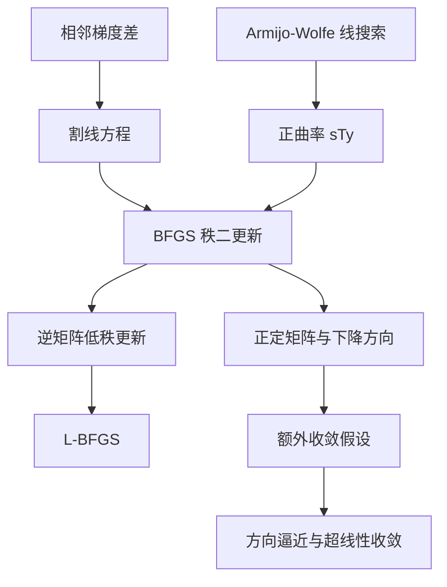

# 第38课｜拟 Newton 法、割线方程与 BFGS

**2026年11月26日｜第6周第3天｜讲授约16分钟，自测另计。**

上一讲用 Armijo 线搜索控制 Newton 步长。今天解决另一项开销：不计算真实 Hessian，能否利用已经算过的梯度学习曲率？BFGS 是确定性无约束光滑优化中经典的拟 Newton 方法。

## 一、问题、假设与割线方程

考虑 min f(x)，x∈Rⁿ，f∈C²。记 gₖ=∇f(xₖ)，Bₖ 为 Hessian 的对称近似，Wₖ=Bₖ⁻¹ 为逆近似。初始 B₀≻0，解 Bₖdₖ=−gₖ，线搜索后 xₖ₊₁=xₖ+αₖdₖ。设非零步 sₖ=xₖ₊₁−xₖ，梯度差 yₖ=gₖ₊₁−gₖ。

沿线段积分：

$$
y_k=\int_0^1\nabla^2 f(x_k+t s_k)s_k\,dt.
$$

这相当于一次沿 sₖ 方向的曲率观测。故要求新矩阵满足割线方程：

$$
B_{k+1}s_k=y_k.
$$

一次观测只确定矩阵在一个方向上的作用，不足以重建整个 Hessian。若线段上 H≽μI（μ>0），则 sᵀy≥μ‖s‖²>0。反之，在给定 s≠0 时，存在正定 B 满足 Bs=y 必须有 sᵀy>0。

## 二、BFGS 秩二更新与严格正定性证明

省略下标。从旧矩阵 B 中减去一个沿 Bs 的秩一项：

$$
C=B-\frac{Bss^\top B}{s^\top Bs},\qquad Cs=0.
$$

再加一个使新矩阵沿 s 的作用恰为 y 的秩一项，得到 BFGS：

$$
B_+=B-\frac{Bss^\top B}{s^\top Bs}+\frac{yy^\top}{s^\top y}.
$$

这是经典 BFGS 的构造动机，并非仅由割线条件唯一推出。直接代入可得 B₊s=Bs−Bs+y=y。矩阵保持对称。

设 B≻0、sᵀy>0。任取 v≠0，

$$
v^\top B_+v=v^\top Bv-\frac{(v^\top Bs)^2}{s^\top Bs}+\frac{(v^\top y)^2}{s^\top y}.
$$

在 B 内积下 Cauchy–Schwarz 给出 (vᵀBs)²≤(vᵀBv)(sᵀBs)，故前两项之和非负。若严格大于零，结论成立；若取等，v=ts（t≠0），最后一项=t²sᵀy>0。因此 B₊≻0。结合割线方程，这也证明 sᵀy>0 是存在正定割线矩阵的充分条件。

## 三、为什么还需要 Wolfe 条件？

当 B≻0 且 g≠0，gᵀd=−gᵀB⁻¹g<0。令 0<c₁<c₂<1，弱 Wolfe 条件：

$$
\begin{aligned}
f(x+\alpha d)&\le f(x)+c_1\alpha g^\top d,\\
\nabla f(x+\alpha d)^\top d&\ge c_2 g^\top d.
\end{aligned}
$$

第一式是 Armijo 充分下降；第二式要求新方向导数不再过于负。由第二式：

$$
s^\top y=\alpha (g_+-g)^\top d
\ge \alpha(c_2-1)g^\top d>0.
$$

所以 Wolfe 曲率条件配合正定初始化保证每次非零 BFGS 更新仍正定。强 Wolfe 将第二式改为 |g₊ᵀd|≤c₂|gᵀd|，它也蕴含弱曲率条件。Armijo 单独不保证正曲率（强凸问题例外）。Wolfe 搜索通常需要区间扩展与夹逼，而非单纯不断减半。正定性也不等于统一谱界或全局收敛。

## 四、逆 BFGS 与实现

直接维护 W=B⁻¹，令 ρ=1/(yᵀs)，则：

$$
W_+=(I-\rho sy^\top)W(I-\rho ys^\top)+\rho ss^\top.
$$

可通过将 B₊W₊ 展开验证为 I，也可由低秩逆更新得到。逆割线关系 W₊y=s 直接成立。下一轮 d=−W₊g，无须稠密求逆。

| 方法 | 曲率信息 | 稠密存储 | 典型单步方向/曲率更新成本 |
|---|---|---|---|
| GD | 梯度 | O(n) | O(n) 向量运算 |
| Newton | 真实 Hessian | O(n²) | 稠密直接解 O(n³) |
| BFGS（逆形式） | 梯度差、稠密逆近似 | O(n²) | O(n²) |
| L-BFGS | 最近 m 对 (s,y) | O(mn) | O(mn) |

表中不计函数、梯度评估、Hessian 构造及线搜索开销；逆 BFGS 利用秩一/秩二结构实现，不能按稠密矩阵乘法直接执行两个因子。

## 五、为什么可能超线性收敛？

先给严格的条件性结论，而不是把割线方程直接当成收敛定理。设 xₖ→x*，∇f(x*)=0，H*=∇²f(x*)≻0，f∈C²；从某轮起取全步 sₖ=−Bₖ⁻¹gₖ。假设满足 Dennis–Moré 方向条件：

$$
\frac{\|(B_k-H_*)s_k\|}{\|s_k\|}\to0.
$$

记 eₖ=xₖ−x*。由可微性，gₖ=H*eₖ+rₖ，其中 ‖rₖ‖=o(‖eₖ‖)。利用 Bₖsₖ=−gₖ，

$$
H_*e_{k+1}=(H_*-B_k)s_k-r_k.
$$

令 δₖ=‖H*⁻¹‖‖(Bₖ−H*)sₖ‖/‖sₖ‖→0，εₖ=‖H*⁻¹‖‖rₖ‖/‖eₖ‖→0。利用 ‖sₖ‖≤‖eₖ‖+‖eₖ₊₁‖，

$$
(1-\delta_k)\|e_{k+1}\|\le(\delta_k+\epsilon_k)\|e_k\|.
$$

充分大的 k 下 1−δₖ>0，故 ‖eₖ₊₁‖/‖eₖ‖→0，即 Q-超线性收敛（有限步终止时无需计算比值）。它不要求整个 Bₖ 在所有方向上都趋于 H*，也不保证二次收敛。

经典 BFGS 收敛定理需要额外假设：例如 f∈C²、全局 μI≼H(x)≼LI（0<μ≤L），B₀≻0，采用满足 Armijo–Wolfe 的线搜索（0<c₁<1/2，c₁<c₂<1），则可保证趋向唯一最优点；再假设 Hessian 在最优点附近 Lipschitz，在经典 BFGS 局部理论下可获得 Q-超线性收敛。上述方向条件证明仅是其中的局部机制，未证明所有 BFGS 序列都自动满足它。参见 Nocedal & Wright《Numerical Optimization》第6章；Byrd 与 Nocedal (1989)：https://doi.org/10.1137/0726042 ；Jin 等关于 Armijo–Wolfe 的复杂度分析：https://arxiv.org/abs/2404.16731 。

## 六、两轮数值迭代：二维二次函数

取 f(x)=½(x₁²+2x₂²)，Q=diag(1,2)，x₀=(2,1)，B₀=I。采用精确线搜索（本例特用）。

第一轮 g₀=(2,2)，d₀=(−2,−2)，α₀=−g₀ᵀd₀/(d₀ᵀQd₀)=2/3。因此 x₁=(2/3,−1/3)，s₀=(−4/3,−4/3)，y₀=Qs₀=(−4/3,−8/3)。更新为：

$$
B_1=I-\frac12\begin{bmatrix}1&1\\1&1\end{bmatrix}
+\frac13\begin{bmatrix}1&2\\2&4\end{bmatrix}
=\begin{bmatrix}5/6&1/6\\1/6&11/6\end{bmatrix}.
$$

第二轮 g₁=(2/3,−2/3)，解 B₁d₁=−g₁ 得 d₁=(−8/9,4/9)。精确线搜索 α₁=3/4，得到 x₂=(0,0)。

| k | xₖ | f(xₖ) | 本轮至下一点的步长 |
|---:|---|---:|---:|
| 0 | (2,1) | 3 | 2/3 |
| 1 | (2/3,−1/3) | 1/3 | 3/4 |
| 2 | (0,0) | 0 | — |

这是 SPD 二次函数、精确线搜索与精确算术的特殊情形；一般 n 维 SPD 二次问题标准 BFGS 至多 n 步终止，不能将此性质推广到非二次目标或不精确线搜索。

## 七、失败反例：只检查 Armijo 会丢失正定性

考虑有下界的非凸函数 f(x)=x⁴/4−x²/2。取 x₀=1/4，B₀=15/16，g₀=−15/64，故 d₀=1/4。接受全步 x₁=1/2 时，g₁=−3/8，s=1/4，y=−9/64，sᵀy=−9/256<0。

实际下降 f(x₀)−f(x₁)=81/1024，而 −g₀d₀=60/1024，因此满足 c₁=0.1 的 Armijo 条件，却不满足任何 0<c₂<1 的弱 Wolfe 曲率条件。标量割线强制 B₊=y/s=−9/16，正定性丢失。可选择跳过更新或对 y 进行 Powell damping 等修正，但这些保护机制的收敛需单独的理论条件。正定性不等于非凸全局最优保证。

## 八、KKT 补强：活跃约束与拟 Newton 的边界

无约束 BFGS 不自动处理不等式。对于 min ½[(x−3)²+(y−1)²]，x+y≤2，y≥0，最优点为 (2,0)。约束 g₁=x+y−2、g₂=−y，二者活跃。驻点方程 (−1,−1)+λ₁(1,1)+λ₂(0,−1)=0，得 λ₁=1、λ₂=0。乘子非负，两个互补乘积均零。活跃约束可能拥有零乘子，非活跃约束必须为零。约束拟 Newton（如 SQP）通常近似拉格朗日函数关于原始变量的 Hessian，并求解带约束的二次子问题；不应直接用无约束 BFGS 更新来保证可行。

## 九、知识关系

## 十、四级自测（100分）

首次课堂不公布答案。请先独立作答，勿提前查看独立 JSON，以免泄题。

### Lv1｜割线方程与正定性（15分，预计2分钟）

设 s≠0、y 为两个同维向量。关于存在对称正定矩阵 B 满足 Bs=y 的条件，下列哪项正确？

A. 只要 y≠0 就一定存在。

B. sᵀy≥0 是充分必要条件。

C. sᵀy>0 是充分必要条件。

D. 必须有 y 与 s 平行。

提示：先考察 sᵀBs，再考虑用任意正定初始矩阵构造一次 BFGS 更新。

### Lv2｜秩二更新的数值计算（20分，预计4分钟）

设 B=diag(2,1)，s=(1,1)ᵀ，y=(3,2)ᵀ。执行一次 Hessian 形式的 BFGS 更新，求新矩阵的 (1,1) 元素，保留四位小数。

绝对误差容限：0.0001。

提示：分别计算 Bs、sᵀBs、sᵀy，再取两个秩一项的 (1,1) 元素。

### Lv3｜Wolfe 曲率条件与理论边界（25分，预计5分钟）

某轮下降方向满足 gₖᵀdₖ=−8，接受步长 α=0.5，弱 Wolfe 曲率参数 c₂=0.75。仅根据曲率条件与这些数值，以下哪项正确？

A. sᵀy 必须等于 1。

B. sᵀy≥1，因此本轮曲率条件足以维持正定 BFGS 更新；但这不是无条件全局收敛证明。

C. sᵀy≥−1，因此允许负曲率更新仍保证正定。

D. Armijo 条件单独就能推出完全相同的曲率下界。

提示：使用 y=gₖ₊₁−gₖ、s=αdₖ，并将弱 Wolfe 条件乘以 α。

### Lv4｜正定性、超线性收敛与 KKT（40分，预计13分钟）

A（12分）：设 B≻0、sᵀy>0，从 BFGS 秩二公式证明割线方程与正定性，写出 Cauchy–Schwarz 取等条件。B（18分）：设 f∈C²、∇f(x*)=0、H*=∇²f(x*)≻0，xₖ→x*，全步 sₖ=−Bₖ⁻¹gₖ，且非零步满足 ‖(Bₖ−H*)sₖ‖/‖sₖ‖→0。证明 ‖xₖ₊₁−x*‖/‖xₖ−x*‖→0（若有限步终止则单独说明）。解释为何仅满足割线方程不能直接推出该条件。C（10分）：求 min ½[(x−5)²+(y−2)²]，s.t. x+y≤3，x≥0，y≥0 的最优点、活跃集和三个 KKT 乘子，逐项验证并说明零乘子约束的状态。

提示：A 用 B 内积；B 将 gₖ 写成 H*(xₖ−x*) 加高阶小量，再用 ‖sₖ‖≤‖eₖ‖+‖eₖ₊₁‖ 吸收误差；C 将约束写为 x+y−3、−x、−y≤0。

## 十一、下一讲

2026年11月27日，第39课：L-BFGS、两层循环递推与存储复杂度。将研究如何只保留最近 m 对曲率信息，而不显式存储 n×n 矩阵。评分：80分及以上继续；60–79分补充秩二更新和 Wolfe 例题；低于60分复习割线、正定性、KKT。成绩不改变日期课号。
