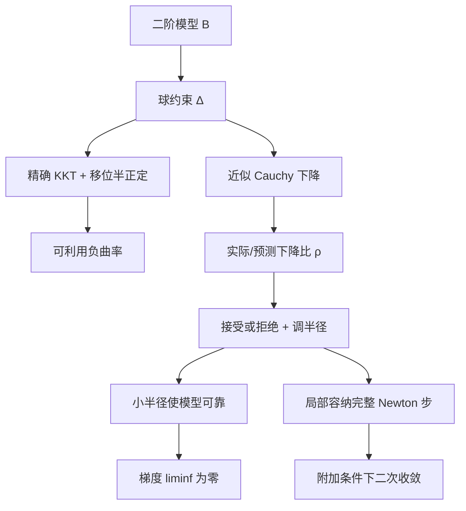

# 第40课｜Trust Region：信赖域、Cauchy 下降与负曲率

2026年11月28日｜第6周第5天｜讲授约17分钟，自测另计。

线搜索先选择方向再决定步长；信赖域先规定模型可信的范围，再选择该范围内的方向和长度。它还可以直接利用非正定 Hessian 的负曲率。

## 一、问题与模型

考虑无约束最小化 f(x)，f∈C²。当前梯度 g=∇f(x)，对称曲率矩阵 B（真实 Hessian 或近似），信赖域半径 Δ>0。省略模型常数 f(x)，求解

$$
\min_{\|d\|\le\Delta} m(d)=g^\top d+\tfrac12d^\top Bd.
$$

即使 B 不正定，连续二次函数在紧球上仍有全局最小点。如果 B 正定且无约束 Newton 步 −B⁻¹g 位于球内，它就是子问题最优步；否则需要处理边界或负曲率。球约束只是对本轮步长的限制，不是原始问题新增的永久约束。

## 二、全局最优性与 KKT：为什么会出现 B+λI？

写约束 h(d)=(‖d‖²−Δ²)/2≤0。拉格朗日函数为 m(d)+λh(d)，λ≥0。球边界梯度非零，KKT 必要条件为

$$
(B+\lambda I)p=-g,\quad \|p\|\le\Delta,\quad \lambda\ge0,\quad \lambda(\|p\|^2-\Delta^2)=0.
$$

但 B 不正定时，一般 KKT 不足以证明全局最优。信赖域子问题的全局最优性充要条件还要求 B+λI⪰0。

充分性证明：对任意可行 d，令 v=d−p。由驻点式展开

$$
m(d)-m(p)=\tfrac12v^\top(B+\lambda I)v+\tfrac{\lambda}{2}(\|p\|^2-\|d\|^2).
$$

第一项非负；若 λ=0 第二项为零，否则 ‖p‖=Δ，第二项也非负。因此 p 全局最优。

必要性补充：若 p 为内部最优点，λ=0，普通二阶必要条件给 B⪰0。若 p 在边界，对任意 pᵀv≠0 的 v，取 d=p−2(pᵀv)v/‖v‖²，则 ‖d‖=‖p‖。全局最优与上式推出 vᵀ(B+λI)v≥0；再由连续性推广到所有 v。

若 B+λI 正定，可直接写 p=−(B+λI)⁻¹g；奇异时不能套逆矩阵，可能有多解，这与 trust-region hard case 有关。λ>0 意味着边界活跃，但活跃不推出 λ>0。例如 m(d)=d²/2−d、Δ=1，最优 p=1，λ=0。

| 情况 | 含义 |
|---|---|
| λ=0，B 正定且 Newton 步可行 | 原始 Newton 方向 |
| λ>0 | 最优步在球边界 |
| B 有负特征值 | λ 至少抵消最负特征值的绝对值 |
| B+λI 奇异 | 需要额外处理零空间，不能直接求逆 |

## 三、Cauchy 点：不精确求解也有下降保证

假设 g≠0、‖B‖≤β，β>0（谱范数）。沿负梯度单位向量 e=−g/‖g‖，寻找球内一维最优步 p_C=t_C e。

令 G=‖g‖，b=eᵀBe。沿此方向 m(te)=−tG+bt²/2。若 b>0，t_C=min{Δ,G/b}；若 b≤0，t_C=Δ。

为证明统一下界，取可行试探长度 t=min{Δ,G/β}。由于 b≤β 且 βt≤G，

$$
m(0)-m(te)=tG-\tfrac12bt^2
\ge tG-\tfrac12\beta t^2\ge\tfrac12tG.
$$

Cauchy 点至少与该试探步一样好，故

$$
m(0)-m(p_C)\ge\tfrac12\|g\|\min\{\Delta,\|g\|/\beta\}.
$$

实际子问题不必精确求解，只需满足固定比例 κ∈(0,1] 的 Cauchy 下降：

$$
\operatorname{pred}_k=m_k(0)-m_k(p_k)\ge\tfrac{\kappa}{2}\|g_k\|\min\{\Delta_k,\|g_k\|/\beta\}.
$$

这就是后面全局化证明所需要的子问题精度；并不要求每轮真正求出全局最优步。g=0 时该下界为零，不保证利用负曲率。

## 四、实际与预测下降比

定义 ared=f(x)−f(x+p)，pred=m(0)−m(p)。当 pred>0 时，ρ=ared/pred。ρ≈1 表示模型预测准确，ρ<0 表示真实目标反而上升，ρ>1 表示真实下降超过预测。

采用以下示例规则：η₁=0.1、η₂=0.75、缩小因子 γ=0.5、扩大因子2、半径上限 Δmax。ρ<η₁ 时拒绝步，x 不变、Δ←γΔ；η₁≤ρ<η₂ 时接受，半径不变；ρ≥η₂ 时接受，若步到达边界则可扩大半径至 min{2Δ,Δmax}，否则保持半径。初始半径不超过上限。阈值是可选参数，不是唯一标准；若 pred=0 不计算比值，应检查驻点或另寻有下降的负曲率步。

## 五、严格证明一阶全局化

假设 f 下有界，梯度全局 L-Lipschitz，所有 Bₖ 对称且 ‖Bₖ‖≤β，步可行并满足上述 κ-Cauchy 下降，拒绝时半径乘固定 γ∈(0,1)，接受时半径不减。若有限步在 g=0 停止，则满足一阶驻点条件；以下讨论无限迭代。

由梯度积分，

$$
|f(x+p)-f(x)-g^\top p|\le \tfrac L2\|p\|^2.
$$

加上 |pᵀBp|≤β‖p‖²，得到

$$
|\operatorname{ared}-\operatorname{pred}|\le\tfrac{L+\beta}{2}\Delta^2.
$$

如果 G≥ε>0 且 Δ≤ε/β，则 pred≥κεΔ/2，因此

$$
|\rho-1|\le\frac{(L+\beta)\Delta}{\kappa\varepsilon}.
$$

取 δ=min{ε/β,(1−η₁)κε/(L+β)}，当 Δ≤δ 时必有 ρ≥η₁，步被接受。

反设存在 K、ε>0，使所有 k≥K 都有 ‖gₖ‖≥ε。因为只有 Δ>δ 才可能被拒绝且缩小，而接受时半径不减，所以 Δₖ≥Δ_min=min{Δ_K,γδ}>0。若只剩有限次接受，后面连续拒绝会使半径趋零，矛盾。于是有无限次接受，每次的真实下降至少为

$$
\eta_1\frac{\kappa\varepsilon}{2}\min\{\Delta_{\min},\varepsilon/\beta\}>0.
$$

拒绝时目标不变，无限次固定正下降与 f 下有界矛盾。故

$$
\liminf_{k\to\infty}\|\nabla f(x_k)\|=0.
$$

这里证明的是至少有一列迭代的一阶残差趋零，不是完整梯度序列收敛，更不是非凸全局最优。经典更完整的信赖域分析可在相应条件下加强结论。

局部性质：若迭代趋于非退化极小点，真实 Hessian 局部 Lipschitz，半径最终容纳完整 Newton 步，且子问题精确求解，则 p 为 Newton 步。Taylor 模型余项 O(‖p‖³)、预测下降 Ω(‖p‖²)，故 ρ→1；全步被接受后由第36课得到局部二次收敛。这里只陈述带条件的局部结论，不把半径自动恢复当作已证明事实。

## 六、数值迭代：用信赖域修复 Newton 越界

取 f(x)=√(1+x²)，x₀=2，使用真实 Hessian，初始 Δ=10，参数如第四节。此时 g=2/√5，B=1/(5√5)，Newton 步 −10。一维精确子问题就是把 Newton 步裁剪到 [−Δ,Δ]。预测下降为 −gd−Bd²/2。

| 尝试 | 当前 x | Δ | 试探 d | pred（约） | ared（约） | ρ（约） | 决策 |
|---|---:|---:|---:|---:|---:|---:|---|
| 1 | 2 | 10 | −10 | 4.4721 | −5.8262 | −1.303 | 拒绝，缩小 |
| 2 | 2 | 5 | −5 | 3.3541 | −0.9262 | −0.276 | 拒绝，缩小 |
| 3 | 2 | 2.5 | −2.5 | 1.9566 | 1.1180 | 0.5714 | 接受，x=−0.5 |
| 4 | −0.5 | 2.5 | 0.625 | 0.1398 | 0.1103 | 0.7889 | 接受，x=0.125 |

前两次失败试探没有改变原始迭代点，只缩小可信区域。第三次找到可靠边界步，第四次接受内部 Newton 步。ρ 较高但步未触边时本规则不扩大半径。

## 七、负曲率与失败反例

取 f(x)=x⁴/4−x²/2，当前位置 x=0，g=0，B=−1。无约束 Newton 步 d=0，会停在局部极大点；二次模型 −d²/2 无约束下还无下界。

令 Δ=0.5。精确信赖域步 p=±0.5，λ=1，B+λI=0。预测下降 1/8，真实下降 7/64，因此 ρ=7/8，接受负曲率步。普通 KKT 也允许 d=0、λ=0，但移位 Hessian 为负，故并非全局子问题最优点。

然而，如果子问题求解器只沿负梯度搜索、在 g=0 时返回零步，那么 Cauchy 下降条件仍成立（右侧为零），算法可能停在极大点。要保证二阶驻点性质，需要额外的负曲率检测及下降条件；信赖域框架本身不是自动逃离所有鞍点的保证。

## 八、方法比较

| 方法 | 如何控制步 | 非正定曲率 |
|---|---|---|
| Newton | 直接全步 | 可能上升或停在非极小驻点 |
| Armijo Newton | 先确定下降方向，再回溯 | 一般需要正定修正或其他下降方向 |
| Trust Region | 先限定球，再联合求方向与长度 | 子问题可以显式利用负曲率 |
| L-BFGS | 历史近似曲率与线搜索 | 标准正定更新不直接保留负曲率 |

信赖域的精确子问题可能昂贵，常见近似方法包括 Cauchy 点、Dogleg（通常 B 正定）、截断 CG（可处理负曲率）。下一课将学习矩阵无关的 Newton-CG 与 Hessian-vector product。

## 九、关系图

## 十、四级自测（100分）

先独立作答，不提前查看独立评分 JSON（含标准答案）。

### Lv1｜信赖域全局最优性条件｜15分｜预计2分钟

信赖域子问题 min m(d)=gᵀd+dᵀBd/2，‖d‖≤Δ，B 对称、Δ>0。以下哪项正确？

A. 只要 B 可逆，无约束 Newton 步必为子问题全局最优。

B. 只要乘子 λ≥0、驻点与互补松弛成立，就足以保证任意非凸二次子问题全局最优。

C. 若可行 d 与 λ≥0 满足 (B+λI)d=−g、B+λI⪰0 和 λ(‖d‖²−Δ²)=0，则 d 为子问题全局最优。

D. 约束活跃必然要求 λ>0。

提示：区分普通 KKT 条件与移位 Hessian 的全局半正定条件。

### Lv2｜实际与预测下降比｜20分｜预计4分钟

取 f(x)=x⁴/4，当前 x=2，使用真实二阶 Taylor 模型，半径 Δ=0.5，精确子问题步 d=−0.5。求实际/预测下降比 ρ=[f(x)−f(x+d)]/[−f′(x)d−f″(x)d²/2]，保留五位小数。

提示：分别计算真实函数值和二阶模型下降，不要将分母换成一阶下降。
绝对误差容限 0.00001。

### Lv3｜非正定 Hessian 与全局子问题｜25分｜预计5分钟

二维信赖域子问题 m(d)=−d₂−d₁²+d₂²/2，‖d‖≤1。令 g=(0,−1)ᵀ、B=diag(−2,1)。关于全局最优步，哪项正确？

A. d=(0,1)，λ=0，是唯一全局最优步。

B. d=(±2√2/3,1/3)，λ=2，均为全局最优步。

C. d=(0,0) 是全局最优步，因为 Hessian 有负特征值。

D. 没有全局最优步，因为 B 不正定。

提示：检查移位 Hessian 半正定要求，并结合驻点方程与活跃半径。

### Lv4｜Cauchy 下降、全局化证明与 KKT｜40分｜预计14分钟

A（14分）：令 g≠0，B 对称、‖B‖≤β，β>0，Δ>0。沿 −g 构造 Cauchy 点，证明其预测下降至少为 (‖g‖/2)min{Δ,‖g‖/β}。B（16分）：假设 f 下有界、梯度全局 L-Lipschitz，所有 Bₖ 满足上述谱范数界，所选步可行且至少达到固定比例 κ∈(0,1] 的 Cauchy 下降。若 ρ<η₁ 则拒绝并把半径乘 γ∈(0,1)；否则接受，半径不减且有上限 Δmax，其中 0<η₁<1。证明当 ‖gₖ‖≥ε>0 时，足够小的半径保证接受；再用反证法证明无限迭代时 liminf ‖gₖ‖=0。解释这不等价于全局最优。C（10分）：对一维子问题 min 2d+d²，|d|≤1，求最优步与对应约束 (d²−1)/2≤0 的乘子，逐项验证 KKT 及移位 Hessian 半正定性，并解释活跃约束的乘子状态。

提示：A 试取沿单位负梯度的长度 min{Δ,‖g‖/β}；B 用 |真实下降−预测下降|≤(L+β)Δ²/2，再假设从某轮起梯度始终不小于 ε；C 先求无约束极小点。

## 下一讲与评分建议

2026年11月29日，第41课：Inexact Newton、Newton-CG 与 Hessian-vector Product。重点学习截断 CG、残差 forcing term 和不显式构造 Hessian 的计算方法。80分及以上正常继续；60–79分补充 Cauchy 下降和半径更新算例；低于60分复习二次模型、KKT 与谱范数。成绩不改变日期课号。
